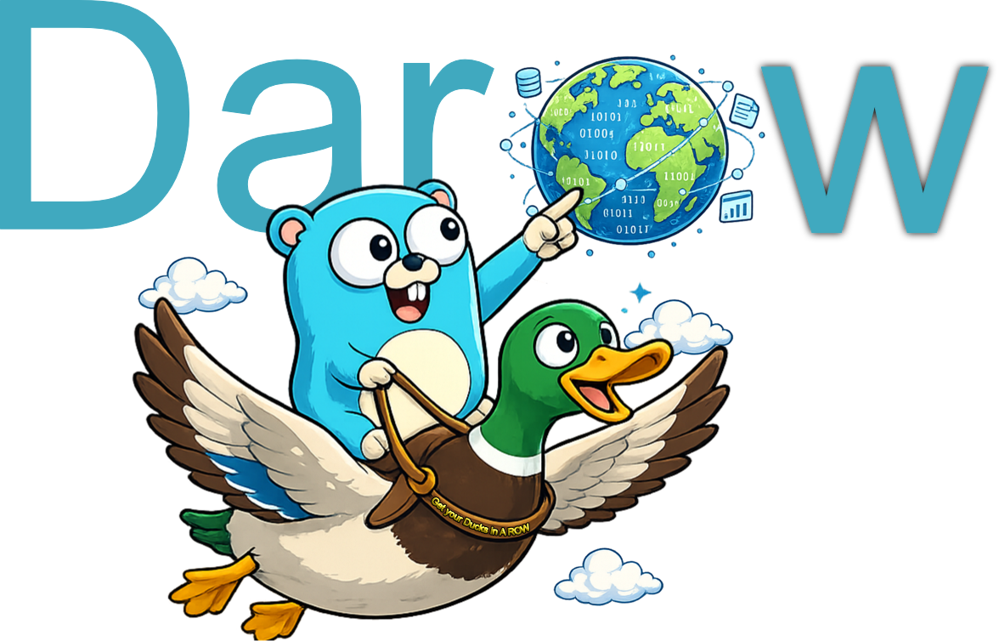

# darow — get your Ducks in A ROW



Geographic files turned into tables: upload a GeoJSON, CSV, GeoPackage, Parquet, FlatGeobuf or KML
file, load it into a table of a DuckDB file (spatial extension), browse and edit its rows and their
geometries, add, rename, drop or transform its columns, filter them and save the filters, tune the
settings globally or per table, draw it as vector tiles on a map, export it as CSV or GeoJSON,
create a table from a SELECT, and serve every geographic table as an **OGC API - Features** service
for any GIS client. One Go binary holds the API, the storage and the backups, and serves the
embedded Vue 3 interface.

darow is an application of the MyAppLibs platform (`github.com/MyAppLibs/go-pkg`,
`@myapplibs/web-platform`), hosting one module: [internal/darow](internal/darow), `web/src/darow`.
Behaviour is specified in [spec/](spec/).

## Requirements

[mise](https://mise.jdx.dev/), which installs the toolchain of [mise.toml](mise.toml), and a C
toolchain: the DuckDB driver uses cgo. The platform's libraries are private repositories.

## Development

| Command                     | Does                                                 |
| --------------------------- | ---------------------------------------------------- |
| `mise run setup`            | Install the frontend dependencies                    |
| `mise run dev`              | Vite dev server and the API, on `./data`             |
| `mise run dev-app-demo`     | The full app with the simulated sign-in, on `./data` |
| `mise run test-all`         | Go and frontend tests                                |
| `mise run lint`             | Go and frontend linters                              |
| `mise run generate-types`   | Regenerate the TypeScript types from the Go packages |
| `mise run generate-api-doc` | Regenerate `docs/swagger.json` from the routes       |
| `mise run build-app`        | Build `bin/darow`, frontend included                 |

## Running

`bin/darow` keeps its data in a `data/` directory beside it, created at the first start: `darow.db`
(the saved filters and the settings), `darow.duckdb` (the tables), `sources/` (the uploaded files)
and `backups/`. The first start downloads DuckDB's spatial extension.

```sh
./bin/darow                       # data in bin/data/, served on http://127.0.0.1:3000
./bin/darow -workdir /srv/darow   # data in /srv/darow/
```

| Flag                | Environment        | Default                             |
| ------------------- | ------------------ | ----------------------------------- |
| `-host`             | `HOST`             | `127.0.0.1`                         |
| `-port`             | `PORT`             | `3000`                              |
| `-workdir`          | `WORK_DIR`         | `data/` beside the executable       |
| `-max-source-mb`    | `MAX_SOURCE_MB`    | `100` (MiB, per uploaded file)      |
| `-duckdb-memory-mb` | `DUCKDB_MEMORY_MB` | `0` (DuckDB's own limit)            |
| `-max-tile-renders` | `MAX_TILE_RENDERS` | `4` (vector tiles rendered at once) |

`./bin/darow -h` lists every option (CORS, rate limit, backups, sign-in).

## OGC API - Features

`/api/v1/darow/ogc` is a service conforming to OGC API - Features Part 1 (Core, GeoJSON): every
table with a geometry is a collection, its items paged with `limit` and `offset`, filtered by
`bbox`, in CRS84. Add it to QGIS as a « WFS / OGC API - Features » connection.

## Sign-in

Reads are open to everyone. A guest edits the data — rows and their geometries, columns, saved
filters —; loading sources, deriving, renaming or deleting tables and the settings are the
administrator's. Without sign-in every route is open to whoever reaches the port, hence the loopback
default. Sign-in goes through [goauth](https://github.com/amauryval/goauth) and an OIDC provider,
configured by the `AUTH_*` variables. `mise run dev-app-demo` runs a simulated sign-in for local
development, compiled only under the `authdemo` tag.

## Docker

```sh
docker build --secret id=github_token,env=PLATFORM_TOKEN -t darow .
docker run -d -p 127.0.0.1:3000:3000 -v darow-data:/data darow
```

## Documentation

-   [spec/](spec/) — the specifications; [spec/README.md](spec/README.md) indexes them.
-   [docs/architecture.md](docs/architecture.md) — the architecture map, also shown at
    `/admin/docs`.
