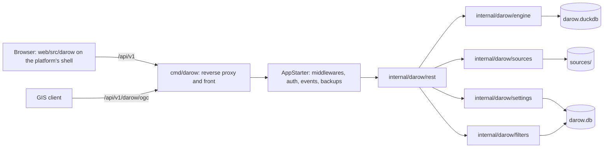
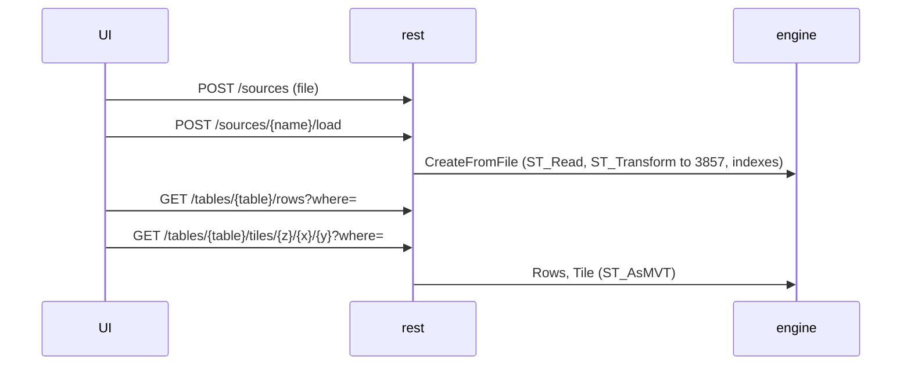

# darow — architecture

darow is one module, `darow`, hosted by the MyAppLibs platform (`go-pkg`, `web-platform`). The
behaviour is specified in `spec/darow/back.md` and `spec/darow/front.md`.

## Layers

## Storage

| File                     | Holds                                             | Archived                             |
| ------------------------ | ------------------------------------------------- | ------------------------------------ |
| `<workdir>/darow.db`     | the saved filters, the settings (platform SQLite) | yes                                  |
| `<workdir>/darow.duckdb` | the tables, `__id` numbered, geometry 3857        | yes, as an attachment of the archive |
| `<workdir>/sources/`     | the uploaded source files                         | no                                   |

## A table's life

## Front

`web/src/darow`: `api` (the client and the generated types) → `stores` (Pinia) → `composables` (the
logic) → `views` (the pages: tables, saved filters, sources, SQL). The shell, the layout, the
backups and erasures pages, the documentation page and the sign-in are the platform's.
