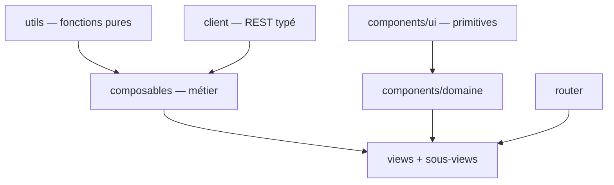

# GeoAPI — Spécification du front

Ce document décrit **l'application d'administration Vue 3** de GeoAPI (`web/`) : son architecture en
couches, ses contrats, ses invariants. Il est écrit pour être lu par un agent IA qui doit intervenir
sur le code sans l'avoir entièrement lu.

`docs/spec.md` décrit le serveur Go (storage, service, router, API REST). Les deux documents sont
disjoints : ce qui concerne le SPA vit ici, ce qui concerne le binaire vit là-bas. Le seul point de
contact est l'API REST, décrite côté serveur (§6 de `spec.md`) et consommée ici par la couche
`client/` (§2).

**Le code est la source de vérité.** Ce document en est la description ; s'il diverge, c'est ce
document qu'il faut corriger. Il ne contient volontairement pas de code : les signatures exactes se
lisent dans les fichiers cités, indiqués à chaque section. Les écarts connus entre les règles
ci-dessous et l'état actuel du code sont listés en §11 — ils ne sont pas des exceptions tolérées
mais une dette identifiée.

---

## 0. Règles non négociables

Ces règles s'appliquent à tout le code produit dans `web/`. La numérotation est stable et ne doit
jamais être réordonnée.

1. **Aucun accès réseau hors de `src/client/`.** Pas de `fetch`, pas d'URL d'API construite à la
   main dans une view, un composant ou un composable. Le client typé est le seul point de contact
   avec le serveur, y compris pour les URL destinées à un `<a href>` ou à un template de tuile
   (`exportUrl`, `tileUrl`).
2. **La mécanique métier ne vit jamais dans un composant.** Chargement, pagination, mutation,
   sélection, dérivation d'état : dans un composable (`src/composables/`) ou une fonction pure
   (`src/utils/`). Un fichier `.vue` ne contient que le câblage de ces briques et le rendu.
3. **Le visuel ne sort jamais du `<template>`.** Aucune classe Tailwind ni daisyUI dans un `.ts`,
   un composable ou une fonction de rendu. Un composable qui renvoie une classe CSS est un
   composable mal découpé.
4. **Pas de markup en fonctions de rendu (`h()`).** Une cellule de tableau riche (bouton, badge,
   lien, champ éditable) est un composant `.vue` référencé par la définition de colonne, jamais un
   arbre de `h()` inline.
5. **Un composant partagé ignore le monde extérieur.** `props` en entrée, `emit` en sortie. Il ne
   connaît ni le client REST, ni le routeur, ni la file de toasts. Seuls les composants de domaine
   d'une feature peuvent recevoir des données déjà chargées par leur view.
6. **Une route = une view ; une view orchestre, elle ne détaille pas.** Dès qu'une view porte une
   seconde responsabilité (un panneau, une modale, une section autonome), celle-ci devient une
   sous-view ou un composant de domaine dans le dossier de la feature.
7. **Plafonds de taille.** 300 lignes par fichier `.vue`, 150 par composable, 100 par fonction pure.
   Un dépassement se résout par découpe, jamais par croissance.
8. **Toute suite de classes répétée devient une primitive.** À la deuxième occurrence d'un même
   habillage (bouton, champ, panneau), on crée le composant `components/ui/` correspondant.
9. **Pas d'assertion de type.** `as`, `!` et les gardes `typeof`/`Array.isArray` sur des paramètres
   de route sont interdits : ils contournent le vérificateur au lieu de s'en servir. Les cas se
   traitent explicitement (`v-if`, valeur par défaut, type narrowing par prédicat).
10. **daisyUI est le socle visuel, mais jamais utilisé directement dans une view.** Ses classes sont
    encapsulées dans les primitives `components/ui/` ; les views n'emploient Tailwind que pour la
    mise en page (flex, grid, espacements, largeurs).
11. **Un composable = un sujet.** Il expose des `ref`/`computed` et des actions, jamais un objet
    réactif à déstructurer. Son nom commence par `use`, son fichier porte ce nom.
12. **Un état distant a un propriétaire unique.** Les données d'une ressource, son `loading` et son
    erreur ne sont jamais dupliqués entre deux composants : ils sont détenus par la view (via son
    composable) et descendus en props.
13. **Aucune erreur d'API n'est avalée.** Toute rejection est convertie en message utilisateur par
    `errorMessage` puis affichée — toast pour une action globale, message local pour un formulaire.
    Le seul silence toléré est celui des chargements d'affichage best-effort (tuiles, étendue), et
    il est commenté sur place.
14. **Le front n'est pas couvert par des tests automatisés.** C'est un choix assumé : la
    vérification est manuelle, adossée à `mise run ui-build` (type-check `vue-tsc`) et à
    `mise run ui-lint`. `client/http.test.ts` reste comme filet sur le transport HTTP, qui n'est pas
    vérifiable à l'œil.
15. **Conventions de langage.** `<script setup lang="ts">` partout, jamais l'Options API.
    PascalCase pour les fichiers de composants, camelCase pour le reste, UPPER_SNAKE_CASE pour les
    constantes. Jamais d'extension `.ts` dans un chemin d'import (TS5097 avec Volar).
16. **Les commentaires expliquent le pourquoi.** Comme dans le reste du dépôt : un invariant, un
    piège, une contrainte serveur. Jamais la paraphrase de la ligne suivante.
17. **Toute chaîne visible par l'utilisateur est en français**, y compris les messages d'erreur de
    repli. Pas d'i18n : le produit est monolingue.
18. **Toute zone alimentée par le serveur gère ses quatre états** : chargement, vide, erreur,
    données. Aucun des quatre n'est laissé implicite, aucun n'est rendu par un écran blanc (§8.1).
19. **Aucune action sans retour visible.** Un clic produit dans la seconde soit le résultat, soit un
    état occupé, soit un message. Une action déclenchée deux fois par impatience est un défaut
    d'interface, pas d'utilisateur (§8.2).
20. **Tout ce qui se fait à la souris se fait au clavier.** Une cible cliquable est un `<button>` ou
    un `<a>`, jamais un `<div>`/`<tr>` avec un `@click` ; tout contrôle a un nom accessible (§8.7).

---

## 1. Architecture



Cinq couches, sans court-circuit : une view n'appelle jamais `fetch`, un composable ne produit
jamais de style, un composant partagé n'appelle jamais le client.

| Couche | Dossier | Rôle | Interdits |
|---|---|---|---|
| Fonctions pures | `src/utils/` | calculs sans état ni I/O (grille de tuiles, arbre de filtres, coercition de types, tri) | Vue, DOM, réseau, CSS |
| Client REST | `src/client/` | un module par famille d'endpoints + `http.ts` (transport) + `types.ts` (DTO) | Vue, DOM, CSS |
| Composables | `src/composables/` | état applicatif et orchestration : chargement, pagination, mutations, sélection, cycle de vie des ressources externes (carte, observers) | CSS, markup |
| Composants | `src/components/` | rendu. `ui/` = primitives sans domaine ; `<feature>/` = composants de domaine présentationnels | appels réseau, routeur, toasts (hors `ui/Toast`) |
| Views | `src/views/` | une par route, plus ses sous-views ; assemblent composables et composants | logique métier inline, markup dupliqué |

Le routeur (`src/router.ts`) ne connaît que les views. `src/App.vue` est la coquille applicative :
navigation latérale, bandeau d'état, montage de `RouterView` et de la file de toasts.

---

## 2. Couche client (`src/client/`)

Client REST typé, réutilisable hors de cette application : il ne dépend ni de Vue ni du DOM.

- `http.ts` — transport. Préfixe `/api/v1` pour toutes les routes applicatives (`apiUrl`), racine
  nue pour les sondes (`getRoot`, utilisé par `ops.ts` seul). `configureApiClient({ baseUrl })`
  permet de pointer une instance GeoAPI distante ; par défaut l'origine de la page, ce dont le SPA
  embarqué a besoin. `ApiError` porte le code HTTP et le message serveur ; `errorMessage` est le
  seul convertisseur erreur → texte utilisateur. Un 204 et un corps vide résolvent sur `undefined`.
- `types.ts` — **tous** les DTO partagés (`Metadata`, `Source`, `Row`, `RowsPage`, `ColumnSchema`,
  `FilterCondition`, `ErrorResponse`…). Aucun type de réponse ne se déclare dans un module de
  ressource.
- `tables.ts`, `sources.ts`, `geo.ts`, `features.ts`, `ops.ts` — une fonction par endpoint, nommée
  d'après l'action et non d'après le verbe HTTP, paramètres explicites, retour typé. Les URL
  construites pour un usage non-`fetch` (export, template de tuile) passent par `apiUrl` et sont
  donc soumises à `baseUrl` comme le reste.

Les contrats des endpoints (pagination, tri, filtre DSL, formats) sont décrits côté serveur —
`spec.md` §6. Ce document ne les redécrit pas.

---

## 3. Fonctions pures (`src/utils/`)

Un module par sujet, sans état de module, sans effet de bord :

- `tileGrid.ts` — grille XYZ (`tilesCovering`, `tileKey`) et tolérance de simplification par zoom,
  alignée sur la formule serveur (`internal/storage/duckdb/data/geo.go`). Toute modification d'un
  côté impose la même de l'autre.
- `filterTree.ts` — modèle de l'arbre de filtres de l'UI (`DraftNode`) et sa projection vers le DSL
  serveur (`pruneActive`), qui élague les nœuds inactifs et les groupes devenus vides
  (`BuildFilter` rejette un groupe booléen vide — `spec.md` §4.5). **Toute** manipulation de cet
  arbre (activation, suppression, remplacement d'enfants, ajout) appartient à ce module : les
  composants qui l'affichent ne le réimplémentent pas.
- `columnTypes.ts` — résolution du type d'une colonne et coercition d'une saisie texte vers le type
  JSON attendu par l'API.
- `sort.ts` — projection de l'état de tri TanStack vers le paramètre `sort` de l'API.

---

## 4. Composables (`src/composables/`)

**Contrat.** Un composable expose des `ref`/`computed` en lecture et des fonctions d'action ; il
enregistre lui-même le nettoyage dont il a besoin (`onUnmounted`, `AbortController`,
`IntersectionObserver`, instance MapLibre). Il ne rend rien, ne style rien, et ne connaît d'un
composant que les paramètres qu'on lui passe. Un composable dont l'état doit être partagé par toute
l'application (file de toasts) le déclare au niveau module et le documente ; c'est l'exception, pas
la règle.

**Découpage cible.** Chaque ligne est un composable, un fichier, un sujet.

| Composable | Sujet | Aujourd'hui |
|---|---|---|
| `useToast` | file de notifications applicative (état de module partagé) | présent |
| `useTiledFeatures` | chargement GeoJSON découpé sur la grille de tuiles, avec réutilisation des tuiles déjà vues | présent |
| `usePaginatedList` | liste paginée : scroll infini, tri serveur, rechargement après mutation, sentinelle d'observation | absent — logique recopiée dans 3 fichiers (§11) |
| `useServerStatus` | sonde `readyz` périodique du bandeau d'état | absent — inline dans `App.vue` |
| `useTableMetadata` | métadonnées + schéma d'une table, réaction au changement de `tableId`, actions renommer/supprimer/dériver/ajouter une colonne | absent |
| `useTableRows` | lignes d'une table : page courante, tri, édition, ajout, suppression | absent |
| `useRowFilter` | arbre de filtres, conditions effectives, résultats filtrés, étendue filtrée | absent |
| `useFeatureSelection` | sélection de features (pkeys) et hydratation par lots des lignes correspondantes | absent |
| `useMapLibre` | cycle de vie de la carte : création, fond, contrôles, `fitBounds`, destruction | absent |
| `useMvtLayer` / `useWfsLayer` | sources et couches d'un mode de rendu, ajout/retrait symétriques, écouteurs | absent |
| `useSources` | liste des sources, upload, chargement avec EPSG, suppression | absent |

---

## 5. Composants (`src/components/`)

Deux familles, deux emplacements.

**`components/ui/` — primitives sans domaine.** Elles encapsulent daisyUI et sont les seules à
porter des classes de composant. Une view ne récrit jamais l'habillage d'un bouton ou d'un champ.

| Primitive | Rôle |
|---|---|
| `BaseButton` | variantes (primaire, secondaire, danger, discret), tailles, état occupé/désactivé |
| `BaseInput` / `BaseSelect` / `BaseTextarea` | champ + libellé + message d'erreur, `v-model` |
| `Modal` | boîte téléportée, fermeture par backdrop et `Échap`, largeurs normale/large |
| `ConfirmButton` | action destructive avec confirmation inline (pas de `confirm()` natif) |
| `Badge` | pastille de statut, tons **sémantiques** (neutre, succès, alerte, erreur) — jamais des noms de couleur |
| `Toast` | rendu de la file `useToast`, monté une seule fois dans `App.vue` |
| `DataTable` | rendu générique d'une instance TanStack Table : en-têtes triables, lignes, état vide, slots `footer` et `row-after` |
| `EmptyState` / `Spinner` | états vides et chargements, formulés une fois |

**`components/<feature>/` — composants de domaine présentationnels.** Ils connaissent les types du
domaine (`Metadata`, `Source`, `Row`) mais restent muets : ils reçoivent des données et émettent des
intentions. Les cellules riches d'un `DataTable` (actions d'une source, saisie EPSG, actions d'une
ligne, cellule éditable) sont de ce type — c'est ce qui remplace les arbres de `h()`.

---

## 6. Views et sous-views (`src/views/`)

Une view par route ; ses sous-views vivent dans un dossier à son nom.

| Route | View | Rôle |
|---|---|---|
| `/tables` | `TablesView` | catalogue des tables, recherche, tri, scroll infini |
| `/tables/:tableId` | `TableDetailView` | en-tête de la table et ses actions, puis composition des sous-views ci-dessous |
| `/sources` | `SourcesView` | fichiers du `workDir`, upload, chargement par couche, suppression |

**Découpage cible de `TableDetailView`** — la view ne garde que l'en-tête et l'assemblage :

- `TableHeader` — nom éditable, badges, compteurs, barre d'actions.
- `TableFilterPanel` — panneau latéral d'édition de l'arbre de filtres + pastilles actives.
- `TableMapPanel` — carte (chargée en `defineAsyncComponent` : MapLibre est la plus grosse
  dépendance du bundle) et bascule MVT/WFS.
- `TableRowsPanel` — grille de lignes : mode édition, sélection épinglée, scroll infini.
- `DeriveTableModal`, `AddColumnModal`, `AddRowModal`, `ColumnsModal` — une modale = un fichier,
  jamais du markup de modale inline dans une view.

**Découpage cible de `SourcesView`** : `SourceDropzone` (upload par glisser-déposer),
`SourcesTable` (arbre fichiers/couches) et les composants de cellule associés.

Le titre affiché par le bandeau vient de `route.meta.title`, dont le type est déclaré une fois
(augmentation de `RouteMeta` de `vue-router`) plutôt que lu sans type.

---

## 7. Style

- **Socle daisyUI**, thème `light` déclaré dans `src/style.css`, chargé via le plugin Tailwind v4.
  Ses classes (`btn`, `badge`, `modal`, `alert`, `navbar`) ne sont employées **que** dans
  `components/ui/`.
- **Tailwind utilitaire** pour la mise en page dans les templates : flex/grid, espacements,
  largeurs, `min-h-0`/`shrink-0` des panneaux à hauteur contrainte.
- **Palette neutre et sobre**, densité forte, pas d'ornement : c'est une console d'administration.
  Les couleurs sémantiques passent par les tons des primitives, jamais par une couleur écrite en
  dur dans une view.
- La carte est le seul endroit où des couleurs sont écrites en dur : ce sont des valeurs de
  peinture MapLibre, pas des classes CSS ; elles vivent dans la définition des couches.

---

## 8. Expérience utilisateur

L'application est une **console d'administration technique** : l'utilisateur est un opérateur qui
manipule des données volumineuses et fait des actions irréversibles. Les priorités sont donc, dans
cet ordre : ne pas lui faire perdre de travail, lui dire en permanence où il en est, aller vite.

### 8.1 Les quatre états d'un écran

Toute zone alimentée par le serveur définit explicitement :

- **Chargement** — squelette (formes grises aux dimensions du contenu attendu) pour un premier
  chargement de liste ou de panneau ; indicateur discret en pied de liste pour une page suivante.
  Un spinner plein écran est réservé aux blocages réels. En dessous de 300 ms, on n'affiche rien :
  un indicateur qui clignote est pire que pas d'indicateur.
- **Vide** — phrase courte qui distingue « il n'y a rien » de « votre recherche ne donne rien », et
  qui propose l'action suivante quand elle existe (« Aucune table. Chargez une source depuis
  l'onglet Sources. »).
- **Erreur** — message en français, cause et recours, plus un moyen de réessayer sans recharger la
  page. Jamais une trace technique brute, jamais un état vide déguisé en succès.
- **Données** — le contenu.

**Le contenu déjà affiché ne disparaît jamais pendant un rechargement.** Un changement de tri, de
filtre ou de page garde les lignes courantes à l'écran (éventuellement atténuées) jusqu'à
l'arrivée des nouvelles. Pas de clignotement vide, pas de saut de hauteur.

### 8.2 Retour d'action et latence

- Tout bouton déclenchant un appel réseau passe en état **occupé** : libellé au participe
  (« Enregistrement… »), bouton désactivé, largeur inchangée pour ne pas décaler la mise en page.
- La désactivation ne sert qu'à empêcher le double envoi et l'invalide : un bouton désactivé pour
  une autre raison porte un `title` qui l'explique.
- Une action réussie **le dit ou le montre** : toast pour une action globale (suppression,
  chargement d'une source), mise à jour visible de la donnée pour une édition inline.
- Une action qui dépasse quelques secondes (upload, import, dérivation) affiche une progression ou,
  à défaut, un état occupé explicite avec le nom de l'objet traité.
- Pas d'optimistic UI : les écritures sont serveur-autoritatives (recalcul de `rowCount`, de `bbox`,
  du `UpdatedAt`), on affiche ce que le serveur a confirmé.

### 8.3 Actions destructives et travail de l'utilisateur

- Suppression, remplacement, écrasement : confirmation **inline** à côté de l'action (jamais
  `confirm()` natif, jamais une modale pour une suppression de ligne). L'état de confirmation
  retombe seul après quelques secondes ou dès qu'on clique ailleurs.
- Le libellé de confirmation nomme ce qui va disparaître, et mentionne les effets de cascade quand
  il y en a (supprimer une source supprime les tables qui en sont issues).
- **Aucune saisie n'est perdue par accident.** Une modale contenant un formulaire modifié ne se
  ferme pas au clic sur le fond ; `Échap` demande confirmation. Un rechargement de schéma ne
  réinitialise pas les colonnes visibles choisies par l'utilisateur, ni le filtre en cours.
- Pas d'annulation (undo) : le serveur ne l'offre pas. C'est précisément pourquoi la confirmation
  est la barrière.

### 8.4 Messages : où va quoi

| Type | Emplacement | Durée |
|---|---|---|
| Résultat d'une action globale | toast en bas à droite | ~4 s, refermable à la main |
| Erreur de formulaire ou de champ | message inline sous le champ ou le bloc concerné | jusqu'à correction |
| Indisponibilité du serveur | bandeau d'état permanent de la barre latérale | tant qu'elle dure |
| Information contextuelle | texte discret sous le titre de la section | permanent |

Une erreur qui empêche l'action en cours ne part **jamais** en toast seul : elle reste sous les yeux
de l'utilisateur, à l'endroit où il doit agir. Un message est court, en français, à la voix active,
et dit quoi faire (« Nom de table déjà utilisé. » plutôt que « erreur 409 »).

### 8.5 Formulaires

- Un libellé par champ, au-dessus, toujours visible — le placeholder est un exemple, pas un
  libellé.
- Le premier champ significatif reçoit le focus à l'ouverture d'une modale.
- `Entrée` valide, `Échap` annule, dans les formulaires courts comme dans l'édition inline.
- Validation à la soumission, pas à chaque frappe ; l'erreur se place sous le champ fautif et le
  focus y va.
- Ordre des boutons constant : action secondaire à gauche, action primaire à droite.
- Les contraintes connues (format EPSG, taille maximale d'upload, extensions acceptées) sont dites
  **avant** la tentative, pas seulement en réponse d'erreur.

### 8.6 Tableaux de données

C'est l'écran principal du produit ; il obéit à des règles fixes.

- En-tête collant, densité forte, une seule zone de défilement (la page ne défile jamais
  horizontalement — c'est le tableau qui le fait, à l'intérieur de son cadre).
- Nombres et dates alignés à droite, formatés en `fr-FR` ; `NULL` rendu comme une valeur grisée
  distincte de la chaîne vide.
- Tri : indicateur visible sur la colonne triée, ordre du tri multiple numéroté, et affordance
  expliquée (`title`) plutôt que devinée.
- Les cellules longues sont tronquées avec la valeur complète en `title` ; on ne casse pas la hauteur
  de ligne.
- Le tri, la recherche et le filtrage portent sur **l'ensemble** des données côté serveur, jamais
  seulement sur les pages déjà chargées : un résultat partiel silencieux est un mensonge.
- Le scroll infini indique toujours ce qui reste (« 50 sur 1 240 ») et n'empêche pas d'atteindre le
  pied de page.
- Sélection et édition ne se marchent pas dessus : une ligne sélectionnée reste identifiable après
  tri, rechargement ou changement de page.

### 8.7 Accessibilité et clavier

- Cible cliquable = `<button>` ou `<a>`. Une ligne de tableau cliquable expose l'action réelle par
  un contrôle focusable (le lien du nom), le `@click` sur la ligne n'en est qu'un raccourci.
- Tout bouton icône seule a un nom accessible (`aria-label`) ; les icônes décoratives sont
  `aria-hidden`.
- Focus visible partout, jamais supprimé par le style. Ordre de tabulation = ordre visuel.
- Modale et panneau latéral : focus déplacé dedans à l'ouverture, piégé tant qu'ils sont ouverts,
  rendu à l'élément déclencheur à la fermeture ; `Échap` ferme.
- Les toasts sont annoncés (`role="status"` / `aria-live="polite"`), les erreurs bloquantes en
  `role="alert"`.
- Contraste minimum AA (4,5:1) pour le texte ; l'information n'est jamais portée par la seule
  couleur (un statut a un libellé, pas seulement une pastille).
- Le mouvement (animations, `animate-ping` du bandeau d'état) respecte
  `prefers-reduced-motion`.

### 8.8 Carte

- Cadrage initial sur l'étendue de la donnée ; recadrage sur l'étendue **du filtre** quand un filtre
  est actif, retour à l'étendue de la table quand il ne l'est plus.
- Chargement de données à `moveend`, jamais à chaque frame, et rendu progressif au fur et à mesure
  des tuiles plutôt qu'en un bloc final.
- Indicateur de chargement visible tant que des tuiles sont en vol ; une tuile en échec ne casse pas
  la carte.
- Curseur `pointer` sur les entités interrogeables, mise en évidence des entités sélectionnées, et
  sélection réversible d'un clic — sans touche modificatrice, pour rester utilisable au trackpad.
- La sélection cartographique et la sélection tabulaire sont **la même** sélection, toujours
  synchronisées dans les deux sens, avec un moyen évident de tout désélectionner.
- Attribution du fond de carte affichée, contrôles de navigation présents.

### 8.9 Cohérence et écriture

- Vocabulaire figé : *source*, *couche*, *table*, *ligne*, *colonne*, *table dérivée*. Un objet
  porte le même nom partout, y compris dans les messages d'erreur.
- Les actions sont des verbes à l'infinitif (« Ajouter une colonne »), sans point final ; les
  phrases d'aide sont ponctuées.
- Emplacements constants : titre et description en haut à gauche, actions de l'objet en haut à
  droite, actions de ligne à droite de la ligne, action destructive toujours en dernier.
- Une même intention garde le même composant et le même libellé d'un écran à l'autre.

### 8.10 Performance perçue et densité

- Cible d'affichage : poste de travail, largeur ≥ 1280 px. Pas de mise en page mobile, mais rien ne
  doit casser ni se chevaucher jusqu'à 1024 px.
- Les dépendances lourdes sont chargées à la demande (MapLibre en composant asynchrone), jamais dans
  le bundle initial.
- Les saisies qui déclenchent un appel réseau sont debouncées ; une réponse périmée n'écrase jamais
  une réponse plus récente (§9).
- Rien qui bloque le fil principal de façon perceptible : les gros lots de données sont rendus par
  pages, et les mises à jour en rafale sont coalescées.

---

## 9. État, routage, cycle de vie

- **Pas de store global.** L'état vit dans la view qui le possède, via ses composables. La seule
  exception est la file de toasts, partagée au niveau module parce qu'un toast poussé depuis
  n'importe où doit s'afficher dans le composant monté une fois dans `App.vue`.
- **Réaction aux paramètres de route.** Une view paramétrée (`:tableId`) est réutilisée par
  `vue-router` quand seul le paramètre change : tout chargement initial se fait par un `watch` sur
  le paramètre avec `{ immediate: true }`, jamais par `onMounted` seul.
- **L'URL porte l'état d'écran.** Recherche, tri et filtre actif vivent dans la query string : un
  écran se partage par copier-coller, le rafraîchissement du navigateur ne perd rien, et les
  boutons Précédent/Suivant font ce qu'on attend. Ce qui est éphémère (modale ouverte, mode
  édition) reste hors de l'URL.
- **Titre de la page.** `document.title` suit la route et nomme l'objet consulté, pas seulement sa
  catégorie.
- **Symétrie des effets.** Tout `addEventListener`, `IntersectionObserver`, `setInterval`, source ou
  couche MapLibre ajouté est retiré par le même composable qui l'a créé.
- **Requêtes concurrentes.** Un chargement déclenché par une saisie ou un déplacement de carte est
  soit débounce, soit versionné (jeton de requête) : une réponse périmée ne doit jamais écraser une
  réponse plus récente.
- **Pagination.** Le tri et le filtrage étant serveur, toute modification de l'un invalide les pages
  déjà chargées : on repart de la page 1, en gardant les lignes affichées jusqu'à l'arrivée de la
  nouvelle page (pas de clignotement vide).

---

## 10. Build et commandes

| Commande | Effet |
|---|---|
| `mise run ui-install` | installation des dépendances npm |
| `mise run ui-build` | `vue-tsc` (type-check) puis build Vite **directement dans `internal/webui/dist`** |
| `mise run ui-dev` | serveur Vite, proxy `/api` vers `localhost:8080` |
| `mise run ui-lint` | ESLint (règles de correction uniquement, pas de formatage) |
| `mise run ui-test` | vitest (`client/http.test.ts`) |

`base: "/ui/"` : les assets se résolvent sous le préfixe servi par le routeur Go (`spec.md` §6.3).
La sortie va dans `internal/webui/dist` parce que `go:embed` est relatif au paquet embarquant.
Le dépôt ne versionne qu'un `dist/index.html` de remplacement, écrasé au premier build.

Un agent ne lance jamais `ui-dev` de sa propre initiative et ne vérifie jamais l'UI dans un
navigateur : il type-check, et l'humain regarde.

---

## 11. Structure cible du répertoire

```
web/
  src/
    client/           transport HTTP + un module par famille d'endpoints + types.ts
    utils/            fonctions pures (grille de tuiles, arbre de filtres, types, tri)
    composables/      un composable par sujet (§4)
    components/
      ui/             primitives sans domaine (§5)
      tables/         composants de domaine des tables
      sources/        composants de domaine des sources
      map/            composants de domaine de la carte
    views/
      TablesView.vue
      SourcesView.vue / SourcesView/    sous-views et panneaux
      TableDetailView.vue / TableDetailView/
    router.ts         une route par view
    App.vue           coquille : navigation, état serveur, toasts
    style.css         Tailwind + daisyUI
```

---

## 12. Écarts connus entre ce document et le code

Dette identifiée, par ordre d'impact. Chaque ligne est un chantier, pas une exception tolérée.

### 12.1 Architecture et code

| # | Écart | Règle |
|---|---|---|
| 1 | `TableDetailView` et `TableDataPanel` chargent sur `onMounted` sans réagir à un changement de `tableId` : après une dérivation (qui navigue vers la nouvelle table), la vue continue d'afficher l'ancienne | §9 |
| 2 | `MapView` préfixe l'URL de tuile par `location.origin`, ce qui produit une URL invalide dès que `configureApiClient` pointe une instance distante | §0.1 |
| 3 | `TableDataPanel` (522 lignes) est une view déguisée en composant : chargement, filtres, sélection, édition, modale d'ajout | §0.2, §0.6, §0.7 |
| 4 | `MapView` (373 lignes) porte toute la mécanique MapLibre — sources, couches, écouteurs, sélection, modes MVT/WFS — dans le composant | §0.2, §0.7 |
| 5 | `SourcesView` (414 lignes) et `TableDataPanel` construisent boutons, champs et badges en `h()` | §0.4 |
| 6 | Pagination + tri serveur + sentinelle `IntersectionObserver` réimplémentés à l'identique dans `TablesView`, `SourcesView` et `TableDataPanel` | §0.2, §4 |
| 7 | `FilterPills` et `FilterConditionsEditor` réimplémentent chacun activation/suppression/mise à jour de l'arbre de filtres, avec deux variantes déjà divergentes | §3 |
| 8 | Les chaînes de classes des boutons primaires et secondaires sont recopiées dans les views (≈14 occurrences) ; les modales « Dériver », « Ajouter une colonne » et « Ajouter une ligne » sont du markup inline | §0.8, §0.10, §5 |
| 9 | 11 assertions `as` dans les composants (`meta as {…}`, `e.target as HTMLInputElement`, poignée de `MapView` retypée à la main) | §0.9 |
| 10 | Aucun composable métier au-delà de `useToast`/`useTiledFeatures` : le tableau §4 est presque entièrement à créer | §0.2 |
| 11 | `ColumnDTO` est déclaré dans `client/tables.ts` au lieu de `client/types.ts` | §2 |
| 12 | La recherche de `TablesView` filtre côté client des pages chargées partiellement : elle ne voit pas les tables non encore paginées | §8.6 |
| 13 | Chaque frappe dans un champ de filtre déclenche `filterRows` + `filtered-extent` + rafraîchissement de la carte, sans debounce | §8.10, §9 |
| 14 | `Badge` expose des tons nommés par leur couleur (`indigo`, `emerald`) et non par leur sens | §5 |
| 15 | `route.meta.title` est lu sans type déclaré, et vaut « Table » en dur sur la vue de détail | §6 |

### 12.2 Expérience utilisateur

| # | Écart | Règle |
|---|---|---|
| 16 | Une modale se ferme au clic sur le fond même si le formulaire est rempli : la saisie est perdue sans confirmation | §8.3 |
| 17 | Ni focus initial, ni piège de focus, ni restitution du focus dans `Modal` et dans le panneau latéral de filtres ; `Entrée` ne valide pas les formulaires de modale | §8.5, §8.7 |
| 18 | Boutons icône seule sans nom accessible (croix de fermeture, suppression d'un nœud de filtre, retrait d'une pastille) ; la croix d'une pastille est une icône cliquable imbriquée dans un bouton | §8.7 |
| 19 | Les lignes de tableau cliquables sont des `<tr>` avec `@click`, sans équivalent clavier — la désélection d'une entité et l'ouverture d'une table n'existent qu'à la souris | §0.20, §8.7 |
| 20 | Les toasts ne sont pas annoncés (`role`/`aria-live` absents) | §8.7 |
| 21 | Une erreur de chargement de liste part en toast de 4 s et laisse un tableau vide indistinguable d'une table réellement vide, sans moyen de réessayer | §8.1, §8.4 |
| 22 | Aucun état de chargement initial : le premier rendu est un cadre vide qui se remplit d'un coup, sans squelette | §8.1 |
| 23 | Le reste à charger n'est jamais indiqué alors que `total` est connu (« 50 sur 1 240 ») | §8.6 |
| 24 | Le choix des colonnes visibles est réinitialisé à chaque rechargement du schéma — ajouter une colonne efface la sélection de l'utilisateur | §8.3 |
| 25 | La confirmation inline de `ConfirmButton` reste indéfiniment en « Sûr ? » : pas de retombée automatique ni au clic ailleurs (le `reset()` exposé n'est appelé nulle part) | §8.3 |
| 26 | Recherche, tri et filtre ne sont pas dans l'URL : un rafraîchissement ou un partage de lien perd tout l'état d'écran ; `document.title` ne suit pas la route | §9 |
| 27 | L'upload n'affiche aucune progression et n'annonce ni la taille maximale ni les extensions acceptées avant l'échec | §8.2, §8.5 |
| 28 | Aucun indicateur de chargement des tuiles : un déplacement de carte en mode WFS ne signale rien tant que rien n'est rendu | §8.8 |
| 29 | Cellules en `whitespace-nowrap` sans troncature ni `title` : une valeur longue étire le tableau au lieu d'être coupée proprement | §8.6 |
| 30 | L'animation `animate-ping` du bandeau d'état ignore `prefers-reduced-motion` | §8.7 |
