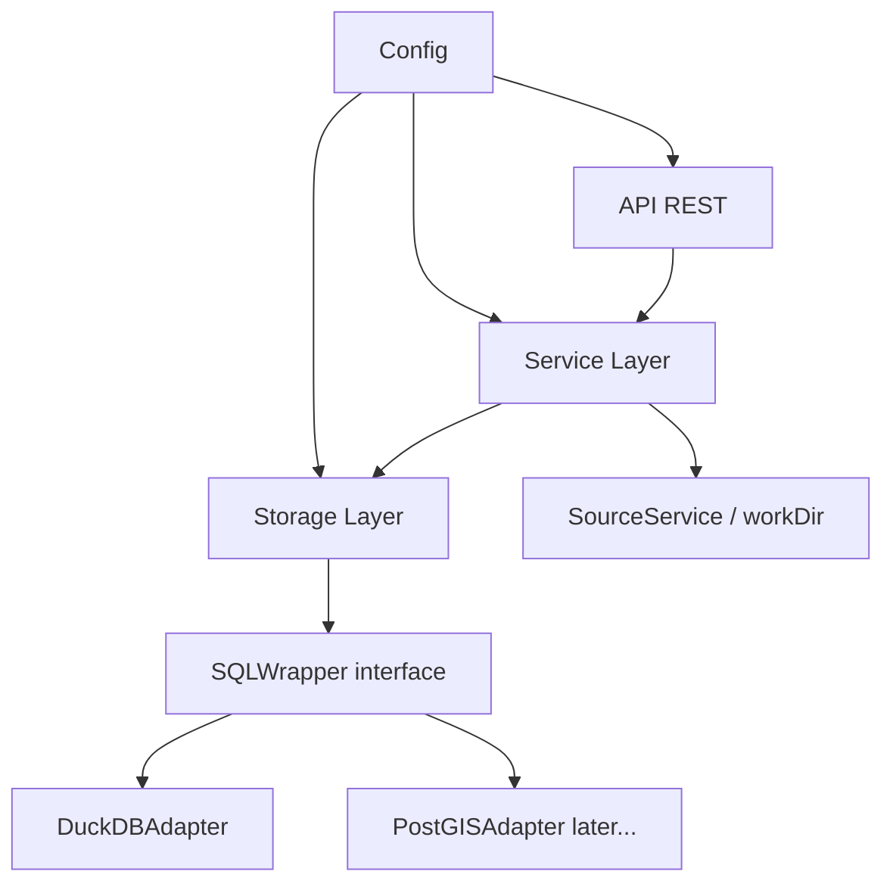

# GeoAPI — Guide d'Implémentation (destiné à un agent IA)

Ce document fait autorité sur les décisions d'architecture du serveur cartographique GeoAPI. Il est écrit pour être suivi par un agent IA qui implémente le projet, pas pour retracer l'historique des choix. Toute décision présentée ici est **définitive** sauf mention explicite du contraire ("à trancher").

Si une tâche demandée contredit une règle de ce document, la règle de ce document prévaut — signaler le conflit plutôt que de le résoudre silencieusement.

---

## 0. Règles non négociables

Ces règles s'appliquent à tout le code produit pour ce projet, quelle que soit la tâche en cours. Ne jamais les enfreindre pour "simplifier" ou "aller plus vite".

1. **Jamais d'identifiant SQL non validé.** Tout nom de table/colonne interpolé dans une requête (via `fmt.Sprintf` ou équivalent) doit passer par `storage.ValidateIdentifier` ou `storage.QuoteIdentifier` avant. `ValidateIdentifier` (rejet par motif alphanumérique strict) est réservé aux identifiants générés côté serveur (`physicalName`, mots-clés de type DuckDB) — jamais à un nom de colonne susceptible de provenir de données importées (accents, espaces, ponctuation d'un CSV/GeoJSON français), qui doit passer par `QuoteIdentifier` (guillemetage, doublement des `"` internes, rejet du seul caractère réellement dangereux dans un identifiant guillemeté : l'octet NUL). Dans les deux cas, la sécurité vient de la validation avant interpolation, pas du jeu de caractères qu'elle autorise. Valeurs (pas identifiants) toujours en paramètres liés (`?`), jamais interpolées.
2. **`tableId` (UUID) n'est jamais un identifiant SQL.** Chaque table logique a un `physicalName` généré côté serveur (`t_<uuid_sans_tirets>`), stocké dans `metadata`, résolu à chaque accès.
3. **Génération d'identifiant : `uuid()` (fonction native DuckDB).** Extension spatiale chargée une fois au démarrage (`INSTALL spatial; LOAD spatial;`), jamais par requête individuelle.
4. **Toute requête SQL fournie par l'utilisateur (`/derive`) est restreinte à `SELECT`.** Aucune requête arbitraire n'atteint `Exec`.
5. **Tout filtre de lecture (`GetRowsWithFilter`) passe par un DSL validé** (`FilterCondition` : colonne whitelistée contre `Columns(tableId)`, opérateur whitelisté, valeur en paramètre lié). Jamais de string construite par concaténation depuis la requête HTTP.
6. **`BulkInsert` s'exécute dans une transaction unique** (`Begin`/`Commit`/`defer Rollback`).
7. **La colonne géométrique n'est jamais retournée par les endpoints de lecture de rows** (`GetRowsByPkey`, `GetRowsWithFilter`). Elle ne sert qu'au rendu carte (`Tile`) et, si besoin plus tard, à l'export en `ST_AsText`/WKT.
8. **`GetPkeys` trie explicitement (`ORDER BY __pkey`).** DuckDB ne garantit aucun ordre stable sans `ORDER BY` — la pagination doit être déterministe.
9. **`rowCount` et `bbox` dans `metadata` sont dérivés, pas des faits stables.** `rowCount` est recalculé via `RefreshDerivedMetadata` après tout `InsertRow`/`BulkInsert`/`Remove`. `bbox` est recalculé après ces mêmes opérations et après tout `Update` qui touche spécifiquement la colonne géométrique — un `Update` sur un champ scalaire ne déclenche pas de recalcul de `bbox`. `geometryColumn` est en revanche une config stable, changée uniquement via `UpdateMetadata`.
10. **`geometryType` n'existe pas en tant que champ stocké.** Une colonne géo peut mélanger des types (POINT + POLYGON) ; utiliser `GeometryTypes(tableId)`, calculé à la demande.
11. **Le cache de métadonnées doit être invalidé explicitement** à chaque écriture (`UpdateMetadata`, `RefreshDerivedMetadata`) — jamais laissé expirer seul.
12. **Sortie JSON de l'API = types JSON natifs**, pas une reproduction des types Go du driver. Conversion explicite selon `ColumnType` (ex. `time.Time` → ISO 8601 selon `DATE`/`TIMESTAMP`/`TIMESTAMPTZ`).
13. **Une table dérivée (`/derive`) et une table chargée depuis une source sont toujours des tables matérialisées, jamais des vues SQL.** Le contrat CRUD (`AddColumn`, `Update`, `InsertRow`...) l'exige — une vue devient read-only dès que la requête filtre ou agrège.
14. **Pas de variable globale package-level pour l'état partagé** (cache, connexion DB, config, liste de sources) — injection de dépendances dans les structs de service, pour rester testable/mockable.
15. **Le chargement de données passe par des fichiers déposés dans `workDir`.** Un seul chemin de création de table à partir d'un fichier : `POST /sources/{name}/load`, où `name` provient exclusivement du dernier `Refresh`/`List` en cache — jamais une valeur construite librement depuis la requête, pour éliminer tout risque de traversée de répertoire.
16. **Le scope du projet est celui décrit dans ce document** (sources, tables, rows, tuiles, dérivation). Toute fonctionnalité hors de ce périmètre se traite dans une demande dédiée, pas en ajout incidental à une autre tâche.
17. **Toute écriture ou modification d'une structure de code (struct, interface, méthode, handler) s'accompagne des tests associés dans le même changement.** Pas de test différé "à la fin" — une struct/fonction livrée sans son test n'est pas considérée terminée.
18. **Tout paramètre susceptible d'être ajusté sans recompiler (limites, tailles max, chemins) vit dans le composant `config`, jamais en constante codée en dur dans le storage/service/router.** Voir section 2.
19. **Toute table géométrique reçoit un index spatial RTREE sur sa colonne géométrique**, créé immédiatement après le chargement/derive (sections 7, 8). Sans lui, `Tile`/`FilterByBbox` scannent la table entière à chaque appel.
20. **Les tuiles MVT sont mises en cache**, clé incluant `UpdatedAt` de la table (`GeoService`, section 5.5). Une tuile déjà servie pour la même version de la table ne recalcule jamais `ST_AsMVT`.
21. **Toute écriture DuckDB (`Exec`, transaction, `CREATE TABLE`) passe par le verrou applicatif unique de `DuckDBAdapter`** (section 4.6). DuckDB n'autorise qu'un seul writer actif à la fois ; des écritures concurrentes non sérialisées échouent ou corrompent l'état.
22. **Une écriture sur la colonne géométrique (`Update`, `InsertRow`, `BulkInsert`) attend du WKT en entrée et le convertit via `ST_GeomFromText(?)`** — jamais un bind direct comme pour une colonne scalaire. Cohérent avec le WKT déjà utilisé en sortie (règle 7). Une écriture qui touche la colonne géométrique déclenche `RefreshDerived` (règle 9) via `RowService` pour une écriture de rows, ou via `ImportService`/`DeriveService` lors de la création d'une table — jamais directement dans le storage layer.
23. **`context.Context` est le premier paramètre de toute méthode storage/service qui accède à DuckDB ou à un stockage externe** (PERF-4), reçu de `req.Context()` côté router et propagé sans dérivation jusqu'à l'appel `*Context` de `database/sql`. Un timeout par requête (`api.requestTimeoutSec`, section 2) l'annule si le traitement dépasse la limite. Les méthodes qui ne touchent ni DuckDB ni le disque (ex. `SourceService.List`) n'en ont pas besoin.
24. **Chaque cache applicatif (métadonnées, schéma de colonnes, tuiles) est une LRU bornée en taille avec expiration** (`hashicorp/golang-lru/v2/expirable`), jamais un cache illimité — TTL et taille max réglables sans recompiler (règle 18, section 2).

---

## 1. Architecture Globale



**Couches :**
- **Config** : chargée une fois au démarrage, injectée dans les autres couches — jamais lue depuis un global ailleurs dans le code.
- **API REST** : Router (`chi`) + Middlewares + Swagger UI
- **Service Layer** : `MetadataService` (cache de métadonnées), `RowService` (CRUD de rows), `SchemaService` (colonnes), `DeriveService`/`ImportService` (création de table), `GeoService` (MVT, requêtes géo), `SourceService` (scan/chargement de `workDir`), `ExportService` (CSV/GeoJSON) — voir section 5
- **Storage Layer** :
  - `SQLWrapper` (interface d'abstraction SQL)
  - `DuckDBAdapter` (implémente `SQLWrapper`)
  - `PostGISAdapter` (future implémentation, hors scope actuel)

---

## 2. Configuration (Settings)

Composant indépendant, chargé une fois au démarrage dans `main.go`, injecté explicitement partout où une valeur réglable est nécessaire — jamais lu depuis une variable globale (règle 14) ni codé en dur dans le storage/service/router (règle 18).

### 2.1 Fichier de configuration

```yaml
# config.yaml — valeurs par défaut, surchargeables par variables d'environnement
# ou par argument de ligne de commande pour workDir (voir 2.3).
server:
  port: 8080

duckdb:
  path: "./data/geo.db"

sources:
  workDir: "./data/sources"
  maxSizeBytes: 104857600  # 100 Mo — fichier au-delà exclu de la liste chargeable
  allowedExtensions: [".geojson", ".shp", ".csv", ".gpkg"]
```

Format YAML retenu (plus lisible qu'un `.env` pour une structure imbriquée). Chaque valeur a un défaut raisonnable dans le code — le fichier n'est jamais obligatoire pour démarrer en local.

Deux sections supplémentaires suivent le même principe : `api.requestTimeoutSec` (règle 23, timeout par requête HTTP, 0 = désactivé) en plus des limites de pagination déjà présentes dans `APIConfig` ; `cache.{metadata,schema,tile}{TTLSec,MaxItems}` (règle 24) pour la taille/expiration de chacune des trois LRU (`MetadataService`, `SchemaService`, `GeoService` — sections 5.1, 5.3, 5.5).

### 2.2 Struct Go et chargement

```go
type Config struct {
    Server  ServerConfig  `yaml:"server"`
    DuckDB  DuckDBConfig  `yaml:"duckdb"`
    Sources SourcesConfig `yaml:"sources"`
}

type ServerConfig struct {
    Port int `yaml:"port"`
}

type DuckDBConfig struct {
    Path string `yaml:"path"`
}

type SourcesConfig struct {
    // WorkDir est le répertoire où l'opérateur dépose les fichiers à
    // charger (GeoJSON, Shapefile, CSV, GeoPackage). Peut être surchargé
    // par l'argument --workdir au lancement (voir 2.3) sans recompiler.
    WorkDir           string   `yaml:"workDir"`
    // MaxSizeBytes exclut un fichier de la liste chargeable au-delà de
    // cette taille, vérifié lors du scan de workDir (section 3).
    MaxSizeBytes      int64    `yaml:"maxSizeBytes"`
    AllowedExtensions []string `yaml:"allowedExtensions"`
}

func defaultConfig() Config {
    return Config{
        Server: ServerConfig{Port: 8080},
        DuckDB: DuckDBConfig{Path: "./data/geo.db"},
        Sources: SourcesConfig{
            WorkDir:           "./data/sources",
            MaxSizeBytes:      100 * 1024 * 1024,
            AllowedExtensions: []string{".geojson", ".shp", ".csv", ".gpkg"},
        },
    }
}

// Load reads config.yaml if present, falling back to defaultConfig() for
// any field left unset. Never panics on a missing file — only on a
// malformed one, since a malformed config is a deployment error worth
// surfacing loudly.
func Load(path string) (*Config, error) {
    cfg := defaultConfig()

    data, err := os.ReadFile(path)
    if errors.Is(err, os.ErrNotExist) {
        return &cfg, nil
    }
    if err != nil {
        return nil, fmt.Errorf("reading config: %w", err)
    }

    if err := yaml.Unmarshal(data, &cfg); err != nil {
        return nil, fmt.Errorf("parsing config: %w", err)
    }
    return &cfg, nil
}
```

### 2.3 `workDir` en argument de ligne de commande

`workDir` est le seul champ de config qu'on attend voir varier d'un lancement à l'autre (environnement de dev vs poste d'un utilisateur). Il est donc exposé en flag CLI, qui surcharge `config.yaml` si fourni :

```go
func main() {
    var workDirFlag string
    flag.StringVar(&workDirFlag, "workdir", "", "surcharge sources.workDir de config.yaml")
    flag.Parse()

    cfg, err := config.Load("config.yaml")
    if err != nil {
        log.Fatalf("config: %v", err)
    }
    if workDirFlag != "" {
        cfg.Sources.WorkDir = workDirFlag
    }

    metadataService := service.NewMetadataService(storage, cache.New(5*time.Minute, 10*time.Minute))
    importService := service.NewImportService(metadataService, storage)
    sourceService := service.NewSourceService(cfg.Sources, importService)
    router := router.NewRouter(metadataService, rowService, schemaService, deriveService, geoService, sourceService, exportService, cfg.API, uiAssets)
    // ...
}
```

`cfg.Sources` (toujours la config, jamais une variable globale — règle 14) est injecté dans `SourceService`, qui est le seul composant à connaître `workDir`.

---

## 3. Sources de données (`workDir`)

Le chargement de données passe par des fichiers déposés dans `workDir` (règle 15) : l'opérateur y dépose les fichiers, l'API les découvre et les charge à la demande. Les tests s'appuient sur un simple répertoire de fixtures.

### 3.1 Modèle

```go
type Source struct {
    Name      string    // nom du fichier, relatif à workDir (ex: "buildings.geojson")
    Ext       string
    SizeBytes int64
    ModTime   time.Time
    Loaded    bool      // true si déjà chargé en base (toujours false pour un .gpkg — 7.1)
    TableId   string    // renseigné uniquement si Loaded
    Layers    []SourceLayer // peuplé uniquement pour un .gpkg (7.1)
}

// SourceLayer suit l'état de chargement d'une couche d'un .gpkg
// indépendamment des autres — voir 7.1.
type SourceLayer struct {
    Name    string
    Loaded  bool
    TableId string
}

type SourceManager interface {
    // Refresh rescanne workDir et remplace le cache en mémoire. Les
    // fichiers dépassant MaxSizeBytes ou d'extension non whitelistée sont
    // exclus de la liste (pas d'erreur — juste absents, silencieusement
    // filtrés comme non chargeables).
    Refresh() ([]Source, error)

    // List retourne le cache du dernier Refresh — ne rescanne jamais le
    // disque elle-même. Un scan implicite à chaque List casserait
    // l'intention d'un refresh explicite et coûterait un os.ReadDir par
    // requête.
    List() []Source

    // Load importe la source nommée. name DOIT correspondre à une entrée
    // du cache courant — jamais un chemin construit depuis la requête HTTP
    // sans être passé par ce cache (règle 15, protection contre la
    // traversée de répertoire). layer est requis pour un .gpkg (doit nommer
    // une entrée de Source.Layers), rejeté sinon (7.1).
    Load(name, layer string) (tableId string, err error)
}
```

### 3.2 Implémentation

```go
// tableImporter est ce dont SourceService a besoin — déclaré ici, le
// consommateur, plutôt que dépendre du type concret *ImportService (5.4).
type tableImporter interface {
    LoadedSourceNames() (map[string]string, error)
    ListLayers(path string) ([]string, error)
    ImportFromFile(name, path, ext, layer string) (string, error)
}

type SourceService struct {
    cfg          config.SourcesConfig
    tableService tableImporter

    mu      sync.Mutex // tenu pour toute la durée du check-then-import de Load
    sources []Source
}

func NewSourceService(cfg config.SourcesConfig, tableService tableImporter) *SourceService {
    return &SourceService{cfg: cfg, tableService: tableService}
}

func (s *SourceService) Refresh() ([]Source, error) {
    entries, err := os.ReadDir(s.cfg.WorkDir)
    if err != nil {
        return nil, fmt.Errorf("reading workDir: %w", err)
    }

    loaded, err := s.tableService.LoadedSourceNames() // depuis metadata.tableName
    if err != nil {
        return nil, err
    }

    var sources []Source
    for _, entry := range entries {
        if entry.IsDir() {
            continue
        }
        ext := filepath.Ext(entry.Name())
        if !slices.Contains(s.cfg.AllowedExtensions, ext) {
            continue
        }
        info, err := entry.Info()
        if err != nil {
            continue
        }
        if info.Size() > s.cfg.MaxSizeBytes {
            continue
        }

        source := Source{Name: entry.Name(), Ext: ext, SizeBytes: info.Size(), ModTime: info.ModTime()}
        if ext == ".gpkg" {
            source.Layers = s.listLoadedLayers(entry.Name(), loaded) // 7.1
        } else {
            source.TableId, source.Loaded = loaded[entry.Name()]
        }
        sources = append(sources, source)
    }

    s.mu.Lock()
    s.sources = sources
    s.mu.Unlock()
    return sources, nil
}

func (s *SourceService) List() []Source {
    s.mu.RLock()
    defer s.mu.RUnlock()
    return s.sources
}

// Load : name doit exister dans le cache (règle 15) — ReadDir ne renvoie
// que des noms de fichiers simples, jamais de chemin avec séparateurs,
// donc filepath.Join(workDir, name) reste borné à workDir par construction
// une fois validé contre le cache. Pour un .gpkg, layer doit nommer une
// entrée de found.Layers (7.1) ; pour tout autre format, layer doit être
// vide.
func (s *SourceService) Load(name, layer string) (string, error) {
    s.mu.RLock()
    var found *Source
    for i := range s.sources {
        if s.sources[i].Name == name {
            found = &s.sources[i]
            break
        }
    }
    s.mu.RUnlock()

    if found == nil {
        return "", fmt.Errorf("source inconnue %q — appeler /sources/refresh d'abord", name)
    }

    if found.Ext != ".gpkg" {
        if layer != "" {
            return "", fmt.Errorf("source %q ne supporte pas la sélection de couche", name)
        }
        if found.Loaded {
            return "", fmt.Errorf("source %q déjà chargée (table %s)", name, found.TableId)
        }
        path := filepath.Join(s.cfg.WorkDir, found.Name)
        return s.tableService.ImportFromFile(found.Name, path, found.Ext, "")
    }

    // .gpkg : layer requis, validé contre found.Layers (règle 15), jamais
    // chargé "en entier" (7.1).
    layerEntry := findLayer(found.Layers, layer)
    if layerEntry == nil {
        return "", fmt.Errorf("couche %q inconnue pour la source %q", layer, name)
    }
    if layerEntry.Loaded {
        return "", fmt.Errorf("couche %q déjà chargée (table %s)", layer, layerEntry.TableId)
    }
    path := filepath.Join(s.cfg.WorkDir, found.Name)
    return s.tableService.ImportFromFile(found.Name+"::"+layer, path, found.Ext, layer)
}
```

`Refresh` est appelé une fois au démarrage (dans `main.go`, juste après la construction de `SourceService`) pour peupler le cache initial, puis à la demande via `POST /sources/refresh`.

---

## 4. Storage Layer

### 4.1 Schéma `metadata`

```sql
CREATE TABLE IF NOT EXISTS metadata (
    tableId TEXT PRIMARY KEY,          -- UUID v4, identifiant logique/API
    physicalName TEXT NOT NULL UNIQUE, -- nom réel de la table SQL (ex: t_a1b2c3...)
    tableName TEXT NOT NULL,           -- nom original du fichier source, éditable
    isGeo BOOLEAN DEFAULT FALSE,
    createdAt TIMESTAMP DEFAULT NOW(),
    updatedAt TIMESTAMP DEFAULT NOW(),
    geometryColumn TEXT,               -- config, changée uniquement via UpdateMetadata
    rowCount INTEGER DEFAULT 0,        -- dérivé, voir RefreshDerivedMetadata
    bbox TEXT,                         -- dérivé, "minX,minY,maxX,maxY"
    srid INTEGER DEFAULT 4326
);

CREATE INDEX IF NOT EXISTS idx_metadata_geo ON metadata(isGeo) WHERE isGeo = TRUE;
CREATE INDEX IF NOT EXISTS idx_metadata_name ON metadata(tableName);
```

`CREATE TABLE IF NOT EXISTS` exécuté au démarrage de l'application — c'est le seul mécanisme de migration nécessaire (voir règle 9, et section 9 "Structure du Projet" pour le détail). Les tables de données (`t_xxx`) n'ont pas de schéma versionné : elles sont créées dynamiquement via CTAS au chargement/derive.

`tableName` est le nom du fichier source (`Source.Name`) une fois chargé via `SourceService.Load` — c'est ce qui permet à `LoadedSourceNames()` (3.2) de savoir quels fichiers de `workDir` sont déjà en base.

### 4.2 Tables de données

```sql
CREATE TABLE t_a1b2c3 (
    __pkey TEXT PRIMARY KEY DEFAULT uuid()
);
```

Toute table de données a une colonne `__pkey` (UUID). Lors d'un chargement (section 7), `__pkey` est généré et rempli ligne par ligne dans le `CREATE TABLE AS SELECT`, pas ajouté après coup.

Pour toute table géométrique (`isGeo = TRUE`), un index spatial suit immédiatement la création (règle 19) :

```sql
CREATE INDEX idx_t_a1b2c3_geom ON t_a1b2c3 USING RTREE (geometryColumn);
```

`geometryColumn` interpolé après `validateIdentifier` (4.3), comme tout identifiant. Sans cet index, `Tile`/`FilterByBbox` scannent la table entière à chaque appel — voir sections 7 et 8 pour où cette étape s'insère dans le chargement et la dérivation.

### 4.3 Validation des identifiants

```go
var identifierRe = regexp.MustCompile(`^[a-zA-Z_][a-zA-Z0-9_]*$`)

// Réservée aux identifiants générés côté serveur (physicalName, mots-clés
// de type DuckDB) — jamais à un nom de colonne issu de données importées.
func ValidateIdentifier(name string) error {
    if !identifierRe.MatchString(name) {
        return fmt.Errorf("invalid identifier: %q", name)
    }
    return nil
}

// Pour tout nom de colonne pouvant provenir de données importées (accents,
// espaces, ponctuation) : validation par guillemetage, pas par rejet du
// jeu de caractères.
func QuoteIdentifier(name string) (string, error) {
    if name == "" {
        return "", fmt.Errorf("empty identifier")
    }
    if strings.ContainsRune(name, 0) {
        return "", fmt.Errorf("invalid identifier: %q", name)
    }
    return `"` + strings.ReplaceAll(name, `"`, `""`) + `"`, nil
}
```

`ValidateIdentifier` est appelée avant toute interpolation d'un `physicalName` ; `QuoteIdentifier` avant toute interpolation d'un nom de colonne (règle 1). Un nom de colonne n'est jamais passé à `Exec`/`Query` non guillemeté.

### 4.4 Interfaces Go

```go
// Metadata holds config fields (set once, changed only via UpdateMetadata)
// and derived fields (RowCount, Bbox — recomputed by RefreshDerivedMetadata
// after any write to the underlying table). GeometryType is intentionally
// absent: a geometry column can hold mixed types, so it's computed on demand
// via GeoTableManager.GeometryTypes rather than cached as a single stale string.
type Metadata struct {
    TableId        string
    PhysicalName   string
    TableName      string
    IsGeo          bool
    CreatedAt      time.Time
    UpdatedAt      time.Time
    GeometryColumn string
    RowCount       int64
    Bbox           string
    Srid           int
}

type MetadataManager interface {
    MetadataReader
    MetadataWriter
}

type MetadataReader interface {
    TableIds() ([]string, error)
    TableExists(tableId string) (bool, error)
    GetMetadata(tableId string) (*Metadata, error)
}

type MetadataWriter interface {
    Create(tableName string, isGeo bool, geometryColumn string) (tableId string, err error)
    Remove(tableId string) error
    UpdateMetadata(tableId string, updates map[string]any) error

    // RefreshDerivedMetadata recomputes RowCount and Bbox from the underlying
    // table, bumps UpdatedAt, and persists them. Must be called after
    // InsertRow, BulkInsert, row Update/Remove, and any Update touching the
    // geometry column. UpdatedAt is what invalidates GeoService's tile
    // cache (section 5.5, règle 20).
    RefreshDerivedMetadata(tableId string) error
}
```

```go
type Row struct {
    Pkey   string
    Values map[string]any // clé = nom de colonne (hors colonne géométrique), valeur typée JSON natif
}

type TableManager interface {
    TableReader
    TableWriter
}

type TableReader interface {
    Columns(tableId string) ([]string, error)
    ColumnType(tableId, column string) (string, error)
    RowsCount(tableId string) (int64, error)
    // Must order by __pkey internally (ORDER BY __pkey LIMIT ? OFFSET ?) — voir règle 8.
    GetPkeys(tableId string, offset, limit int64) ([]string, error)
    GetRowsByPkey(tableId string, pKeys []string) ([]Row, error)
    // filter est produit par BuildFilter (4.5), jamais une string libre — voir règle 5.
    GetRowsWithFilter(tableId string, filter string, args []any, limit int) ([]Row, error)
    GetDistinctValues(tableId, column string) ([]any, error)
}

type TableWriter interface {
    AddColumn(tableId, colName, colType string) error
    // Update met à jour toutes les colonnes de updates en une requête —
    // un update multi-colonnes est atomique, jamais un Exec par colonne.
    Update(tableId string, pkeys []string, updates map[string]any) error
    Remove(tableId string, pKeys []string) error
    InsertRow(tableId string, values map[string]any) (string, error)
    // Doit s'exécuter dans une transaction unique — voir règle 6.
    BulkInsert(tableId string, rows []map[string]any) ([]string, error)
}

type GeoTableManager interface {
    Tile(tableId string, zoom, x, y int) ([]byte, error)
    FilterByBbox(tableId string, bbox [4]float64) ([]string, error)
    // Computed on demand, never cached — voir règle 10.
    GeometryTypes(tableId string) ([]string, error)
}
```

`GeoTableManager` se limite aux opérations géospatiales (`Tile`, `FilterByBbox`, `GeometryTypes`) ; l'état `isGeo`/`geometryColumn` vit dans `MetadataReader`, source unique de vérité.

### 4.5 Construction sécurisée des filtres

```go
type FilterCondition struct {
    Column   string // validé contre Columns(tableId) avant usage
    Operator string // whitelist: "=", "!=", ">", "<", ">=", "<=", "LIKE"
    Value    any    // toujours passé en paramètre lié, jamais interpolé
}

// BuildFilter valide chaque Column contre validColumns (le whitelisting
// contre le schéma réel de la table est ce qui rend l'interpolation sûre)
// et chaque Operator contre la whitelist, guillemette Column via
// QuoteIdentifier (règle 1), puis construit "\"column\" op ?" par condition
// jointe en AND. C'est le seul chemin autorisé vers GetRowsWithFilter —
// voir règle 5.
func BuildFilter(conditions []FilterCondition, validColumns []string) (filter string, args []any, err error) {
    // implémentation : validation puis construction de la clause
}
```

`storage.Storage` (l'agrégat plus haut) documente ce qu'un adaptateur complet doit implémenter — aucun service n'en dépend directement. Chaque service déclare, dans son propre paquet, l'interface étroite composée à partir de `MetadataManager`/`TableManager`/`GeoTableManager`/`TableCreator` qui correspond exactement à ce qu'il appelle (voir 5.1–5.6, 7) ; l'adaptateur DuckDB la satisfait implicitement (typage structurel Go), sans changement de câblage dans `main.go`.

### 4.6 `SQLWrapper` / `DuckDBAdapter`

`SQLWrapper` n'est jamais exposé à un service : `Query`/`QueryRow`/`Exec`/`Begin` restent un détail interne du paquet `duckdb`, utilisé par `DuckDBAdapter` pour implémenter ses propres méthodes typées. Un service qui pouvait y accéder aurait pu contourner toute validation d'identifiant (règle 1) en écrivant du SQL directement au lieu de passer par les méthodes ci-dessus.

```go
type SQLWrapper interface {
    Query(query string, args ...any) (*sql.Rows, error)
    QueryRow(query string, args ...any) *sql.Row
    Exec(query string, args ...any) (sql.Result, error)
    Begin() (*sql.Tx, error)
}

type DuckDBAdapter struct {
    db      *sql.DB
    writeMu sync.Mutex // règle 21 : sérialise toute écriture, DuckDB n'autorisant qu'un seul writer actif
}

func (d *DuckDBAdapter) Query(query string, args ...any) (*sql.Rows, error) {
    return d.db.Query(query, args...)
}

// Exec sérialise toute écriture via writeMu (règle 21).
func (d *DuckDBAdapter) Exec(query string, args ...any) (sql.Result, error) {
    d.writeMu.Lock()
    defer d.writeMu.Unlock()
    return d.db.Exec(query, args...)
}

// Tile builds an MVT tile for the given z/x/y. Identifiers are validated
// before interpolation (règle 1); zoom/x/y are bound parameters.
func (d *DuckDBAdapter) Tile(tableId string, zoom, x, y int) ([]byte, error) {
    meta, err := d.GetMetadata(tableId)
    if err != nil {
        return nil, err
    }
    if err := validateIdentifier(meta.PhysicalName); err != nil {
        return nil, err
    }
    if err := validateIdentifier(meta.GeometryColumn); err != nil {
        return nil, err
    }

    query := fmt.Sprintf(`
        SELECT ST_AsMVT(
            ST_AsMVTGeom(%s, ST_TileEnvelope(?, ?, ?), 4096, 256, true),
            __pkey
        ) AS mvt
        FROM %s
        WHERE %s && ST_TileEnvelope(?, ?, ?)
    `, meta.GeometryColumn, meta.PhysicalName, meta.GeometryColumn)

    var mvt []byte
    err = d.QueryRow(query, zoom, x, y, zoom, x, y).Scan(&mvt)
    return mvt, err
}

// GeometryTypes runs a lightweight distinct scan; not cached (règle 10).
func (d *DuckDBAdapter) GeometryTypes(tableId string) ([]string, error) {
    meta, err := d.GetMetadata(tableId)
    if err != nil {
        return nil, err
    }
    if err := validateIdentifier(meta.PhysicalName); err != nil {
        return nil, err
    }
    if err := validateIdentifier(meta.GeometryColumn); err != nil {
        return nil, err
    }

    query := fmt.Sprintf(
        `SELECT DISTINCT ST_GeometryType(%s) FROM %s`,
        meta.GeometryColumn, meta.PhysicalName,
    )
    rows, err := d.Query(query)
    if err != nil {
        return nil, err
    }
    defer rows.Close()

    var types []string
    for rows.Next() {
        var t string
        if err := rows.Scan(&t); err != nil {
            return nil, err
        }
        types = append(types, t)
    }
    return types, rows.Err()
}

// Rows de lecture : la colonne géométrique est systématiquement exclue (règle 7).
func rowsQuery(meta *Metadata) string {
    return fmt.Sprintf(
        `SELECT * EXCLUDE (%s) FROM %s WHERE __pkey IN (?)`,
        meta.GeometryColumn, meta.PhysicalName,
    )
}

// BulkInsert s'exécute dans une transaction unique (règle 6), tenue sous
// writeMu pour toute sa durée (règle 21) — une transaction ouverte ne doit
// jamais rester longtemps active, pour ne pas bloquer les autres écritures.
func (d *DuckDBAdapter) BulkInsert(tableId string, rows []map[string]any) ([]string, error) {
    d.writeMu.Lock()
    defer d.writeMu.Unlock()

    tx, err := d.db.Begin()
    if err != nil {
        return nil, err
    }
    defer tx.Rollback() // no-op si Commit réussit

    pkeys := make([]string, 0, len(rows))
    for _, row := range rows {
        pkey := uuid.NewString()
        // ... construire et exécuter l'INSERT dans tx pour cette row ...
        pkeys = append(pkeys, pkey)
    }

    if err := tx.Commit(); err != nil {
        return nil, err
    }
    return pkeys, nil
}

// Update : chaque colonne de updates est mise à jour dans une unique
// requête (spec §5.2) — un update multi-colonnes est atomique, jamais un
// Exec par colonne. Si une colonne est la colonne géométrique, sa valeur
// (WKT) est convertie via ST_GeomFromText(?) plutôt que bindée directement
// — une géométrie n'est pas une valeur scalaire (règle 22). Chaque colonne
// est guillemetée via QuoteIdentifier (règle 1) avant interpolation dans
// le SET.
func (d *DuckDBAdapter) Update(tableId string, pkeys []string, updates map[string]any) error {
    meta, err := d.GetMetadata(tableId)
    if err != nil {
        return err
    }
    if err := validateIdentifier(meta.PhysicalName); err != nil {
        return err
    }

    setClauses := make([]string, 0, len(updates))
    args := make([]any, 0, len(updates)+len(pkeys))
    for column, value := range updates {
        quotedCol, err := quoteIdentifier(column)
        if err != nil {
            return err
        }
        setClause := fmt.Sprintf("%s = ?", quotedCol)
        if column == meta.GeometryColumn {
            setClause = fmt.Sprintf("%s = ST_GeomFromText(?)", quotedCol)
        }
        setClauses = append(setClauses, setClause)
        args = append(args, value)
    }
    args = append(args, pkeysToArgs(pkeys)...)

    query := fmt.Sprintf(
        `UPDATE %s SET %s WHERE __pkey IN (%s)`,
        meta.PhysicalName, strings.Join(setClauses, ", "), placeholders(len(pkeys)),
    )

    d.writeMu.Lock()
    defer d.writeMu.Unlock()

    args := append([]any{value}, pkeysToArgs(pkeys)...)
    if _, err := d.db.Exec(query, args...); err != nil {
        return fmt.Errorf("update failed (invalid WKT si colonne géométrique): %w", err)
    }
    return nil
}
```

Le chargement de l'extension spatiale (`LOAD spatial;`) est une étape d'initialisation de connexion, exécutée une fois à l'ouverture de la connexion DuckDB (section 4).

---

## 5. Service Layer

Ce qui était `TableService` (métadonnées + cache, CRUD de rows, schéma, dérivation, import) est
éclaté en cinq services à responsabilité unique — `MetadataService`, `RowService`,
`SchemaService`, `DeriveService`, `ImportService` — plus `GeoService` et `ExportService`. Chacun
dépend du storage layer via une interface qu'il déclare lui-même (4.6), jamais via
`storage.Storage` : par exemple `SchemaService` n'a besoin que de `storage.TableManager`, jamais
de métadonnées ni de `GeoTableManager`.

`MetadataService` est le seul propriétaire du cache de métadonnées (règle 11) : tous les autres
services y accèdent via un port étroit qu'ils déclarent (`metadataGetter`, `metadataRefresher`,
`metadataStore`...), jamais en cachant indépendamment — l'invalidation reste à un seul endroit.

Toute méthode ci-dessous qui touche le storage layer prend désormais `ctx context.Context` en
premier paramètre (règle 23), reçu de `req.Context()` côté router ; les extraits de code de cette
section l'omettent pour rester courts, mais c'est le comportement réel. De même, les caches
présentés comme `*cache.Cache` sont en réalité des LRU bornées `*expirable.LRU[K, V]`
(`github.com/hashicorp/golang-lru/v2/expirable`, règle 24), avec `.Get`/`.Add`/`.Remove` à la place
de `.Get`/`.Set`/`.Delete`.

### 5.1 `MetadataService` : seul propriétaire du cache de métadonnées

```go
type MetadataService struct {
    storage storage.MetadataManager
    cache   *cache.Cache
}

func NewMetadataService(s storage.MetadataManager, c *cache.Cache) *MetadataService {
    return &MetadataService{storage: s, cache: c}
}

func (s *MetadataService) GetMetadata(tableId string) (*storage.Metadata, error) {
    if val, ok := s.cache.Get("metadata_" + tableId); ok {
        return val.(*storage.Metadata), nil
    }

    meta, err := s.storage.GetMetadata(tableId)
    if err != nil {
        return nil, err
    }

    s.cache.Set("metadata_"+tableId, meta, cache.DefaultExpiration)
    return meta, nil
}

func (s *MetadataService) ListTables() ([]*storage.Metadata, error) {
    // implémentation : storage.TableIds() puis GetMetadata par id (mis en
    // cache au passage)
}

// Create enregistre la ligne metadata d'une nouvelle table logique, utilisé
// par DeriveService/ImportService avant de matérialiser sa table physique.
func (s *MetadataService) Create(tableName string, isGeo bool, geometryColumn string) (string, error) {
    return s.storage.Create(tableName, isGeo, geometryColumn)
}

// invalidateMetadataCache doit être appelée après toute écriture qui change
// metadata: UpdateMetadata, RefreshDerived, RemoveTable, Rollback (règle 11).
func (s *MetadataService) invalidateMetadataCache(tableId string) {
    s.cache.Delete("metadata_" + tableId)
}

func (s *MetadataService) UpdateMetadata(tableId string, updates map[string]any) error {
    if err := s.storage.UpdateMetadata(tableId, updates); err != nil {
        return err
    }
    s.invalidateMetadataCache(tableId)
    return nil
}

func (s *MetadataService) RemoveTable(tableId string) error {
    if err := s.storage.Remove(tableId); err != nil {
        return err
    }
    s.invalidateMetadataCache(tableId)
    return nil
}

// RefreshDerived recalcule RowCount/Bbox/UpdatedAt (règle 9) et invalide le
// cache. Appelée par RowService et ImportService/DeriveService après toute
// écriture qui change le nombre de lignes ou touche la colonne géométrique
// — c'est ce qui invalide le cache de tuiles de GeoService (5.5, règle 20).
func (s *MetadataService) RefreshDerived(tableId string) error {
    if err := s.storage.RefreshDerivedMetadata(tableId); err != nil {
        return err
    }
    s.invalidateMetadataCache(tableId)
    return nil
}

// Rollback supprime la ligne metadata (et la table physique partiellement
// créée, via le DROP TABLE IF EXISTS de storage.Remove) après un échec en
// cours de création dans DeriveService/ImportService (BUG-2) : une création
// ratée ne doit jamais laisser une ligne metadata sans table physique.
func (s *MetadataService) Rollback(tableId string, cause error) error {
    if err := s.RemoveTable(tableId); err != nil {
        return fmt.Errorf("%w (cleanup also failed: %v)", cause, err)
    }
    return cause
}

// LoadedSourceNames retourne les tableName déjà présents en metadata,
// utilisé par ImportService pour satisfaire SourceService.Refresh (3.2).
func (s *MetadataService) LoadedSourceNames() (map[string]string, error) {
    ids, err := s.storage.TableIds()
    if err != nil {
        return nil, err
    }
    names := make(map[string]string, len(ids))
    for _, id := range ids {
        meta, err := s.GetMetadata(id)
        if err != nil {
            return nil, err
        }
        names[meta.TableName] = meta.TableId
    }
    return names, nil
}
```

### 5.2 `RowService` : CRUD de rows, atomique et typé

```go
// metadataRefresher est ce dont RowService a besoin de MetadataService :
// lire les métadonnées (pour savoir quelle colonne est géométrique) et
// rafraîchir les champs dérivés après une écriture (règle 9).
type metadataRefresher interface {
    GetMetadata(tableId string) (*storage.Metadata, error)
    RefreshDerived(tableId string) error
}

type RowService struct {
    storage  storage.TableManager
    metadata metadataRefresher
}

func NewRowService(storage storage.TableManager, metadata metadataRefresher) *RowService {
    return &RowService{storage: storage, metadata: metadata}
}

// UpdateRow met à jour toutes les colonnes de updates pour les pkeys donnés
// en un seul appel storage, donc un PATCH multi-colonnes est atomique :
// soit toutes les colonnes changent, soit aucune. Si une des colonnes est
// la colonne géométrique, RefreshDerived recalcule bbox et bumpe UpdatedAt
// (règle 9). Un update ne touchant que des champs scalaires ne déclenche
// rien de plus.
func (s *RowService) UpdateRow(tableId string, pkeys []string, updates map[string]any) error {
    meta, err := s.metadata.GetMetadata(tableId)
    if err != nil {
        return err
    }

    if err := s.storage.Update(tableId, pkeys, updates); err != nil {
        return err
    }

    if _, touchesGeometry := updates[meta.GeometryColumn]; touchesGeometry {
        return s.metadata.RefreshDerived(tableId)
    }
    return nil
}
```

Principe de typage de sortie (règle 12) : la sortie JSON de l'API utilise des types JSON natifs, jamais une reproduction directe des types Go du driver DuckDB. `Row.Values` reste un `map[string]any` (schéma dynamique par table), mais chaque valeur est convertie explicitement selon `ColumnType` :
- `DATE` → `"YYYY-MM-DD"`
- `TIMESTAMP`/`TIMESTAMPTZ` → ISO 8601 complet
- colonne géométrique → absente du résultat (règle 7)

### 5.3 `SchemaService` : structure, pas donnée

`Schema`/`AddColumn` ne déclenchent jamais `RefreshDerived` (ajouter une colonne n'affecte ni
`RowCount` ni `Bbox`) : `SchemaService` n'a donc aucune dépendance vers `MetadataService`, juste
`storage.TableManager`.

`SchemaService` est aussi le seul propriétaire d'un cache par table du schéma complet
(`[]ColumnSchema`, PERF-1), invalidé par `AddColumn` — la seule écriture qui change la structure
d'une table. `Types(ctx, tableId) map[string]string`, dérivé du même cache, est le port
(`columnTyper`) que `RowService.convertRow` utilise pour convertir les valeurs d'une row sans
émettre un `DESCRIBE`/`ColumnType` par colonne à chaque lecture.

### 5.4 `DeriveService` et `ImportService` : créer une table, avec rollback

Les deux services suivent le même schéma — enregistrer la ligne `metadata` puis matérialiser la
table physique, avec compensation (`Rollback`, 5.1) si la matérialisation échoue (BUG-2) — d'où un
port `metadataStore` partagé :

```go
// metadataStore est ce dont DeriveService/ImportService ont besoin de
// MetadataService pour enregistrer une nouvelle table logique et nettoyer
// en cas d'échec de sa matérialisation.
type metadataStore interface {
    GetMetadata(tableId string) (*storage.Metadata, error)
    Create(tableName string, isGeo bool, geometryColumn string) (string, error)
    UpdateMetadata(tableId string, updates map[string]any) error
    RefreshDerived(tableId string) error
    Rollback(tableId string, cause error) error
}

type DeriveService struct {
    metadata metadataStore
    storage  storage.TableCreator // n'utilise que CreateFromQuery
}

// DeriveTable matérialise une nouvelle table à partir d'une requête SELECT
// fournie par l'appelant (règle 4). Table dérivée = instantané figé, jamais
// une vue (règle 13).
func (s *DeriveService) DeriveTable(sourceTableId, query, newTableName string) (string, error) {
    // implémentation : validateSelectOnly, puis Create/GetMetadata/
    // CreateFromQuery/UpdateMetadata/RefreshDerived, Rollback à chaque échec
}
```

`ImportService` a en plus besoin de `LoadedSourceNames` (d'où `metadataImporter`, qui embarque
`metadataStore`) pour satisfaire à lui seul le `tableImporter` que `SourceService` attend (7) — les
trois méthodes de ce port (`LoadedSourceNames`, `ListLayers`, `ImportFromFile`) vivent donc sur
`ImportService`, `LoadedSourceNames` délèguant directement à `MetadataService.LoadedSourceNames`.

### 5.5 `GeoService` : cache des tuiles

```go
// metadataGetter est ce dont GeoService a besoin de MetadataService :
// lire les métadonnées en cache, pour clé de cache sur UpdatedAt.
type metadataGetter interface {
    GetMetadata(tableId string) (*storage.Metadata, error)
}

type GeoService struct {
    storage   storage.GeoTableManager
    metadata  metadataGetter
    tileCache *cache.Cache
}

func NewGeoService(storage storage.GeoTableManager, metadata metadataGetter, tileCache *cache.Cache) *GeoService {
    return &GeoService{storage: storage, metadata: metadata, tileCache: tileCache}
}

// GetTile sert une tuile depuis le cache pour la version courante de la
// table. La clé inclut UpdatedAt : une écriture sur la table change
// UpdatedAt (via RefreshDerived, règle 9), ce qui invalide automatiquement
// les tuiles de l'ancienne version sans mécanisme séparé (règle 20).
func (g *GeoService) GetTile(tableId string, zoom, x, y int) ([]byte, error) {
    meta, err := g.metadata.GetMetadata(tableId)
    if err != nil {
        return nil, err
    }

    key := fmt.Sprintf("tile_%s_%d_%d_%d_%d", tableId, zoom, x, y, meta.UpdatedAt.UnixNano())
    if val, ok := g.tileCache.Get(key); ok {
        return val.([]byte), nil
    }

    mvt, err := g.storage.Tile(tableId, zoom, x, y)
    if err != nil {
        return nil, err
    }

    g.tileCache.Set(key, mvt, cache.DefaultExpiration)
    return mvt, nil
}
```

`RefreshDerived` (5.1) doit mettre à jour `UpdatedAt` en plus de `RowCount`/`Bbox` — c'est ce qui fait fonctionner l'invalidation de `GetTile` sans code d'invalidation dédié.

### 5.6 `ExportService` : export = domaine, pas transport

L'export CSV/GeoJSON (`GET /tables/{tableId}/export`) est de la logique métier, pas un détail de
transport HTTP : `ExportService.Export` construit le corps de la réponse et son content-type, le
router se limite à poser les en-têtes et écrire le corps.

```go
// rowLister et geometryFetcher sont la composition exacte dont
// ExportService a besoin, déclarée ici (le consommateur).
type rowLister interface {
    ListRows(tableId string, offset, limit int64) (*RowsPage, error)
}

type geometryFetcher interface {
    // GetGeometryGeoJSON : seule exception export à "jamais la colonne
    // géométrique dans une lecture de rows" (règle 7).
    GetGeometryGeoJSON(tableId string, pkeys []string) (map[string]string, error)
}

type ExportService struct {
    rows     rowLister
    geometry geometryFetcher
}

func NewExportService(rows rowLister, geometry geometryFetcher) *ExportService {
    return &ExportService{rows: rows, geometry: geometry}
}

// Export rend toutes les lignes de meta au format demandé ("csv" ou
// "geojson"), déjà résolu par le caller (le défaut par type de table est
// une décision HTTP, pas domaine). Une erreur de validation (format
// inconnu, GeoJSON sur une table non géo) est un *ExportValidationError,
// que le router mappe en 400 ; toute autre erreur reste un 500.
func (s *ExportService) Export(meta *storage.Metadata, format string) (body []byte, contentType string, err error) {
    // implémentation : ListRows puis rendu CSV ou GeoJSON (avec
    // GetGeometryGeoJSON pour ce dernier)
}
```

Instancié dans `main.go` avec `RowService` et `GeoService` eux-mêmes (chacun satisfait
implicitement `rowLister`/`geometryFetcher`), pas avec une nouvelle dépendance storage.

---

## 6. API REST

### 6.1 Endpoints

| **Domaine**       | **Endpoint**                          | **Méthode** | **Description**                                | **Réponse**                          |
|-------------------|----------------------------------------|-------------|-------------------------------------------------|---------------------------------------|
| **Metadata**      | `/tables`                             | GET         | Liste toutes les tables (avec métadonnées)      | `200: [{"tableId": "...", ...}]`      |
|                   | `/tables/{tableId}`                   | GET         | Métadonnées d'une table                         | `200: {"tableId": "...", ...}`        |
|                   | `/tables/{tableId}`                   | DELETE      | Supprime une table + ses données                | `204: No Content`                     |
| **Sources**       | `/sources`                            | GET         | Liste les fichiers de `workDir` en cache (chargés ou non) | `200: [{"name": "...", "loaded": true, ...}]` |
|                   | `/sources/refresh`                    | POST        | Rescanne `workDir`, met à jour le cache         | `200: [{"name": "...", ...}]`         |
|                   | `/sources/{name}/load?layer=`         | POST        | Charge la source (ou une couche `.gpkg`) dans une nouvelle table | `201: {"tableId": "..."}` |
| **Données**       | `/tables/{tableId}/rows`              | GET         | Liste les lignes (pagination)                   | `200: {"rows": [...], "total": 100, "limit": 100, "offset": 0}` |
|                   | `/tables/{tableId}/rows`              | POST        | Ajoute une ou plusieurs lignes                  | `201: {"pkeys": ["...", ...]}`        |
|                   | `/tables/{tableId}/rows/{pkey}`       | GET         | Récupère une ligne par pkey                     | `200: {"row": {...}}`                 |
|                   | `/tables/{tableId}/rows/{pkey}`       | PATCH       | Met à jour une ligne                            | `200: {"row": {...}}`                 |
|                   | `/tables/{tableId}/rows/{pkey}`       | DELETE      | Supprime une ligne                              | `204: No Content`                     |
|                   | `/tables/{tableId}/filter`            | POST        | Filtre les lignes par conditions de colonnes (`BuildFilter`, règle 5) | `200: {"rows": [...]}` |
| **Géo (MVT)**     | `/tables/{tableId}/tiles/{z}/{x}/{y}?attrs=` | GET  | Récupère une tuile MVT ; `attrs` (colonnes séparées par `,`) embarque des attributs non-géométrie dans la tuile (GEO-3) | `200: []byte (application/x-protobuf)`|
|                   | `/tables/{tableId}/geometry-types`    | GET         | Types de géométrie distincts (règle 10)         | `200: {"types": ["POLYGON", ...]}`    |
| **Géo (Requêtes)**| `/tables/{tableId}/bbox`              | POST        | Filtre les pkeys dans un bbox                   | `200: {"pkeys": ["...", ...]}`        |
| **Schémas**       | `/tables/{tableId}/schema`            | GET         | Schéma de la table (colonnes + types)            | `200: {"columns": [{"name": "...", "type": "..."}]}` |
|                   | `/tables/{tableId}/columns`           | POST        | Ajoute une colonne                              | `201: {"name": "...", "type": "..."}` |
|                   | `/tables/{tableId}/columns/{col}/distinct` | GET   | Valeurs distinctes d'une colonne (non-géométrie) | `200: {"values": [...]}`             |
| **Dérivation**    | `/tables/{tableId}/derive`            | POST        | Crée une table à partir d'une requête `SELECT`  | `201: {"tableId": "..."}`             |
| **Export**        | `/tables/{tableId}/export`            | GET         | Exporte la table en GeoJSON/CSV                 | `200: file`                           |

Le chargement d'une table à partir d'un fichier passe uniquement par le trio `/sources` (règle 15). `POST /sources/{name}/load` échoue en `409 Conflict` si la source (ou, pour un `.gpkg`, la couche demandée) est déjà chargée, ou si `layer` est absent/inconnu pour un `.gpkg` (voir `SourceService.Load`, 3.2, et 7.1).

`/tables/{tableId}/filter`, `/tables/{tableId}/columns/{col}/distinct` et `?attrs=` sur les tuiles sont une API publique stable, testée et documentée dans Swagger — mais sans consommateur dans `web/` à ce jour (décision `docs/audit2.md` §4.5) : l'UI n'appelle aucun des trois. Toute UI future qui veut un filtre par colonne, une inspection de valeurs distinctes, ou une infobulle carte les consomme directement via `web/src/client/`, sans en faire des endpoints nouveaux.

### 6.2 Router (`chi`)

`Setup()` monte `middleware.Timeout(api.requestTimeoutSec)` juste après `Recoverer`, seulement si
`requestTimeoutSec > 0` (0 désactive le timeout plutôt que d'annuler chaque requête instantanément,
règle 23) — avant `maxBodyBytes` puisqu'un timeout doit couvrir toute la requête, pas seulement la
lecture du corps.

```go
package router

import (
    "net/http"

    "github.com/go-chi/chi/v5"
    "github.com/go-chi/chi/v5/middleware"
    httpSwagger "github.com/swaggo/http-swagger"
    _ "your-app/docs"
)

// metadataAPI/rowAPI/schemaAPI/deriveAPI/geoAPI/sourceAPI (déclarées dans le
// paquet router, un fichier ports.go) sont exactement les méthodes que le
// router appelle sur chaque service — jamais les types concrets
// *service.MetadataService/RowService/SchemaService/DeriveService/
// GeoService/SourceService, qui les satisfont implicitement. Un test de
// handler peut les satisfaire avec un double plus léger que le service
// entier.
type Router struct {
    metadataService metadataAPI
    rowService      rowAPI
    schemaService   schemaAPI
    deriveService   deriveAPI
    geoService      geoAPI
    sourceService   sourceAPI
    exportService   *service.ExportService
}

func NewRouter(
    metadataSvc metadataAPI, rowSvc rowAPI, schemaSvc schemaAPI, deriveSvc deriveAPI,
    geoSvc geoAPI, sourceSvc sourceAPI, exportSvc *service.ExportService,
) *Router {
    return &Router{
        metadataService: metadataSvc, rowService: rowSvc, schemaService: schemaSvc, deriveService: deriveSvc,
        geoService: geoSvc, sourceService: sourceSvc, exportService: exportSvc,
    }
}

func (rt *Router) Setup() http.Handler {
    router := chi.NewRouter()

    router.Use(middleware.Logger)
    router.Use(middleware.Recoverer)
    router.Use(middleware.AllowContentType("application/json"))

    router.Get("/swagger/*", httpSwagger.WrapHandler)

    router.Route("/sources", func(sub chi.Router) {
        sub.Get("/", rt.listSources)
        sub.Post("/refresh", rt.refreshSources)
        sub.Post("/{name}/load", rt.loadSource)
    })

    router.Route("/tables", func(sub chi.Router) {
        sub.Get("/", rt.listTables)
        sub.Route("/{tableId}", func(sub chi.Router) {
            sub.Use(rt.tableMiddleware)
            sub.Get("/", rt.getTableMetadata)
            sub.Delete("/", rt.deleteTable)

            sub.Route("/rows", func(sub chi.Router) {
                sub.Get("/", rt.listRows)
                sub.Post("/", rt.addRows)
                sub.Route("/{pkey}", func(sub chi.Router) {
                    sub.Get("/", rt.getRow)
                    sub.Patch("/", rt.updateRow)
                    sub.Delete("/", rt.deleteRow)
                })
            })

            sub.Get("/tiles/{z}/{x}/{y}", rt.getTile)
            sub.Post("/bbox", rt.filterByBbox)
        })
    })

    return router
}

func (rt *Router) listSources(w http.ResponseWriter, req *http.Request) {
    json.NewEncoder(w).Encode(rt.sourceService.List())
}

func (rt *Router) refreshSources(w http.ResponseWriter, req *http.Request) {
    sources, err := rt.sourceService.Refresh()
    if err != nil {
        WriteError(w, err, http.StatusInternalServerError)
        return
    }
    json.NewEncoder(w).Encode(sources)
}

// loadSource implements POST /sources/{name}/load. name est validé contre
// le cache par SourceService.Load lui-même (règle 15) — le handler ne fait
// aucune validation de chemin ici, ce n'est pas sa responsabilité. layer
// (query param) sélectionne une couche pour un .gpkg (7.1).
func (rt *Router) loadSource(w http.ResponseWriter, req *http.Request) {
    name := chi.URLParam(req, "name")
    layer := req.URL.Query().Get("layer")

    tableId, err := rt.sourceService.Load(name, layer)
    if err != nil {
        WriteError(w, err, http.StatusConflict)
        return
    }

    w.Header().Set("Location", "/tables/"+tableId)
    w.WriteHeader(http.StatusCreated)
    json.NewEncoder(w).Encode(map[string]string{"tableId": tableId})
}

func (rt *Router) getTile(w http.ResponseWriter, req *http.Request) {
    tableId := chi.URLParam(req, "tableId")
    z, x, y := parseTileCoords(req)

    mvt, err := rt.geoService.GetTile(tableId, z, x, y)
    if err != nil {
        WriteError(w, err, http.StatusInternalServerError)
        return
    }

    // Cache-Control complète le cache applicatif de GeoService (5.5, règle
    // 20) : évite même l'aller-retour réseau pour un client/CDN qui a déjà
    // la tuile. max-age court car une tuile change dès la prochaine écriture.
    w.Header().Set("Cache-Control", "public, max-age=3600")
    w.Header().Set("Content-Type", "application/x-protobuf")
    w.Write(mvt)
}

func (rt *Router) deriveTable(w http.ResponseWriter, req *http.Request) {
    var body struct {
        Query        string `json:"query"`
        NewTableName string `json:"newTableName"`
    }
    if err := json.NewDecoder(req.Body).Decode(&body); err != nil {
        WriteError(w, err, http.StatusBadRequest)
        return
    }

    // DeriveTable doit rejeter tout ce qui n'est pas un SELECT (règle 4).
    tableId, err := rt.tableService.DeriveTable(
        chi.URLParam(req, "tableId"),
        body.Query,
        body.NewTableName,
    )
    if err != nil {
        WriteError(w, req, err, http.StatusBadRequest)
        return
    }

    w.Header().Set("Location", "/tables/"+tableId)
    w.WriteHeader(http.StatusCreated)
    json.NewEncoder(w).Encode(map[string]string{"tableId": tableId})
}
```

Note pour toute closure de routing chi : nommer le paramètre `sub` (ou équivalent), jamais `r` — masquerait le receiver `*Router` et empêcherait la compilation.

### 6.3 Doc Swagger

`swag init -g cmd/main.go -o docs`, annotations standard (`@Summary`, `@Router`) sur chaque handler.

### 6.4 Gestion des erreurs

```go
type ErrorResponse struct {
    Error   string `json:"error"`
    Message string `json:"message"`
    Code    int    `json:"code"`
}

// Un 5xx journalise err côté serveur (méthode + chemin) et n'en envoie jamais
// le détail au client (peut contenir du texte d'erreur DuckDB, un
// physicalName...) — seul un 4xx, causé par la requête de l'appelant
// lui-même, expose le message sous-jacent.
func WriteError(w http.ResponseWriter, req *http.Request, err error, code int) {
    message := err.Error()
    if code >= 500 {
        log.Printf("%s %s: %v", req.Method, req.URL.Path, err)
        message = http.StatusText(code)
    }
    w.Header().Set("Content-Type", "application/json")
    w.WriteHeader(code)
    json.NewEncoder(w).Encode(ErrorResponse{
        Error:   message,
        Message: http.StatusText(code),
        Code:    code,
    })
}
```

---

## 7. Chargement de données (`SourceService.Load`)

`SourceService.Load` (section 3.2) appelle `ImportService.ImportFromFile(name, path, ext, layer)` avec un chemin déjà résolu et validé dans `workDir` — `layer` reste vide hors GeoPackage (7.1). `SourceService` dépend d'un `tableImporter` (`LoadedSourceNames`, `ListLayers`, `ImportFromFile` — déclaré dans son propre paquet), pas du type concret `*ImportService` : sa dépendance réelle est ces trois méthodes (5.4), satisfaites par `ImportService`.

`ImportFromFile` (et de façon symétrique `DeriveTable`, section 8) enregistre d'abord la ligne
`metadata` (`storage.Create`) puis matérialise la table physique. Si la matérialisation échoue
(fichier corrompu, requête invalide) — le cas nominal d'une erreur utilisateur, pas une exception —
la ligne `metadata` déjà créée est supprimée (`storage.Remove`, dont le `DROP TABLE IF EXISTS` gère
aussi bien une table jamais créée qu'une table partiellement créée) avant de renvoyer l'erreur.
Sans cette compensation, une table apparaîtrait dans `GET /tables` sans `physicalName` valide.

`ST_Read` est un mécanisme de **lecture** du fichier source, jamais un mode de stockage : il ne permet ni `AddColumn`, ni `Update`/`InsertRow`/`Remove` fiables, ni `__pkey`. La table doit toujours être matérialisée (règle 13) :

```sql
CREATE TABLE t_a1b2c3 AS
SELECT
    uuid()::TEXT AS __pkey,
    *
FROM ST_Read('/data/sources/buildings.geojson');

-- CREATE TABLE AS SELECT ne préserve aucune contrainte, à redéclarer explicitement
ALTER TABLE t_a1b2c3 ADD PRIMARY KEY (__pkey);

-- Index spatial obligatoire pour toute table géo (règle 19, détail 4.2)
CREATE INDEX idx_t_a1b2c3_geom ON t_a1b2c3 USING RTREE (geom);
```

**Deux points à traiter systématiquement au chargement, jamais différés :**

1. **Nom de la colonne géométrique variable selon le format source** (souvent `geom`, parfois `wkb_geometry` selon Shapefile/GeoPackage/GeoJSON). Inspecter après chargement (`DESCRIBE t_a1b2c3`), stocker dans `metadata.geometryColumn` — ne jamais supposer un nom fixe.
2. **SRID.** `Tile()` compare en Web Mercator (EPSG:3857). Si la donnée source est en 4326 (GeoJSON standard) ou autre SRID, reprojeter au chargement (`ST_Transform(geom, 'EPSG:4326', 'EPSG:3857')`) — choix par défaut si les données servent surtout au rendu carte. Reprojection à la volée dans `Tile()` uniquement si l'usage hors-carte de la précision native est explicitement demandé.

### 7.1 Sources multi-couches (GeoPackage)

Un GeoPackage (`.gpkg`) peut contenir plusieurs couches (tables de features distinctes). `ST_Read` ne lit qu'une seule couche par appel — celle passée en paramètre nommé `layer`, ou la première par défaut si omis :

```sql
SELECT * FROM ST_Read('/data/sources/regions.gpkg', layer='communes');
```

Les couches disponibles se découvrent via `ST_Read_Meta`, qui expose un champ `layers` (liste de structs, dont `name`) sans matérialiser aucune donnée :

```sql
SELECT layer.name FROM (SELECT unnest(layers) AS layer FROM st_read_meta('/data/sources/regions.gpkg'));
```

Un `.gpkg` n'est donc jamais « chargé » comme un tout : chaque couche se charge indépendamment dans sa propre table via `ImportFromFile(name, path, ext, layer)`, avec `name` composé comme `"<fichier>::<couche>"` pour distinguer les tables issues d'un même fichier. `Source.Layers` (un `SourceLayer{Name, Loaded, TableId}` par couche) remplace, pour ce format, l'état `Loaded`/`TableId` au niveau du fichier — chaque couche a son propre statut de chargement, sans état global pour le fichier entier.

---

## 8. Dérivation de tables (`/derive`)

`query` est une requête `SELECT` fournie par l'utilisateur (règle 4) — rejeter tout le reste avant exécution.

Le rejet se fait en deux temps : le service layer fait un rejet rapide sur la forme de la requête
(pas de `;`, doit commencer par `SELECT`) avant même de toucher le storage layer ; le storage layer
(`DuckDBAdapter.CreateFromQuery`) fait le contrôle qui compte réellement, en s'appuyant sur le
propre parseur SQL de DuckDB (`json_serialize_sql`) plutôt que sur une liste noire de mots-clés —
une liste noire ne peut jamais énumérer toutes les fonctions-table de DuckDB qui lisent des
fichiers ou de l'état système (`read_csv`, `read_text`, `duckdb_settings`, `st_read_meta`, ...).
`json_serialize_sql` rejette déjà lui-même tout ce qui n'est pas un unique `SELECT` ; l'arbre
résultant est ensuite parcouru récursivement pour rejeter tout nœud `TABLE_FUNCTION` (aucune
fonction-table n'a de raison légitime d'apparaître dans un `/derive`, qui ne fait que joindre des
tables déjà enregistrées) et tout nœud `BASE_TABLE` dont le nom ne figure pas dans les
`physicalName` actuellement enregistrés dans `metadata` — `metadata` elle-même n'y figure jamais,
donc une requête ne peut jamais la lire. Les noms de CTE (`WITH x AS (...)`) sont collectés à part
et ajoutés à l'ensemble autorisé, puisqu'ils ne résolvent qu'à l'intérieur de la requête qui les
définit.

Table dérivée = table matérialisée, jamais une vue (règle 13) :

```sql
CREATE TABLE t_derived_xyz AS
SELECT * FROM t_a1b2c3 WHERE height > 10;

ALTER TABLE t_derived_xyz ADD PRIMARY KEY (__pkey);

-- Index spatial obligatoire si la table dérivée est géo (règle 19, détail 4.2)
CREATE INDEX idx_t_derived_xyz_geom ON t_derived_xyz USING RTREE (geom);
```

Une table dérivée est un instantané figé au moment de la création — pas de synchronisation avec la table source, ni dans un sens ni dans l'autre. Pas de statut spécial ("read-only", "liée à une source") à gérer dans le service layer.

---

## 9. Structure du Projet

```bash
.
├── cmd/
│   └── server/
│       └── main.go
├── internal/
│   ├── config/
│   │   └── config.go
│   ├── storage/
│   │   ├── duckdb/
│   │   │   ├── adapter.go
│   │   │   └── mvt.go
│   │   ├── postgis/
│   │   ├── sqlwrapper.go
│   │   └── metadata.go
│   ├── service/
│   │   ├── metadata.go
│   │   ├── rows.go
│   │   ├── schema.go
│   │   ├── derive.go
│   │   ├── import.go
│   │   ├── geo.go
│   │   ├── export.go
│   │   └── source.go
│   └── router/
│       ├── ports.go
│       ├── handlers_*.go
│       ├── middleware.go
│       └── routes.go
├── config.yaml
├── docs/
├── go.mod
└── go.sum
```

Les structs de domaine restent dans leur package propriétaire (`Metadata`/`Source` dans `storage`/`service`, `ErrorResponse` dans `router`).

Seule la table `metadata` a un schéma à faire évoluer, géré par `CREATE TABLE IF NOT EXISTS` au démarrage (section 4.1).

`config.yaml` à la racine, optionnel (défauts en dur dans `config.Load` si absent) — voir section 2. `sources.workDir` pointe par défaut vers `./data/sources`, surchargeable par `--workdir`.

---

## 10. Tests

```go
func TestMetadataService_GetMetadata(t *testing.T) {
    mockStorage := &mocks.MetadataManager{}
    mockStorage.On("GetMetadata", "id-1").Return(&storage.Metadata{TableId: "id-1"}, nil)

    svc := service.NewMetadataService(mockStorage, cache.New(5*time.Minute, 10*time.Minute))
    meta, err := svc.GetMetadata("id-1")

    assert.NoError(t, err)
    assert.Equal(t, "id-1", meta.TableId)
}

func TestConfig_Load_DefaultsWhenFileAbsent(t *testing.T) {
    cfg, err := config.Load("does-not-exist.yaml")

    assert.NoError(t, err)
    assert.Equal(t, "./data/sources", cfg.Sources.WorkDir)
}

func TestSourceService_Refresh_ExcludesOversizedAndDisallowedFiles(t *testing.T) {
    dir := t.TempDir()
    writeFixture(t, dir, "ok.geojson", 100)
    writeFixture(t, dir, "too_big.geojson", 200*1024*1024)
    writeFixture(t, dir, "ignored.txt", 100)

    svc := service.NewSourceService(config.SourcesConfig{
        WorkDir:           dir,
        MaxSizeBytes:      100 * 1024 * 1024,
        AllowedExtensions: []string{".geojson"},
    }, mockImportService)

    sources, err := svc.Refresh()

    assert.NoError(t, err)
    assert.Len(t, sources, 1)
    assert.Equal(t, "ok.geojson", sources[0].Name)
}

func TestSourceService_Load_RejectsNameNotInCache(t *testing.T) {
    svc := service.NewSourceService(config.SourcesConfig{WorkDir: t.TempDir()}, mockImportService)
    // pas de Refresh() appelé — le cache est vide

    _, err := svc.Load("../../etc/passwd")

    assert.Error(t, err)
}
```

---

## 11. Plan d'implémentation (ordre séquentiel)

Chaque étape dépend de la précédente — suivre l'ordre, ne pas paralléliser sans nécessité. Chaque étape inclut ses tests unitaires (règle 17) — une étape n'est pas terminée sans eux, même pour une structure simple.

1. `config.Load` + `Config`/`SourcesConfig` (section 2), flag `--workdir` en surcharge + tests (défauts, fichier présent, fichier malformé, surcharge par flag) — prérequis de tout composant réglable.
2. Init idempotente du schéma `metadata` (`CREATE TABLE IF NOT EXISTS`), section 4.1 + test de création/idempotence.
3. `validateIdentifier` (4.3) + tests (identifiants valides/invalides).
4. `SQLWrapper` + `DuckDBAdapter`, avec `LOAD spatial` au démarrage de connexion, `writeMu` sérialisant les écritures, et `Update` convertissant la géométrie via `ST_GeomFromText` (4.6, règles 21, 22) + tests d'intégration sur DuckDB en mémoire, y compris un test de contention sur écritures concurrentes et un test de WKT invalide sur la colonne géométrique.
5. Interfaces `MetadataManager` / `TableManager` / `GeoTableManager` (4.4) + mocks associés pour les tests des couches supérieures.
6. `MetadataWriter.RefreshDerivedMetadata`, appelée après chaque écriture, mettant aussi à jour `UpdatedAt` (4.4, règle 9) + test vérifiant le recalcul après `InsertRow`/`Update`/`Remove`.
7. `BuildFilter` / `FilterCondition` (4.5) + tests (colonnes/opérateurs valides et rejetés) — prérequis de `GetRowsWithFilter`.
8. `MetadataService` avec cache et invalidation explicite (`RefreshDerived`, `Rollback`) et `RowService.UpdateRow` orchestrant `RefreshDerived` conditionnel sur la colonne géométrique (5.1, 5.2, règles 9, 11, 22) + tests vérifiant l'invalidation après écriture scalaire vs géométrique.
9. Conversion typée de `Row.Values` selon `ColumnType` (5.2) + tests par type (date, timestamp, exclusion géométrie).
10. `SourceService` : `Refresh`/`List`/`Load` (section 3), dépendant du port `tableImporter` (7) + tests sur répertoire de fixtures (filtrage taille/extension, rejet nom hors-cache, conflit si déjà chargé).
11. `ImportService.ImportFromFile` : CTAS + résolution nom colonne géo + gestion SRID + création de l'index RTREE (section 7, règle 19, 5.4) + tests sur au moins deux formats (GeoJSON, Shapefile) vérifiant la présence de l'index.
12. `DeriveService.DeriveTable` avec restriction `SELECT`-only + matérialisation + index RTREE si la table dérivée est géo (section 8, règle 19, 5.4) + tests rejetant les requêtes non-`SELECT`.
13. `GeoService`/`Tile`/`GeometryTypes`/`FilterByBbox`, avec cache de tuiles clé sur `UpdatedAt` (5.5, règle 20) + tests sur une table géo de référence, y compris un test d'invalidation après écriture.
14. Router `chi` + handlers, y compris `/sources` et `Cache-Control` sur `getTile` (6.2), attention au shadowing de paramètre (note 6.2) + tests HTTP par handler.
15. Swagger (6.3).
16. Revue finale de couverture de tests sur l'ensemble des étapes précédentes.

Le périmètre reste celui de ce document (règle 16) — toute extension se traite dans une demande dédiée.