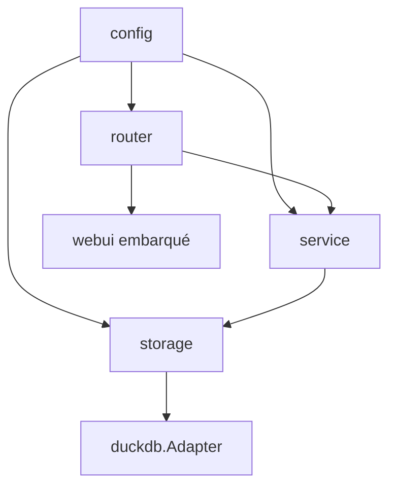

# GeoAPI — Spécification

Ce document décrit **l'état actuel** du serveur cartographique GeoAPI : son architecture, ses
contrats, ses invariants. Il est écrit pour être lu par un agent IA qui doit intervenir sur le code
sans l'avoir entièrement lu.

**Le code est la source de vérité.** Ce document en est la description ; s'il diverge, c'est ce
document qu'il faut corriger. Il ne contient volontairement pas de code : les signatures exactes se
lisent dans les fichiers cités, qui sont indiqués à chaque section.

Trois documents complètent celui-ci :
- `docs/audit-go.md` — état de santé du code Go, défauts connus, recommandations.
- `docs/plan-repository-metadata.md` — refonte prévue de la couche catalogue (`metadata`).
- `docs/plan-repository-data.md` — refonte jumelle des tables de données référencées par `metadata`.

---

## 0. Règles non négociables

Ces règles s'appliquent à tout le code produit pour ce projet. Elles sont référencées par leur
numéro dans ~90 commentaires du code (« règle 7 », « règle 21 »…) : **leur numérotation est stable
et ne doit jamais être réordonnée**.

1. **Jamais d'identifiant SQL non validé.** Tout nom de table/colonne interpolé dans une requête
   passe par `storage.ValidateIdentifier` **ou** `storage.QuoteIdentifier` (§4.3). Les valeurs sont
   toujours des paramètres liés, jamais interpolées.
2. **`tableId` (UUID) n'est jamais un identifiant SQL.** Chaque table logique a un `physicalName`
   généré côté serveur (`t_<uuid_sans_tirets>`), stocké dans `metadata`, résolu à chaque accès.
3. **Identifiants générés par `uuid()`** (fonction native DuckDB pour les `__pkey` créés en CTAS,
   `github.com/google/uuid` côté Go pour les insertions ligne à ligne). L'extension spatiale est
   chargée une fois à l'ouverture de la connexion, jamais par requête.
4. **Toute requête SQL fournie par l'utilisateur (`/derive`) est restreinte à `SELECT`**, validée
   par le parseur DuckDB lui-même (§8), et ne peut référencer que des tables déjà enregistrées.
5. **Tout filtre de lecture passe par le DSL validé `BuildFilter`** (§4.5) : colonne whitelistée
   contre le schéma réel, opérateur whitelisté, valeur liée. Jamais de chaîne concaténée depuis la
   requête HTTP.
6. **`BulkInsert` s'exécute dans une transaction unique.**
7. **La colonne géométrique n'est jamais retournée par les endpoints de lecture de rows.** Deux
   exceptions délibérées et nommées : l'export (`GetGeometryGeoJSON`) et OGC API - Features
   (`GetFeatures`, `GetFeaturesTile`), où la géométrie *est* la donnée demandée.
8. **Tout listing paginé trie explicitement**, avec une clé de départage déterministe (`__pkey`
   pour les rows, `tableId` pour le catalogue) toujours ajoutée en dernier. DuckDB ne garantit
   aucun ordre stable sans `ORDER BY`.
9. **`rowCount` et `bbox` sont dérivés, pas des faits stables.** Ils sont recalculés par
   `RefreshDerivedMetadata` après tout `InsertRow`/`BulkInsert`/`RemoveRows`, et après tout `Update`
   touchant **spécifiquement** la colonne géométrique. Un `Update` sur un champ scalaire ne
   déclenche rien. `geometryColumn` est au contraire une config stable, changée uniquement via
   `UpdateMetadata`.
10. **`geometryType` n'existe pas en tant que champ stocké.** Une colonne géo peut mélanger POINT et
    POLYGON ; le type se calcule à la demande via `GeometryTypes`, jamais mis en cache.
11. **Le cache de métadonnées est invalidé explicitement** à chaque écriture — jamais laissé
    expirer seul.
12. **Sortie JSON de l'API = types JSON natifs**, pas une reproduction des types Go du driver.
    Conversion explicite selon le `ColumnType` (`DATE` → `YYYY-MM-DD`, sinon RFC 3339).
13. **Une table dérivée ou importée est toujours matérialisée, jamais une vue SQL.** Le contrat CRUD
    l'exige : une vue devient read-only dès qu'elle filtre ou agrège.
14. **Pas de variable globale package-level pour l'état partagé.** Injection de dépendances dans les
    structs de service.
15. **Le chargement de données passe par des fichiers de `workDir`.** Un `name` provient
    exclusivement du dernier `Refresh`/`List` en cache — jamais une valeur construite librement
    depuis la requête, pour éliminer tout risque de traversée de répertoire.
16. **Le scope du projet est celui décrit ici.** Toute fonctionnalité hors périmètre se traite dans
    une demande dédiée, pas en ajout incident.
17. **Toute écriture ou modification d'une struct, interface, méthode ou handler s'accompagne de ses
    tests dans le même changement.**
18. **Tout paramètre ajustable sans recompiler vit dans `config`**, jamais en constante en dur dans
    storage/service/router (§2).
19. **Toute table géométrique reçoit un index spatial RTREE**, créé immédiatement après le
    chargement/derive, plus un index unique sur `__pkey`.
20. **Les tuiles MVT sont mises en cache**, clé incluant `UpdatedAt` de la table — une écriture
    invalide donc les tuiles sans mécanisme d'invalidation séparé.
21. **Toute écriture DuckDB passe par le verrou applicatif unique de l'adapter.** DuckDB n'autorise
    qu'un seul writer actif ; des écritures concurrentes non sérialisées échouent.
22. **Une écriture sur la colonne géométrique attend du WKT** et le convertit via
    `ST_GeomFromText`, jamais un bind direct. Elle déclenche `RefreshDerived` via le service, jamais
    depuis la couche storage.
23. **`context.Context` est le premier paramètre de toute méthode qui accède à DuckDB ou au disque**,
    reçu de `req.Context()` et propagé sans dérivation. Les méthodes purement mémoire
    (`SourceService.List`, `MaxUploadBytes`) n'en prennent pas.
24. **Chaque cache applicatif est un LRU borné avec expiration** (`hashicorp/golang-lru/v2/expirable`),
    jamais illimité, TTL et taille réglables par config.

---

## 1. Architecture



Quatre couches, sans court-circuit : un handler n'appelle jamais storage, un service ne construit
jamais d'identifiant SQL, storage ne connaît ni HTTP ni cache applicatif.

| Paquet | Rôle |
|---|---|
| `cmd/server` | point d'entrée : config, bootstrap, serveur HTTP, arrêt gracieux |
| `internal/config` | chargement YAML + surcharges d'environnement + validation |
| `internal/core` | câblage : construit les huit services et les caches à partir de la config |
| `internal/router` | routeur `chi`, middlewares, montage du SPA et de Swagger |
| `internal/router/handlers` | un handler par famille d'endpoints + les ports vers les services |
| `internal/router/validation` | résolution de `{tableId}`, validation des noms de colonnes |
| `internal/router/response` | écriture JSON, corps d'erreur standard, mapping erreur → statut |
| `internal/service` | logique applicative, caches, orchestration |
| `internal/storage` | contrats et primitives indépendants du moteur |
| `internal/storage/duckdb` | implémentation DuckDB |
| `internal/storage/storagetest` | suite de conformité réutilisable par tout adapter |
| `internal/storage/mocks` | mock testify de `storage.Storage` |
| `internal/webui` | `go:embed` du build de production du SPA Vue |

**Pattern d'interfaces.** Chaque consommateur déclare l'interface étroite dont il a besoin, dans son
propre paquet, avec une assertion de conformité (`var _ X = (*Y)(nil)`). Les handlers ne connaissent
jamais un type de service concret ; les services ne connaissent jamais l'adapter complet. Les
fichiers concernés : `router/handlers/ports.go`, `service/derive.go`, `service/import.go`,
`service/rows.go`, `service/export.go`, `service/source.go`, `core/core.go`.

**Bootstrap** (`core/core.go`) : `Setup` ouvre DuckDB, crée `workDir` si absent, construit les trois
caches LRU depuis la config, câble les huit services, puis fait un premier scan de `workDir`.
L'appelant doit différer `Close`. `NewServices` fait le câblage seul, sans connexion — c'est ce que
les tests utilisent avec un mock.

---

## 2. Configuration

Fichier `config.yaml` à la racine, **optionnel** (les défauts s'appliquent s'il est absent). Ordre
d'application : défauts → fichier → variables d'environnement `GEOAPI_*` → validation. Un fichier
malformé, une variable non parsable ou une valeur invalide sont des erreurs fatales au démarrage,
jamais ignorées silencieusement. La validation collecte **toutes** les violations avant d'échouer.

Fichier : `internal/config/config.go`.

### 2.1 `server`

| Champ | Défaut | Variable d'env | Contrainte |
|---|---|---|---|
| `port` | 8080 | `GEOAPI_SERVER_PORT` | 1..65535 |
| `readTimeoutSec` | 15 | `GEOAPI_SERVER_READ_TIMEOUT_SEC` | ≥ 0 |
| `writeTimeoutSec` | 30 | `GEOAPI_SERVER_WRITE_TIMEOUT_SEC` | ≥ 0 |
| `idleTimeoutSec` | 60 | `GEOAPI_SERVER_IDLE_TIMEOUT_SEC` | ≥ 0 |
| `shutdownTimeoutSec` | 10 | `GEOAPI_SERVER_SHUTDOWN_TIMEOUT_SEC` | ≥ 0 |

### 2.2 `duckdb`

| Champ | Défaut | Variable d'env |
|---|---|---|
| `path` | `./data/geo.db` | `GEOAPI_DUCKDB_PATH` |

Le répertoire parent est créé s'il n'existe pas — DuckDB refuse d'ouvrir un fichier dans un
répertoire absent.

### 2.3 `sources`

| Champ | Défaut | Variable d'env |
|---|---|---|
| `workDir` | `./data/sources` | `GEOAPI_SOURCES_WORKDIR` |
| `maxSizeBytes` | 104 857 600 (100 Mio) | `GEOAPI_SOURCES_MAX_SIZE_BYTES` |
| `allowedExtensions` | `.geojson`, `.shp`, `.csv`, `.gpkg` | `GEOAPI_SOURCES_ALLOWED_EXTENSIONS` (séparées par `,`) |

Chaque extension doit commencer par un point. `workDir` est aussi surchargeable par le flag
`--workdir`, qui a la priorité sur tout le reste (§2.6).

### 2.4 `api`

| Champ | Défaut | Rôle |
|---|---|---|
| `defaultRowLimit` | 100 | pagination des rows sans `limit` explicite |
| `maxRowLimit` | 1000 | plafond dur des rows |
| `defaultListLimit` | 50 | pagination de `/tables` et `/sources` |
| `maxListLimit` | 500 | plafond dur des listings |
| `maxBodyBytes` | 10 Mio | taille max du corps de requête (hors `/sources/upload`) |
| `requestTimeoutSec` | 30 | timeout par requête ; `0` désactive |
| `exportBatchSize` | 1000 | taille de page du streaming d'export |
| `defaultFeaturesLimit` | 100 | pagination OGC items et tuiles GeoJSON |
| `maxSimplifyTolerance` | 10000 | plafond du paramètre `simplify` |
| `maxPrecision` | 1000 | plafond du paramètre `precision` |

Variables d'environnement correspondantes : `GEOAPI_API_<CHAMP_EN_SNAKE_MAJUSCULE>`.

### 2.5 `cache`

Trois caches indépendants, tous LRU bornés avec TTL (règle 24).

| Champ | Défaut | Cache concerné |
|---|---|---|
| `metadataTTLSec` / `metadataMaxItems` | 300 / 1000 | métadonnées de table (`MetadataService`) |
| `schemaTTLSec` / `schemaMaxItems` | 300 / 1000 | schéma de colonnes (`SchemaService`) |
| `tileTTLSec` / `tileMaxItems` | 300 / 5000 | tuiles MVT rendues (`GeoService`) |

### 2.6 Flags de ligne de commande

| Flag | Défaut | Effet |
|---|---|---|
| `--config` | `config.yaml` | chemin du fichier de configuration |
| `--workdir` | vide | surcharge `sources.workDir` après chargement complet |

---

## 3. Sources (`workDir`)

`workDir` est un répertoire de fichiers déposés à la main ou uploadés. `SourceService`
(`internal/service/source.go`) le scanne et maintient un **cache en mémoire** de son contenu.

### 3.1 Modèle

Une `Source` porte : nom de fichier, extension, taille, date de modification, état chargé, `tableId`
si chargée, et pour un format multi-couches la liste de ses couches (chacune avec son propre état
chargé et son `tableId`).

Formats reconnus (`internal/service/formats.go`) :

| Extension | Multi-couches |
|---|---|
| `.geojson` | non |
| `.shp` | non |
| `.csv` | non |
| `.gpkg` | oui |

Un fichier dont l'extension n'est pas dans `allowedExtensions`, ou dont la taille dépasse
`maxSizeBytes`, est **silencieusement exclu** du scan — ce n'est pas une erreur.

### 3.2 Opérations

| Opération | Comportement |
|---|---|
| `Refresh` | rescanne `workDir`, recroise avec les tables déjà chargées, remplace le cache. Appelée au démarrage et via `POST /sources/refresh`. |
| `List` | pagine et trie une **copie** du cache, sans jamais retoucher le disque. Tri validé contre une allowlist (`name`, `sizeBytes`, `modTime`, `loaded`). |
| `Upload` | écrit dans `workDir` après réduction du nom à sa base (anti-traversée), vérification d'extension et de taille. Refuse d'écraser un fichier existant. |
| `Load` | importe une source (ou une de ses couches) en table. `name` doit exister dans le cache (règle 15). |
| `DetectCRS` | lit le CRS déclaré par le fichier, sans rien importer — permet à l'UI de le montrer et de le corriger avant chargement. |
| `Delete` | supprime la ou les tables issues de la source et son entrée de cache. **Le fichier lui-même n'est jamais supprimé.** |

**Verrouillage.** `Load` détient le verrou pendant tout son check-then-import, pas seulement autour
de la lecture du cache : deux `Load` concurrents sur la même source ne peuvent pas passer tous les
deux le test « pas encore chargée ». `Delete` ne retire l'entrée du cache qu'après succès de toutes
les suppressions de tables, pour qu'un échec partiel laisse la source visible et réessayable
(NEW-BUG-6).

**Suivi chargé/non chargé.** Le lien source ↔ table repose sur les champs `sourceName` et
`sourceLayer` de `metadata`, **jamais** sur `tableName` — que `PATCH /tables/{id}` peut renommer
librement. Renommer une table ne la détache donc pas de sa source, et aucune table sans relation ne
peut se faire passer pour une source par coïncidence de nom (NEW-BUG-5).

**Nommage multi-couches.** Une couche chargée depuis `fichier.gpkg` produit une table nommée
`fichier.gpkg::nom_couche` ; `sourceName` reçoit `fichier.gpkg` et `sourceLayer` reçoit
`nom_couche`.

---

## 4. Couche storage

### 4.1 Le catalogue `metadata`

Une table système, un enregistrement par table logique. Colonnes :

| Colonne | Type SQL | Nature | Sens |
|---|---|---|---|
| `tableId` | `TEXT PRIMARY KEY` | config | UUID v4, identifiant logique/API |
| `physicalName` | `TEXT NOT NULL UNIQUE` | config | nom réel de la table SQL (`t_<uuid>`) |
| `tableName` | `TEXT NOT NULL` | config | nom d'affichage, renommable |
| `isGeo` | `BOOLEAN` | config | la table a une colonne géométrique |
| `createdAt` / `updatedAt` | `TIMESTAMP` | dérivé (`updatedAt`) | `updatedAt` est bumpé par chaque refresh dérivé — c'est le signal d'invalidation des tuiles (règle 20) |
| `geometryColumn` | `TEXT` | config | nom de la colonne géométrique, variable selon le format source |
| `rowCount` | `INTEGER` | dérivé | recalculé par `RefreshDerivedMetadata` (règle 9) |
| `bbox` | `TEXT` | dérivé | `"minX,minY,maxX,maxY"` en **OGC:CRS84** (lon/lat) |
| `srid` | `INTEGER` | config | CRS **source** d'origine, avant reprojection |
| `sourceName` | `TEXT` | config | fichier de `workDir` d'origine ; vide pour une table `/derive` |
| `sourceLayer` | `TEXT` | config | couche d'origine pour une source multi-couches |

Deux index : sur `isGeo` et sur `tableName`.

`Metadata` est un **type valeur** côté Go : chaque appelant en reçoit sa copie, aucune synchronisation
n'est nécessaire.

`geometryType` est délibérément absent (règle 10).

> **Dette connue.** `sourceName` et `sourceLayer` ont été ajoutés au DDL sans entrée de migration :
> une base créée avant leur existence ne s'ouvre plus. `rowCount` est un `INTEGER` 32 bits pour un
> `int64` Go. Les deux sont traités par `docs/plan-repository-metadata.md`, étape 2.

### 4.2 Tables de données et contrat d'accès

Chaque table logique est matérialisée en `t_<uuid_sans_tirets>` avec une colonne `__pkey` (UUID
texte) générée dans le `CREATE TABLE AS SELECT`, jamais ajoutée après coup. Un index unique sur
`__pkey` remplace la contrainte de clé primaire, que DuckDB ne permet pas d'ajouter après CTAS.

Pour une table géo : un index RTREE sur la colonne géométrique (règle 19), et un **clustering
Hilbert** — les lignes sont physiquement réordonnées le long d'une courbe de Hilbert sur la
géométrie, pour que les scans de tuiles élaguent par localité spatiale. Le clustering reconstruit la
table, donc les deux index sont créés **après** lui, jamais avant.

**Contrat d'accès (référencé « §4.2 » dans le code).** Toute méthode storage de lecture/écriture de
données prend la `storage.Metadata` **déjà résolue** par l'appelant, jamais un `tableId`. Le
middleware de résolution du routeur la lit une fois par requête ; `ExportService` la garde pour tout
un export. Aucune méthode ne refait un `SELECT` sur `metadata` que l'appelant a déjà fait. Corollaire
appliqué à l'export : `ListRowsPage` existe à côté de `ListRows` précisément pour éviter un
`COUNT(*)` par page dont le streaming n'a aucun usage.

### 4.3 Validation des identifiants

Deux primitives aux rôles **distincts et non interchangeables** (`internal/storage/identifier.go`) :

| Primitive | Usage | Mécanique |
|---|---|---|
| `ValidateIdentifier` | identifiants **générés côté serveur** : `physicalName`, mots-clés de type DuckDB | rejet par motif alphanumérique strict (`^[a-zA-Z_][a-zA-Z0-9_]*$`) |
| `QuoteIdentifier` | tout nom de colonne pouvant **provenir de données importées** (accents, espaces, ponctuation d'un CSV français) | guillemetage, doublement des `"` internes, rejet du seul octet réellement dangereux dans un identifiant guillemeté : NUL |

Utiliser `ValidateIdentifier` sur un nom de colonne importé casse les fichiers réels ; utiliser
`QuoteIdentifier` sur un `physicalName` fonctionne mais masque une erreur de conception. Dans les
deux cas, **la sécurité vient de la validation avant interpolation, pas du jeu de caractères
autorisé**.

### 4.4 Contrats Go

Fichiers : `internal/storage/metadata.go`, `feature.go`, `geoquery.go`, `sort.go`, `aggregate.go`.

| Interface | Responsabilité |
|---|---|
| `MetadataReader` | `TableIds` (trié), `TableExists`, `GetMetadata` |
| `MetadataWriter` | `Create`, `Remove`, `UpdateMetadata`, `RefreshDerivedMetadata` |
| `TableReader` | `Columns`, `ColumnType`, `RowsCount`, `GetPkeys`, `GetRowsByPkey`, `GetRowsWithFilter`, `GetDistinctValues` |
| `TableWriter` | `AddColumn`, `Update`, `RemoveRows`, `InsertRow`, `BulkInsert` |
| `GeoTableManager` | `Tile`, `FilterByBbox`, `FilteredExtent`, `GeometryTypes`, `GetGeometryGeoJSON`, `GetFeatures`, `GetFeaturesTile` |
| `TableCreator` | `CreateFromFile`, `CreateFromQuery`, `ListLayers`, `DetectCRS` |
| `SQLWrapper` | `Query`, `QueryRow`, `Exec`, `Begin` — détail d'implémentation du paquet `duckdb`, **délibérément absent** de l'agrégat `Storage` pour qu'aucun service ne puisse contourner la règle 1 |

`Storage` agrège les quatre premiers groupes. Elle sert à **documenter et asserter** qu'un adapter
est complet ; aucun service n'en dépend — chacun déclare son interface étroite.

**Nommage.** `MetadataWriter.Remove` supprime une table entière, `TableWriter.RemoveRows` supprime
des lignes. Go ne permet pas deux méthodes homonymes de signatures différentes sur une interface
combinée, d'où la distinction.

**Types de données transverses.** `Row` (pkey + valeurs, sans géométrie), `GeoFeature` (pkey +
fragment GeoJSON brut + valeurs), `GeoQuery` (clause `BuildFilter` + args + tolérance de
simplification + précision, tous optionnels), `SortField` (colonne + sens, parsé depuis une valeur
`sort=a,-b`).

### 4.5 Construction des filtres

`storage.BuildFilter` (`internal/storage/filter.go`) est **le seul** chemin autorisé vers un `WHERE`
piloté par le client (règle 5).

Une `FilterCondition` est soit une feuille (`Column` + `Operator` + `Value`), soit un groupe booléen
(`Bool` valant `AND` ou `OR`, plus `Conditions` enfants) — jamais les deux.

- La colonne est validée contre la liste des colonnes réelles de la table, **géométrie exclue**.
- L'opérateur est validé contre `=`, `!=`, `>`, `<`, `>=`, `<=`, `LIKE`.
- Le connecteur booléen est validé contre `AND`, `OR`.
- La valeur est **toujours** un paramètre lié.
- Les conditions de premier niveau sont jointes par `AND` ; les groupes sont parenthésés.

Le whitelisting contre le schéma réel est ce qui rend l'interpolation sûre ; `QuoteIdentifier` ne
fait qu'échapper.

### 4.6 L'adapter DuckDB

Fichiers : `internal/storage/duckdb/` (`adapter.go`, `table.go`, `create.go`, `derive.go`, `mvt.go`,
`features.go`, `migrations.go`).

- **Ouverture** : `INSTALL spatial; LOAD spatial;` une fois, pool limité à 4 connexions, création du
  répertoire parent, puis migration du schéma.
- **Sérialisation des écritures** : un mutex applicatif unique couvre `Exec` (règle 21).
  `BulkInsert` le prend lui-même pour toute la durée de sa transaction, plutôt que par instruction.
- **Migrations** : une liste ordonnée d'instructions `ALTER`, appliquées une fois chacune, suivies
  par une table `schema_version`. Une base neuve reçoit directement le DDL courant et est marquée à
  la version la plus haute ; une base préexistante est marquée à 0 et rejoue tout. **La liste est
  actuellement vide** (voir §4.1, dette connue).
- **Reprojection** : la géométrie est reprojetée **une fois à l'import** vers EPSG:3857, jamais par
  requête. Toute sortie lon/lat (bbox, GeoJSON) reconvertit vers `OGC:CRS84`.

> **`OGC:CRS84`, jamais `EPSG:4326`.** L'ordre d'axes officiel d'EPSG:4326 est (lat, lon) : l'utiliser
> comme CRS cible inverse silencieusement X et Y. Cette règle s'applique aux quatre endroits qui
> transforment : calcul de `bbox`, `FilteredExtent`, `GetGeometryGeoJSON`, `GetFeatures`.

---

## 5. Couche service

Huit services, chacun propriétaire exclusif de son état. Fichiers : `internal/service/`.

### 5.1 `MetadataService` — propriétaire unique du cache de métadonnées

Tout autre service passe par lui pour lire ou écrire des métadonnées, via un port étroit ; personne
ne cache indépendamment (règle 11). Le cache est un LRU borné avec TTL.

Il invalide l'entrée concernée après **chaque** écriture : `UpdateMetadata`, `RefreshDerived`,
`RemoveTable`, `Rollback`.

- `ListTables` pagine sur l'ordre déterministe de `TableIds` et renvoie aussi le total.
- `Rollback` supprime la ligne de métadonnées (et, via `Remove`, la table physique éventuellement à
  moitié matérialisée) après un échec en cours de création, et renvoie la cause d'origine enrichie.
  C'est ce qui garantit qu'aucune ligne de catalogue ne survit sans table physique.
- `LoadedSourceNames` construit la table de correspondance source → `tableId` utilisée par
  `SourceService.Refresh`, clé sur `sourceName`(`::sourceLayer`).

### 5.2 `RowService` — CRUD de lignes, typé

Convertit chaque valeur en type JSON natif selon son `ColumnType` (règle 12), en s'appuyant sur le
cache de `SchemaService` pour ne pas redemander les types ligne par ligne.

`UpdateRow` écrit toutes les colonnes en **une** instruction : un update multi-colonnes est atomique,
tout passe ou rien (§5.1 du point de vue du code appelant). Il déclenche `RefreshDerived`
**uniquement** si la mise à jour touche la colonne géométrique (règle 9) ; un update scalaire ne
recalcule ni `bbox` ni `updatedAt`, et n'invalide donc pas les tuiles.

`InsertRow`, `BulkInsertRows` et `RemoveRows` déclenchent systématiquement `RefreshDerived`
(le nombre de lignes change).

### 5.3 `SchemaService` — structure, pas donnée

Propriétaire de son cache de schéma. Expose le schéma complet (**géométrie incluse** : c'est de la
structure, la règle 7 ne s'applique pas) et la table nom → type. `AddColumn` est la seule écriture
qui change la structure et invalide donc le cache ; l'ajout de colonne n'affecte aucun champ dérivé,
donc ce service n'a pas besoin de `MetadataService`.

### 5.4 `DeriveService` et `ImportService` — créer une table, avec rollback

Même séquence dans les deux cas :

1. Créer la ligne de catalogue (obtenir `tableId` et `physicalName`).
2. Matérialiser la table physique (CTAS depuis un fichier ou depuis une requête).
3. Persister la colonne géométrique / le SRID / la source résolus via `UpdateMetadata`.
4. `RefreshDerived`.

Tout échec après l'étape 1 passe par `Rollback`. `ImportService` porte en plus l'attribution de
`sourceName`/`sourceLayer` (§3.2) et le passage de la couche et du SRID explicite.

`DeriveService` applique un fail-fast bon marché sur la forme de la requête (un seul énoncé,
commençant par `SELECT`) — **ce n'est pas le contrôle qui fait autorité** : la validation réelle est
faite par le parseur DuckDB côté storage (§8).

### 5.5 `GeoService` — cache de tuiles

Seul service à cacher un résultat de rendu. La clé de cache inclut : `tableId`, z/x/y, `UpdatedAt`
(règle 20), les attributs demandés (triés), et la clause de filtre avec ses arguments — puisque tous
changent le contenu de la tuile pour une même version de table.

Tout le reste est calculé à la demande et **jamais caché** : `GetFeatures`, `GetFeaturesTile`,
`FilteredExtent`, `GeometryTypes`. Raison : filtre, bbox, tolérance et attributs forment un espace de
clés non borné, contrairement au z/x/y d'une tuile.

### 5.6 `ExportService` — l'export est du domaine, pas du transport

Le routeur ne fait que valider le format, poser les en-têtes, et laisser le service écrire
directement dans le corps de la réponse.

- Les lignes sont lues **page par page** (`exportBatchSize`), jamais toutes en mémoire (PERF-2).
- Le format est validé **avant** le premier octet écrit : une fois le streaming commencé, le code de
  statut ne peut plus changer.
- CSV : en-tête `pkey` + colonnes du schéma (géométrie exclue), écrit avant toute lecture de ligne.
- GeoJSON : `FeatureCollection` assemblée en flux ; refusé sur une table non géo. Une géométrie NULL
  produit le littéral JSON `null`, jamais une chaîne vide (NEW-BUG-2).

### 5.7 `SourceService`

Voir §3.

---

## 6. API REST

Préfixe `/api/v1` pour toute l'API métier. Hors préfixe : `/healthz`, `/readyz`, `/swagger/*`,
`/ui/*`, et `/` qui redirige vers `/ui/`.

### 6.1 Endpoints

**Ops**

| Méthode | Chemin | Description |
|---|---|---|
| GET | `/healthz` | liveness — le processus répond, indépendamment de l'état du stockage |
| GET | `/readyz` | readiness — ping de la connexion DuckDB ; `503` si injoignable |

**Sources**

| Méthode | Chemin | Description |
|---|---|---|
| GET | `/api/v1/sources` | liste paginée et triable du cache (`offset`, `limit`, `sort`) |
| POST | `/api/v1/sources/refresh` | rescanne `workDir` puis renvoie la même enveloppe paginée |
| POST | `/api/v1/sources/upload` | multipart, champ `file` ; écrit dans `workDir` **puis charge immédiatement** en table. `?srid=` optionnel. Une source multi-couches est renvoyée telle quelle sans chargement (le choix de couche revient à l'appelant) |
| POST | `/api/v1/sources/{name}/load` | charge une source en table. `?layer=` requis pour un `.gpkg`, rejeté sinon. `?srid=` fixe le CRS source explicitement |
| GET | `/api/v1/sources/{name}/metadata` | CRS détecté du fichier, sans import. `srid` vaut `null` si indétectable |
| DELETE | `/api/v1/sources/{name}` | supprime la ou les tables issues de la source ; **ne supprime pas le fichier** |

**Tables**

| Méthode | Chemin | Description |
|---|---|---|
| GET | `/api/v1/tables` | liste paginée et triable des métadonnées |
| GET | `/api/v1/tables/{tableId}` | métadonnées d'une table |
| PATCH | `/api/v1/tables/{tableId}` | renommage (`tableName` uniquement) |
| DELETE | `/api/v1/tables/{tableId}` | supprime la table et ses données |
| GET | `/api/v1/tables/{tableId}/schema` | colonnes et types, géométrie incluse |
| POST | `/api/v1/tables/{tableId}/columns` | ajoute une colonne |
| GET | `/api/v1/tables/{tableId}/columns/{col}/distinct` | valeurs distinctes d'une colonne non géométrique |
| POST | `/api/v1/tables/{tableId}/derive` | crée une nouvelle table depuis une requête `SELECT` |
| POST | `/api/v1/tables/{tableId}/filter` | filtre par conditions (`BuildFilter`) |
| GET | `/api/v1/tables/{tableId}/export` | export streamé, `?format=csv\|geojson` |

**Rows**

| Méthode | Chemin | Description |
|---|---|---|
| GET | `/api/v1/tables/{tableId}/rows` | liste paginée (`offset`, `limit`, `sort` validé contre le schéma) |
| POST | `/api/v1/tables/{tableId}/rows` | insère une ou plusieurs lignes (une seule → insert simple, plusieurs → transaction) |
| POST | `/api/v1/tables/{tableId}/rows/batch` | récupère plusieurs lignes par pkeys |
| GET | `/api/v1/tables/{tableId}/rows/{pkey}` | une ligne |
| PATCH | `/api/v1/tables/{tableId}/rows/{pkey}` | met à jour une ligne, renvoie l'état résultant |
| DELETE | `/api/v1/tables/{tableId}/rows/{pkey}` | supprime une ligne |

**Géo**

| Méthode | Chemin | Description |
|---|---|---|
| GET | `/api/v1/tables/{tableId}/tiles/{z}/{x}/{y}` | tuile MVT. `?attrs=` embarque des colonnes non géométriques ; `?filter=` restreint les lignes. `simplify`/`precision` sont ignorés (une tuile simplifie à sa propre résolution de zoom) |
| GET | `/api/v1/tables/{tableId}/tiles/{z}/{x}/{y}/features` | **mêmes** limites de tuile, en `FeatureCollection` GeoJSON — un client peut découper son chargement GeoJSON sur la grille MVT sans refaire le calcul d'emprise |
| GET | `/api/v1/tables/{tableId}/geometry-types` | types de géométrie distincts présents |
| POST | `/api/v1/tables/{tableId}/bbox` | pkeys des lignes intersectant une emprise |
| GET | `/api/v1/tables/{tableId}/filtered-extent` | emprise des lignes correspondant à un filtre, pour recentrer une carte |

**OGC API - Features**

| Méthode | Chemin | Description |
|---|---|---|
| GET | `/api/v1/ogc/` | landing page (liens self / conformance / data) |
| GET | `/api/v1/ogc/conformance` | classes déclarées : Core + GeoJSON |
| GET | `/api/v1/ogc/collections` | une collection par table géo |
| GET | `/api/v1/ogc/collections/{tableId}` | description d'une collection |
| GET | `/api/v1/ogc/collections/{tableId}/items` | `FeatureCollection`, paramètres `bbox`, `filter`, `simplify`, `precision`, `limit`, `offset` |
| GET | `/api/v1/ogc/collections/{tableId}/items/{featureId}` | une `Feature`, résolution pleine |

### 6.2 OGC API - Features

C'est OGC API - Features (le successeur JSON/REST de WFS), pas le WFS 2.0.0 XML/GML historique —
cohérent avec le style tout-JSON du reste de l'API.

- `collectionId` **est** `tableId` : déjà un identifiant serveur opaque et stable, exactement ce que
  le standard demande.
- Une table non géo renvoie `404` sur toute route `/ogc/collections/{tableId}/...`.
- Conformance déclarée : Core + GeoJSON uniquement. Ni `oas30`, ni CQL2.
- `filter`, `simplify` et `precision` sont des **extensions** au-delà de Core : CQL2 complet ne
  correspond pas au modèle colonne/opérateur whitelisté qu'impose la règle 5.
- `datetime` n'est pas supporté : le modèle n'a aucune notion de colonne temporelle.
- Le lien `next` n'est émis que si la page renvoyée est pleine — seul signal de « il y a peut-être
  plus » disponible sans requête de comptage séparée.

> **Écart connu.** `numberMatched` renvoie le nombre d'entités **de la page**, pas le total
> correspondant à la requête. Voir `docs/audit-go.md` §3.5.

### 6.3 Routeur et middlewares

Fichier : `internal/router/routes.go`.

Chaîne globale, dans l'ordre : `RequestID` → journalisation structurée `slog` → `Recoverer` →
plafond de corps de requête.

- **Plafond de corps** : rejette immédiatement en `413` si `Content-Length` dépasse la limite,
  **avant** de lire un seul octet. Nécessaire car un dépassement détecté en cours de flux force Go à
  fermer la connexion avec des octets non lus, ce que le client voit comme une coupure brutale sans
  statut HTTP. La route `/sources/upload` reçoit un plafond dédié (taille max de source + 64 Kio de
  marge pour l'encadrement multipart).
- **Timeout par requête** : appliqué au **groupe** `/api/v1` seulement, et seulement si
  `requestTimeoutSec > 0`.
- **`/tables/{tableId}/export` est enregistrée hors de ce groupe** : un export volumineux dépasse
  légitimement le budget d'une requête normale, et le timeout tronquerait une réponse déjà passée en
  `200`. Le handler neutralise en plus `WriteTimeout` du serveur juste avant de streamer, pour la
  même raison (NEW-BUG-7).

**Résolution de table.** `TableResolver` (`router/validation/resolver.go`) résout `{tableId}` une
fois par requête, servi par le cache dans le cas courant, et écrit un `404` si la table n'existe pas.
Tous les handlers d'une table l'embarquent.

**Validation des colonnes.** `ColumnValidator` (`router/validation/columns.go`) vérifie tout nom de
colonne fourni par le client contre le schéma réel, **géométrie exclue** (règle 7 : ne jamais
exposer la géométrie par un chemin générique). Utilisé par `/filter`, `/distinct`, le `sort` des
rows, et les `attrs` de tuile.

### 6.4 Erreurs

Corps d'erreur unique : `{"error", "message", "code"}` (`router/response/response.go`).

**Un 5xx ne renvoie jamais le message d'origine** — il est journalisé côté serveur avec l'identifiant
de requête, et le client reçoit le texte standard du statut. Une erreur DuckDB peut contenir un
`physicalName` ou des détails internes. Les 4xx, causés par la requête de l'appelant, transmettent
le message.

`MapServiceError` fait le mapping par type d'erreur, avec **500 par défaut** : une erreur non
classifiée est un problème interne, jamais une faute du client (NEW-SEC-1).

| Type d'erreur | Statut |
|---|---|
| `service.ValidationError` | 400 |
| `service.ExportValidationError` | 400 |
| `storage.InvalidSortError` | 400 |
| `service.NotFoundError` | 404 |
| `service.ConflictError` | 409 |
| tout le reste | 500 |

### 6.5 Cache HTTP des tuiles

En complément du cache applicatif (règle 20), `GET /tiles/{z}/{x}/{y}` émet un `ETag` dérivé de
`UpdatedAt`, des attributs et du filtre, plus un `Cache-Control: public, max-age=60` court — rien
n'invalide la copie d'un CDN entre-temps. Un `If-None-Match` correspondant renvoie `304` sans
toucher au stockage (HTTP-2).

### 6.6 Documentation Swagger

Générée par `swag init` depuis les annotations des handlers (`mise run docs`). `docs/docs.go`,
`docs/swagger.json` et `docs/swagger.yaml` sont **générés** : ne jamais les éditer à la main. Servie
sous `/swagger/`.

### 6.7 Sécurité — état actuel

**Il n'y a ni authentification, ni autorisation, ni CORS, ni limitation de débit.** Toutes les routes
d'écriture (`POST /rows`, `DELETE /tables/{id}`, `POST /derive`, `POST /sources/upload`,
`DELETE /sources/{name}`) sont ouvertes. C'est cohérent avec le périmètre (règle 16) : le serveur est
conçu pour un déploiement en réseau de confiance ou derrière un reverse-proxy qui porte ces
fonctions. **Ce n'est pas un oubli, c'est une décision** — mais elle interdit une exposition directe
sur Internet.

Les protections en place sont : plafond de corps de requête, plafonds de pagination, timeout par
requête, whitelisting systématique des identifiants et des colonnes, restriction de `/derive` aux
tables enregistrées, et confinement des chemins de fichiers au cache de `workDir`.

---

## 7. Chargement d'un fichier

Séquence de `CreateFromFile` (`storage/duckdb/create.go`), déclenchée par
`POST /sources/{name}/load` ou `/sources/upload` :

1. **CTAS depuis `ST_Read`** avec génération de `__pkey` dans la projection. `ST_Read` ne fait que
   lire : la table résultante est matérialisée (règle 13), jamais une vue.
2. **Index unique sur `__pkey`.**
3. **Détection de la colonne géométrique** par introspection du schéma résultant. Le nom varie selon
   le format (`geom`, `wkb_geometry`…), il n'est jamais supposé fixe. **Une table à plusieurs
   colonnes géométriques est rejetée** : tout le reste du domaine suppose une géométrie unique, et
   en choisir une silencieusement ne serait juste qu'à moitié (GEO-2). Sans colonne géométrique, la
   table est non géo et la séquence s'arrête ici.
4. **Résolution du CRS source** : `srid` explicite s'il est fourni, sinon détection depuis les
   métadonnées du fichier. **Si aucun des deux n'aboutit, le chargement échoue** plutôt que de
   deviner (GEO-1) — l'appelant doit rappeler avec un `srid` explicite.
5. **Reprojection vers EPSG:3857**, une fois, en base. La chaîne de CRS source est un **paramètre
   lié**, pas une interpolation : elle peut provenir des métadonnées d'un fichier, qui ne sont pas
   du contenu de confiance.
6. **Clustering Hilbert** sur la géométrie. Il reconstruit la table, donc détruit les index — d'où
   l'ordre. Une table sans géométrie non NULL est laissée telle quelle (pas d'emprise de référence).
7. **Recréation de l'index `__pkey` + création de l'index RTREE** (règle 19).

### 7.1 Sources multi-couches

Un `.gpkg` n'est **jamais** chargé en bloc. `ListLayers` énumère ses couches, chacune se charge
indépendamment dans sa propre table, et son état chargé est suivi individuellement (§3.2).

---

## 8. Dérivation de tables

`POST /tables/{tableId}/derive` matérialise une nouvelle table depuis une requête `SELECT` fournie
par l'appelant. La table dérivée est un **instantané figé** : aucune synchronisation avec sa source,
dans aucun sens.

**Validation en deux temps :**

1. Côté service, un fail-fast : un seul énoncé, commençant par `SELECT`.
2. Côté storage, la validation qui fait autorité : la requête est parsée **par DuckDB lui-même**
   (sérialisation de l'AST), puis l'arbre est parcouru pour rejeter (règle 4) :
   - **toute fonction de table** — c'est ce qui bloque `read_csv`, `read_text`, `duckdb_settings` et
     tout autre lecteur de fichiers ou d'état système ;
   - **toute table de base** qui n'est pas un `physicalName` enregistré dans `metadata` ;
   - **tout énoncé non-`SELECT`**, que le sérialiseur rejette de lui-même.
   Les noms introduits par des CTE (`WITH x AS …`) sont collectés au préalable et autorisés.

Une blacklist de mots-clés ne pourrait jamais énumérer toutes les fonctions de table de DuckDB : la
validation par AST est le seul contrôle fiable, et le regex ne doit jamais être considéré comme
suffisant.

**Génération de `__pkey`.** La requête de l'appelant est **enveloppée** : un `__pkey` neuf est
toujours généré, exactement comme à l'import. La requête est donc libre de projeter ce qu'elle veut —
projection partielle, `GROUP BY`, jointure — sans rien savoir de `__pkey`. Si elle en projette déjà
un (typiquement un `SELECT *` sur une table déjà importée), il est exclu de l'enveloppe plutôt que
d'entrer en collision (NEW-BUG-3).

Le reste de la séquence (détection géométrie, clustering, index) est identique à §7, étapes 3, 6, 7.

---

## 9. Structure du projet

```
cmd/server/            point d'entrée
internal/
  config/              chargement et validation de la configuration
  core/                câblage services + caches, bootstrap
  router/
    handlers/          un fichier par famille d'endpoints + ports.go + dto.go
    validation/        résolution de table, validation de colonnes
    response/          JSON, erreurs, mapping statut
    routes.go          montage chi, middlewares
    webui.go           service du SPA avec repli history-mode
  service/             un fichier par service + errors.go + formats.go
  storage/
    duckdb/            adapter, création, données, MVT, features, migrations
    storagetest/       suite de conformité réutilisable
    mocks/             mock testify de storage.Storage
    *.go               contrats et primitives indépendants du moteur
  webui/               go:embed du build de production
web/                   application Vue 3 (build vers internal/webui/dist)
docs/                  cette spec, l'audit, le plan, et le Swagger généré
```

Les structs de domaine restent dans leur paquet propriétaire : `Metadata`/`Row`/`GeoFeature` dans
`storage`, `Source`/`ColumnSchema`/`RowsPage` dans `service`, les DTO dans `handlers`,
`ErrorResponse` dans `response`.

---

## 10. Tests

Fichiers de test à côté du code testé, dans le même paquet.

| Niveau | Approche |
|---|---|
| `config` | chargement avec/sans fichier, surcharges d'environnement, cas invalides |
| `storage` | tests unitaires des primitives (`BuildFilter`, identifiants, tri) |
| `storage/duckdb` | tests d'intégration sur une **vraie** base DuckDB temporaire — le moteur n'est jamais mocké |
| `storagetest` | suite de conformité comportementale, exécutable contre tout adapter ; branchée sur DuckDB par `conformance_test.go`. Elle ne crée ses tables que par `CreateFromFile`, jamais par DDL propre à un backend |
| `service` | mocks testify des ports, aucun accès disque ni base |
| `router/handlers` | `httptest` + doubles légers des ports déclarés dans `ports.go` |
| `router` | câblage des routes et middlewares |

Règle 17 : une struct, méthode ou handler livré sans son test n'est pas terminé.

Commandes : `mise run test`, `mise run test-race`, `mise run lint`.

---

## 11. Glossaire des références du code

Les commentaires du code renvoient à des identifiants issus d'audits successifs. Les documents
d'origine (`docs/audit.md`, `docs/audit2.md`) ne sont plus dans le dépôt ; voici ce que chaque tag
désigne, pour que ces commentaires restent lisibles.

| Tag | Sujet |
|---|---|
| `règle N` | règle non négociable N de la §0 de ce document |
| `§4.1`, `§4.2`, `§4.4`, `§5`, `§5.1` | sections de ce document (numérotation préservée à cet effet) |
| `GEO-1` | le CRS source doit être détecté ou fourni explicitement — jamais deviné ; d'où `?srid=` et `/sources/{name}/metadata` |
| `GEO-2` | une table à plusieurs colonnes géométriques est rejetée à l'import |
| `GEO-3` | les attributs embarqués dans une tuile (`?attrs=`) et la simplification à la résolution du zoom |
| `PERF-1` | cache de schéma de colonnes, pour éviter une requête de type par colonne |
| `PERF-2` | export streamé par lots bornés au lieu de tout charger en mémoire |
| `PERF-4` | propagation de `context.Context` jusqu'aux appels `database/sql` |
| `PERF-5` | tous les caches sont des LRU bornés avec expiration |
| `HTTP-2` | `ETag`/`Cache-Control` sur les tuiles, dérivés de `UpdatedAt` |
| `NEW-SEC-1` | mapping erreur → statut par type, avec 500 par défaut ; pas de fuite de message en 5xx |
| `NEW-BUG-2` | une géométrie NULL exportée doit produire le littéral JSON `null` |
| `NEW-BUG-3` | `/derive` génère toujours un `__pkey` neuf et exclut celui que la requête projette |
| `NEW-BUG-4` | une `limit` absente ou nulle sur `/filter` retombe sur le défaut, pas sur `LIMIT 0` |
| `NEW-BUG-5` | le lien source ↔ table repose sur `sourceName`/`sourceLayer`, jamais sur `tableName` |
| `NEW-BUG-6` | `SourceService.Delete` ne retire l'entrée de cache qu'après succès complet |
| `NEW-BUG-7` | l'export échappe au timeout de requête **et** au `WriteTimeout` du serveur |

---

## 12. Écarts connus entre ce document et le code

Recensés par `docs/audit-go.md` ; listés ici pour qu'ils ne soient pas lus comme des contrats.

| Sujet | État |
|---|---|
| `numberMatched` OGC | renvoie le compte de la page, pas le total (audit §3.5) |
| CRS de `POST /tables/{id}/bbox` | attend de l'EPSG:3857, alors que tous les autres bbox sont en OGC:CRS84 (audit §3.6) |
| Migrations | la liste est vide alors que le schéma a évolué ; une base antérieure à `sourceName` ne s'ouvre pas (audit §4.1) |
| `ColumnType` | une requête `DESCRIBE` par colonne, contrairement à ce que le commentaire du service annonce (audit §3.1) |
| `TableExists` | présent dans le contrat, sans appelant en production (audit §4.3) |
| `GetDistinctValues`, `FilterByBbox` | lectures sans plafond (audit §3.9) |
