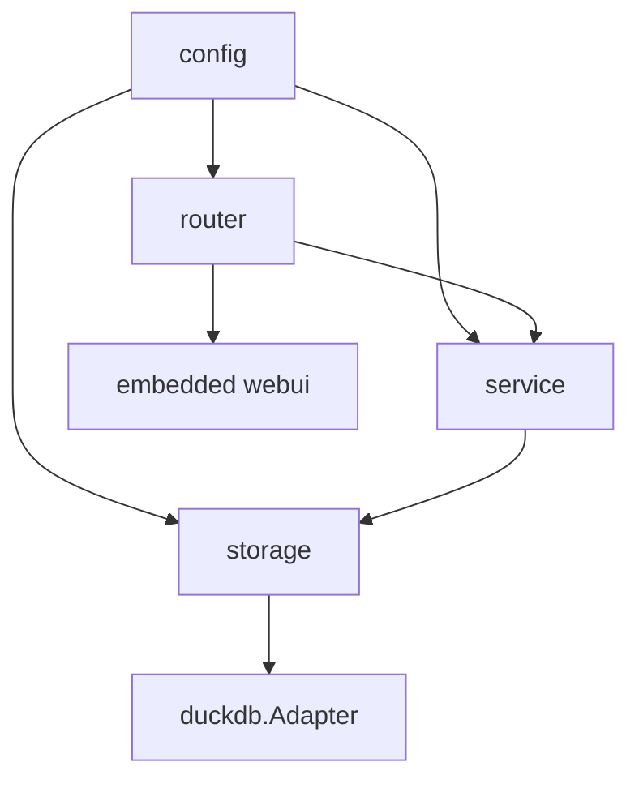
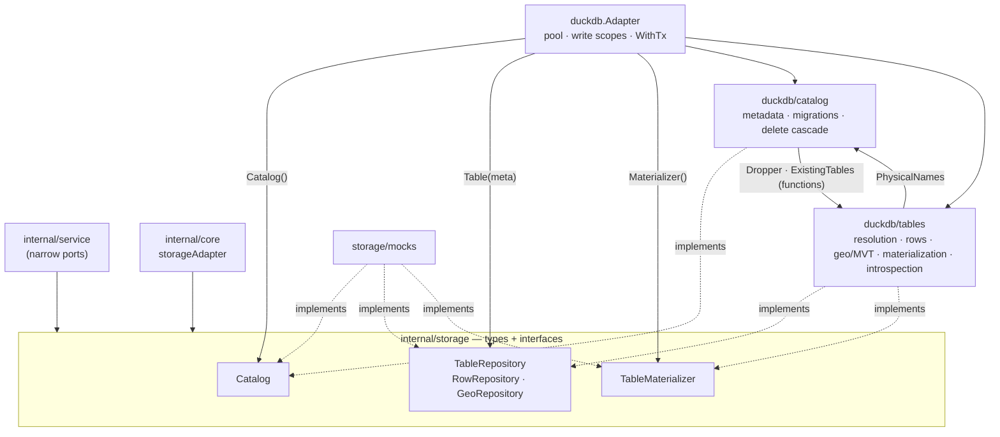

# Darow — Specification

This document describes the **current state** of the Darow cartographic server: its architecture,
its contracts, its invariants. It is written to be read by an AI agent that has to work on the code
without having read all of it.

**The code is the source of truth.** This document is its description; if it diverges, it is this
document that must be fixed. It deliberately contains no code: exact signatures are read in the
files it cites, named in each section. It only describes the **stable** state: blockers, accepted
limitations, identified debt and improvement leads live in separate files, listed in §11.

Its sections are indexed by title, grouped by layer, in [`spec/index.md`](../index.md) — the entry
point to read only what a task needs. **Any section added, renamed, removed or renumbered here is
mirrored there in the same change.**

Its scope is the **Go server** alone. The Vue 3 admin application (`web/`) has its own
specification, `spec/front/spec.md`; the two documents are disjoint and their only contact point is
the REST API, described here (§6) and consumed there. `docs/swagger.json` / `docs/swagger.yaml` /
`docs/docs.go` are generated by `swag init` from the handler annotations and are never edited by
hand.

---

## 0. Non-negotiable rules

These rules apply to all code produced for this project. The numbering is stable and must never be
reordered — code comments describe the code itself and do not refer to these numbers.

1. **Never an unvalidated SQL identifier.** Every table/column name interpolated into a query goes
   through `storage.ValidateIdentifier` **or** `storage.QuoteIdentifier` (§4.3). Values are always
   bound parameters, never interpolated.
2. **`tableId` (UUID) is never an SQL identifier.** Every logical table has a server-generated
   `physicalName` (`t_<uuid_without_dashes>`), stored in `metadata`, resolved on every access.
3. **Identifiers generated by `uuid()`** (DuckDB's native function for the `__pkey`s created in
   CTAS, `github.com/google/uuid` on the Go side for row-by-row insertions). The spatial extension
   is loaded once when the connection opens, never per query.
4. **Every user-supplied SQL query (`/derive`) is restricted to `SELECT`**, validated by DuckDB's
   own parser (§8), and may only reference already registered tables.
5. **Every read filter goes through the validated `BuildFilter` DSL** (§4.5): column whitelisted
   against the real schema, whitelisted operator, bound value. Never a string concatenated from the
   HTTP request.
6. **A multi-row write runs in a single transaction** — `BulkInsert` as much as `UpdateMany`: a
   topological edit moves a boundary shared by several rows, and half of it landing is a corrupted
   boundary, not a partial success.
7. **The geometry column is never returned by the row read endpoints.** Three deliberate, named
   exceptions: export (`GetGeometryGeoJSON`), OGC API - Features (`GetFeatures`, `GetFeaturesTile`)
   and the per-row geometry read (`GeoService.RowGeometry`, plus the echo a geometry-setting write
   returns), where the geometry _is_ the requested data.
8. **Every paginated listing sorts explicitly**, with a deterministic tie-breaker (`__pkey` for
   rows, `tableId` for the catalogue) always appended last. DuckDB guarantees no stable order
   without an `ORDER BY`.
9. **`rowCount` and `bbox` are derived, not stable facts.** They are recomputed by
   `RefreshDerivedMetadata` after every `InsertRow`/`BulkInsert`/`RemoveRows`, and after every
   `Update` that **specifically** touches the geometry column. An `Update` on a scalar field
   triggers nothing. `geometryColumn`, by contrast, is stable configuration, changed only through
   `UpdateMetadata`.
10. **`geometryType` does not exist as a stored field.** A geo column may mix POINT and POLYGON; the
    type is computed on demand through `GeoRepository.Types`, never cached. What a table holds is
    nonetheless a **constraint on what may be written to it**: a table already homogeneous in one
    family (point, line, area — each covering its `MULTI` form) refuses a geometry of another (rule
    23).
11. **The metadata cache is invalidated explicitly** on every write — never left to expire on its
    own.
12. **JSON API output = native JSON types**, not a reproduction of the driver's Go types. Explicit
    conversion according to the column type resolved by `SchemaService.Types` (`DATE` →
    `YYYY-MM-DD`, otherwise RFC 3339).
13. **A derived or imported table is always materialized, never an SQL view.** The CRUD contract
    demands it: a view becomes read-only as soon as it filters or aggregates.
14. **No package-level global variable for shared state.** Dependency injection into the service
    structs.
15. **Data loading goes through `workDir` files.** A `name` comes exclusively from the latest cached
    `Refresh`/`List` — never a value freely built from the request, so as to rule out any directory
    traversal.
16. **The project's scope is the one described here.** Any out-of-scope feature is handled in a
    dedicated request, not as an incidental addition.
17. **Every write or change to a struct, interface, method or handler ships with its tests in the
    same change.**
18. **Every parameter adjustable without recompiling lives in `config`**, never as a constant
    hardcoded in storage/service/router (§2).
19. **Every geometry table receives an RTREE spatial index**, created immediately after the
    load/derive, plus a unique index on `__pkey`.
20. **MVT tiles are cached**, with a key including the table's `UpdatedAt` — a write therefore
    invalidates the tiles with no separate invalidation mechanism.
21. **Every DuckDB write names the scope it serializes on** (`storage.WriteScope`): the table it
    concerns, or `GlobalWriteScope` for the settings singleton. The adapter holds one lock per
    scope, so writes to different tables run at once while writes to the same one queue. DuckDB
    runs concurrent writer threads under MVCC and optimistic concurrency control; serializing per
    scope is what keeps a write conflict from ever reaching a caller, so the server carries no
    retry path (LIM-3).
22. **A table homogeneous in one geometry family stays homogeneous.** Every write that sets the
    geometry column is checked against `GeoRepository.Types` first: a polygon layer refuses a point,
    and the refusal is a `ValidationError` (400) raised before anything is written. An **empty**
    table takes any family — the first geometry written is what locks it — and a table already
    mixing families takes any, since the constraint is already broken and refusing would make half
    its rows unwritable. `GEOMETRYCOLLECTION` belongs to no family and is never refused. The check
    reads the types once per request, not once per row.
23. **A write to the geometry column carries its own encoding and its own CRS**
    (`storage.GeometryValue`): WKT through `ST_GeomFromText`, a GeoJSON geometry through
    `ST_GeomFromGeoJSON`, never a direct bind — then `ST_Transform` from the stated CRS (`OGC:CRS84`
    by default, what every read emits) to the EPSG:3857 the column stores, the exact mirror of the
    read. The CRS is a bound parameter. The write triggers `RefreshDerived` through the service,
    never from the storage layer.
24. **`context.Context` is the first parameter of every method that touches DuckDB**, received from
    `req.Context()` and propagated without derivation. Methods that touch neither DuckDB nor
    anything cancellable do not take one — `SourceService.List`/`MaxUploadBytes`, and the plain
    filesystem calls of `SourceService.Upload`/`Delete`.
25. **Every application cache is a bounded LRU with expiry** (`hashicorp/golang-lru/v2/expirable`),
    never unbounded, with TTL and size configurable.

---

## 1. Architecture



Four layers, no short-circuit: a handler never calls storage, a service never builds an SQL
identifier, storage knows neither HTTP nor the application caches.

| Package                      | Role                                                                                                                                                                                             |
| ---------------------------- | ------------------------------------------------------------------------------------------------------------------------------------------------------------------------------------------------ |
| `cmd/server`                 | entrypoint: config, bootstrap, `goauth.New` (the only place this module is imported, §6.7), HTTP server, graceful shutdown                                                                      |
| `internal/guards`            | maps the roles `github.com/amauryval/goauth/types` grants to the single authorization scope this API enforces — `Guards.AdminScope` (write), the only scope, since every read is public (§6.7). `internal/router` depends on it for the middleware type alone; only `cmd/server` imports the `goauth` top-level package and builds the `Auth` this package's `New` takes (§6.7) |
| `internal/config`            | YAML loading + environment overrides + validation, bootstrap-only fields plus the settings-surface guards (§2.1–2.4), and the `auth` block it declares itself (`AuthConfig`, §2.7)              |
| `internal/settings`          | exported constants: every runtime-editable setting's and every config guard's default value and bound (§2.4, §2.5), plus `Limit` (the pagination rule) and `Validate`, no other logic          |
| `internal/core`              | wiring: builds the ten services and the caches from the config and the settings table                                                                                                            |
| `internal/router`            | `chi` router, middlewares, mounting of the SPA and of Swagger                                                                                                                                    |
| `internal/router/handlers`   | one handler per endpoint family + the ports to the services                                                                                                                                      |
| `internal/router/validation` | `{tableId}` resolution, column-name validation                                                                                                                                                   |
| `internal/router/response`   | JSON writing, standard error body, error → status mapping                                                                                                                                        |
| `internal/service`           | application logic, caches, orchestration                                                                                                                                                         |
| `internal/observer`          | `Observer[T]`, a generic in-memory lifecycle notifier — no domain vocabulary, no `context.Context`                                                                                              |
| `internal/storage`           | the storage layer's types, primitives and interfaces: `Metadata`/`Row`/`GeoFeature`/`StoredFilter`/`Settings`, `BuildFilter`, identifiers, `Catalog`, `TableRepository`, `TableMaterializer`, `FilterStore`, `SettingsStore` |
| `internal/storage/duckdb`    | the single implementation (sub-packages `catalog/` and `tables/`)                                                                                                                                |
| `internal/storage/mocks`     | testify doubles of `storage`'s interfaces (`Adapter`, the three repositories), one file per file of `storage` declaring them                                                                     |
| `internal/webui`             | `go:embed` of the Vue SPA's production build                                                                                                                                                     |

**Interface pattern.** Each consumer declares the narrow interface it needs, in its own package,
with a conformance assertion (`var _ X = (*Y)(nil)`). Handlers never know a concrete service type;
services never know the full adapter. The files concerned: `router/handlers/ports.go`,
`service/derive.go`, `service/import.go`, `service/rows.go`, `service/export.go`,
`service/source.go`, `core/core.go`.

**Bootstrap** (`core/core.go`): `Setup` opens DuckDB, creates `workDir` if absent, loads the settings
row (§5.8) — a failure here is a startup failure — builds the three LRU caches from it, wires the ten
services, then makes a first scan of `workDir`. The caller must defer `Close`. `NewServices` does the
wiring alone, with no connection — that is what the tests use with a mock, and it now returns an
error alongside `*Services` for that settings load to fail into.

---

## 2. Configuration

A `config.yaml` file at the root, **optional** (defaults apply if it is absent);
`config.example.yaml` beside it states every field at its default value, commented, and a test in
`internal/config` fails if the two drift apart. Order of application: defaults → file → `GEOAPI_*`
environment variables → validation. A malformed file, an
unparsable variable or an invalid value are fatal errors at startup, never silently ignored.
Validation collects **all** violations before failing.

File: `internal/config/config.go`.

### 2.1 `server`

| Field                | Default | Env variable                         | Constraint |
| -------------------- | ------- | ------------------------------------ | ---------- |
| `host`               | `0.0.0.0` | `GEOAPI_SERVER_HOST`               | not empty  |
| `port`               | 8080    | `GEOAPI_SERVER_PORT`                 | 1..65535   |
| `readTimeoutSec`     | 15      | `GEOAPI_SERVER_READ_TIMEOUT_SEC`     | ≥ 0        |
| `writeTimeoutSec`    | 30      | `GEOAPI_SERVER_WRITE_TIMEOUT_SEC`    | ≥ 0        |
| `idleTimeoutSec`     | 60      | `GEOAPI_SERVER_IDLE_TIMEOUT_SEC`     | ≥ 0        |
| `shutdownTimeoutSec` | 10      | `GEOAPI_SERVER_SHUTDOWN_TIMEOUT_SEC` | ≥ 0        |
| `trustedProxies`     | empty   | `GEOAPI_SERVER_TRUSTED_PROXIES`      | each entry an IP or CIDR |

`host` is the interface the listener binds to, joined to `port` by `cmd/server`. The default accepts
connections from every interface, which is what a containerized process behind a reverse proxy
needs: bound to the loopback, a process in a container answers nothing through a published port, and
no gateway on another host or in another container can reach it. An operator who wants the previous
behaviour asks for it explicitly, with `127.0.0.1`.

`trustedProxies` names the reverse proxy this server's `Forwarded`/`X-Forwarded-For`/
`X-Forwarded-Host`/`X-Forwarded-Proto` headers are believed from (`internal/router`'s
`stripUntrustedForwarded`, §6.3): read only when the request's peer falls inside one of these
prefixes, and stripped off any other request — a header is client-controlled, so with no trusted
upstream `FeaturesHandler` would otherwise build an OGC link (§6.2) off whatever host a direct caller
claims. This is its only purpose: the server verifies bearer tokens itself (§6.7), so
`trustedProxies` feeds no identity at all, only link integrity. Config-only, parsed once at `config.Load` (`config.ParseTrustedProxies`) and again by
`internal/router` to build the stripping middleware.

### 2.2 `duckdb`

| Field          | Default         | Env variable                   |
| -------------- | --------------- | ------------------------------ |
| `path`         | `./data/geo.db` | `GEOAPI_DUCKDB_PATH`           |
| `maxOpenConns` | 4               | `GEOAPI_DUCKDB_MAX_OPEN_CONNS` |
| `maxSizeBytes` | 0 (unlimited)   | `GEOAPI_DUCKDB_MAX_SIZE_BYTES` |

The parent directory is created if it does not exist — DuckDB refuses to open a file in a missing
directory.

`maxSizeBytes` is a hard cap on the database's on-disk size, enforced by `service.SizeGuardService`
(§5.10) — an operator decision about the disk the process runs on, and deliberately config-only:
unlike the settings table (§2.5), it is never exposed through `PATCH /api/v1/settings`, so raising it
always requires a restart. `settings.maxBodyBytes`/`requestTimeoutSec`/`cacheMaxItems`/`tileMaxItems`
(§2.4) are config-only for the same reason.

### 2.3 `sources`

| Field               | Default                                         | Env variable                                          |
| ------------------- | ----------------------------------------------- | ----------------------------------------------------- |
| `workDir`           | `./data/sources`                                | `GEOAPI_SOURCES_WORKDIR`                              |
| `maxSizeBytes`      | 104,857,600 (100 MiB)                           | `GEOAPI_SOURCES_MAX_SIZE_BYTES`                       |
| `allowedExtensions` | `.geojson`, `.shp`, `.csv`, `.gpkg`, `.parquet` | `GEOAPI_SOURCES_ALLOWED_EXTENSIONS` (comma-separated) |

Every extension must start with a dot. `workDir` can also be overridden by the `--workdir` flag,
which takes priority over everything else (§2.6). `maxSizeBytes` and `allowedExtensions` are the
two config fields published to clients, read-only, by `GET /api/v1/sources/limits` (§6.1): an
upload is refused against them server-side, so a client that cannot read them can only guess what
it is allowed to send.

### 2.4 `settings`

| Field               | Default               | Env variable                        | Constraint             |
| ------------------- | ---------------------- | ------------------------------------ | ----------------------- |
| `maxBodyBytes`      | 10,485,760 (10 MiB)    | `GEOAPI_SETTINGS_MAX_BODY_BYTES`     | 65,536..536,870,912     |
| `requestTimeoutSec` | 30                      | `GEOAPI_SETTINGS_REQUEST_TIMEOUT_SEC`| 0..600                  |
| `cacheMaxItems`     | 1000                    | `GEOAPI_SETTINGS_CACHE_MAX_ITEMS`    | 1..100,000              |
| `tileMaxItems`      | 5000                    | `GEOAPI_SETTINGS_TILE_MAX_ITEMS`     | 1..100,000              |

These memory/availability guards sit outside the runtime-editable settings table (§2.5),
config-only for the same reason `duckdb.maxSizeBytes` is (§2.2), and the same reason the `auth`
block is (§2.7): they sit on `PATCH /api/v1/settings`, a route every authorized writer reaches
(§6.7), and a guard whose own limit is edited through the surface it guards is not a guard. `maxBodyBytes` bounds the `/api/v1` group's request body
cap (`routes.go`'s `maxBodyBytes` middleware; the upload carries its own, §6.3) and
`requestTimeoutSec` the same group's request
timeout — both read once at `router.NewRouter` and fixed for the process's life, no longer "fresh on
every request" the way the settings table's own fields are (§6.3). `cacheMaxItems` sizes both the
metadata and the schema `expirable.LRU`; `tileMaxItems` sizes the tile cache, which additionally
carries no TTL at all — its key already carries the table's `UpdatedAt`, so a time-based expiry
would invalidate nothing. Defaults and bounds are
`internal/settings`'s exported constants, the same ones §2.5's bound table draws from — so a guard
and its ceiling can never drift apart.

### 2.5 Runtime-editable settings

Every parameter an operator legitimately retunes while the process is serving — one pagination limit
per family (rows, catalogue listings, features), geometry simplification bounds, the tile HTTP cache
lifetime, and the shared TTL of the metadata/schema caches — is **not** in `config.yaml`. It lives in
the single-row `settings` table (§4.9), read and written through `SettingsService` (§5.8) and edited
at runtime through `GET`/`PATCH /api/v1/settings` (§6.1) — never through a file or an environment
variable, and never requiring a restart. Its default values and bounds are `internal/settings`'s
exported constants (`constants.go`) and `internal/settings.Validate` (a `Validator` with one method
per field), the one place they are written and enforced;

**A value never travels without what constrains it.** `internal/settings.Descriptors`
(`descriptor.go`) states, per field, the unit its value is expressed in and the range `Validate`
refuses outside of — inclusive `Minimum`, `ExclusiveMinimum` for a field that only accepts a
positive value, `Maximum`, each absent when the field has no such bound and each read off the very
constants the `Validator` methods check against, so a published bound cannot drift from the check
that backs it. `internal/settings.Descriptor` answers for one field, and the field names are that
package's own constants (`FieldDefaultRowLimit` and its siblings), which are also the JSON keys of
the settings routes and the keys `geoOnlyFields` (§6.1) is built from. The read routes serve the
descriptor **inside each field's object**, beside the value (§6.1): a client reads what a setting is
and what it may be set to in one place, instead of holding a value and a bounds table in step. The
patch bodies are unchanged — a write carries bare numbers, the bounds travel with the read only.

**One page size per family, and nothing else.** `defaultRowLimit`, `defaultListLimit` and
`defaultFeaturesLimit` are the only pagination fields the table holds, one per family (rows,
catalogue listings, features), and each is a plain page size: the number of items a handler serves
when the request asks for no limit, and the most it serves when the request asks for more. There is
no second, hidden ceiling and no sentinel — the row is **seeded** with `internal/settings`'
`Default*Limit` constants (`constants.go`) rather than with `0`, so the value read is always the
value applied, and an operator's own value replaces it rather than shadowing it. `0` is not a legal
value: `internal/settings.Validate` refuses anything below `LimitFloor` (50), the point under which
a page stops being a page, and anything above the family's ceiling
(`RowLimitCeiling`/`ListLimitCeiling`/`FeaturesLimitCeiling`). A handler never reads a limit field
raw: it goes through `internal/settings.Limit` (`limits.go`, `Resolve`/`Resolve64`), the one place
that rule is written. `GET /api/v1/settings` therefore publishes exactly what it stores — every
field editable, none derived. `config.yaml` keeps only what the process needs to start at
all, before that table can even be read, plus the guards of §2.4. `exportBatchSize` is a plain
`internal/settings` constant rather than a setting: it has no observable effect on an export's result,
only on how it is produced, so it costs an operator a decision they had no way to make honestly.

### 2.5.1 Per-table overrides

A table may override any of §2.5's fields but two. `defaultRowLimit` (every table) and
`defaultFeaturesLimit`, `maxSimplifyTolerance`, `maxPrecision`, `tileCacheMaxAgeSec`,
`coordinateDecimals` (geo tables only) each accept a per-table value on top of the global row,
stored sparsely in `table_settings` (§4.10) and resolved through `internal/settings`'s `Resolve*`
functions (§5.8.1) — a table with no override has no row at all, and the global value is what every
table without one sees. An override is a page size like the global one, bound by the same floor and
ceiling; it is free to be larger than the global value, which is the point of overriding it. Being
bound by the same range, each field of a table's payload carries the same descriptor the global
route serves (§2.5), beside its override and its effective value.
`defaultListLimit` and `cacheTTLSec` stay global only: a page of *tables*
belongs to no table, and the metadata/schema caches are process-wide (`limitations.md` LIM-12).
`coordinateDecimals` is new here: the number of decimal digits a GeoJSON coordinate is rounded to
once emitted, applied after the CRS84 transform in every GeoJSON-producing route but the MVT tile
(§4.7) — a plain default, not a client-overridable ceiling like `simplify`/`precision`.

### 2.6 Command-line flags

| Flag        | Default       | Effect                                          |
| ----------- | ------------- | ----------------------------------------------- |
| `--config`  | `config.yaml` | path of the configuration file                  |
| `--workdir` | empty         | overrides `sources.workDir` after the full load |

### 2.7 `auth`

**Not part of `config.go` at all.** Unlike every other block in this file, authentication carries no
`config.AuthConfig` and no `config.yaml` key: `cmd/server/main.go`'s `authSettings` resolves it
entirely from the process environment, normally populated from a `.env` file at the repository root
(`.env.example` states every variable) — never versioned, since every one of them is either a
credential or a value that only makes sense for one deployment. `authSettings` is what builds the
settings `github.com/amauryval/goauth` needs (`goauth.NewSettings`) to verify OIDC bearer tokens
itself and decide the two application roles, `types.RoleAdmin` and `types.RoleGuest`.

**`AUTH_PROVIDER` being set is the switch**, regardless of how it reached the process — a `.env`
file at the repository root is loaded first if present (`godotenv.Load`, silently skipped when
absent), but an `env_file:`/`-e`-style injection with no `.env` on disk works just as well. Unset
`AUTH_PROVIDER` is demo mode: every visitor is authorized as an administrator, no token verified at
all — meant for local development, and refused outright by `goauth.New` unless this binary was built
with the `authdemo` build tag (`goauth.DemoBuildTag`, `mise run run-dev`'s `-tags authdemo`); a
production binary carries no such tag, so a deployment that forgot it **fails at startup** rather
than opening. A `.env` present and unreadable for any reason other than not existing is also fatal —
`authSettings` never falls back to demo silently. There is no separate `enabled` flag: `AUTH_PROVIDER`
**is** the flag.

| Variable                 | Required          | Constraint                                       |
| ------------------------- | ------------------ | -------------------------------------------------- |
| `AUTH_PROVIDER`           | to leave demo mode | `zitadel` or `pocketid`                            |
| `AUTH_ISSUER`             | when `AUTH_PROVIDER` set | not empty                                     |
| `AUTH_AUDIENCE`           | when `AUTH_PROVIDER` set | not empty                                     |
| `AUTH_ADMIN_ROLE`         | —                  | falls back to `admin`                              |
| `AUTH_GUEST_ROLE`         | —                  | falls back to `guest`                              |
| `AUTH_REDIRECT_URL`       | when `AUTH_PROVIDER` set | absolute URL                                  |
| `AUTH_COOKIE_SECRET`      | when `AUTH_PROVIDER` set, exclusive with `AUTH_COOKIE_SECRET_FILE` | at least 32 bytes |
| `AUTH_COOKIE_SECRET_FILE` | when `AUTH_PROVIDER` set, exclusive with `AUTH_COOKIE_SECRET`      | path to a readable file |
| `AUTH_CLIENT_SECRET`      | when `AUTH_PROVIDER` set | not empty                                     |

Every name above is the module's own exported constant where one exists (`goauth.ProviderEnv`,
`IssuerEnv`, `AudienceEnv`, `AdminRoleEnv`, `GuestRoleEnv`) — `authSettings` reads through the
constant rather than the literal it currently holds, so a rename inside the module cannot silently
stop being read here. `AUTH_REDIRECT_URL`/`AUTH_COOKIE_SECRET`/`AUTH_COOKIE_SECRET_FILE`/
`AUTH_CLIENT_SECRET` carry no such constant, being secrets and deployment-specific values the module
deliberately leaves to the host to name.

**`provider` names which of the supported identity providers issued the token** (`zitadel` or
`pocketid` — each reads its roles from a different claim, `github.com/amauryval/goauth/provider`),
`issuer` is that provider's base URL, `audience` is this application's client Id. `goauth.New`
contacts the issuer for its public keys at startup, so an unreachable or mistyped `issuer` is a
startup failure, never a caller's problem. `adminRole`/`guestRole` are the **provider's own names**
for the two application roles, mapped by the module rather than compiled in — a Zitadel project role
or a Pocket ID group named however the installation likes, defaulting to the literal strings
`admin`/`guest` when left empty. They never reach the browser: `GET /api/v1/auth/session` (§6.1)
answers with this application's own role names only.

**`AUTH_PROVIDER` set also drives the login flow on the server** (`goauth.WithBrowser`, wired by
`browserAuthOption`): the admin UI never obtains a token of its own. It signs in by following a
redirect to the provider and back, and calls the API with the session cookie the module seals for
it — `web/src/composables/useAuth.ts` holds no OIDC client, no PKCE dance and no token storage at
all (`spec/front/spec.md`). `AUTH_REDIRECT_URL` must resolve to `router.APIRoot+goauth.CallbackPath`
on this server and be registered as such at the provider; `AUTH_COOKIE_SECRET` (or, read instead of
it, the file `AUTH_COOKIE_SECRET_FILE` names — `goauth.WithSecretFile`, for a deployment whose secret
store mounts as files, Docker and Kubernetes secrets both work this way) seals the session cookie;
`AUTH_CLIENT_SECRET` authenticates this application to the issuer for token introspection — without
it a disabled account or an ended session keeps working until its access token expires on its own.
Demo mode carries no provider, so it carries no browser option either: `goauth.New` refuses the two
together, which is why `browserAuthOption` is only ever called once `AUTH_PROVIDER` is set.

**Never config-only in the usual sense — not config at all.** Where §2.4's guards and `duckdb`'s
`maxSizeBytes` are kept out of the runtime-editable `settings` table on purpose, `auth` goes one step
further and is kept out of `config.yaml` too: a credential belongs in the environment, not in a file
this repository might one day track by mistake. Turning authentication on or off, or changing any of
it, costs a restart either way.

**A half-configured `.env` is fatal at startup**, the same refusal `goauth.New` would make on its
own — reported by `authSettings` before `goauth.New` is even called, so it surfaces as one clear
error rather than a handful of individually confusing ones: an unknown `AUTH_PROVIDER`, an empty
`AUTH_ISSUER`/`AUTH_AUDIENCE`, `AUTH_REDIRECT_URL`/`AUTH_COOKIE_SECRET`(`_FILE`)/`AUTH_CLIENT_SECRET`
set only in part, or both `AUTH_COOKIE_SECRET` and `AUTH_COOKIE_SECRET_FILE` set together. An
authentication that loads but verifies nothing, or that silently falls back to demo mode, would
leave the API open while reading as closed — worse than none.

---

## 3. Sources (`workDir`)

`workDir` is a directory of files dropped in by hand or uploaded. `SourceService`
(`internal/service/source.go`) scans it and maintains an **in-memory cache** of its contents.

### 3.1 Model

A `Source` carries: file name, extension, size, modification date, and for a multi-layer format the
names of its layers. Nothing more: **a source knows nothing of the tables loaded from it.** A load
copies the file's data into a table (rule 13), and that table lives on its own from then on — it is
never listed, tracked or deleted through its source.

Recognized formats (`internal/service/formats.go`): Multi-layer decides whether `Load` requires a
`layer` and whether `Refresh` populates `Source.Layers` via `ListLayers`. Introspectable decides
whether `GetSourceMetadata` (`/sources/{name}/metadata`) calls `DetectCRS` at all — false for a
format whose reader (`read_parquet` for `.parquet`, §7.2) has no `ST_Read_Meta`-based CRS preview to
offer, and must never be reached with a file `ST_Read_Meta` cannot safely open.

`SourceHasGeometry` is asked **first**, and of every format including Parquet: a source carrying no
geometry field needs no CRS at all, and `Load` takes it with no `srid`. It is the storage layer that
knows how to read each format for that answer — `st_read_meta`'s `geometry_fields` for an `ST_Read`
format, a `DESCRIBE` over `read_parquet` for a Parquet one, the same dispatch `CreateFromFile` makes
— so no format is ever assumed to carry a geometry it does not have. `DetectCRS` is only called when
the answer is yes.

| Extension  | Multi-layer | Introspectable |
| ---------- | ----------- | -------------- |
| `.geojson` | no          | yes            |
| `.shp`     | no          | yes            |
| `.csv`     | no          | yes            |
| `.gpkg`    | yes         | yes            |
| `.parquet` | no          | no             |

A file whose extension is not in `allowedExtensions`, or whose size exceeds `maxSizeBytes`, is
**silently excluded** from the scan — it is not an error.

### 3.2 Operations

| Operation           | Behaviour                                                                                                                                                                                                                                                                                                                                                          |
| ------------------- | ------------------------------------------------------------------------------------------------------------------------------------------------------------------------------------------------------------------------------------------------------------------------------------------------------------------------------------------------------------------ |
| `Refresh`           | rescans `workDir` and replaces the cache. Called at startup and through `POST /sources/refresh`.                                                                                                                                                                                                                                                                   |
| `List`              | paginates and sorts a **copy** of the cache, without ever touching the disk again. Sorting validated against an allowlist (`name`, `sizeBytes`, `modTime`).                                                                                                                                                                                                        |
| `Upload`            | writes into `workDir` after reducing the name to its base (traversal protection), checking extension and size. Refuses to overwrite an existing file.                                                                                                                                                                                                              |
| `Load`              | imports a source (or one of its layers) into a **new** table. `name` must exist in the cache (rule 15). The caller names that table; without a name it takes the source's own. A source may be loaded any number of times — each load is its own table, and nothing refuses a second one.                                                        |
| `Reload`            | replaces an **existing** table's data with a fresh import of a cached source, resolved exactly as `Load` resolves it. The table keeps its `tableId`, its name, its settings and its stored filters — only its rows and its provenance move.                                                                                                                                                  |
| `DetectCRS`         | reads the CRS declared by the file, importing nothing — lets the UI show and correct it before loading.                                                                                                                                                                                                                                                            |
| `SourceHasGeometry` | reports whether the file carries a geometry field at all, importing nothing — what decides whether a CRS has to be asked for.                                                                                                                                                                                                                                      |
| `Delete`            | erases the file from `workDir` and drops its cache entry. The tables loaded from it are **not** touched — they hold their own copy of the data. A file already gone from the disk is not an error: the outcome asked for is the one already there.                                                                                                                  |

**Locking.** `mu` only ever guards the cache itself: every method reads a **copy** of the entry it
works on and releases the lock before touching the disk or importing. There is no cross-request
invariant left to hold — no operation depends on another's outcome.

**Provenance.** `metadata` records the `sourceName`/`sourceLayer` a table was imported from, and
survives both a rename (`PATCH /tables/{id}`) and the deletion of the file itself. A table is never
*resolved* by it — `tableId` alone identifies one — but the catalogue is listable by it:
`Catalog.ListProvenance` projects every imported table's origin (`GET /tables/provenance`), which is
how a client tells a source already loaded from one not yet loaded, and offers to reload a table
rather than create a second of the same name.

**Multi-layer naming.** A layer loaded from `file.gpkg` produces a table named
`file.gpkg::layer_name`; `sourceName` receives `file.gpkg` and `sourceLayer` receives `layer_name`.

---

## 4. Storage layer

Four packages, and a single import direction — nothing under `duckdb/` is ever named above it:



A service holds an interface, never `*duckdb.Adapter`. `Adapter` owns the connection and hands out
its three components; the two sub-packages implement the contracts and **never import each other** —
each link between them is a one-method interface declared on the consumer's side and wired in `New`
(§4.6).

### 4.1 The `metadata` catalogue

A system table, one record per logical table. Columns:

| Column                    | SQL type               | Nature                | Meaning                                                                                       |
| ------------------------- | ---------------------- | --------------------- | --------------------------------------------------------------------------------------------- |
| `tableId`                 | `TEXT PRIMARY KEY`     | config                | UUID v4, the logical/API identifier                                                           |
| `physicalName`            | `TEXT NOT NULL UNIQUE` | config                | real name of the SQL table (`t_<uuid>`)                                                       |
| `tableName`               | `TEXT NOT NULL`        | config                | display name, renameable                                                                      |
| `createdAt` / `updatedAt` | `TIMESTAMP`            | derived (`updatedAt`) | `updatedAt` is bumped by every derived refresh — it is the tile invalidation signal (rule 20) |
| `rowCount`                | `INTEGER`              | derived               | recomputed by `RefreshDerivedMetadata` (rule 9)                                               |
| `bbox`                    | `TEXT`                 | derived               | `"minX,minY,maxX,maxY"` in **OGC:CRS84** (lon/lat)                                            |
| `srid`                    | `INTEGER`              | config                | the original **source** CRS, before reprojection; `NULL` for a scalar table or one created via `/derive`, which has no source file |
| `sourceName`              | `TEXT`                 | config                | originating `workDir` file; empty for a `/derive` table                                       |
| `sourceLayer`             | `TEXT`                 | config                | originating layer for a multi-layer source                                                    |

One index, on `tableName`.

`storage.Metadata.IsGeo`/`GeometryColumn` are **not** columns of this table: they are derived on
every read (`Repository.GetMetadata`/`List`, `duckdb/catalog/catalog.go`'s `GeometryInfo`) from the
physical table's own catalogue entry (§4.8, `duckdb/tables.GeometryInfo`) — the same
`tableColumns`/`soleGeometryColumn` read `CreateFromFile` uses to detect the geometry column when a
table is created. This is why they cannot drift from what the physical table actually has: there is
nothing stored to drift.

`Metadata` is a **value type** on the Go side: every caller receives its own copy, no
synchronization is needed.

`geometryType` is deliberately absent — a geometry column may mix types, so it is computed on demand
rather than cached.

### 4.2 Data tables and the access contract

Every logical table is materialized as `t_<uuid_without_dashes>` with a `__pkey` column (text UUID)
generated in the `CREATE TABLE AS SELECT`, never added afterwards. A unique index on `__pkey`
replaces the primary key constraint, which DuckDB does not allow adding after a CTAS.

For a geo table: an RTREE index on the geometry column (rule 19), and **Hilbert clustering** — rows
are physically reordered along a Hilbert curve on the geometry, so that tile scans prune by spatial
locality. Clustering rebuilds the table, so both indexes are created **after** it, never before, and
their presence is then **asserted against `duckdb_indexes()`** (§4.8) rather than assumed: a missing
RTREE index degrades every tile scan without failing anything, so the load fails instead.

**Access contract (referred to as "§4.2" in the code).** Every storage method reading or writing
data takes the `storage.Metadata` **already resolved** by the caller, never a `tableId`. The
router's resolution middleware reads it once per request; `ExportService` keeps it for a whole
export. No method redoes a `SELECT` on `metadata` that the caller has already done. The corollary as
applied to export: `ListRowsPage` exists next to `ListRows` precisely to avoid a per-page `COUNT(*)`
that the streaming has no use for.

### 4.3 Identifier validation

Two primitives with **distinct, non-interchangeable** roles (`internal/storage/identifier.go`):

| Primitive            | Use                                                                                                   | Mechanics                                                                                                      |
| -------------------- | ----------------------------------------------------------------------------------------------------- | -------------------------------------------------------------------------------------------------------------- |
| `ValidateIdentifier` | **server-generated** identifiers: `physicalName`, DuckDB type keywords                                | rejection by a strict alphanumeric pattern (`^[a-zA-Z_][a-zA-Z0-9_]*$`)                                        |
| `QuoteIdentifier`    | any column name that may **come from imported data** (accents, spaces, punctuation from a French CSV) | quoting, doubling of inner `"`, rejection of the only byte genuinely dangerous inside a quoted identifier: NUL |

Using `ValidateIdentifier` on an imported column name breaks real-world files; using
`QuoteIdentifier` on a `physicalName` works but hides a design error. In both cases, **safety comes
from validation before interpolation, not from the allowed character set**.

### 4.4 Go contracts

Files: `internal/storage/catalog.go`, `table.go`, `row.go`, `feature.go`, `geoquery.go`, `sort.go`.

`storage` declares both the types crossing the layer and the interfaces its single engine
implements. There is one implementation of each — DuckDB (LIM-9) — so they exist to keep the
consumers off the concrete type and to be mockable (§10), not to make a second backend possible:

| Interface           | Responsibility                                                                                                                                                                                                                                                                                                                                                                                                                                                                                                                   |
| ------------------- | -------------------------------------------------------------------------------------------------------------------------------------------------------------------------------------------------------------------------------------------------------------------------------------------------------------------------------------------------------------------------------------------------------------------------------------------------------------------------------------------------------------------------------- |
| `Catalog`           | the catalogue aggregate: `TableIds` (sorted), `TableExists`, `GetMetadata`, `List`, `PhysicalNames` (the registered-table allowlist `/derive` validates against), `ListProvenance` (every imported table's `sourceName`/`sourceLayer`, §3.2), `CreateFromFile`, `CreateFromQuery`, `ReloadFromFile`, `Remove`, `UpdateMetadata`, `RefreshDerivedMetadata`. `TableExists` and `PhysicalNames` answer against **both** `metadata` and `duckdb_tables()` (§4.8): a metadata row whose physical table is gone reads as absent, instead of reading as an existing table until the first query against it returns a 500 |
| `TableRepository`   | `Schema`, `Types`, `AddColumn`, `RenameColumn`, `DropColumn`, `Count`, `Rows() RowRepository`, `Geo() (GeoRepository, bool)`                                                                                                                                                                                                                                                                                                                                                                                                                                   |
| `RowRepository`     | `Pkeys`, `Page`, `ByPkey`, `Filtered`, `Distinct` (paginated, with an optional case-insensitive `search` matched against the value's text form, LIKE wildcards escaped so they match literally), `Insert`, `InsertMany`, `Update`, `UpdateMany` (its own values per row, all in one transaction), `Delete`                                                                                                                                                                                                                       |
| `GeoRepository`     | `Tile`, `Features`, `CountFeatures`, `FeaturesInTile`, `CountFeaturesInTile`, `PkeysInBbox`, `Extent`, `GeoJSONByPkey`, `WKTByPkey` (the same geometry as Well-Known Text, both reprojected to `OGC:CRS84`), `Types`                                                                                                                                                                                                                                                                                                                                    |
| `TableMaterializer` | `ListLayers`, `DetectCRS`, `SourceHasGeometry` — answers questions about a source file before any table exists. The materialization itself (CTAS, indexing, clustering, from a source file or a derived SELECT) is not on this interface — it runs transactionally through `Catalog.CreateFromFile`/`CreateFromQuery` (below) instead                                                                                                                                                                                          |

Both the delete cascade and the create path are deliberately absent from these interfaces:
`duckdb/catalog.Catalog.Remove` drops the physical table through a `Dropper` and cascades to every
registered `Attachment`'s `DeleteAttached(ctx, tx *sql.Tx, tableId string) error`;
`Catalog.CreateFromFile`/`CreateFromQuery` register the metadata row, materialize the physical
table through a `FileCreator`/`QueryCreator` function value, and cascade to every registered
`Attachment`'s `CreateAttached(ctx, tx *sql.Tx, tableId string) error` — all four (`Dropper`,
`FileCreator`, `QueryCreator`, `Attachment`) declared in `duckdb/catalog` and naming `*sql.Tx`
directly. `Register(Attachment)` is a construction-time extension point on that concrete type — the
point through which a catalogue-attached repository joins both the whole-table delete cascade and
the create transaction — not a method any service reaches through `storage.Catalog`.

No service depends on the interfaces above directly: each declares its own narrow interface over the
subset it actually calls. `core.storageAdapter` documents the full surface an adapter must satisfy —
`Catalog() storage.Catalog`, `Materializer() storage.TableMaterializer`, and
`Table(meta) (TableRepository, error)`, plus `Filters() storage.FilterStore` — four accessors rather
than a flattened union of every storage method.

`Catalog.ReloadFromFile` follows the same shape as the create path: it drops the physical table
through the same `Dropper` and rematerializes it under the **same** `physicalName` through the same
`FileCreator`, in one transaction. No `Attachment` is touched — a reload keeps the table, so
everything attached to its `tableId` stays valid.

**Naming.** `Catalog.Remove` deletes a whole table (metadata and physical table, in a single
transaction), `Catalog.CreateFromFile`/`CreateFromQuery` create one (metadata and physical table,
equally in a single transaction), `RowRepository.Delete` deletes rows.

**Cross-cutting data types.** `Metadata` (+ `MetadataPatch`, `SourceKey`), `Row` (pkey + values, no
geometry), `GeoFeature` (pkey + raw GeoJSON fragment + values), `GeoQuery` (`BuildFilter` clause +
args + simplification tolerance + precision, all optional), `RowQuery`/`FeatureQuery` (a repository
call's criteria grouped into one struct, so a new criterion is an added field and never an added
parameter position), `SortField` (column + direction, parsed from a `sort=a,-b` value).

**Hidden columns.** `IsHiddenColumn(name string) bool` (`internal/storage/hidden_columns.go`)
answers whether a physical column is one the server manages internally and never surfaces to a
caller — `__pkey` (carried separately as `Row.Pkey`/`GeoFeature.Pkey`, never in `Values`) and
`OGC_FID` (§7's GDAL/OGR feature-id column). Both stay physically stored; every consumer that
builds a user-facing column list — `scanRows`/`scanFeatureRows` (`duckdb/tables/scan.go`),
`DeriveFromTable`'s `projectionFor`, `ExportService.exportColumns`, `ColumnValidator.ValidateColumns`
— excludes them the same way it excludes the geometry column. There is no single SQL-level
exclusion: each consumer calls `IsHiddenColumn` on its own column list, exactly as each already
excludes the geometry column on its own.

### 4.5 Filter construction

`storage.BuildFilter` (`internal/storage/filter.go`) is **the only** allowed path to a client-driven
`WHERE` (rule 5).

A `FilterCondition` is either a leaf (`Column` + `Operator` + `Value`) or a boolean group (`Bool`
being `AND` or `OR`, plus child `Conditions`) — never both.

-   The column is validated against the list of the table's real columns, **geometry excluded**.
    `BuildFilter` receives `ColumnInfo` values (name **and** DuckDB type), not bare names: the type
    is what shapes the comparison below.
-   The operator is validated against `=`, `!=`, `>`, `<`, `>=`, `<=`, `LIKE`, `NOT LIKE`,
    `IS NULL`, `IS NOT NULL`. The last two bind **no** parameter — they test the column itself, and
    are the only way to match a NULL at all, since SQL's `col = NULL` is never true.
-   The boolean connector is validated against `AND`, `OR`.
-   `Not` negates whatever the node produces — leaf or group alike, the clause is wrapped in
    `NOT (…)`. That, plus `NOT LIKE` and `IS NOT NULL`, is the whole of negation: there is no `NOT`
    boolean connector, since a negated group already expresses it.
-   The value is **always** a bound parameter.
-   Top-level conditions are joined by `AND`; groups are parenthesized.

**A value the column's type cannot read narrows the result to nothing; it never aborts the query.**
DuckDB raises a Conversion Error on a bare parameter comparison (`"abc"` against an `INTEGER`
column) and a Binder Error on `LIKE` against a non-text column — both surfaced as a 500 on what is,
from the client's side, an ordinary search. So the parameter is wrapped in `TRY_CAST(? AS <type>)`,
which yields `NULL` instead of failing, and `LIKE` compares `CAST(col AS VARCHAR)` so it applies to
any column. The cast target is the column's declared type, interpolated only when its base name is
in `castableTypes` and anything following it is numeric parameters alone (`DECIMAL(10,2)`); any
other declared type (`STRUCT`, `LIST`, an array suffix) falls back to a bare parameter.

Whitelisting against the real schema is what makes the interpolation safe; `QuoteIdentifier` only
escapes.

### 4.5.1 Stored filters

A filter can also be **saved against a table**, under a name, and reused. `storage.StoredFilter`
(`internal/storage/storedfilter.go`) is a name plus the very `[]FilterCondition` tree an ad-hoc
filter posts; `storage.FilterStore` is the read/write contract, implemented by
`duckdb/catalog.Filters` over a `filters` table registered as its own migration `Component`.

-   The tree is persisted as **JSON**, read and written whole — it is never queried into.
-   `service.FilterService` validates a filter at **save** time by running it through `BuildFilter`
    against the table's real schema, so a filter read back from the catalogue is always applicable.
    It also trims the name, requires it non-empty and bounded, and requires at least one condition.
-   Every read, update and delete is scoped to the resolved table: a filter belonging to another
    table is reported as missing rather than served across tables.
-   `Filters` is registered on the catalogue as an `Attachment`, so `Catalog.Remove` deletes a
    table's filters inside the same transaction as its metadata row and its physical table.

### 4.6 The DuckDB adapter

Files: `internal/storage/duckdb/adapter.go` — the connection, the write serialization and the
accessors (`Catalog`, `Materializer`, `Filters`, `Settings`, `TableSettings`, `Table`) the rest of the
server reaches the engine through — plus the sub-packages `duckdb/catalog/` (metadata, stored filters, migrations, delete
cascade) and `duckdb/tables/` (one file per family: table resolution, rows, geo, `introspection.go`
— the engine catalogue reads (§4.8) — and the `Materializer` type split across
`create_from_file.go`, `create_from_query.go` (`/derive` and its query validation), `crs.go`
(detection and reprojection) and `indexes.go` (pkey/RTREE indexes, Hilbert clustering), with
`materializer.go` holding the type alone and `drop.go` the stateless `DropTable`). `Adapter`
forwards nothing: each accessor returns the sub-package type that implements the contract. The two
sub-packages never import each other — `New` wires the catalogue's `Dropper` and its
`ExistingTables` reader straight to `duckdb/tables.DropTable` and `tables.ExistingTables(conn)`,
both function values needing nothing but a transaction or a connection, and the materializer's
physical-name allowlist to the catalogue. `New` wires the catalogue two geometry readers rather than one: `GeometryInfo` over the pooled
connection, and `TxGeometryInfo` over a `tables.NewTxQuerier(tx)` — `createTable` derives its new
table's geometry through the second, the transaction being the only place that table is visible
before it commits. Reading it through the pooled connection there reports no geometry, which sends
`RefreshDerivedMetadata` down its count-only branch and commits a geo table with no bbox. `New` also
wires the catalogue's `FileCreator`/
`QueryCreator` to two closures over `tables.NewTxMaterializer` — a tx-scoped `*tables.Materializer`
built fresh per call, its `Querier`/`TxRunner` backed by the `*sql.Tx` the create transaction
already opened, so `CreateFromFile`/`CreateFromQuery`'s existing CTAS/index/reproject/cluster
statements join it unchanged rather than being rewritten to take a `*sql.Tx` directly. Only that
last link (the materializer's physical-name allowlist) needs an already-built dependency, so the two
constructions run in that order rather than through a deferred closure.

-   **Opening**: `INSTALL spatial; LOAD spatial;` once, pool sized by `duckdb.maxOpenConns` (§2.2),
    creation of the parent directory, then schema migration, then `RefreshMissingBbox` — every geo
    table left without a bbox has its derived metadata recomputed, `bbox` being derived and never
    stored truth (rule 9), then the spatial-index repair (§4.6.1). Both are best-effort: a failure
    is logged and the server still opens.
-   **Readiness**: `Ping` is the connection ping **plus** the assertion that `spatial` is loaded
    (§4.8) — the extension is loaded once at open (rule 3) and every geo route depends on it.
-   **Write serialization**: `Exec` and `WithTx` each name a `storage.WriteScope` and take that
    scope's lock, handed out by `writeLocks` (`duckdb/write_locks.go`) — one mutex per scope, its
    entry dropped once nobody holds or awaits it, so the registry stays the size of the writes in
    flight. `BulkInsert`, `Catalog.Remove` and `Catalog.CreateFromFile`/`CreateFromQuery` hold their
    scope for the whole duration of their transaction, rather than per statement. Every write
    concerning a table names `TableWriteScope(tableId)` — its rows, its structure, its catalogue
    row, its stored filters and its per-table settings alike — so a table's removal excludes the
    writes to it while an import into another table runs alongside. `Catalog.createTable` generates
    the tableId before opening its transaction (`Repository.CreateWithId`) precisely so it can name
    that scope. The writes already running inside a caller-owned transaction name `TxWriteScope`,
    ignored by the tx-backed `Querier`s that carry them, the transaction holding the real scope
    itself. Only the settings singleton row uses `GlobalWriteScope`. Reads never take a lock —
    `Query` and `QueryRow` run concurrently across the pool. Serializing per scope rather than
    globally is what keeps a transaction conflict off every caller without a retry path (rule 21,
    LIM-3). Across processes the choice is not the server's: DuckDB holds the database file under
    an exclusive lock, so one instance at a time serves a given database (LIM-15).
-   **Fatal-instance recovery**: an `INTERNAL` or `FATAL` DuckDB error *may* invalidate the whole
    instance, not just the query that raised it — it does not always, and a spatial index the
    planner crashes on (§4.6.1) leaves it perfectly usable. Every call that reaches the connection
    (`Query`, `QueryRow`, `Exec`, `WithTx`, `Ping`) checks its error against `isFatalDuckDBError`
    and, on a match **whose pool no longer answers a ping**, reopens it — a fresh `sql.Open` plus `INSTALL`/`LOAD spatial` — through
    `recoverIfFatal`, guarded by `reopenMu` so two callers hitting the same dead instance at once
    reopen it only once. `db` itself is guarded by `dbMu`, read through `conn()`, so the swap never
    races a concurrent reader.
-   **Migrations** (`duckdb/catalog/migrations.go`): a registry of `Component`s, one per
    catalogue-owned table — `metadata` (registered from `duckdb/catalog/metadata.go`'s `init`),
    `filters` (`filters.go`), `settings` (`settings.go`) and `table_settings` (`tablesettings.go`).
    Each
    `Component` carries its own creation DDL and its own ordered list of `ALTER` statements, and
    `schema_version` tracks one `(component, version)` row per component rather than a single
    whole-database integer, so adding a component never touches another's history. Per component: a
    database with no recorded version for it gets the current DDL directly and is marked at the
    highest version; a recorded version behind `len(Migrations)` replays the missing statements and
    bumps the version. `metadata`'s own `Migrations` list is empty today — see `limitations.md`
    LIM-7.
-   **Reprojection**: geometry is reprojected **once at import** to EPSG:3857, never per query.
    Every lon/lat output (bbox, GeoJSON) converts back to `OGC:CRS84`.

> **`OGC:CRS84`, never `EPSG:4326`.** EPSG:4326's official axis order is (lat, lon): using it as the
> target CRS silently swaps X and Y. This rule applies to the four places that transform: `bbox`
> computation, `FilteredExtent`, `GetGeometryGeoJSON`, `GetFeatures`.

### 4.6.1 Spatial-index repair at open

`repairSpatialIndexes` (`adapter.go`, `duckdb/tables/repair.go`) probes every geo table at open and
rebuilds the RTREE indexes the engine cannot plan against. It exists because of one observed failure
mode: an index whose state came back from a **replayed write-ahead log** made the spatial
extension's own optimizer rule raise `INTERNAL Error: Operation requires a flat vector…` while
*planning* — so every tile and every WFS read answered `500` while the rest of the server kept
working, and the map hung on *Chargement…*.

-   The **probe** is the cheapest query shaped like a tile's — a constant `ST_MakeEnvelope` against
    the geometry column — since only that shape is rewritten into an index scan and only the rewrite
    crashes. It costs one planned query per geo table at open.
-   Only `IsEngineError` (DuckDB's `INTERNAL`/`FATAL`) triggers a rebuild. Any other failure is
    returned: a table that is merely missing or misnamed must not have its index silently rewritten.
-   The **rebuild** drops every RTREE index the table carries — read from DuckDB's catalogue, never
    rebuilt from the naming convention, an older database may name it otherwise — and recreates the
    single one rule 19 requires, then probes again.
-   `DropTableIndexes`/`RebuildIndexes` are what every structural `ALTER` goes through
    (`table.alterAroundIndexes`, feeding `RenameColumn` and `DropColumn`). DuckDB refuses to alter a
    table **any** index depends on — `Dependency Error: Cannot alter entry …` on a rename,
    `Cannot drop this column: an index depends on a column after it!` on a drop — and that includes
    the unique `__pkey` index every table carries, not only the RTREE one. So both come off before
    the statement and are rebuilt after it, failure path included. It is cheap — 24 ms to rebuild
    the RTREE index of a 35 k-multipolygon table — so no structural write is deferred because of it.

Two repairs were measured and rejected. A `CHECKPOINT` at open raises the same error as a **FATAL**
one on such a database, which invalidates the instance outright — it turns a broken map into a dead
server. A tile predicate written without the index (four scalar comparisons on the geometry's own
extent) plans and answers correctly, but took over 150 s for a single z2 tile on a 35 k-multipolygon
table, against 0.4 s once the index is rebuilt.

### 4.7 Rendering an MVT tile

File: `internal/storage/duckdb/tables/geo.go` (`Tile`).

A single query, in three steps: selection of the rows intersecting the tile envelope
(`ST_TileEnvelope`), simplification, then `ST_AsMVTGeom` + `ST_AsMVT` aggregation. The decisions
that govern its cost:

-   **`ST_Intersects_Extent`, not `ST_Intersects`**, for the tile filter: comparing envelopes is
    enough — `ST_AsMVTGeom` then clips exactly — and the RTREE index is not picked up by the planner
    on this kind of query anyway. The real pruning comes from the Hilbert clustering (§4.2), which
    lets the zone maps discard row groups outside the tile. `ST_Intersects` on the same query is
    measured several seconds slower.
-   **`ST_Simplify`, not `ST_SimplifyPreserveTopology`.** The topology-preserving variant dominates
    the query's total time (measured on an administrative layer of 35,000 polygons / 7 M vertices:
    4.0 s against 0.78 s at z5; 3.0 s against 0.10 s at z0) for a tile that differs by 0.1 % in
    size, since `ST_AsMVTGeom` then re-quantizes every coordinate onto the integer 4096-unit grid.
    What topology preservation buys — rings that survive instead of collapsing — is precisely what
    must disappear at a zoom where the feature is less than a pixel wide.
-   **The tolerance comes from the zoom**, `tileSimplifyTolerance`: one MVT extent unit converted to
    Web Mercator metres, floored at 0.25 m. The HTTP request's `simplify`/`precision` parameters are
    therefore ignored on the MVT route (they only apply to the GeoJSON routes), and do not enter the
    cache key. `coordinateDecimals` (§2.5.1, §5.8.1) is ignored here for the same reason: a tile
    re-quantizes every coordinate onto its own 4096-unit integer grid, so a digit count on the
    pre-quantization value means nothing (`limitations.md` LIM-5).
-   **`TRY(...)` + `WHERE mvt_geom IS NOT NULL`** around `ST_AsMVTGeom`: a safety net against an
    upstream duckdb-spatial defect (`duckdb/duckdb-spatial#792`) that produces corrupt clipped
    geometry on certain source/tile combinations. It can only discard an already broken feature,
    never a valid one.

The MVT layer is named after `Metadata.TableId`, escaped like the attribute struct keys it sits
beside — never the fixed string `"layer"` — so two tables loaded into the same client-side map never
collide under the same layer name. `z`/`x`/`y` reach `Tile` already validated against the
WebMercatorQuad tile matrix (`0 ≤ z ≤ 24`, `0 ≤ x, y < 2^z`) by `validateTileCoords`
(`router/handlers/geo.go`), the layer this file's own doc comment on `tileEnvelope` relies on — its
four literals are only safe to inline unbound because the caller guarantees they are already in
range.

### 4.8 Reading DuckDB's own catalogue

File: `internal/storage/duckdb/tables/introspection.go` — the **single** place DuckDB's catalogue
functions are read. Their result columns are versioned with the engine, so a DuckDB upgrade is one
file to check. LIM-9 makes this engine-specific access legitimate: there is no second backend to
keep it portable for.

| Function              | Read through                                                                           | Answers                                                                                                                                    |
| --------------------- | -------------------------------------------------------------------------------------- | ------------------------------------------------------------------------------------------------------------------------------------------ |
| `duckdb_columns()`    | `tableColumns`, and `GeometryInfo` built on top of it plus `soleGeometryColumn`         | the columns of an **existing** table: name, declaration index, full declared type (`GEOMETRY('EPSG:2154')` included), nullability, default; `GeometryInfo` reduces that to isGeo/the geometry column's name, exposed to `duckdb/catalog` as a `GeometryInfo` function value (mirroring `ExistingTables`) so `Repository.GetMetadata`/`List` derive `storage.Metadata.IsGeo`/`GeometryColumn` rather than store them (§4.1) |
| `duckdb_indexes()`    | `tableIndexes`                                                                         | the indexes really created on a table (rule 19's assertion, §4.2)                                                                          |
| `duckdb_tables()`     | `existingTableNames`, reached from outside through the `ExistingTables` function value | the tables that physically exist, for the catalogue to tell a live registration from a metadata row whose table is gone                    |
| `duckdb_extensions()` | `ExtensionLoaded`, `loadedExtensions`                                                  | whether `spatial` is loaded, for `/readyz`; the full loaded list, for `/diagnostics`                                                       |
| `pragma_database_size()` | `databaseSizeBytes`                                                                 | on-disk size, from the exact `total_blocks`/`block_size` columns — never the human-readable ones, not meant to be parsed back              |
| `duckdb_memory()`     | `memoryUsageBytes`                                                                     | buffer-manager memory usage, summed across tags                                                                                            |
| `duckdb_temporary_files()` | `temporaryFilesBytes`                                                            | bytes currently spilled to disk, summed across files — zero when nothing is spilling                                                       |

`Diagnostics` (also in `introspection.go`) composes the four into a `storage.Diagnostics` value, read
by `duckdb.Adapter.Diagnostics` and served whole by `GET /diagnostics` (§6.1) — no
`duckdb_settings()` involved, that surface staying out of scope (rule 16).

The table name is a **bound parameter** in every one of them: no physical name is interpolated to
list a structure, so rule 1 is structurally satisfied there rather than validated after the fact.

`DESCRIBE` survives in exactly one place, `queryColumns`: the shape of a `SELECT` that has **not**
been materialized, which by definition has no catalogue entry. It is what `/derive`'s `__pkey`
collision check reads (§8). Separating the two — a table target goes to the catalogue, a query
target to `DESCRIBE` — is what removes the interpolation from the common case.

> Rule 4 is untouched by all this. The `/derive` AST validator rejects **every** table function
> precisely because `duckdb_settings` and its siblings read system state. These functions are
> server-side only, called with server-built SQL: the validator is never relaxed to admit them, and
> no path hands a caller-supplied query to one.

### 4.9 The `settings` repository

`duckdb/catalog.Settings` (`settings.go`) owns the single row of the `settings` table — the
runtime-editable counterpart of `metadata` (§4.1), registered as a `Component` in the same
per-component migration registry (`migrations.go`) and reached through `Adapter.Settings()`
alongside `Catalog()`/`Filters()`/`Materializer()` (§4.6). It is **not** an `Attachment`: nothing
about it is scoped to a `tableId`, so it never joins the delete cascade `Catalog.Register` builds.

The table is a singleton, `id` fixed at `1`, one column per `storage.Settings` field, seeded inside
`CreateSchema` itself — every column from `internal/settings`'s constants, the three page sizes
included (§2.5), so no reader of this table ever needs a fallback (an `INSERT ... WHERE NOT EXISTS`, run
once per process the first time the table doesn't exist yet — every later startup finds the row and
leaves it alone). `GetSettings` reads that row whole; `UpdateSettings` takes a `storage.SettingsPatch`
(nil fields left unchanged, the same shape as `MetadataPatch`) and writes only the columns given,
stamping `updatedAt`.

### 4.10 The `table_settings` repository

`duckdb/catalog.TableSettings` (`tablesettings.go`) owns every per-table override (§2.5.1), on the
model `Filters` (§4.5.1) already follows rather than `Settings`' singleton row: registered as a
`Component` in the migration registry, reached through `Adapter.TableSettings()`, and registered as
an `Attachment` on `Catalog` — `Catalog.Remove` deletes a table's overrides inside the same
transaction as its metadata row and its physical table, the one failure mode this pattern rules out
(an orphan override row keyed on a `tableId` that no longer exists).

The table is **sparse**: one row per table that carries at least one override, never one per table.
Every column but `tableId` is nullable, `NULL` meaning "inherit" — the Go type mirrors this exactly,
`storage.TableSettings` a pointer per overridable field. `GetTableSettings` returns the zero value
(every field `nil`), never a `NotFoundError`, when a table has no row: absence is a normal, sparse
state, not a missing entity. `UpdateTableSettings` takes a `storage.TableSettingsPatch` whose fields
are `**T` — a `nil` field leaves that override unchanged, a non-nil field pointing to `nil` clears it
back to "inherit," a non-nil field pointing to a value sets it — merges it onto the current row, and
either upserts (`INSERT ... ON CONFLICT (tableId) DO UPDATE`) or, when the merge leaves every field
`nil`, deletes the row instead: a table with no more override goes back to having no row.
`ListOverriddenTables` returns every row, ordered by `tableId` — the settings screen's per-table list
(§6.1) reads this and nothing wider, so a deployment with a thousand tables never has to load them
all to find the few that override something.

---

## 5. Service layer

Twelve services, each the exclusive owner of its state. Files: `internal/service/`.

**Error wrapping.** Every service method that calls into the storage layer wraps a raw failure it
did not itself construct (a DuckDB error, an `os` error) in `service.DisplayError` (§6.4) before
returning it — a clean message naming the table, column, source or operation concerned, the raw
cause kept reachable through `Unwrap` for classification and logging. An error a service already
constructs itself (`ValidationError`, `NotFoundError`, `ConflictError`) is deliberate and clean as
written and is never further wrapped.

### 5.1 `MetadataService` — sole owner of the metadata cache

Every other service goes through it to read or write metadata, through a narrow port; nobody caches
independently (rule 11). The cache is a bounded LRU with a TTL.

It invalidates the entry concerned after **every** write: `UpdateMetadata`, `RefreshDerived`,
`RemoveTable`. A newly created `tableId` was never cached, so `CreateFromFile`/`CreateFromQuery`
need no invalidation of their own.

`RemoveTable` takes the caller's already-resolved `storage.Metadata`, not a bare `tableId` (the
same access contract §4.2 states for storage-touching calls), and after deleting it notifies it to
`removed`, an `*observer.Observer[storage.Metadata]` (`internal/observer`) injected through the
constructor. `core.NewServices` builds the observer, passes it to `NewMetadataService`, and
registers `SchemaService.InvalidateSchema` and `TableSettingsService.InvalidateOverride` onto it —
deleting a table changes its structure just as surely as `AddColumn` does, and would otherwise leave
a stale entry in `SchemaService`'s cache until its TTL. Registration happens once, at construction, in `core.NewServices`: `Observer[T]` is not
safe for concurrent registration, only for the fan-out itself, which runs after the delete has
already committed and never returns an error — nothing a cache eviction could fail at is left to
report by then. This is `MetadataService`'s only dependency on another service's behaviour, and it
only goes that way — neither `SchemaService` nor `TableSettingsService` knows `MetadataService`,
only the observer both `MetadataService` and they hold a reference to.

-   `ListTables` paginates over `TableIds`'s deterministic order and also returns the total.
-   `CreateFromFile`/`CreateFromQuery` thinly wrap `storage.Catalog`'s methods of the same name
    (§5.4): the transaction that guarantees a catalogue row never survives without a physical table
    is owned by `duckdb/catalog`, not by this service.

### 5.2 `RowService` — typed row CRUD

Converts every value to a native JSON type according to the column type resolved by
`SchemaService.Types` (rule 12), resolved **once per page** rather than once per row.

A write that sets the geometry column names the CRS its literal is expressed in (`crs`, defaulting
to `OGC:CRS84`); the service turns the raw JSON value into a `storage.GeometryValue` — a string is
WKT, an object is a GeoJSON geometry, anything else is a `ValidationError` — and reads the stored
geometry back as GeoJSON (`RowWriteResult`), so the client redraws what the server kept rather than
its own draft. A bulk insert carries the same CRS and echoes nothing.

Before any of that reaches the repository, a write that sets the geometry column passes two guards,
in sequence, both raising a `ValidationError` **before** anything is written, batch included — a save
that half-landed would leave the caller's grid and map disagreeing. `RowService.checkWrittenGeometry`
(`geometry_validity.go`) runs them in order, from `UpdateRow`/`UpdateRows`/`InsertRow`/`BulkInsertRows`:

1. **Family homogeneity** (rule 22, `geometry_family.go`): the families of the written geometries —
   read off the WKT type name or the GeoJSON `type`, so nothing is parsed twice — checked against the
   families of `GeoRepository.Types`. One family stored and another written is refused. The stored
   types are read **once per request**, one distinct scan of the geometry column per write.
2. **Validity** (`geometry_validity.go`): `GeoRepository.ValidateGeometries` runs `ST_IsValid` on the
   geometry exactly as it will be stored — after `ST_GeomFromText`/`ST_GeomFromGeoJSON` and the
   `ST_Transform` of rule 23, never on the raw literal — in one batched query covering every written
   geometry of the request. A self-intersecting polygon or an unclosed ring is refused naming the
   written literal, not an engine explanation: DuckDB's spatial extension has no `ST_IsValidReason`,
   unlike PostGIS.

`UpdateRows` is the multi-row form: each row carries its own values, the whole set is written in one
transaction, and derived metadata is refreshed once. `UpdateRow` writes every column in **one**
statement: a multi-column update is atomic, all or nothing (§5.1 from the calling code's point of
view). `UpdateRow`, `InsertRow` and `BulkInsertRows` trigger `RefreshDerived` with `touchesGeometry`
true only if the write actually sets the geometry column (rule 9); a purely scalar update or insert
recomputes only `rowCount`/`updatedAt`, never the `bbox`. `RemoveRows` always passes
`touchesGeometry` as `meta.IsGeo`: a deleted row may have been on the bbox boundary, which there is
no cheap way to check after the fact.

### 5.3 `SchemaService` — structure, not data

Owner of its schema cache. Exposes the full schema (**geometry included**: this is structure, rule 7
does not apply) and the name → type table. `AddColumn` is the only write that changes the structure
from this service and therefore invalidates the cache; adding a column affects no derived field, so
this service does not need `MetadataService`. `InvalidateSchema` exposes the same invalidation as a
callback `core.NewServices` registers onto `MetadataService`'s removed-table observer (§5.1),
without the cache ceasing to belong to this service.

`AddColumn` checks `colType` against `storage.ValidateColumnType` before opening the table: an
allowlist of DuckDB scalar types, `GEOMETRY` deliberately excluded — a column added this way must
never produce the second geometry column the rest of the domain assumes cannot exist, nor a geometry
`isGeo` never learns about. `duckdb/tables`' `table.AddColumn`, the one place that interpolates
`colType` into the `ALTER TABLE` statement, checks it again with the same function — the repository
never trusts a caller other than this service to have validated first.

`RenameColumn` and `DropColumn` are the two other structural writes, invalidating the cache the same
way. Both read the real schema first: an unknown column, a **hidden** column (§4.4) and the
**geometry column** are refused as a `ValidationError` before the table is opened, and a rename
additionally refuses an empty or already-taken target name. `duckdb/tables`' `table.RenameColumn`/
`table.DropColumn` refuse the hidden and geometry columns again before quoting — the same
belt-and-braces `AddColumn` applies to `colType`: `__pkey` and the geometry column the rest of the
domain assumes exist must survive any caller. Neither touches `MetadataService`: no derived field
moves, and the other columns' values do not change, so the tile cache (rule 20) stays correct.
Both writes drop and rebuild the table's indexes (§4.6.1), DuckDB refusing to alter a table any
index depends on. A **stored filter** (§4.5.1) or a per-table override naming the
column is left as it is and simply stops applying — dropping a column has no undo, exactly like a transform (§5.11).

### 5.4 `DeriveService` and `ImportService` — creating a table, transactionally

Neither service owns the create transaction: each calls one method on `MetadataService`
(`CreateFromQuery`/`CreateFromFile`), which itself thinly wraps `storage.Catalog`'s method of the
same name. `duckdb/catalog.Catalog.CreateFromFile`/`CreateFromQuery` register the metadata row,
materialize the physical table (CTAS from a file or from a query, via the `FileCreator`/
`QueryCreator` function value `duckdb.New` wired in — §4.6), persist the resolved geometry column /
SRID / source, and cascade to every registered `Attachment`'s `CreateAttached`, all inside one
transaction (§4.4): a failure at any step leaves neither a metadata row nor a physical table
behind, rolled back together — the create path's counterpart to `Catalog.Remove`'s cascade.
`ImportService` additionally computes `sourceName`/`sourceLayer` (§3.2) from the layer suffix before
calling `CreateFromFile`, and offers `ReloadFromFile` — the same import against an existing
`tableId`, size guard included (§7).

`DeriveService` applies a cheap fail-fast on the query's shape (a single statement, starting with
`SELECT`) before ever calling `CreateFromQuery` — **this is not the authoritative check**: the real
validation is done by DuckDB's parser on the storage side (§8). It serves all three derivation
modes: `DeriveTable` takes the query as given, `DeriveFromTable` assembles one from a `DeriveSpec`
(§8.1), `AggregateFromTable` assembles a `GROUP BY` query from the distinct `AggregateSpec` shape
(§8.2) — all three then run the same `materialize` helper. Building a spec's query needs the source
table's structure, so this is the one service besides the router to hold a port onto
`SchemaService`.

### 5.5 `GeoService` — tile cache

The only service that caches a rendering result. The cache key includes: `tableId`, z/x/y,
`UpdatedAt` (rule 20), the requested attributes (sorted), and the filter clause with its arguments —
since all of them change the tile's contents for a given table version.

Everything else is computed on demand and **never cached**: `GetFeatures`, `CountFeatures`,
`GetFeaturesTile`, `CountFeaturesTile`, `FilteredExtent`, `GeometryTypes`, `RowGeometry` (a single
row's geometry in both
encodings, rule 7's third exception — both encodings follow the resolved `coordinateDecimals`,
§5.8.1, and both come back in the CRS the caller asked for through `?srid=`, **lon/lat**
(`OGC:CRS84`) failing that — the CRS a geometry-setting write takes back (`geometryCRS`), so a map
posts the coordinates it was handed. Pinning a read to the table's own CRS is an export's default
(§5.6), never this one: reprojecting a **read** changes nothing stored, and
the CRS actually applied is reported alongside so a caller displays it rather than assumes it. A
CRS PROJ cannot resolve is refused by the same `validateCRS` probe the export runs, before the read,
and reaches the caller **unwrapped** — a generic "unable to fetch the geometry" over "unknown
coordinate reference system" would hide the one thing they can fix), `NeighbourFeatures` (the rows within a buffer of a
geometry — the query an edit session runs, unbounded in its key space like every other filtered
read. It emits its geometries under the **same** resolved `coordinateDecimals` as the per-row read,
and that is not an option the caller has: a neighbour rounded differently from the row it surrounds
no longer holds the same coordinate, and a limit shared to fewer digits on one side is a limit the
editor moves on one side only). The reason: filter, bbox, tolerance and attributes form an unbounded key space, unlike a
tile's z/x/y.

### 5.6 `ExportService` — export is DuckDB's COPY, streamed back

The router validates the format, sets the headers, and lets the service write into the response
body. Every format goes through DuckDB's own `COPY` into a temporary directory the service owns,
whose file is then streamed to the caller and removed — the escaping of a CSV, the shape of a
`FeatureCollection` and the GeoParquet metadata are the engine's business, never rebuilt here.

-   Formats (`storage.ExportFormat`): `csv` (`FORMAT CSV, HEADER`), `geojson`
    (`FORMAT GDAL, DRIVER 'GeoJSON'`, `LAYER_NAME` naming the collection after the table) and
    `parquet` (`FORMAT PARQUET`, which DuckDB turns into GeoParquet by itself on a geometry column).
    The format is validated **before** the first byte is written.
-   CSV carries the schema's columns, geometry excluded (rule 7); `__pkey` is never exported, like
    everywhere else it is hidden (`storage.IsHiddenColumn`, §4.4). The other two carry the geometry,
    aliased to `geometry` — the name GDAL reads a Feature's geometry from, every other column
    becoming a property.
-   **Output CRS** (`service.ResolveCRS`, an export's own default and not the per-row read's, §5.5):
    `?srid=`
    pins it exactly as it pins an import's source CRS; without one the table goes back out in the
    CRS it came in (`Metadata.Srid`), and only a table whose source CRS was never recorded falls
    back to `OGC:CRS84`. `EPSG:4326` is always named `OGC:CRS84` (§4.6).
    A CRS PROJ cannot resolve is refused before any file is written. A table with no geometry
    reprojects nothing.
-   The file being complete before its first byte reaches the response, a failure to produce it is
    still a normal error response (§6.4). `ExportHandler.ExportTable` still tracks whether any byte
    has reached the response (`firstByteWriter`): only the copy of the finished file to the client
    can now fail that late, and it aborts the connection (`panic(http.ErrAbortHandler)`) rather than
    let a truncated download look whole.
-   The exported file **names its CRS** (`communes_EPSG2154.parquet`): no format states it reliably
    — GeoParquet's metadata omits it and GeoJSON is read as lon/lat whatever it holds — and the
    default is the table's own CRS rather than one fixed value.

### 5.7 `SourceService`

See §3.

### 5.8 `SettingsService` — sole owner of the current settings value

The read/write port onto `storage.SettingsStore` (§4.9): `Load` (called once, by `core.Setup`, before
any request is served — a failure here is a startup failure, exactly as an invalid `config.yaml` is)
populates an in-memory `storage.Settings` behind a `sync.RWMutex`; `Current()` reads it with no
context and no error, the shape every hot-path reader needs (a handler sizing a page, `ExportService`
sizing a batch — both hold `SettingsService` through a narrow `Current() storage.Settings` port, never
the concrete type). `GetSettings`/`UpdateSettings` are the pair `SettingsHandler` calls: the same
repository-pattern shape `MetadataService` exposes for `metadata`.

`UpdateSettings` merges the patch onto the current value **in memory first** (`mergeSettings`) and
validates the *result* through `internal/settings.Validate` — every field checked against its own
bound (an upper ceiling, and for `maxBodyBytes` a floor keeping `PATCH /api/v1/settings` itself
always able to pass), a page size checked against `LimitFloor` as well as its family's ceiling
(§2.5) — before writing anything; a rejection is a
`ValidationError` (§6.4), the store never reached. `internal/settings.Validator` (built by
`NewValidator`) carries one method per field, each returning that field's own validated value or the
error naming it; `Validate` runs every one of them and joins the violations, and the ceilings/floor
each method checks against live as constants in `internal/settings/constants.go`, next to the
field's default. On success `UpdateSettings` persists through `SettingsStore.UpdateSettings`,
replaces the in-memory value, and notifies an `*observer.Observer[storage.Settings]`
(`internal/observer`, the same generic type §5.1's removed-table observer uses) injected through the
constructor. It also logs one `INFO` line per field the accepted change actually moved —
`setting changed`, with `field`, `from` and `to` — the request line saying only that a settings
change was accepted, and `UpdatedAt` only when: after an incident, that is what tells a limit that
was always wrong from one raised an hour earlier.

`core.NewServices` registers two callbacks onto that observer, one for `MetadataService.ResetCache`
and one for `SchemaService.ResetCache` (`GeoService` has no `ResetCache` at all, see below): `expirable.LRU` bakes its size and TTL into `expirable.NewLRU` at
construction, with no live-resize API, so a changed `cacheTTLSec` takes effect by swapping the cache
for a freshly built one, sized `cfg.Settings.CacheMaxItems` (fixed, never itself the reason for a
swap) — each of the two services holds its cache behind `atomic.Pointer` for exactly this — rather
than by mutating a field; every entry the old cache held is simply dropped, a cache miss costing one
extra read, not a migration. The tile cache is built once at `NewServices` and never swapped: neither
its size (`cfg.Settings.TileMaxItems`) nor its TTL (always `0` — no time-based expiry) is
settings-editable, so `GeoService` holds it as a plain field, no `atomic.Pointer`, no `ResetCache`.
Every other setting (the three page sizes, simplification bounds,
`tileCacheMaxAgeSec`) needs no callback at all: `Router` and every handler read it live off
`Current()` on each request instead (§6.3).

### 5.8.1 `TableSettingsService` — per-table overrides

The read/write port onto `storage.TableSettingsStore` (§4.10), built on top of `SettingsService`
rather than beside it — every resolution needs the current global row as its fallback. `Load`
(called once, by `core.Setup`, right after `SettingsService.Load`) populates an in-memory
`map[tableId]storage.TableSettings` holding only the tables that carry an override; `GetOverride`
reads it directly, `Resolve(tableId)` collapses it against `SettingsService.Current()` into a
`TableSettingsResolved` — `settings.Limit` for `defaultRowLimit`/`defaultFeaturesLimit`, a plain
value for the rest — through `internal/settings`'s `Resolve*` functions, the one place the two-level
chain (global row → table override) is written. There is no third level and no sentinel: an override
is either present, and it is the page size, or absent, and the global row is. Every handler that
reads a table-scoped limit calls `Resolve(meta.TableId)` at the same
point it already resolves `meta` (`validation.TableResolver`), never `SettingsService.Current()`
directly for a field this service overrides.

`UpdateOverride` merges the patch onto the current override **in memory first**, resolves the merge
into the `storage.Settings` shape `internal/settings.Validate` already checks (§5.8), and validates
it there — a per-table value can never sit outside the bounds the global one respects, and the
mapping is exactly `ResolveRowLimit`/`ResolveFeaturesLimit`'s own fallback rule, reused rather than
reforked. On success it persists through `TableSettingsStore.UpdateTableSettings` and replaces the
map entry (or removes it, once the merge leaves no override). `core.NewServices` also registers this
service on the `tableRemoved` observer (§5.1): a table's removal already cascades its
`table_settings` row away in storage (§4.10), and `InvalidateOverride` drops the now-stale map entry
without a second store read.

### 5.9 `DiagnosticsService`

A single pass-through onto `storage.DiagnosticsReader` (§4.8): `Diagnostics` reads live off
`duckdb.Adapter.Diagnostics` and wraps a raw storage failure in `service.DisplayError`, same as every
other service. It owns no cache — a stale spike would misreport the one thing a caller of
`GET /diagnostics` (§6.1) is asking about.

### 5.10 `SizeGuardService` — enforcing `duckdb.maxSizeBytes`

Every data-growing write — `RowService.InsertRow`/`BulkInsertRows`, `ImportService.ImportFromFile`,
`DeriveService`'s shared `materialize` (both `DeriveTable` and `DeriveFromTable` go through it) —
calls `Check(ctx)` before writing and `Grew()` right after the write succeeds. `Check` refuses with a
`QuotaExceededError` (mapped to `507` by `response.MapServiceError`, §6.4) once the database's size is
at or over `duckdb.maxSizeBytes`; `duckdb.maxSizeBytes` ≤ 0 disables the guard, `Check` always
succeeding.

The size itself is **not** read on every write: `Check` answers off a cached value, read through the
same `storage.DiagnosticsReader` `DiagnosticsService` uses. `Grew` invalidates that cache so the next
`Check` re-reads it; a `ttl` (`core.NewServices`' `sizeGuardTTL`, 5s) is a backstop, not the primary
invalidation path, for the rare case a write path forgets to call `Grew`. The cap is therefore
enforced with at most one write's worth of drift, never with a `pragma_database_size` query added to
every single write in the server.

Deliberately out of the guard's scope: `UpdateRow`/`UpdateRows`/`RemoveRows`, `AddColumn`, rename and
every metadata patch — none of them can push the database further over the limit, and blocking them
would lock an operator out of the very moves (deleting rows, dropping a table) that shrink it back
down.

### 5.11 `ColumnService` — in-place column transform

The write `RowService`'s pkey-keyed `Update`/`UpdateMany` cannot express and `DeriveFromTable`
(§8.1) only reaches by producing a new, frozen table: rewriting one column's values across the rows
a filter names, on the table in hand. Holds ports onto `tableResolver` (open the table), a schema
port bundling `Schema` and `Types` (whitelist column references, type-check the result), and
`metadataRefresher`/`sizeGuard`, the same shape `RowService` holds.

`service.TransformSpec` describes the write structurally: a target `Column`, an ordered `Cases`
list (each a non-empty `[]FilterCondition` tree plus an `Assignment`), a `Default` assignment for
every row a case doesn't match, and `Conditions` restricting which rows are touched at all. An
`Assignment` is a discriminated union — a constant, an ordered concatenation of column
references/literals (`concat(...)`, not `||`, so one `NULL` part cannot silently blank the whole
result), a whitelisted arithmetic operation (`+ - * /`, both operands checked numeric against the
schema before rendering) or a free scalar expression (the same escape hatch `ComputedColumn`, §8.1,
is, and for the same reason). The whole `Cases`/`Default` list renders as a **single** `CASE WHEN`
(§8.3) rather than one write per case — two overlapping cases depend on the order they were given
in, and a per-case write could not express that.

The rendered assignment's result type is probed (§8.3's `ProbeExpressionType`) and compared against
the target column's declared type (`SchemaService.Types`) by coarse family (numeric/text/
boolean/datetime): an obvious mismatch is a `ValidationError` before anything is written, a subtler
bad cast still surfaces from the `UPDATE` itself. `Transform` is a size-growing write in
`sizeGuard`'s sense (`Check` before, `Grew` after) and calls `RefreshDerived(ctx, tableId, false)` —
`touchesGeometry` is always false (the geometry column can never be a target), but `UpdatedAt` still
bumps, since the MVT tile cache is keyed on it (rule 20) and a tile requested with `attrs` embeds
the very column that just changed. No `InvalidateSchema`: nothing structural changed.

There is no undo and no history (`limitations.md` LIM-17). `PreviewTransform` — a matched-row count
(`TableRepository.CountFiltered`) plus a bounded before/after sample
(`RowRepository.PreviewTransform`) — is what stands in for one: it renders and type-checks exactly
like `Transform` but writes nothing, sharing `ColumnService.prepare`.

---

## 6. REST API

The `/api/v1` prefix for the whole business API. Outside the prefix: `/healthz`, `/readyz`,
`/diagnostics`, `/version`, `/swagger/*`, `/ui/*`, and `/`, which redirects to `/ui/`.

### 6.1 Endpoints

**Ops**

| Method | Path       | Description                                                                                                                                               |
| ------ | ---------- | --------------------------------------------------------------------------------------------------------------------------------------------------------- |
| GET    | `/healthz` | liveness — the process answers, regardless of the storage's state                                                                                         |
| GET    | `/readyz`  | readiness — ping of the DuckDB connection **and** assertion that the `spatial` extension is loaded (every geo route depends on it); `503` if either fails |
| GET    | `/diagnostics` | the storage engine's own operating state: on-disk size, buffer-manager memory usage, bytes spilled to disk, loaded extensions (§4.8) — what tells "the server is up" from "the server is healthy"; also carries `maxSizeBytes` (`duckdb.maxSizeBytes` from config, §2.2, 0 meaning unlimited), for a caller to render on-disk size against its cap |
| GET    | `/version` | the running build's identity — `version` (git describe), `commit` (short SHA) and `buildDate` (UTC, RFC 3339), all baked in at build time by `internal/version` (project spec §5); `"dev"`/`"unknown"` outside a `mise`/Docker build |

**Derive**

| Method | Path              | Description                                                                                                                |
| ------ | ----------------- | --------------------------------------------------------------------------------------------------------------------------- |
| POST   | `/api/v1/derive`  | creates a new table from a free `SELECT` query, over **every** registered table — a top-level route, scoped to no table    |

**Sources**

| Method | Path                              | Description                                                                                                                                                                                          |
| ------ | --------------------------------- | ---------------------------------------------------------------------------------------------------------------------------------------------------------------------------------------------------- |
| GET    | `/api/v1/sources`                 | paginated, sortable listing of the cache (`offset`, `limit`, `sort`)                                                                                                                                 |
| GET    | `/api/v1/sources/limits`          | the constraints an upload has to satisfy: `sources.maxSizeBytes` and `sources.allowedExtensions`, config-only (§2.3) and read-only here — published so a client states them before an attempt instead of assuming the default configuration |
| POST   | `/api/v1/sources/refresh`         | rescans `workDir` then returns the same paginated envelope                                                                                                                                           |
| POST   | `/api/v1/sources/upload`          | multipart, `file` field; writes into `workDir` and returns the rescanned entry, `{source}` — loading it into a table is a separate, explicit `POST /sources/{name}/load`                              |
| POST   | `/api/v1/sources/{name}/load`     | loads a source into a table. `?layer=` required for a `.gpkg`, rejected otherwise. `?srid=` sets the source CRS explicitly. `?tableName=` names the created table (default: the source's own name), `201`. `?replace=<tableId>` reloads that table's data in place instead of creating a second one, `200` |
| GET    | `/api/v1/sources/{name}/metadata` | the file's detected CRS, without importing. `srid` is `null` if undetectable                                                                                                                         |
| DELETE | `/api/v1/sources/{name}`          | erases the file from `workDir`; the tables loaded from it are **kept**; `200` with the source's name                                                                                                 |

**Tables**

| Method | Path                                              | Description                                                                                                                                  |
| ------ | ------------------------------------------------- | -------------------------------------------------------------------------------------------------------------------------------------------- |
| GET    | `/api/v1/tables`                                  | paginated, sortable listing of the metadata                                                                                                  |
| GET    | `/api/v1/tables/provenance`                       | every imported table's origin (`tableId`, `tableName`, `sourceName`, `sourceLayer`) in one unpaginated projection; a derived table has no entry (§3.2)                                        |
| GET    | `/api/v1/tables/{tableId}`                        | a table's metadata                                                                                                                           |
| PATCH  | `/api/v1/tables/{tableId}`                        | rename (`tableName` only)                                                                                                                    |
| DELETE | `/api/v1/tables/{tableId}`                        | deletes the table and its data, `200` with the deleted table's id and name                                                                   |
| GET    | `/api/v1/tables/{tableId}/schema`                 | columns and types, geometry included                                                                                                         |
| POST   | `/api/v1/tables/{tableId}/columns`                | adds a column                                                                                                                                |
| PATCH  | `/api/v1/tables/{tableId}/columns/{col}`          | renames `{col}`, `{name: <newName>}`                                                                                                         |
| DELETE | `/api/v1/tables/{tableId}/columns/{col}`          | drops `{col}` and the values it held                                                                                                         |
| GET    | `/api/v1/tables/{tableId}/columns/{col}/distinct` | distinct values of a non-geometry column, paginated (`offset`, `limit`, capped like the rows') and narrowed by an optional `search`          |
| POST   | `/api/v1/tables/{tableId}/columns/{col}/transform` | rewrites `{col}`'s values in place, on the rows a filter names, `{written: <rowCount>}` (§8.3, §5.11)                                       |
| POST   | `/api/v1/tables/{tableId}/columns/{col}/transform/preview` | how many rows a transform would touch and a bounded before/after sample, writing nothing (§8.3, §5.11)                             |
| POST   | `/api/v1/tables/{tableId}/derive-from-table`      | creates a new table from `{tableId}` alone, described structurally (columns, computed expressions, row conditions) rather than as SQL (§8.1) |
| POST   | `/api/v1/tables/{tableId}/aggregate-from-table`   | creates a new table from `{tableId}` alone, grouped and aggregated, described structurally rather than as SQL (§8.2)                        |
| POST   | `/api/v1/tables/{tableId}/filter`                 | filters by conditions (`BuildFilter`)                                                                                                        |
| GET    | `/api/v1/tables/{tableId}/filters`                | lists the table's stored filters (§4.5.1), oldest first                                                                                      |
| POST   | `/api/v1/tables/{tableId}/filters`                | saves a named filter, `201` with the stored filter                                                                                           |
| PATCH  | `/api/v1/tables/{tableId}/filters/{filterId}`     | patches a stored filter's name and/or conditions — an omitted field is left unchanged                                                        |
| DELETE | `/api/v1/tables/{tableId}/filters/{filterId}`     | deletes a stored filter, `204`                                                                                                               |
| GET    | `/api/v1/tables/{tableId}/export`                 | streamed export, `?format=csv\|geojson`                                                                                                      |
| GET    | `/api/v1/tables/{tableId}/settings`               | the table's settings overrides (§2.5.1, §4.10): per field, the override (`null` if inherited), the effective value, and the same unit/bounds the global route publishes |
| PATCH  | `/api/v1/tables/{tableId}/settings`               | sets or clears overrides field by field — a key absent leaves it unchanged, `null` clears it, a number sets it; a geometry-only field named on a non-geo table is `400` with nothing persisted |
| DELETE | `/api/v1/tables/{tableId}/settings`               | clears every override at once, returning the table to every global value                                                                     |

**Rows**

| Method | Path                                            | Description                                                                                                                                                                                                     |
| ------ | ----------------------------------------------- | --------------------------------------------------------------------------------------------------------------------------------------------------------------------------------------------------------------- |
| GET    | `/api/v1/tables/{tableId}/rows`                 | paginated listing (`offset`, `limit`, `sort` validated against the schema)                                                                                                                                      |
| POST   | `/api/v1/tables/{tableId}/rows`                 | inserts one or more rows (one → simple insert, several → transaction). `?crs=` names the CRS a written geometry is in (default `OGC:CRS84`); a single insert that sets the geometry echoes back what was stored |
| PATCH  | `/api/v1/tables/{tableId}/rows`                 | updates several rows, each with its own values, in **one transaction**; `?crs=` as on the insert, and every row that set a geometry gets the stored one back                                                    |
| DELETE | `/api/v1/tables/{tableId}/rows`                 | deletes several rows in one write (`pkeys` in the body), `200` with the pkeys and `rowsRemoved`                                                                                                                  |
| POST   | `/api/v1/tables/{tableId}/rows/batch`           | fetches several rows by pkeys                                                                                                                                                                                   |
| GET    | `/api/v1/tables/{tableId}/rows/{pkey}`          | one row                                                                                                                                                                                                         |
| GET    | `/api/v1/tables/{tableId}/rows/{pkey}/geometry` | the row's geometry alone, as GeoJSON **and** as WKT, both rounded to the resolved `coordinateDecimals` (§2.5.1). `?srid=` names the EPSG code they are read in — lon/lat (`OGC:CRS84`) by default, the CRS a write takes back — and the response carries the `crs` applied. A CRS PROJ cannot resolve is a `400` naming it, never a failed read; `404` on a scalar table or an unknown row |
| PATCH  | `/api/v1/tables/{tableId}/rows/{pkey}`          | updates a row, returns the resulting state — and, when the update set the geometry, the geometry as stored. `?crs=` as on the insert                                                                            |
| DELETE | `/api/v1/tables/{tableId}/rows/{pkey}`          | deletes a row, `200` with its pkey                                                                                                                                                                              |

**Geo**

| Method | Path                                                  | Description                                                                                                                                                                          |
| ------ | ----------------------------------------------------- | ------------------------------------------------------------------------------------------------------------------------------------------------------------------------------------ |
| GET    | `/api/v1/tables/{tableId}/tiles/{z}/{x}/{y}`          | MVT tile. `?attrs=` embeds non-geometry columns; `?filter=` restricts the rows. `simplify`/`precision` are ignored (a tile simplifies at its own zoom resolution). `404` if `z`/`x`/`y` falls outside the WebMercatorQuad tile matrix (§4.7) |
| GET    | `/api/v1/tables/{tableId}/tiles/{z}/{x}/{y}/features` | the **same** tile bounds, as a GeoJSON `FeatureCollection` — a client can split its GeoJSON loading over the MVT grid without redoing the extent computation. `numberMatched` is counted over the tile's own envelope (`CountFeaturesInTile`, §4.4), never the page's length, and it alone decides the `next` link |
| GET    | `/api/v1/tables/{tableId}/geometry-types`             | the distinct geometry types present                                                                                                                                                  |
| POST   | `/api/v1/tables/{tableId}/bbox`                       | pkeys of the rows intersecting an extent                                                                                                                                             |
| POST   | `/api/v1/tables/{tableId}/neighbours`                 | the features within `buffer` meters of a GeoJSON geometry (`ST_Intersects` against `ST_Buffer`), minus the rows named by `exclude` — what an edit session snaps to and carries along |
| GET    | `/api/v1/tables/{tableId}/filtered-extent`            | extent of the rows matching a filter, to recentre a map                                                                                                                              |

**Auth**

| Method | Path                     | Description                                                                                             |
| ------ | ------------------------ | --------------------------------------------------------------------------------------------------------- |
| GET    | `/api/v1/auth/config`    | which identity provider the browser should sign in against — `issuer_url`, `client_id`, `scopes`, every field empty in demo mode. A **read**: it answers an anonymous caller, since it is what a browser needs before it has a token at all |
| GET    | `/api/v1/auth/session`   | the caller a bearer token (or its absence) resolves to: `logged_in`, `authorized`, `roles`, `user` — for any token, valid or not. A **read** too, and the only pair of routes this repository does not implement: both are `github.com/amauryval/goauth`'s own (`Auth.RegisterRoutes`), mounted by `cmd/server` above every write group (§6.3, §6.7). Field names and Swagger annotations are the module's, not this repository's (§6.6) |

**Settings**

| Method | Path                 | Description                                                                                             |
| ------ | -------------------- | --------------------------------------------------------------------------------------------------------- |
| GET    | `/api/v1/settings`   | the current runtime-editable settings — every field stored, every field editable (§2.5). One object per field: its `value`, its `unit`, and the bounds `internal/settings.Validate` enforces (`minimum` **or** `exclusiveMinimum`, `maximum`), each absent where the field has none |
| PATCH  | `/api/v1/settings`   | patches one or more settings; an omitted field is left unchanged, an invalid resulting value is `400` and nothing is persisted |
| GET    | `/api/v1/settings/tables` | every table that carries at least one override (§2.5.1, §4.10), same shape as `GET /tables/{tableId}/settings` |

**OGC API - Features**

| Method | Path                                                  | Description                                                                                  |
| ------ | ----------------------------------------------------- | -------------------------------------------------------------------------------------------- |
| GET    | `/api/v1/ogc/`                                        | landing page (self / service-desc / service-doc / conformance / data links)                  |
| GET    | `/api/v1/ogc/conformance`                             | declared classes: Core + GeoJSON                                                             |
| GET    | `/api/v1/ogc/collections`                             | one collection per geo table                                                                 |
| GET    | `/api/v1/ogc/collections/{tableId}`                   | description of a collection                                                                  |
| GET    | `/api/v1/ogc/collections/{tableId}/items`             | `FeatureCollection`, parameters `bbox`, `filter`, `simplify`, `precision`, `limit`, `offset`, `f`; coordinates rounded to the resolved `coordinateDecimals` (§2.5.1) |
| GET    | `/api/v1/ogc/collections/{tableId}/items/{featureId}` | one `Feature`, at full resolution, parameter `f`                                             |

### 6.2 OGC API - Features

This is OGC API - Features (the JSON/REST successor to WFS), not the historical WFS 2.0.0 XML/GML —
consistent with the all-JSON style of the rest of the API.

-   `collectionId` **is** `tableId`: already an opaque, stable server identifier, exactly what the
    standard asks for.
-   A non-geo table returns `404` on every `/ogc/collections/{tableId}/...` route.
-   Declared conformance: Core + GeoJSON only. Neither `oas30` (the served API definition is Swagger
    2.0, not OpenAPI 3.0) nor CQL2.
-   `/items` and `/items/{featureId}` answer as `application/geo+json`, every other OGC route as
    `application/json` (`response.WriteJSONAs`).
-   **Links.** Every OGC resource carries the `links` Core requires, as `linkDTO` (`dto.go`): the
    landing page `self`/`service-desc`/`service-doc`/`conformance`/`data` — the two service links
    pointing at the Swagger definition and its UI; a collection `self`/`items`; a `FeatureCollection`
    `self`/`collection` plus `next`/`prev`; a feature `self`/`collection`.
-   **Parameters.** `bbox` (Core's 2D `minX,minY,maxX,maxY` and its 3D six-ordinate form, whose
    height ordinates are dropped), `limit`, `offset`, and `f` restricted to `json`/`geojson`, the
    only encoding served. `filter`, `simplify` and `precision` are **extensions** beyond Core: full
    CQL2 does not match the whitelisted column/operator model that rule 5 imposes.
-   **Anything else is a `400`.** A parameter outside that whitelist (`datetime` included), an
    unparseable or negative `offset`, a `limit` that is not an integer ≥ 1, a malformed `bbox`: all
    refused rather than ignored, so a client never receives a page it did not ask for. A `limit`
    above `MaxFeaturesLimit` is the one value clamped rather than refused, as the standard allows.
-   `datetime` is not supported: the model has no notion of a temporal column (`limitations.md`
    LIM-13).
-   `next` is emitted when `offset + limit < numberMatched`, `prev` when `offset > 0`; both keep
    every other parameter of the request, so a paged traversal stays on the same result set.
-   `numberMatched` is the total count of features matching the query (`bbox`/`filter`, ignoring
    `limit`/`offset`), from a `COUNT(*)` query run alongside the page query
    (`GeoRepository.CountFeatures`); `numberReturned` is the page size; `timeStamp` is when the
    response was generated.

### 6.3 Router and middlewares

File: `internal/router/routes.go`.

The global chain, in order: `RequestID` → `stripUntrustedForwarded` → structured `slog` logging →
`Recoverer` → request body cap.

-   **Forwarded-header stripping** (`stripUntrustedForwarded`, `middleware.go`): clears
    `Forwarded`/`X-Forwarded-For`/`X-Forwarded-Host`/`X-Forwarded-Proto` off any request whose peer
    does not fall inside `server.trustedProxies` (§2.1) — a link-integrity guard for
    `FeaturesHandler`'s OGC links (§6.2), never an identity source: an identity comes from the
    verified bearer token alone (§6.7). Applied globally, every route covered.
-   There is **no global authentication middleware** any more: `goauth`'s verifier runs inside the
    write guard alone (§6.7), on the write routes it guards, and `/auth/session` (§6.1) runs its own
    verification for the one anonymous-or-not read that needs it. A public read resolves no caller at
    all — there is nothing to log for it (`middleware_log.go`'s `slogLogger` carries no `user` field
    any more, since it sits **above** the write guard and cannot see a context value the guard sets
    below it).

Every table/row/geo/source handler holds `SettingsService` through the same narrow
`Current() storage.Settings` port (§5.8), never a value captured once at `Setup`: a limit changed
through `PATCH /api/v1/settings` applies to the very next request. The body cap and the per-request
timeout are the exception: both are guards, config-only (§2.4), so `NewRouter` receives
`config.SettingsConfig` and captures the two values once, at `Setup` — a change to either now costs a
restart, not a `PATCH`.

-   **Body cap** (`maxBodyBytes`, `middleware.go`): rejects immediately with `413` if `Content-Length`
    exceeds the cap, **before** reading a single byte. Necessary because an overrun
    detected mid-stream forces Go to close the connection with unread bytes, which the client sees as
    an abrupt cut with no HTTP status. Applied to the `/api/v1` **group**, never at the top of
    `Setup`: `/sources/upload` is registered outside that group, with its own cap (max source size
    + 64 KiB of headroom for the multipart framing), computed fresh per request since it depends on
    `SourceService` rather than on a fixed config value. Nesting the two would apply the **smaller**
    of them and refuse a source file against a JSON-sized limit — stacked caps never resolve to the
    more specific one. The same registration keeps `requestTimeout` off the upload, whose body takes
    longer to read than any normal request's budget, and `UploadSource` clears
    `http.Server.ReadTimeout` for its own request (`SetReadDeadline`), the read-side mirror of what
    `ExportTable` does for the write deadline.
-   **Per-request timeout** (`requestTimeout`, `middleware.go`): applied to the `/api/v1` **group**
    only, building a `middleware.Timeout` around `settingsCfg.RequestTimeoutSec` — `0` leaves every
    request unbounded.
-   **`/tables/{tableId}/export` is registered outside that group**: a large export legitimately
    exceeds a normal request's budget, and the timeout would truncate a response already committed
    to `200`. The handler additionally neutralizes the server's `WriteTimeout` just before
    streaming, for the same reason.

**Auth wiring.** `NewRouter` takes `guards.Guards` (`internal/guards`) and a `MountAuth` closure —
`func(chi.Router)` — rather than importing `goauth` itself (§1, §6.7): `cmd/server` builds both from
the `goauth.Auth` it constructs, `guards.Guards.AdminScope()` from `RequireRoles(types.RoleAdmin)`
and `MountAuth` by closing over `Auth.RegisterRoutes`. `rt.mountAuth(v1)` is called once, inside the
`/api/v1` group that carries `requestTimeout`/`maxBodyBytes`, above every route it registers — so
`/auth/config` and `/auth/session` (§6.1) answer before any write group's guard could apply.
`rt.guards.AdminScope()` is used on every write route's own `Group` (§6.7), and it is the only scope
`guards.Guards` carries — every read stays fully public, with no guard of any kind.

**Table resolution.** `TableResolver` (`router/validation/resolver.go`) resolves `{tableId}` once
per request, served from the cache in the common case, and writes a `404` if the table does not
exist. Every table handler embeds it.

**Column validation.** `ColumnValidator` (`router/validation/columns.go`) checks every
client-supplied column name against the real schema, **geometry excluded** (rule 7: never expose the
geometry through a generic path). Used by `/filter`, `/distinct`, the rows' `sort`, and the tile
`attrs`.

### 6.4 Errors

A single error body: `{"error", "message", "code", "requestId"}` (`router/response/response.go`).
`error` is a stable, coarse, machine-readable discriminator (`errorCode`, e.g. `not_found`,
`bad_request`, `unauthorized`, `forbidden`, `timeout`, `internal_error`) a client can switch on
without matching on prose;
`message` is the human-readable detail; `requestId` is the same identifier `middleware.RequestID`
attaches to the request and the server log line, so a caller can quote it and an operator can find
the matching entry.

**A 4xx carries its underlying message; a 5xx carries it only to an authenticated caller.** The raw
text may name a `physicalName` or quote a DuckDB error verbatim, which is diagnostic to an operator
and an internal detail to everyone else — and every read is open to everyone (§6.7). So `WriteError`
sends `err.Error()` on a 5xx only when `guards.Authenticated(req.Context())` reports a user the auth
module verified, which is exactly a request that passed a guard (§6.7); otherwise it sends the
status's own generic text (`http.StatusText`). A write route is guarded, so its caller always sees
the detail; a public read never does. The full error is logged server-side either way, with the
request identifier the anonymous caller still receives and can quote. A read route traverses no
guard, so its `5xx` is generic even for an operator holding an `admin` token
(`limitations.md` LIM-25).

A `service.DisplayError` is the one message that crosses that line unchanged: it is authored to be
shown, not a cause leaking through, so an anonymous caller reads it as-is.

A service showing a clean message instead of an internal cause's raw text — a DuckDB error too far
into the engine's own vocabulary, a multi-step rollback — wraps the cause in `service.DisplayError`
(`internal/service/errors.go`, §5). `WriteError` sends `DisplayError.DisplayMessage()` to the client
instead of `Error()`; the wrapped cause stays reachable through `Unwrap()`, so `MapServiceError`'s
`errors.As`/`errors.Is` dispatch (below) still classifies by the cause, not by the wrapper, and the
full chain (message plus cause) is still what reaches the server log.

Every exit out of the router answers with this same envelope, not only the handlers: an unmatched
route (`Router.NotFound`) and a matched route hit with the wrong verb (`Router.MethodNotAllowed`)
both write it, and a recovered panic (`recoverJSON`, replacing chi's default `Recoverer`) writes it
as a `500` rather than an empty body. `http.ErrAbortHandler` is the one panic value `recoverJSON`
re-panics untouched — the deliberate signal `ExportHandler.ExportTable` raises to abort a streamed
response whose headers are already committed (§5.6); `recoverJSON` must never answer it with a body
that can no longer be sent cleanly. The `/ui/*` SPA fallback and `/swagger/*` keep their own
non-JSON behaviour, since they are not part of the JSON API.

`MapServiceError` maps by error type, with **500 as the default**: an unclassified error is an
internal problem, never the client's fault (NEW-SEC-1). A cancelled or expired request context
(`context.DeadlineExceeded`, `context.Canceled` — surfaced by `middleware.Timeout` on the `/api/v1`
group, §6.3) is classified explicitly rather than falling into that default, so a client can tell an
overrun budget from a genuine internal failure.

| Error type                      | Status                                              |
| ------------------------------- | --------------------------------------------------- |
| `service.ValidationError`       | 400                                                 |
| `service.ExportValidationError` | 400                                                 |
| `storage.InvalidSortError`      | 400                                                 |
| `service.NotFoundError`         | 404                                                 |
| `service.ConflictError`         | 409                                                 |
| `service.QuotaExceededError`    | 507 (`duckdb.maxSizeBytes`, §2.2, §5.10)            |
| `context.DeadlineExceeded`      | 504                                                 |
| `context.Canceled`              | 499 (non-standard, nginx's "client closed request") |
| everything else                 | 500                                                 |

The write guard's own `401`/`403`/`503` (§6.7) are **not** in this table: `goauth` writes them
itself, before any handler in this table's dispatch runs, and they do not carry this envelope at all
— see §6.7's own note on that gap.

### 6.5 HTTP tile caching

On top of the application cache (rule 20), `GET /tiles/{z}/{x}/{y}` emits an `ETag` derived from
`UpdatedAt`, the attributes and the filter, plus a short `Cache-Control: public, max-age=60`.
`public` is correct because a tile is a read and every read is open to everyone (§6.7): no shared
cache can serve one caller a tile another was not entitled to. It stops being correct the day
authorization goes finer than global (`improvements.md` IMP-24), and would become `private` then.
Nothing invalidates a CDN's copy in the meantime. A matching `If-None-Match` returns `304` without
touching storage.

### 6.6 Swagger documentation

Generated by `swag init` from the handler annotations (`mise run docs`). `docs/docs.go`,
`docs/swagger.json` and `docs/swagger.yaml` are **generated**: never edit them by hand. Served under
`/swagger/`. `swag` walks this repository's source tree, not the module graph, so `/auth/config` and
`/auth/session` (§6.1) — `github.com/amauryval/goauth`'s own handlers — carry no annotation and are
absent from the generated definition; that gap is described here in prose rather than in generated
output, and the generation command itself is unchanged by their existence.

### 6.7 Security — reads are public, writes are authenticated

**Every read is open to everyone; every route that changes state demands a bearer token whose holder
is granted the `admin` application role.** That is the whole authorization model, and it is stated
once here rather than route by route:

-   **Read** — every `GET`, plus the `POST`s that only query: `/tables/{tableId}/filter`, `/bbox`,
    `/neighbours`, `/rows/batch`, `/columns/{col}/transform/preview`, `/sources/refresh` (a rescan
    of `workDir` writes nothing), and the whole `/ogc` group. The ops routes `/healthz` and
    `/readyz` are reads too, and must stay reachable without traversing any gateway: an
    orchestrator's probe carries no credentials, and a readiness check behind authentication turns
    an authentication outage into a rolling restart. `/diagnostics`, `/swagger/*`, `/ui/*` and
    `/api/v1/auth/config`/`/api/v1/auth/session` (§6.1) are reads as well, deliberately — the same
    decision, not an oversight of where they were registered.
-   **Write** — everything else: row create/update/delete, `/columns`, `/columns/{col}` (rename,
    drop) and `/columns/{col}/transform`, table rename and delete, the `/filters` writes, per-table
    and global settings writes, `/derive`, `/derive-from-table`, `/aggregate-from-table`,
    `/sources/upload`, `/sources/{name}/load` and `DELETE /sources/{name}`.

**The identity model.** `github.com/amauryval/goauth` verifies OIDC bearer tokens itself and answers in exactly two application roles: `types.RoleAdmin` and
`types.RoleGuest`. Every write demands a verified token whose bearer holds `admin` — one middleware,
`RequireRoles(types.RoleAdmin)` (wrapped as `guards.Guards.AdminScope()`, `internal/guards`), on
every `Group` carrying a write route. **`guest` stands exactly where an
anonymous caller stands**: it reads everything, which everyone already may, and writes nothing — say
that plainly rather than leaving it to be inferred, because a role that grants no privilege reads as
a bug otherwise. The role exists to be *named*: the provider grants it to identify a reader, and this
server can later hang a private read on it (`improvements.md` IMP-24). It is also why
`guards.RoleMiddlewares` declares `RequireRoles` alone and not `goauth`'s `RequireAnyRole`, even for
a single required role: the first states "this role", the second "one of these", and a second role
added to a `RequireAnyRole` list would silently become a writer.

**Statuses.** `401` (`unauthorized`) with no bearer token or an invalid one; `403` (`forbidden`) for
a verified token granted no role, or one granted `guest` alone; `503` if the authorization policy
itself is unavailable. `goauth` writes all three **itself**, before any handler in §6.4's dispatch
table runs, in its **own** body (`{error, message}`) — it offers no hook to reshape that body, so
none of the three carries this repository's envelope: no `code`, no `requestId`. That is accepted and
recorded as a limitation rather than worked around: wrapping the guard to re-shape a refusal it
already wrote means buffering every guarded response for two fields, and the front only ever reads
`error`/`message` on these three statuses (`spec/front/spec.md`). `routes_test.go` holds the
inventory of every write route and asserts each answers `401` with no credentials, `403` for a
verified token holding no role and for one holding `guest` alone, and its own success status for an
`admin` token — so a route added later without a thought for authorization fails the build rather
than shipping open.

**Where the guard is mounted.** `guards.Guards.AdminScope()` is mounted with `Use` on **one `Group`
per level of the route tree**, never once over a subtree: reads and writes share every path, and a
route registered outside a group to escape that group's other middlewares would escape this one with
it — which is exactly the case of `/sources/upload`, outside the `/api/v1` group for its own body cap
(§6.3) and carrying the guard on its own group.

**Trust and `trustedProxies` — not the same question.** `goauth` verifies a bearer token itself and
trusts no upstream to vouch for a caller, so `trustedProxies` lives in the `server` block (§2.1) and
carries **only** its narrower purpose:
`FeaturesHandler`'s OGC links (§6.2) are built off `Forwarded`/`X-Forwarded-*`, and those headers are
stripped off any request whose peer falls outside it (`stripUntrustedForwarded`, §6.3) — a guard on
the host this API prints in a link, not on who may write. Dropping it instead would mean an
unauthenticated caller choosing the host every OGC link points at, which is worth recording rather
than leaving as a silent consequence of the identity model changing underneath it.

**What a client is told.** `GET /api/v1/auth/session` (§6.1) is `goauth`'s own answer to "who am I
and what may I do", for any bearer token, valid or not — a **read**, answering an anonymous caller
`logged_in: false` rather than `401`. `GET /api/v1/auth/config` (§6.1) is what a browser needs
*before* it has a token at all: which provider to redirect to, and with which scopes, empty in demo
mode. Both exist because the alternative is a client guessing — a browser application cannot
evaluate a bearer token's roles itself, and discovering the answer through a failed write costs the
user the work they had just done.

**Both handlers are `goauth`'s own, mounted by `cmd/server`, not written in this repository** — the
one pair of endpoints of this API whose body, field names and Swagger annotations (§6.6) are the
module's rather than this repository's. `internal/router` only decides where they hang: inside the
`/api/v1` group, above every write group, so both answer an anonymous caller (§6.3).

**Accountability.** There is no longer a request-scoped identity resolved for every request the way
the old `Authenticate` middleware built one (§6.3): `slogLogger` sits **above** the write guard, so a
context value the guard sets is invisible to it, and a public read has no caller to name in the first
place. A write's caller is available only inside the guard itself, through `goauth.UserFrom(ctx)` —
this repository does not add a logging line there today (`limitations.md` LIM-22), relying instead on
the guard's own denial warnings (`path`, `granted`, `required` roles) logged by the module on every
`403`.

**Not done, on purpose** (`limitations.md` LIM-19): no CORS and no rate limiting, both delegated to
whatever fronts this server. Authorization is global, never per table or per row
(`improvements.md` IMP-24) — `guards.Guards` carries the write scope alone, `guest` being equivalent
to anonymous everywhere reads already are.

The protections around all of this are unchanged: request body cap, pagination caps, per-request
timeout, systematic whitelisting of identifiers and columns, restriction of `/derive` to registered
tables, and confinement of file paths to the `workDir` cache.

---

## 7. Loading a file

`CreateFromFile` (`storage/duckdb/tables/create_from_file.go`), triggered by
`POST /sources/{name}/load` or `/sources/upload`, dispatches on `sourcePath`'s extension into one of
two readers before running the shared reprojection/clustering/indexing tail (steps 5-7 below): every
GDAL-readable format (GeoJSON, Shapefile, CSV, GeoPackage) through `ST_Read`; `.parquet` (Parquet
and GeoParquet) through `read_parquet` instead (§7.2) — `ST_Read` cannot open a Parquet file at all,
and `ST_Read_Meta` (which backs `DetectCRS`/`ListLayers` for every `ST_Read` format) crashes the
process outright on one, so a Parquet source is never routed through either.

1. **CTAS from `ST_Read`** with `__pkey` generated in the projection. `ST_Read` only reads: the
   resulting table is materialized (rule 13), never a view. GDAL/OGR injects its own `OGC_FID`
   feature-id column on almost every format `ST_Read` opens, geometry or not, and the `*` wildcard
   carries it straight into the physical table alongside `__pkey`. It is never dropped from
   storage — only hidden from display, exactly like `__pkey` (`storage.IsHiddenColumn`, §4.4).
2. **Unique index on `__pkey`.**
3. **Detection of the geometry column** from the table's catalogue entry (§4.8): the column whose
   declared type is `GEOMETRY`, with or without a CRS parameter. The name varies with the format
   (`geom`, `wkb_geometry`…), it is never assumed fixed. **A table with several geometry columns is
   rejected**: the whole rest of the domain assumes a single geometry, and silently picking one
   would only be half right. With no geometry column, the table is non-geo and the sequence stops
   here — after the same index assertion as step 7, minus the RTREE one.
4. **Source CRS resolution**: an explicit `srid` if provided, otherwise detection from the file's
   metadata. **If neither succeeds, the load fails** rather than guessing — the caller must call
   again with an explicit `srid`.
5. **Reprojection to EPSG:3857**, once, in the database. The source CRS string is a **bound
   parameter**, not an interpolation: it may come from a file's metadata, which is not trusted
   content.
6. **Hilbert clustering** on the geometry. It rebuilds the table, hence destroys the indexes — hence
   the order. A table with no non-NULL geometry is left as is (no reference extent).
7. **Recreation of the `__pkey` index + creation of the RTREE index** (rule 19), then **assertion
   through `duckdb_indexes()` that both are really there** (§4.2, §4.8) — the load fails if either
   is missing.

**Reloading.** `POST /sources/{name}/load?replace=<tableId>` runs the very same sequence, in one
transaction, against a table that already exists: its physical table is dropped and recreated under
its own `physicalName`, its `srid`/`sourceName`/`sourceLayer` are rewritten from the load, and its
derived metadata is refreshed. A failure rolls the whole thing back, table and metadata alike.

### 7.1 Multi-layer sources

A `.gpkg` is **never** loaded as a whole. `ListLayers` enumerates its layers and each loads
independently into its own table, named `file.gpkg::layer` (§3.2).

### 7.2 Parquet and GeoParquet

`.parquet` materializes via
`CREATE TABLE ... AS SELECT uuid()::TEXT AS __pkey, * FROM read_parquet(?)` — DuckDB's native
Parquet reader, not `ST_Read`. Step 3 (geometry detection) is unchanged, but step 4 (CRS resolution)
has no `DetectCRS`/`ST_Read_Meta` call at all: a GeoParquet file's declared CRS is already exposed
by `read_parquet`'s own schema, as the DuckDB `GEOMETRY` column type's parameter
(`GEOMETRY('EPSG:2154')`, or `GEOMETRY('OGC:CRS84')` for an unset/WGS84 CRS) — `parseGeometryCRS`
reads it directly off the column's catalogue type (§4.8), and an explicit `srid` still overrides it
exactly as it overrides `ST_Read`'s `DetectCRS`. Steps 5-7 are identical to the `ST_Read` path.
`.parquet` is always single-layer (`ListLayers` is never called against one) and never
`Introspectable` (`service/formats.go`): `GetSourceMetadata` (`/sources/{name}/metadata`) reports no
CRS to preview before `Load` for it, rather than risk `ST_Read_Meta` reaching a Parquet path from
anywhere.

---

## 8. Table derivation

Three modes, one materialization path. All produce a **frozen snapshot**: no synchronization with
the source, in either direction.

-   **Free SQL** (`POST /derive`, a top-level route) — the caller supplies the `SELECT`, which may
    read any registered table. It has no source table, hence no `{tableId}` in its path.
-   **Guided, row-wise** (`POST /tables/{tableId}/derive-from-table`, §8.1) — the caller supplies a
    structure and the server assembles the SQL; the source is `{tableId}` and nothing else.
-   **Guided, aggregated** (`POST /tables/{tableId}/aggregate-from-table`, §8.2) — the same idea,
    grouped: the server assembles a `GROUP BY` query from a distinct spec shape.

The rest of this section describes what all three share, since every mode's assembled (or
caller-supplied) query is materialized through the very same `CreateFromQuery`.

**Two-stage validation:**

1. On the service side, a fail-fast: a single statement, starting with `SELECT`.
2. On the storage side, the authoritative validation: the query is parsed **by DuckDB itself** (AST
   serialization), then the tree is walked to reject (rule 4):
    - **any table function** — this is what blocks `read_csv`, `read_text`, `duckdb_settings` and
      every other file or system-state reader;
    - **any base table** that is not a `physicalName` registered in `metadata`;
    - **any non-`SELECT` statement**, which the serializer rejects on its own. Names introduced by
      CTEs (`WITH x AS …`) are collected beforehand and allowed.

A keyword blacklist could never enumerate all of DuckDB's table functions: AST validation is the
only reliable check, and the regex must never be considered sufficient.

**`__pkey` generation.** The caller's query is **wrapped**: a fresh `__pkey` is always generated,
exactly as at import. The query is therefore free to project whatever it wants — partial projection,
`GROUP BY`, join — knowing nothing about `__pkey`. If it already projects one (typically a
`SELECT *` on an already imported table), it is excluded from the wrapper rather than colliding —
detected by describing the still unmaterialized query (`queryColumns`, §4.8), the one shape the
engine's catalogue cannot answer, since `* EXCLUDE (__pkey)` errors when no such column exists.

**Bound parameters.** `CreateFromQuery` takes the query's parameters alongside it, and DuckDB
carries them through all three stages unchanged — `json_serialize_sql` parses a `?` as part of the
grammar, `DESCRIBE` and the CTAS bind them. That is what lets the guided mode keep its filter values
bound (rule 5) instead of interpolating them into the assembled query.

### 8.1 Guided derivation

`service.DeriveSpec` (`internal/service/derive_from_table.go`) describes a derivation from one
source table: the columns carried over, the columns computed, the conditions restricting the rows.
It exists because free SQL says nothing about which table it starts from and requires knowing the
physical schema — unusable from an interface that has a table in hand. It is **row-wise**: one
source row produces at most one derived row. Grouping is a distinct spec and mode, §8.2.

The SQL is assembled server-side, which is the point: identifier quoting and the filter DSL never
leave this layer.

-   **Carried columns** are whitelisted against the source's real schema (`SchemaService.Schema`)
    and quoted with `QuoteIdentifier`. An empty list means every column. `__pkey` is never projected
    — `CreateFromQuery` regenerates one — but the geometry column carries over like any other:
    selecting it keeps the derived table geo, an explicit selection that leaves it out derives a
    scalar table. `isGeo`/`geometryColumn` are read back off the materialized table by
    `RefreshDerivedMetadata`, never decided here.
-   **Computed columns** are a free SQL scalar expression under a caller-chosen alias, rendered
    parenthesized and aliased. The expression is deliberately **not** decomposed into an
    operand/operator model: `CASE WHEN`, `COALESCE` and the spatial functions are what a derivation
    is wanted for, and no widget form reaches them. It grants no reach the free-SQL mode does not
    already have, and the assembled query goes through the same AST validation. An alias colliding
    with another column is rejected rather than left to DuckDB's silent `<alias>_1` rename.
-   **Conditions** are the same `[]FilterCondition` tree a read filter posts, built by `BuildFilter`
    (rule 5) against the schema minus the geometry column, its values bound.
-   A spec that projects nothing at all is rejected: an empty `SELECT` list is a broken query, not
    an empty table.

Every rejection above is a `ValidationError` raised **before** the catalogue row is created, so a
malformed spec never reaches the rollback path.

The rest of the sequence (geometry detection, clustering, indexes) is identical to §7, steps 3,
6, 7.

### 8.2 Guided aggregation

`service.AggregateSpec` (`internal/service/aggregate_from_table.go`) is a `GROUP BY` derivation from
one source table: a **distinct shape** from `DeriveSpec`, not extra fields on it — the cardinality
changes (one row per group, not per source row), a geometry column is fused by an aggregate rather
than carried, and `projectionFor`'s "empty selection means every column, geometry appended on its
own" default is exactly wrong under `GROUP BY`, where an unaggregated column is a query error, not a
safe default. `groupProjectionFor` (the `AggregateSpec` counterpart of `projectionFor`) therefore
carries no such default: an empty `GroupBy` means "aggregate the whole table into one row," a real
and valid case, never "nothing was specified."

-   **Grouped columns** (`GroupBy`) are whitelisted against the source's real schema
    (`SchemaService.Schema`, excluding the geometry column and every hidden column) and quoted with
    `QuoteIdentifier`, carried into the result and into the assembled `GROUP BY` clause unchanged. A
    column named twice is rejected.
-   **Aggregate columns** (`Aggregates`) are a free SQL aggregate expression under a caller-chosen
    alias (`COUNT(*)`, `SUM(height)`, `ST_Union(geom)`), rendered parenthesized and aliased — the
    same escape hatch `ComputedColumn` is, and for the same reason: no operand/operator form reaches
    an arbitrary DuckDB aggregate. An alias colliding with a grouped column or with another
    aggregate is rejected rather than left to DuckDB's silent `<alias>_1` rename. Bounded by
    `maxAggregateExpressions` (50), the aggregation counterpart of `maxComputedColumns`.
-   **Conditions** are the same `[]FilterCondition` tree a read filter posts, built by the same
    `whereFor` `DeriveFromTable` uses — a `WHERE`, applied **before** grouping. There is no
    `HAVING` — filtering on an aggregated value needs a second pass (`/derive-from-table` or
    `/filter` on the result), `limitations.md` LIM-18.
-   A spec with neither a grouped column nor an aggregate is rejected: nothing to select.

The assembled `SELECT <projection> FROM <physicalName> [WHERE <where>] [GROUP BY <grouped
columns>]` goes through the exact same tail as the row-wise mode: `DeriveService.materialize`, hence
the same DuckDB AST validation (rule 4), the same `__pkey` wrapping (a `GROUP BY`'s output columns
are ordinary columns once the subquery closes, so `SELECT * FROM (<grouped query>) __derive_source`
is well-defined), and the same post-materialization `isGeo`/geometry-column detection
(`findGeometryColumn`/`soleGeometryColumn`, reading the physical table's actual column types) — a
group with no geometry-producing aggregate is plain scalar (`isGeo=false`) and one with e.g.
`ST_Union(geom) AS geom` is geo (`isGeo=true`, indexed and clustered like any other geo derivation),
with no special-casing needed at any layer for either case.

### 8.3 In-place column transform

`POST /tables/{tableId}/columns/{col}/transform` (§6.1, §5.11) rewrites a column **in place** —
unlike every mode above, it is not a materialization: it is a single `UPDATE` on the physical table
already registered as `{tableId}`, through one new `storage.RowRepository` method, `Transform`,
taking the rendered `SET` expression, the outer `WHERE` and their args, run through the adapter's
`Exec` under the table's write scope (rule 21) — atomic on its own (rule 6), never a per-row loop.

**The same gate, extracted.** `duckdb/tables`' AST validator (the two-stage validation above) is a
package-level function, `validateDeriveQuery(ctx, conn, names, query)`, called both by the
materializer (a `/derive` query) and here: the rendered assignment is wrapped as
`SELECT (<assignment>) FROM <physical>` and walked exactly like a derived query, immediately before
either probing it or executing the `UPDATE` — never a second, weaker validator for the write path.
This is why an `UPDATE`'s `SET` expression can carry a scalar subquery (the free-expression arm's
reach is exactly a free `SELECT`'s) without ever reaching `read_csv`/`read_text`/a table function
(rule 4) or a table outside the registered allowlist. `tables.Open` takes the same
`physicalNamesReader` `NewMaterializer` does (`duckdb.New` wires both from `a.catalog`), so
`RowRepository`'s implementation holds the same dependency the materializer does.

**Probing a type without writing.** `ProbeExpressionType` (on `RowRepository`) wraps a candidate
expression the same way, validates it, then reads its result type via `queryColumns`/`DESCRIBE` —
the same "describe without materializing" primitive `CreateFromQuery` uses for `__pkey` detection —
without executing anything. `ColumnService` (§5.11) uses it both to type-check an assignment before
writing and, unchanged, for `PreviewTransform`.

**Preview instead of undo.** There is no transaction log and no rollback for a column transform
(`limitations.md` LIM-17): `POST .../transform/preview` runs the identical render-and-validate path
and reports a matched-row count (`TableRepository.CountFiltered`, a `BuildFilter` clause without
materializing rows) and a bounded before/after sample (`RowRepository.PreviewTransform`, one
read-only `SELECT __pkey, <col> AS before, (<assignment>) AS after ... LIMIT n`), writing nothing.

---

## 9. Project structure

```
cmd/server/            entrypoint; the only package importing github.com/amauryval/goauth (§1, §6.7)
internal/
  config/              bootstrap-only configuration loading and validation (§2.1-2.4), including AuthConfig (§2.7)
  guards/              maps goauth's roles to this API's single write scope (§1, §6.7)
  settings/            default values/bounds of every setting and config guard, as constants, plus Limit and Validate (§2.4, §2.5)
  core/                service + cache wiring, bootstrap
  router/
    handlers/          one file per endpoint family + ports.go + dto.go
    validation/        table resolution, column validation
    response/          JSON, errors, status mapping
    routes.go          chi mounting, middlewares
    webui.go           SPA serving with history-mode fallback
  service/             one file per service + errors.go + formats.go
  observer/            Observer[T], a generic in-memory lifecycle notifier
  storage/
    *.go               Metadata/Row/GeoFeature/GeoQuery/SortField/Settings, the Catalog,
                        TableRepository, TableMaterializer and SettingsStore interfaces,
                        BuildFilter, identifiers
    duckdb/            DuckDB adapter: connection, write serialization, wiring, and the
                        Catalog/Materializer/Settings/Table accessors
      catalog/         DuckDB implementation of the catalogue (the metadata table), the
                        settings table + migrations + delete cascade
      tables/          DuckDB implementation of the physical tables and of TableMaterializer
                        (materialization, indexing, clustering, drop, /derive validation)
    mocks/             testify mocks of storage's interfaces
  webui/               go:embed of the production build
web/                   Vue 3 application (builds into internal/webui/dist) — see spec/front/
spec/
  back/                spec.md, blockers.md, limitations.md, todo.md, improvements.md — the Go server
  front/               the same five files for the Vue 3 application
  project/             the same five files for the project layer (naming, repository, tooling, CI)
docs/                  Swagger generated by swag init (docs.go, swagger.json, swagger.yaml)
```

Domain structs stay in their owning package: `Metadata`/`Row`/`GeoFeature` in `storage`,
`Source`/`ColumnSchema`/`RowsPage` in `service`, the DTOs in `handlers`, `ErrorResponse` in
`response`.

---

## 10. Tests

Test files sit next to the code they test, in the same package, and carry its name: `rows.go` is
tested by `rows_test.go`. A package's shared test harness — the doubles and fixtures several of its
test files build on — sits in `fixtures_test.go`, which tests nothing itself; it is the only
`*_test.go` with no `.go` of the same name.

| Level             | Approach                                                                                                                                                                                                                                                                                                                                                                                                                                                      |
| ----------------- | ------------------------------------------------------------------------------------------------------------------------------------------------------------------------------------------------------------------------------------------------------------------------------------------------------------------------------------------------------------------------------------------------------------------------------------------------------------- |
| `config`          | loading with/without a file, environment overrides, invalid cases, including the `auth` block's own validation matrix (§2.7)                                                                                                                                                                                                                                                                                                                                 |
| `guards`          | the role-to-scope mapping alone — `AdminScope` built on a fake `RoleMiddlewares`, no OIDC involved                                                                                                                                                                                                                                                                                                                                               |
| `storage`         | unit tests of the primitives (`BuildFilter`, identifiers, sorting)                                                                                                                                                                                                                                                                                                                                                                                            |
| `storage/duckdb`  | integration tests against a **real** temporary DuckDB database — the engine is never mocked. Each package tests what it owns: `duckdb/` tests `adapter.go` and `write_locks.go` alone (opening, pool, per-scope write locks, and the wiring between its two sub-packages), `duckdb/catalog/` and `duckdb/tables/` each test their own code against a plain `*sql.DB`, self-sufficiently — neither needs the `Adapter`, and each builds its fixtures with raw SQL rather than through the other |
| `service`         | testify mocks of the ports, no disk or database access. The doubles of `storage`'s interfaces live in `storage/mocks` rather than in each consumer's `fixtures_test.go`: `service`, `router` and `core` need the same ones, and Go cannot share `_test.go` code across packages. It is the only test-support package, and nothing in `cmd/server`'s import graph reaches it                                                                                   |
| `router/handlers` | `httptest` + light doubles of the ports declared in `ports.go`                                                                                                                                                                                                                                                                                                                                                                                                |
| `router`          | route and middleware wiring, plus the inventory of every write route against the write guard, on a fake `goauth.TokenVerifier` (`fixtures_test.go`) driven with four bearer tokens — none, no role, `guest`, `admin` (§6.7)                                                                                                                                                                                                                                                                                                                  |

Rule 17: a struct, method or handler delivered without its test is not finished.

Commands: `mise run test`, `mise run test-race`, `mise run lint`.

These tasks (and the matching CI steps) **never pass `./...` to the go tool**. `./...` enumerates
the packages present in the module tree, imported or not: it therefore picks up
`web/node_modules/flatted/golang/pkg/flatted`, a third-party Go package shipped by npm. It would be
_tested and vetted_, never linked — the binary is made only of `cmd/server`'s import graph, and
`internal/webui` embeds `dist/` alone — but that is CI time spent on third-party code and a
potential `gofmt` failure on code we do not control. Since the go tool has no exclusion mechanism,
the package list is filtered explicitly (`go list ./... | grep -v /web/`) and `gofmt` only sweeps
`cmd internal docs`, the three directories this module's own Go code lives in.

---

## 11. Where the rest lives

This document only describes the stable state: architecture, contracts, invariants. It only moves
when the code moves. Everything that is in motion lives in four neighbouring files, independent of
one another, each of which exists even when empty:

| File                                 | Contents                                                                       |
| ------------------------------------ | ------------------------------------------------------------------------------ |
| [`blockers.md`](blockers.md)         | what prevents a correct use or deployment — fixed before any new feature       |
| [`limitations.md`](limitations.md)   | what the server deliberately does not do — scope decisions, not defects        |
| [`todo.md`](todo.md)                 | the identified debt: gaps between this document and the code, chantiers to run |
| [`improvements.md`](improvements.md) | the undecided leads, to be decided before being planned                        |

The Vue 3 front has the same structure in [`spec/front/`](../front/): [`spec.md`](../front/spec.md),
[`blockers.md`](../front/blockers.md), [`limitations.md`](../front/limitations.md),
[`todo.md`](../front/todo.md), [`improvements.md`](../front/improvements.md).

The project domain — product identity and naming, repository layout, toolchain and `mise` tasks,
Docker, CI, outward-facing documentation — has the same structure in [`spec/project/`](../project/).
