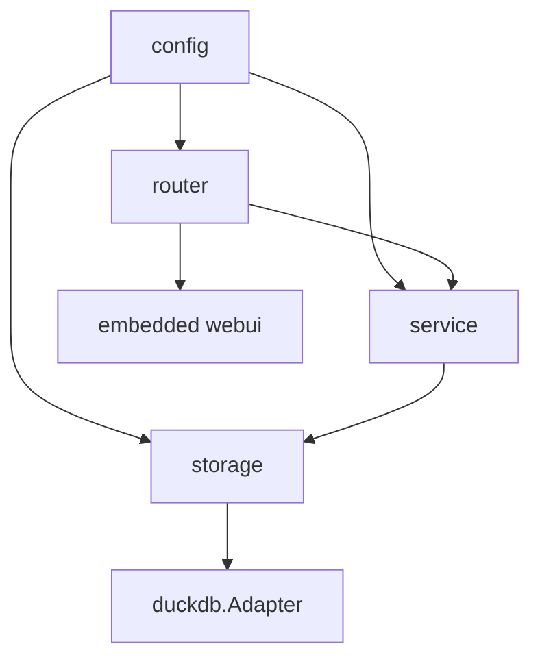
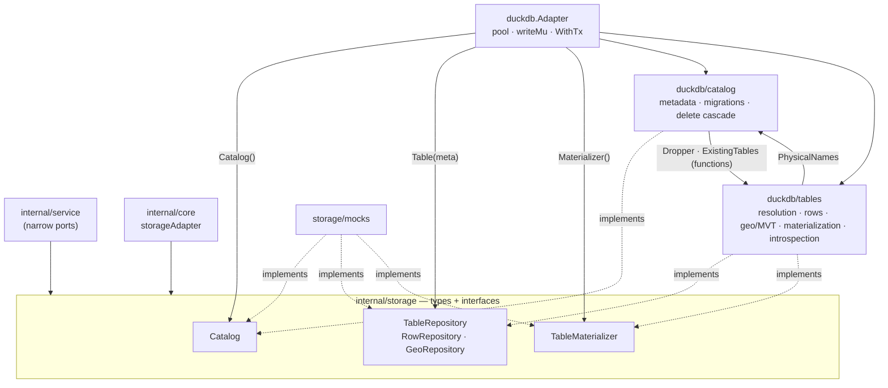

# Darow — Specification

This document describes the **current state** of the Darow cartographic server: its architecture,
its contracts, its invariants. It is written to be read by an AI agent that has to work on the code
without having read all of it.

**The code is the source of truth.** This document is its description; if it diverges, it is this
document that must be fixed. It deliberately contains no code: exact signatures are read in the
files it cites, named in each section. It only describes the **stable** state: blockers, accepted
limitations, identified debt and improvement leads live in separate files, listed in §11.

Its scope is the **Go server** alone. The Vue 3 admin application (`web/`) has its own
specification, `spec/front/spec.md`; the two documents are disjoint and their only contact point is
the REST API, described here (§6) and consumed there. `docs/swagger.json` / `docs/swagger.yaml` /
`docs/docs.go` are generated by `swag init` from the handler annotations and are never edited by
hand.

---

## 0. Non-negotiable rules

These rules apply to all code produced for this project. The numbering is stable and must never be
reordered — code comments describe the code itself and do not refer to these numbers.

1. **Never an unvalidated SQL identifier.** Every table/column name interpolated into a query goes
   through `storage.ValidateIdentifier` **or** `storage.QuoteIdentifier` (§4.3). Values are always
   bound parameters, never interpolated.
2. **`tableId` (UUID) is never an SQL identifier.** Every logical table has a server-generated
   `physicalName` (`t_<uuid_without_dashes>`), stored in `metadata`, resolved on every access.
3. **Identifiers generated by `uuid()`** (DuckDB's native function for the `__pkey`s created in
   CTAS, `github.com/google/uuid` on the Go side for row-by-row insertions). The spatial extension
   is loaded once when the connection opens, never per query.
4. **Every user-supplied SQL query (`/derive`) is restricted to `SELECT`**, validated by DuckDB's
   own parser (§8), and may only reference already registered tables.
5. **Every read filter goes through the validated `BuildFilter` DSL** (§4.5): column whitelisted
   against the real schema, whitelisted operator, bound value. Never a string concatenated from the
   HTTP request.
6. **A multi-row write runs in a single transaction** — `BulkInsert` as much as `UpdateMany`: a
   topological edit moves a boundary shared by several rows, and half of it landing is a corrupted
   boundary, not a partial success.
7. **The geometry column is never returned by the row read endpoints.** Three deliberate, named
   exceptions: export (`GetGeometryGeoJSON`), OGC API - Features (`GetFeatures`, `GetFeaturesTile`)
   and the per-row geometry read (`GeoService.RowGeometry`, plus the echo a geometry-setting write
   returns), where the geometry _is_ the requested data.
8. **Every paginated listing sorts explicitly**, with a deterministic tie-breaker (`__pkey` for
   rows, `tableId` for the catalogue) always appended last. DuckDB guarantees no stable order
   without an `ORDER BY`.
9. **`rowCount` and `bbox` are derived, not stable facts.** They are recomputed by
   `RefreshDerivedMetadata` after every `InsertRow`/`BulkInsert`/`RemoveRows`, and after every
   `Update` that **specifically** touches the geometry column. An `Update` on a scalar field
   triggers nothing. `geometryColumn`, by contrast, is stable configuration, changed only through
   `UpdateMetadata`.
10. **`geometryType` does not exist as a stored field.** A geo column may mix POINT and POLYGON; the
    type is computed on demand through `GeoRepository.Types`, never cached. What a table holds is
    nonetheless a **constraint on what may be written to it**: a table already homogeneous in one
    family (point, line, area — each covering its `MULTI` form) refuses a geometry of another (rule
    23).
11. **The metadata cache is invalidated explicitly** on every write — never left to expire on its
    own.
12. **JSON API output = native JSON types**, not a reproduction of the driver's Go types. Explicit
    conversion according to the column type resolved by `SchemaService.Types` (`DATE` →
    `YYYY-MM-DD`, otherwise RFC 3339).
13. **A derived or imported table is always materialized, never an SQL view.** The CRUD contract
    demands it: a view becomes read-only as soon as it filters or aggregates.
14. **No package-level global variable for shared state.** Dependency injection into the service
    structs.
15. **Data loading goes through `workDir` files.** A `name` comes exclusively from the latest cached
    `Refresh`/`List` — never a value freely built from the request, so as to rule out any directory
    traversal.
16. **The project's scope is the one described here.** Any out-of-scope feature is handled in a
    dedicated request, not as an incidental addition.
17. **Every write or change to a struct, interface, method or handler ships with its tests in the
    same change.**
18. **Every parameter adjustable without recompiling lives in `config`**, never as a constant
    hardcoded in storage/service/router (§2).
19. **Every geometry table receives an RTREE spatial index**, created immediately after the
    load/derive, plus a unique index on `__pkey`.
20. **MVT tiles are cached**, with a key including the table's `UpdatedAt` — a write therefore
    invalidates the tiles with no separate invalidation mechanism.
21. **Every DuckDB write goes through the adapter's single application-level lock.** DuckDB allows
    only one active writer; unserialized concurrent writes fail.
22. **A table homogeneous in one geometry family stays homogeneous.** Every write that sets the
    geometry column is checked against `GeoRepository.Types` first: a polygon layer refuses a point,
    and the refusal is a `ValidationError` (400) raised before anything is written. An **empty**
    table takes any family — the first geometry written is what locks it — and a table already
    mixing families takes any, since the constraint is already broken and refusing would make half
    its rows unwritable. `GEOMETRYCOLLECTION` belongs to no family and is never refused. The check
    reads the types once per request, not once per row.
23. **A write to the geometry column carries its own encoding and its own CRS**
    (`storage.GeometryValue`): WKT through `ST_GeomFromText`, a GeoJSON geometry through
    `ST_GeomFromGeoJSON`, never a direct bind — then `ST_Transform` from the stated CRS (`OGC:CRS84`
    by default, what every read emits) to the EPSG:3857 the column stores, the exact mirror of the
    read. The CRS is a bound parameter. The write triggers `RefreshDerived` through the service,
    never from the storage layer.
24. **`context.Context` is the first parameter of every method that touches DuckDB or the disk**,
    received from `req.Context()` and propagated without derivation. Purely in-memory methods
    (`SourceService.List`, `MaxUploadBytes`) do not take one.
25. **Every application cache is a bounded LRU with expiry** (`hashicorp/golang-lru/v2/expirable`),
    never unbounded, with TTL and size configurable.

---

## 1. Architecture



Four layers, no short-circuit: a handler never calls storage, a service never builds an SQL
identifier, storage knows neither HTTP nor the application caches.

| Package                      | Role                                                                                                                                                                                             |
| ---------------------------- | ------------------------------------------------------------------------------------------------------------------------------------------------------------------------------------------------ |
| `cmd/server`                 | entrypoint: config, bootstrap, HTTP server, graceful shutdown                                                                                                                                    |
| `internal/config`            | YAML loading + environment overrides + validation, bootstrap-only fields (§2.1–2.3)                                                                                                              |
| `internal/settings`          | exported constants: every runtime-editable setting's default value (§2.4), no logic                                                                                                              |
| `internal/core`              | wiring: builds the ten services and the caches from the config and the settings table                                                                                                            |
| `internal/router`            | `chi` router, middlewares, mounting of the SPA and of Swagger                                                                                                                                    |
| `internal/router/handlers`   | one handler per endpoint family + the ports to the services                                                                                                                                      |
| `internal/router/validation` | `{tableId}` resolution, column-name validation                                                                                                                                                   |
| `internal/router/response`   | JSON writing, standard error body, error → status mapping                                                                                                                                        |
| `internal/service`           | application logic, caches, orchestration                                                                                                                                                         |
| `internal/observer`          | `Observer[T]`, a generic in-memory lifecycle notifier — no domain vocabulary, no `context.Context`                                                                                              |
| `internal/storage`           | the storage layer's types, primitives and interfaces: `Metadata`/`Row`/`GeoFeature`/`StoredFilter`/`Settings`, `BuildFilter`, identifiers, `Catalog`, `TableRepository`, `TableMaterializer`, `FilterStore`, `SettingsStore` |
| `internal/storage/duckdb`    | the single implementation (sub-packages `catalog/` and `tables/`)                                                                                                                                |
| `internal/storage/mocks`     | testify doubles of `storage`'s interfaces (`Adapter`, the three repositories), one file per file of `storage` declaring them                                                                     |
| `internal/webui`             | `go:embed` of the Vue SPA's production build                                                                                                                                                     |

**Interface pattern.** Each consumer declares the narrow interface it needs, in its own package,
with a conformance assertion (`var _ X = (*Y)(nil)`). Handlers never know a concrete service type;
services never know the full adapter. The files concerned: `router/handlers/ports.go`,
`service/derive.go`, `service/import.go`, `service/rows.go`, `service/export.go`,
`service/source.go`, `core/core.go`.

**Bootstrap** (`core/core.go`): `Setup` opens DuckDB, creates `workDir` if absent, loads the settings
row (§5.8) — a failure here is a startup failure — builds the three LRU caches from it, wires the ten
services, then makes a first scan of `workDir`. The caller must defer `Close`. `NewServices` does the
wiring alone, with no connection — that is what the tests use with a mock, and it now returns an
error alongside `*Services` for that settings load to fail into.

---

## 2. Configuration

A `config.yaml` file at the root, **optional** (defaults apply if it is absent). Order of
application: defaults → file → `GEOAPI_*` environment variables → validation. A malformed file, an
unparsable variable or an invalid value are fatal errors at startup, never silently ignored.
Validation collects **all** violations before failing.

File: `internal/config/config.go`.

### 2.1 `server`

| Field                | Default | Env variable                         | Constraint |
| -------------------- | ------- | ------------------------------------ | ---------- |
| `port`               | 8080    | `GEOAPI_SERVER_PORT`                 | 1..65535   |
| `readTimeoutSec`     | 15      | `GEOAPI_SERVER_READ_TIMEOUT_SEC`     | ≥ 0        |
| `writeTimeoutSec`    | 30      | `GEOAPI_SERVER_WRITE_TIMEOUT_SEC`    | ≥ 0        |
| `idleTimeoutSec`     | 60      | `GEOAPI_SERVER_IDLE_TIMEOUT_SEC`     | ≥ 0        |
| `shutdownTimeoutSec` | 10      | `GEOAPI_SERVER_SHUTDOWN_TIMEOUT_SEC` | ≥ 0        |

### 2.2 `duckdb`

| Field          | Default         | Env variable                   |
| -------------- | --------------- | ------------------------------ |
| `path`         | `./data/geo.db` | `GEOAPI_DUCKDB_PATH`           |
| `maxOpenConns` | 4               | `GEOAPI_DUCKDB_MAX_OPEN_CONNS` |
| `maxSizeBytes` | 0 (unlimited)   | `GEOAPI_DUCKDB_MAX_SIZE_BYTES` |

The parent directory is created if it does not exist — DuckDB refuses to open a file in a missing
directory.

`maxSizeBytes` is a hard cap on the database's on-disk size, enforced by `service.SizeGuardService`
(§5.10) — an operator decision about the disk the process runs on, and deliberately config-only:
unlike the settings table (§2.4), it is never exposed through `PATCH /api/v1/settings`, so raising it
always requires a restart.

### 2.3 `sources`

| Field               | Default                                         | Env variable                                          |
| ------------------- | ----------------------------------------------- | ----------------------------------------------------- |
| `workDir`           | `./data/sources`                                | `GEOAPI_SOURCES_WORKDIR`                              |
| `maxSizeBytes`      | 104,857,600 (100 MiB)                           | `GEOAPI_SOURCES_MAX_SIZE_BYTES`                       |
| `allowedExtensions` | `.geojson`, `.shp`, `.csv`, `.gpkg`, `.parquet` | `GEOAPI_SOURCES_ALLOWED_EXTENSIONS` (comma-separated) |

Every extension must start with a dot. `workDir` can also be overridden by the `--workdir` flag,
which takes priority over everything else (§2.5).

### 2.4 Runtime-editable settings

Every parameter a request path or a cache reads once the process is up — row/list pagination
limits, request body size, per-request timeout, export batch size, OGC/tile feature limits,
geometry simplification bounds, the tile HTTP cache lifetime, and the TTL/size of the three LRU
caches — is **not** in `config.yaml`. It lives in the single-row `settings` table (§4.9), read and
written through `SettingsService` (§5.8) and edited at runtime through `GET`/`PATCH /api/v1/settings`
(§6.1) — never through a file or an environment variable, and never requiring a restart. Its default
values are `internal/settings`'s exported constants, the one place they are written; `config.yaml`
keeps only what the process needs to start at all, before that table can even be read.

### 2.5 Command-line flags

| Flag        | Default       | Effect                                          |
| ----------- | ------------- | ----------------------------------------------- |
| `--config`  | `config.yaml` | path of the configuration file                  |
| `--workdir` | empty         | overrides `sources.workDir` after the full load |

---

## 3. Sources (`workDir`)

`workDir` is a directory of files dropped in by hand or uploaded. `SourceService`
(`internal/service/source.go`) scans it and maintains an **in-memory cache** of its contents.

### 3.1 Model

A `Source` carries: file name, extension, size, modification date, loaded state, `tableId` if
loaded, and for a multi-layer format the list of its layers (each with its own loaded state and its
`tableId`).

Recognized formats (`internal/service/formats.go`): Multi-layer decides whether `Load` requires a
`layer` and whether `Refresh` populates `Source.Layers` via `ListLayers`. Introspectable decides
whether `GetSourceMetadata` (`/sources/{name}/metadata`) calls `DetectCRS` at all — false for a
format whose reader (`read_parquet` for `.parquet`, §7.2) has no `ST_Read_Meta`-based CRS preview to
offer, and must never be reached with a file `ST_Read_Meta` cannot safely open.

`SourceHasGeometry` is asked **first**, and of every format including Parquet: a source carrying no
geometry field needs no CRS at all, and `Load` takes it with no `srid`. It is the storage layer that
knows how to read each format for that answer — `st_read_meta`'s `geometry_fields` for an `ST_Read`
format, a `DESCRIBE` over `read_parquet` for a Parquet one, the same dispatch `CreateFromFile` makes
— so no format is ever assumed to carry a geometry it does not have. `DetectCRS` is only called when
the answer is yes.

| Extension  | Multi-layer | Introspectable |
| ---------- | ----------- | -------------- |
| `.geojson` | no          | yes            |
| `.shp`     | no          | yes            |
| `.csv`     | no          | yes            |
| `.gpkg`    | yes         | yes            |
| `.parquet` | no          | no             |

A file whose extension is not in `allowedExtensions`, or whose size exceeds `maxSizeBytes`, is
**silently excluded** from the scan — it is not an error.

### 3.2 Operations

| Operation           | Behaviour                                                                                                                                                                                                                                                                                                                                                          |
| ------------------- | ------------------------------------------------------------------------------------------------------------------------------------------------------------------------------------------------------------------------------------------------------------------------------------------------------------------------------------------------------------------ |
| `Refresh`           | rescans `workDir`, cross-references the already loaded tables, replaces the cache. Called at startup and through `POST /sources/refresh`.                                                                                                                                                                                                                          |
| `List`              | paginates and sorts a **copy** of the cache, without ever touching the disk again. Sorting validated against an allowlist (`name`, `sizeBytes`, `modTime`, `loaded`).                                                                                                                                                                                              |
| `Upload`            | writes into `workDir` after reducing the name to its base (traversal protection), checking extension and size. Refuses to overwrite an existing file.                                                                                                                                                                                                              |
| `Load`              | imports a source (or one of its layers) into a table. `name` must exist in the cache (rule 15).                                                                                                                                                                                                                                                                    |
| `DetectCRS`         | reads the CRS declared by the file, importing nothing — lets the UI show and correct it before loading.                                                                                                                                                                                                                                                            |
| `SourceHasGeometry` | reports whether the file carries a geometry field at all, importing nothing — what decides whether a CRS has to be asked for.                                                                                                                                                                                                                                      |
| `Delete`            | removes the table(s) derived from the source and its cache entry. **The file itself is never deleted.**                                                                                                                                                                                                                                                            |
| `UnmarkLoaded`      | drops the loaded state of whichever source or layer entry matches the given `storage.Metadata`'s `SourceName`/`SourceLayer`, a no-op if none does. Registered onto `MetadataService`'s removed-table observer by `core.NewServices` (§5.1) — the fix for a table deleted through `DELETE /tables/{tableId}` otherwise leaving its source cached as loaded and pointing at a `tableId` that no longer exists. |

**Locking.** `Load` holds the lock for its whole check-then-import, not just around the cache read:
two concurrent `Load`s on the same source cannot both pass the "not loaded yet" test. `Delete`
removes the cache entry only after all table deletions have succeeded, so that a partial failure
leaves the source visible and retryable.

**Loaded/not-loaded tracking.** The source ↔ table link relies on the `sourceName` and
`sourceLayer` fields of `metadata`, **never** on `tableName` — which `PATCH /tables/{id}` may rename
freely. Renaming a table therefore does not detach it from its source, and no unrelated table can
pass for a source by a coincidence of names.

**Multi-layer naming.** A layer loaded from `file.gpkg` produces a table named
`file.gpkg::layer_name`; `sourceName` receives `file.gpkg` and `sourceLayer` receives `layer_name`.

---

## 4. Storage layer

Four packages, and a single import direction — nothing under `duckdb/` is ever named above it:



A service holds an interface, never `*duckdb.Adapter`. `Adapter` owns the connection and hands out
its three components; the two sub-packages implement the contracts and **never import each other** —
each link between them is a one-method interface declared on the consumer's side and wired in `New`
(§4.6).

### 4.1 The `metadata` catalogue

A system table, one record per logical table. Columns:

| Column                    | SQL type               | Nature                | Meaning                                                                                       |
| ------------------------- | ---------------------- | --------------------- | --------------------------------------------------------------------------------------------- |
| `tableId`                 | `TEXT PRIMARY KEY`     | config                | UUID v4, the logical/API identifier                                                           |
| `physicalName`            | `TEXT NOT NULL UNIQUE` | config                | real name of the SQL table (`t_<uuid>`)                                                       |
| `tableName`               | `TEXT NOT NULL`        | config                | display name, renameable                                                                      |
| `isGeo`                   | `BOOLEAN`              | config                | the table has a geometry column                                                               |
| `createdAt` / `updatedAt` | `TIMESTAMP`            | derived (`updatedAt`) | `updatedAt` is bumped by every derived refresh — it is the tile invalidation signal (rule 20) |
| `geometryColumn`          | `TEXT`                 | config                | name of the geometry column, which varies with the source format                              |
| `rowCount`                | `INTEGER`              | derived               | recomputed by `RefreshDerivedMetadata` (rule 9)                                               |
| `bbox`                    | `TEXT`                 | derived               | `"minX,minY,maxX,maxY"` in **OGC:CRS84** (lon/lat)                                            |
| `srid`                    | `INTEGER`              | config                | the original **source** CRS, before reprojection                                              |
| `sourceName`              | `TEXT`                 | config                | originating `workDir` file; empty for a `/derive` table                                       |
| `sourceLayer`             | `TEXT`                 | config                | originating layer for a multi-layer source                                                    |

Two indexes: on `isGeo` and on `tableName`.

`Metadata` is a **value type** on the Go side: every caller receives its own copy, no
synchronization is needed.

`geometryType` is deliberately absent — a geometry column may mix types, so it is computed on demand
rather than cached.

### 4.2 Data tables and the access contract

Every logical table is materialized as `t_<uuid_without_dashes>` with a `__pkey` column (text UUID)
generated in the `CREATE TABLE AS SELECT`, never added afterwards. A unique index on `__pkey`
replaces the primary key constraint, which DuckDB does not allow adding after a CTAS.

For a geo table: an RTREE index on the geometry column (rule 19), and **Hilbert clustering** — rows
are physically reordered along a Hilbert curve on the geometry, so that tile scans prune by spatial
locality. Clustering rebuilds the table, so both indexes are created **after** it, never before, and
their presence is then **asserted against `duckdb_indexes()`** (§4.8) rather than assumed: a missing
RTREE index degrades every tile scan without failing anything, so the load fails instead.

**Access contract (referred to as "§4.2" in the code).** Every storage method reading or writing
data takes the `storage.Metadata` **already resolved** by the caller, never a `tableId`. The
router's resolution middleware reads it once per request; `ExportService` keeps it for a whole
export. No method redoes a `SELECT` on `metadata` that the caller has already done. The corollary as
applied to export: `ListRowsPage` exists next to `ListRows` precisely to avoid a per-page `COUNT(*)`
that the streaming has no use for.

### 4.3 Identifier validation

Two primitives with **distinct, non-interchangeable** roles (`internal/storage/identifier.go`):

| Primitive            | Use                                                                                                   | Mechanics                                                                                                      |
| -------------------- | ----------------------------------------------------------------------------------------------------- | -------------------------------------------------------------------------------------------------------------- |
| `ValidateIdentifier` | **server-generated** identifiers: `physicalName`, DuckDB type keywords                                | rejection by a strict alphanumeric pattern (`^[a-zA-Z_][a-zA-Z0-9_]*$`)                                        |
| `QuoteIdentifier`    | any column name that may **come from imported data** (accents, spaces, punctuation from a French CSV) | quoting, doubling of inner `"`, rejection of the only byte genuinely dangerous inside a quoted identifier: NUL |

Using `ValidateIdentifier` on an imported column name breaks real-world files; using
`QuoteIdentifier` on a `physicalName` works but hides a design error. In both cases, **safety comes
from validation before interpolation, not from the allowed character set**.

### 4.4 Go contracts

Files: `internal/storage/catalog.go`, `table.go`, `row.go`, `feature.go`, `geoquery.go`, `sort.go`.

`storage` declares both the types crossing the layer and the interfaces its single engine
implements. There is one implementation of each — DuckDB (LIM-9) — so they exist to keep the
consumers off the concrete type and to be mockable (§10), not to make a second backend possible:

| Interface           | Responsibility                                                                                                                                                                                                                                                                                                                                                                                                                                                                                                                   |
| ------------------- | -------------------------------------------------------------------------------------------------------------------------------------------------------------------------------------------------------------------------------------------------------------------------------------------------------------------------------------------------------------------------------------------------------------------------------------------------------------------------------------------------------------------------------- |
| `Catalog`           | the catalogue aggregate: `TableIds` (sorted), `TableExists`, `GetMetadata`, `List`, `BySource`, `PhysicalNames` (the registered-table allowlist `/derive` validates against), `CreateFromFile`, `CreateFromQuery`, `Remove`, `UpdateMetadata`, `RefreshDerivedMetadata`. `TableExists` and `PhysicalNames` answer against **both** `metadata` and `duckdb_tables()` (§4.8): a metadata row whose physical table is gone reads as absent, instead of reading as an existing table until the first query against it returns a 500 |
| `TableRepository`   | `Schema`, `Types`, `AddColumn`, `Count`, `Rows() RowRepository`, `Geo() (GeoRepository, bool)`                                                                                                                                                                                                                                                                                                                                                                                                                                   |
| `RowRepository`     | `Pkeys`, `Page`, `ByPkey`, `Filtered`, `Distinct` (paginated, with an optional case-insensitive `search` matched against the value's text form, LIKE wildcards escaped so they match literally), `Insert`, `InsertMany`, `Update`, `UpdateMany` (its own values per row, all in one transaction), `Delete`                                                                                                                                                                                                                       |
| `GeoRepository`     | `Tile`, `Features`, `CountFeatures`, `FeaturesInTile`, `PkeysInBbox`, `Extent`, `GeoJSONByPkey`, `WKTByPkey` (the same geometry as Well-Known Text, both reprojected to `OGC:CRS84`), `Types`                                                                                                                                                                                                                                                                                                                                    |
| `TableMaterializer` | `ListLayers`, `DetectCRS`, `SourceHasGeometry` — answers questions about a source file before any table exists. The materialization itself (CTAS, indexing, clustering, from a source file or a derived SELECT) is not on this interface — it runs transactionally through `Catalog.CreateFromFile`/`CreateFromQuery` (below) instead                                                                                                                                                                                          |

Both the delete cascade and the create path are deliberately absent from these interfaces:
`duckdb/catalog.Catalog.Remove` drops the physical table through a `Dropper` and cascades to every
registered `Attachment`'s `DeleteAttached(ctx, tx *sql.Tx, tableId string) error`;
`Catalog.CreateFromFile`/`CreateFromQuery` register the metadata row, materialize the physical
table through a `FileCreator`/`QueryCreator` function value, and cascade to every registered
`Attachment`'s `CreateAttached(ctx, tx *sql.Tx, tableId string) error` — all four (`Dropper`,
`FileCreator`, `QueryCreator`, `Attachment`) declared in `duckdb/catalog` and naming `*sql.Tx`
directly. `Register(Attachment)` is a construction-time extension point on that concrete type — the
point through which a catalogue-attached repository joins both the whole-table delete cascade and
the create transaction — not a method any service reaches through `storage.Catalog`.

No service depends on the interfaces above directly: each declares its own narrow interface over the
subset it actually calls. `core.storageAdapter` documents the full surface an adapter must satisfy —
`Catalog() storage.Catalog`, `Materializer() storage.TableMaterializer`, and
`Table(meta) (TableRepository, error)`, plus `Filters() storage.FilterStore` — four accessors rather
than a flattened union of every storage method.

**Naming.** `Catalog.Remove` deletes a whole table (metadata and physical table, in a single
transaction), `Catalog.CreateFromFile`/`CreateFromQuery` create one (metadata and physical table,
equally in a single transaction), `RowRepository.Delete` deletes rows.

**Cross-cutting data types.** `Metadata` (+ `MetadataPatch`, `SourceKey`), `Row` (pkey + values, no
geometry), `GeoFeature` (pkey + raw GeoJSON fragment + values), `GeoQuery` (`BuildFilter` clause +
args + simplification tolerance + precision, all optional), `RowQuery`/`FeatureQuery` (a repository
call's criteria grouped into one struct, so a new criterion is an added field and never an added
parameter position), `SortField` (column + direction, parsed from a `sort=a,-b` value).

**Hidden columns.** `IsHiddenColumn(name string) bool` (`internal/storage/hidden_columns.go`)
answers whether a physical column is one the server manages internally and never surfaces to a
caller — `__pkey` (carried separately as `Row.Pkey`/`GeoFeature.Pkey`, never in `Values`) and
`OGC_FID` (§7's GDAL/OGR feature-id column). Both stay physically stored; every consumer that
builds a user-facing column list — `scanRows`/`scanFeatureRows` (`duckdb/tables/scan.go`),
`DeriveFromTable`'s `projectionFor`, `ExportService.exportColumns`, `ColumnValidator.ValidateColumns`
— excludes them the same way it excludes the geometry column. There is no single SQL-level
exclusion: each consumer calls `IsHiddenColumn` on its own column list, exactly as each already
excludes the geometry column on its own.

### 4.5 Filter construction

`storage.BuildFilter` (`internal/storage/filter.go`) is **the only** allowed path to a client-driven
`WHERE` (rule 5).

A `FilterCondition` is either a leaf (`Column` + `Operator` + `Value`) or a boolean group (`Bool`
being `AND` or `OR`, plus child `Conditions`) — never both.

-   The column is validated against the list of the table's real columns, **geometry excluded**.
    `BuildFilter` receives `ColumnInfo` values (name **and** DuckDB type), not bare names: the type
    is what shapes the comparison below.
-   The operator is validated against `=`, `!=`, `>`, `<`, `>=`, `<=`, `LIKE`, `NOT LIKE`,
    `IS NULL`, `IS NOT NULL`. The last two bind **no** parameter — they test the column itself, and
    are the only way to match a NULL at all, since SQL's `col = NULL` is never true.
-   The boolean connector is validated against `AND`, `OR`.
-   `Not` negates whatever the node produces — leaf or group alike, the clause is wrapped in
    `NOT (…)`. That, plus `NOT LIKE` and `IS NOT NULL`, is the whole of negation: there is no `NOT`
    boolean connector, since a negated group already expresses it.
-   The value is **always** a bound parameter.
-   Top-level conditions are joined by `AND`; groups are parenthesized.

**A value the column's type cannot read narrows the result to nothing; it never aborts the query.**
DuckDB raises a Conversion Error on a bare parameter comparison (`"abc"` against an `INTEGER`
column) and a Binder Error on `LIKE` against a non-text column — both surfaced as a 500 on what is,
from the client's side, an ordinary search. So the parameter is wrapped in `TRY_CAST(? AS <type>)`,
which yields `NULL` instead of failing, and `LIKE` compares `CAST(col AS VARCHAR)` so it applies to
any column. The cast target is the column's declared type, interpolated only when its base name is
in `castableTypes` and anything following it is numeric parameters alone (`DECIMAL(10,2)`); any
other declared type (`STRUCT`, `LIST`, an array suffix) falls back to a bare parameter.

Whitelisting against the real schema is what makes the interpolation safe; `QuoteIdentifier` only
escapes.

### 4.5.1 Stored filters

A filter can also be **saved against a table**, under a name, and reused. `storage.StoredFilter`
(`internal/storage/storedfilter.go`) is a name plus the very `[]FilterCondition` tree an ad-hoc
filter posts; `storage.FilterStore` is the read/write contract, implemented by
`duckdb/catalog.Filters` over a `filters` table registered as its own migration `Component`.

-   The tree is persisted as **JSON**, read and written whole — it is never queried into.
-   `service.FilterService` validates a filter at **save** time by running it through `BuildFilter`
    against the table's real schema, so a filter read back from the catalogue is always applicable.
    It also trims the name, requires it non-empty and bounded, and requires at least one condition.
-   Every read, update and delete is scoped to the resolved table: a filter belonging to another
    table is reported as missing rather than served across tables.
-   `Filters` is registered on the catalogue as an `Attachment`, so `Catalog.Remove` deletes a
    table's filters inside the same transaction as its metadata row and its physical table.

### 4.6 The DuckDB adapter

Files: `internal/storage/duckdb/adapter.go` — the connection, the write serialization and the three
accessors (`Catalog`, `Materializer`, `Filters`, `Table`) the rest of the server reaches the engine
through — plus the sub-packages `duckdb/catalog/` (metadata, stored filters, migrations, delete
cascade) and `duckdb/tables/` (one file per family: table resolution, rows, geo, `introspection.go`
— the engine catalogue reads (§4.8) — and the `Materializer` type split across
`create_from_file.go`, `create_from_query.go` (`/derive` and its query validation), `crs.go`
(detection and reprojection) and `indexes.go` (pkey/RTREE indexes, Hilbert clustering), with
`materializer.go` holding the type alone and `drop.go` the stateless `DropTable`). `Adapter`
forwards nothing: each accessor returns the sub-package type that implements the contract. The two
sub-packages never import each other — `New` wires the catalogue's `Dropper` and its
`ExistingTables` reader straight to `duckdb/tables.DropTable` and `tables.ExistingTables(conn)`,
both function values needing nothing but a transaction or a connection, and the materializer's
physical-name allowlist to the catalogue. `New` also wires the catalogue's `FileCreator`/
`QueryCreator` to two closures over `tables.NewTxMaterializer` — a tx-scoped `*tables.Materializer`
built fresh per call, its `Querier`/`TxRunner` backed by the `*sql.Tx` the create transaction
already opened, so `CreateFromFile`/`CreateFromQuery`'s existing CTAS/index/reproject/cluster
statements join it unchanged rather than being rewritten to take a `*sql.Tx` directly. Only that
last link (the materializer's physical-name allowlist) needs an already-built dependency, so the two
constructions run in that order rather than through a deferred closure.

-   **Opening**: `INSTALL spatial; LOAD spatial;` once, pool sized by `duckdb.maxOpenConns` (§2.2),
    creation of the parent directory, then schema migration.
-   **Readiness**: `Ping` is the connection ping **plus** the assertion that `spatial` is loaded
    (§4.8) — the extension is loaded once at open (rule 3) and every geo route depends on it.
-   **Write serialization**: a single application-level mutex (`writeMu`) covers `Exec`.
    `BulkInsert`, `Catalog.Remove` and `Catalog.CreateFromFile`/`CreateFromQuery` take it themselves
    for the whole duration of their transaction, rather than per statement.
-   **Fatal-instance recovery**: an `INTERNAL` or `FATAL` DuckDB error invalidates the whole
    instance, not just the query that raised it. Every call that reaches the connection (`Query`,
    `QueryRow`, `Exec`, `WithTx`, `Ping`) checks its error against `isFatalDuckDBError` and, on a
    match, reopens the pool — a fresh `sql.Open` plus `INSTALL`/`LOAD spatial` — through
    `recoverIfFatal`, guarded by `reopenMu` so two callers hitting the same dead instance at once
    reopen it only once. `db` itself is guarded by `dbMu`, read through `conn()`, so the swap never
    races a concurrent reader.
-   **Migrations** (`duckdb/catalog/migrations.go`): a registry of `Component`s, one per
    catalogue-owned table — `metadata` (registered from `duckdb/catalog/metadata.go`'s `init`) and
    `filters` (from `duckdb/catalog/filters.go`'s), a future settings table tomorrow. Each
    `Component` carries its own creation DDL and its own ordered list of `ALTER` statements, and
    `schema_version` tracks one `(component, version)` row per component rather than a single
    whole-database integer, so adding a component never touches another's history. Per component: a
    database with no recorded version for it gets the current DDL directly and is marked at the
    highest version; a recorded version behind `len(Migrations)` replays the missing statements and
    bumps the version. `metadata`'s own `Migrations` list is empty today — see `limitations.md`
    LIM-7.
-   **Reprojection**: geometry is reprojected **once at import** to EPSG:3857, never per query.
    Every lon/lat output (bbox, GeoJSON) converts back to `OGC:CRS84`.

> **`OGC:CRS84`, never `EPSG:4326`.** EPSG:4326's official axis order is (lat, lon): using it as the
> target CRS silently swaps X and Y. This rule applies to the four places that transform: `bbox`
> computation, `FilteredExtent`, `GetGeometryGeoJSON`, `GetFeatures`.

### 4.7 Rendering an MVT tile

File: `internal/storage/duckdb/tables/geo.go` (`Tile`).

A single query, in three steps: selection of the rows intersecting the tile envelope
(`ST_TileEnvelope`), simplification, then `ST_AsMVTGeom` + `ST_AsMVT` aggregation. The decisions
that govern its cost:

-   **`ST_Intersects_Extent`, not `ST_Intersects`**, for the tile filter: comparing envelopes is
    enough — `ST_AsMVTGeom` then clips exactly — and the RTREE index is not picked up by the planner
    on this kind of query anyway. The real pruning comes from the Hilbert clustering (§4.2), which
    lets the zone maps discard row groups outside the tile. `ST_Intersects` on the same query is
    measured several seconds slower.
-   **`ST_Simplify`, not `ST_SimplifyPreserveTopology`.** The topology-preserving variant dominates
    the query's total time (measured on an administrative layer of 35,000 polygons / 7 M vertices:
    4.0 s against 0.78 s at z5; 3.0 s against 0.10 s at z0) for a tile that differs by 0.1 % in
    size, since `ST_AsMVTGeom` then re-quantizes every coordinate onto the integer 4096-unit grid.
    What topology preservation buys — rings that survive instead of collapsing — is precisely what
    must disappear at a zoom where the feature is less than a pixel wide.
-   **The tolerance comes from the zoom**, `tileSimplifyTolerance`: one MVT extent unit converted to
    Web Mercator metres, floored at 0.25 m. The HTTP request's `simplify`/`precision` parameters are
    therefore ignored on the MVT route (they only apply to the GeoJSON routes), and do not enter the
    cache key.
-   **`TRY(...)` + `WHERE mvt_geom IS NOT NULL`** around `ST_AsMVTGeom`: a safety net against an
    upstream duckdb-spatial defect (`duckdb/duckdb-spatial#792`) that produces corrupt clipped
    geometry on certain source/tile combinations. It can only discard an already broken feature,
    never a valid one.

### 4.8 Reading DuckDB's own catalogue

File: `internal/storage/duckdb/tables/introspection.go` — the **single** place DuckDB's catalogue
functions are read. Their result columns are versioned with the engine, so a DuckDB upgrade is one
file to check. LIM-9 makes this engine-specific access legitimate: there is no second backend to
keep it portable for.

| Function              | Read through                                                                           | Answers                                                                                                                                    |
| --------------------- | -------------------------------------------------------------------------------------- | ------------------------------------------------------------------------------------------------------------------------------------------ |
| `duckdb_columns()`    | `tableColumns`                                                                         | the columns of an **existing** table: name, declaration index, full declared type (`GEOMETRY('EPSG:2154')` included), nullability, default |
| `duckdb_indexes()`    | `tableIndexes`                                                                         | the indexes really created on a table (rule 19's assertion, §4.2)                                                                          |
| `duckdb_tables()`     | `existingTableNames`, reached from outside through the `ExistingTables` function value | the tables that physically exist, for the catalogue to tell a live registration from a metadata row whose table is gone                    |
| `duckdb_extensions()` | `ExtensionLoaded`, `loadedExtensions`                                                  | whether `spatial` is loaded, for `/readyz`; the full loaded list, for `/diagnostics`                                                       |
| `pragma_database_size()` | `databaseSizeBytes`                                                                 | on-disk size, from the exact `total_blocks`/`block_size` columns — never the human-readable ones, not meant to be parsed back              |
| `duckdb_memory()`     | `memoryUsageBytes`                                                                     | buffer-manager memory usage, summed across tags                                                                                            |
| `duckdb_temporary_files()` | `temporaryFilesBytes`                                                            | bytes currently spilled to disk, summed across files — zero when nothing is spilling                                                       |

`Diagnostics` (also in `introspection.go`) composes the four into a `storage.Diagnostics` value, read
by `duckdb.Adapter.Diagnostics` and served whole by `GET /diagnostics` (§6.1) — no
`duckdb_settings()` involved, that surface staying out of scope (rule 16).

The table name is a **bound parameter** in every one of them: no physical name is interpolated to
list a structure, so rule 1 is structurally satisfied there rather than validated after the fact.

`DESCRIBE` survives in exactly one place, `queryColumns`: the shape of a `SELECT` that has **not**
been materialized, which by definition has no catalogue entry. It is what `/derive`'s `__pkey`
collision check reads (§8). Separating the two — a table target goes to the catalogue, a query
target to `DESCRIBE` — is what removes the interpolation from the common case.

> Rule 4 is untouched by all this. The `/derive` AST validator rejects **every** table function
> precisely because `duckdb_settings` and its siblings read system state. These functions are
> server-side only, called with server-built SQL: the validator is never relaxed to admit them, and
> no path hands a caller-supplied query to one.

### 4.9 The `settings` repository

`duckdb/catalog.Settings` (`settings.go`) owns the single row of the `settings` table — the
runtime-editable counterpart of `metadata` (§4.1), registered as a `Component` in the same
per-component migration registry (`migrations.go`) and reached through `Adapter.Settings()`
alongside `Catalog()`/`Filters()`/`Materializer()` (§4.6). It is **not** an `Attachment`: nothing
about it is scoped to a `tableId`, so it never joins the delete cascade `Catalog.Register` builds.

The table is a singleton, `id` fixed at `1`, one column per `storage.Settings` field, seeded from
`internal/settings`'s defaults inside `CreateSchema` itself (an `INSERT ... WHERE NOT EXISTS`, run
once per process the first time the table doesn't exist yet — every later startup finds the row and
leaves it alone). `GetSettings` reads that row whole; `UpdateSettings` takes a `storage.SettingsPatch`
(nil fields left unchanged, the same shape as `MetadataPatch`) and writes only the columns given,
stamping `updatedAt`.

---

## 5. Service layer

Twelve services, each the exclusive owner of its state. Files: `internal/service/`.

**Error wrapping.** Every service method that calls into the storage layer wraps a raw failure it
did not itself construct (a DuckDB error, an `os` error) in `service.DisplayError` (§6.4) before
returning it — a clean message naming the table, column, source or operation concerned, the raw
cause kept reachable through `Unwrap` for classification and logging. An error a service already
constructs itself (`ValidationError`, `NotFoundError`, `ConflictError`) is deliberate and clean as
written and is never further wrapped.

### 5.1 `MetadataService` — sole owner of the metadata cache

Every other service goes through it to read or write metadata, through a narrow port; nobody caches
independently (rule 11). The cache is a bounded LRU with a TTL.

It invalidates the entry concerned after **every** write: `UpdateMetadata`, `RefreshDerived`,
`RemoveTable`. A newly created `tableId` was never cached, so `CreateFromFile`/`CreateFromQuery`
need no invalidation of their own.

`RemoveTable` takes the caller's already-resolved `storage.Metadata`, not a bare `tableId` (the
same access contract §4.2 states for storage-touching calls), and after deleting it notifies it to
`removed`, an `*observer.Observer[storage.Metadata]` (`internal/observer`) injected through the
constructor. `core.NewServices` builds the observer, passes it to `NewMetadataService`, and
registers `SchemaService.InvalidateSchema` and `SourceService.UnmarkLoaded` onto it — deleting a
table changes its structure just as surely as `AddColumn` does, and would otherwise leave a stale
entry in `SchemaService`'s cache until its TTL, and a deleted table's source displayed as loaded
otherwise. Registration happens once, at construction, in `core.NewServices`: `Observer[T]` is not
safe for concurrent registration, only for the fan-out itself, which runs after the delete has
already committed and never returns an error — nothing a cache eviction could fail at is left to
report by then. This is `MetadataService`'s only dependency on another service's behaviour, and it
only goes that way — neither `SchemaService` nor `SourceService` knows `MetadataService`, only the
observer both `MetadataService` and they hold a reference to.

-   `ListTables` paginates over `TableIds`'s deterministic order and also returns the total.
-   `CreateFromFile`/`CreateFromQuery` thinly wrap `storage.Catalog`'s methods of the same name
    (§5.4): the transaction that guarantees a catalogue row never survives without a physical table
    is owned by `duckdb/catalog`, not by this service.
-   `LoadedSourceNames` builds the source → `tableId` lookup used by `SourceService.Refresh`, keyed
    on `sourceName`(`::sourceLayer`).

### 5.2 `RowService` — typed row CRUD

Converts every value to a native JSON type according to the column type resolved by
`SchemaService.Types` (rule 12), resolved **once per page** rather than once per row.

A write that sets the geometry column names the CRS its literal is expressed in (`crs`, defaulting
to `OGC:CRS84`); the service turns the raw JSON value into a `storage.GeometryValue` — a string is
WKT, an object is a GeoJSON geometry, anything else is a `ValidationError` — and reads the stored
geometry back as GeoJSON (`RowWriteResult`), so the client redraws what the server kept rather than
its own draft. A bulk insert carries the same CRS and echoes nothing.

Before any of that reaches the repository, a write that sets the geometry column is checked against
what the table already holds (rule 23, `geometry_family.go`): the families of the written geometries
— read off the WKT type name or the GeoJSON `type`, so nothing is parsed twice — against the
families of `GeoRepository.Types`. One family stored and another written is a `ValidationError`, and
the whole request is refused, batch included: a save that half-landed would leave the caller's grid
and map disagreeing. The types are read **once per request**, which is one distinct scan of the
geometry column per write.

`UpdateRows` is the multi-row form: each row carries its own values, the whole set is written in one
transaction, and derived metadata is refreshed once. `UpdateRow` writes every column in **one**
statement: a multi-column update is atomic, all or nothing (§5.1 from the calling code's point of
view). `UpdateRow`, `InsertRow` and `BulkInsertRows` trigger `RefreshDerived` with `touchesGeometry`
true only if the write actually sets the geometry column (rule 9); a purely scalar update or insert
recomputes only `rowCount`/`updatedAt`, never the `bbox`. `RemoveRows` always passes
`touchesGeometry` as `meta.IsGeo`: a deleted row may have been on the bbox boundary, which there is
no cheap way to check after the fact.

### 5.3 `SchemaService` — structure, not data

Owner of its schema cache. Exposes the full schema (**geometry included**: this is structure, rule 7
does not apply) and the name → type table. `AddColumn` is the only write that changes the structure
from this service and therefore invalidates the cache; adding a column affects no derived field, so
this service does not need `MetadataService`. `InvalidateSchema` exposes the same invalidation as a
callback `core.NewServices` registers onto `MetadataService`'s removed-table observer (§5.1),
without the cache ceasing to belong to this service.

`AddColumn` checks `colType` against `storage.ValidateColumnType` before opening the table: an
allowlist of DuckDB scalar types, `GEOMETRY` deliberately excluded — a column added this way must
never produce the second geometry column the rest of the domain assumes cannot exist, nor a geometry
`isGeo` never learns about. `duckdb/tables`' `table.AddColumn`, the one place that interpolates
`colType` into the `ALTER TABLE` statement, checks it again with the same function — the repository
never trusts a caller other than this service to have validated first.

### 5.4 `DeriveService` and `ImportService` — creating a table, transactionally

Neither service owns the create transaction: each calls one method on `MetadataService`
(`CreateFromQuery`/`CreateFromFile`), which itself thinly wraps `storage.Catalog`'s method of the
same name. `duckdb/catalog.Catalog.CreateFromFile`/`CreateFromQuery` register the metadata row,
materialize the physical table (CTAS from a file or from a query, via the `FileCreator`/
`QueryCreator` function value `duckdb.New` wired in — §4.6), persist the resolved geometry column /
SRID / source, and cascade to every registered `Attachment`'s `CreateAttached`, all inside one
transaction (§4.4): a failure at any step leaves neither a metadata row nor a physical table
behind, rolled back together — the create path's counterpart to `Catalog.Remove`'s cascade.
`ImportService` additionally computes `sourceName`/`sourceLayer` (§3.2) from the layer suffix before
calling `CreateFromFile`.

`DeriveService` applies a cheap fail-fast on the query's shape (a single statement, starting with
`SELECT`) before ever calling `CreateFromQuery` — **this is not the authoritative check**: the real
validation is done by DuckDB's parser on the storage side (§8). It serves both derivation modes:
`DeriveTable` takes the query as given, `DeriveFromTable` assembles one from a `DeriveSpec` (§8.1),
and both then run the same `materialize` helper. Building a spec's query needs the source table's
structure, so this is the one service besides the router to hold a port onto `SchemaService`.

### 5.5 `GeoService` — tile cache

The only service that caches a rendering result. The cache key includes: `tableId`, z/x/y,
`UpdatedAt` (rule 20), the requested attributes (sorted), and the filter clause with its arguments —
since all of them change the tile's contents for a given table version.

Everything else is computed on demand and **never cached**: `GetFeatures`, `CountFeatures`,
`GetFeaturesTile`, `FilteredExtent`, `GeometryTypes`, `RowGeometry` (a single row's geometry in both
encodings, rule 7's third exception), `NeighbourFeatures` (the rows within a buffer of a geometry —
the query an edit session runs, unbounded in its key space like every other filtered read). The
reason: filter, bbox, tolerance and attributes form an unbounded key space, unlike a tile's z/x/y.

### 5.6 `ExportService` — export is domain, not transport

The router only validates the format, sets the headers, and lets the service write directly into the
response body.

-   Rows are read **page by page** (`exportBatchSize`), never all in memory.
-   The format is validated **before** the first byte is written: once the streaming has started,
    the status code can no longer change. `ExportHandler.ExportTable` tracks whether any byte has
    actually reached the response (`firstByteWriter`): a failure before that point is answered as a
    normal error response (§6.4); a failure after it aborts the connection
    (`panic(http.ErrAbortHandler)`) instead of letting the response complete as if the export were
    whole — a truncated or empty file is never presented as a `200`.
-   CSV: a `pkey` header + the schema's columns (geometry excluded), written before any row is read.
-   GeoJSON: a `FeatureCollection` assembled as a stream; refused on a non-geo table. A NULL
    geometry produces the JSON literal `null`, never an empty string.

### 5.7 `SourceService`

See §3.

### 5.8 `SettingsService` — sole owner of the current settings value

The read/write port onto `storage.SettingsStore` (§4.9): `Load` (called once, by `core.Setup`, before
any request is served — a failure here is a startup failure, exactly as an invalid `config.yaml` is)
populates an in-memory `storage.Settings` behind a `sync.RWMutex`; `Current()` reads it with no
context and no error, the shape every hot-path reader needs (a handler sizing a page, `ExportService`
sizing a batch — both hold `SettingsService` through a narrow `Current() storage.Settings` port, never
the concrete type). `GetSettings`/`UpdateSettings` are the pair `SettingsHandler` calls: the same
repository-pattern shape `MetadataService` exposes for `metadata`.

`UpdateSettings` merges the patch onto the current value **in memory first** (`mergeSettings`) and
validates the *result* — a `maxRowLimit` patched below the current `defaultRowLimit` is rejected even
though neither field alone is invalid — before writing anything; a rejection is a `ValidationError`
(§6.4), the store never reached. On success it persists through `SettingsStore.UpdateSettings`,
replaces the in-memory value, and notifies an `*observer.Observer[storage.Settings]`
(`internal/observer`, the same generic type §5.1's removed-table observer uses) injected through the
constructor.

`core.NewServices` registers three callbacks onto that observer, one per LRU cache
(`MetadataService`/`SchemaService`/`GeoService`.`ResetCache`): `expirable.LRU` bakes its size and TTL
into `expirable.NewLRU` at construction, with no live-resize API, so a changed
`cache.*MaxItems`/`*TTLSec` takes effect by swapping the cache for a freshly built one — each of the
three services holds its cache behind `atomic.Pointer` for exactly this — rather than by mutating a
field; every entry the old cache held is simply dropped, a cache miss costing one extra read, not a
migration. Every other setting (row/list limits, `maxBodyBytes`, `requestTimeoutSec`,
`exportBatchSize`, OGC/tile feature limits, simplification bounds, `tileCacheMaxAgeSec`) needs no
callback at all: `Router` and every handler read it live off `Current()` on each request instead
(§6.3), and `ExportService` off `Current().ExportBatchSize` on each export.

### 5.9 `DiagnosticsService`

A single pass-through onto `storage.DiagnosticsReader` (§4.8): `Diagnostics` reads live off
`duckdb.Adapter.Diagnostics` and wraps a raw storage failure in `service.DisplayError`, same as every
other service. It owns no cache — a stale spike would misreport the one thing a caller of
`GET /diagnostics` (§6.1) is asking about.

### 5.10 `SizeGuardService` — enforcing `duckdb.maxSizeBytes`

Every data-growing write — `RowService.InsertRow`/`BulkInsertRows`, `ImportService.ImportFromFile`,
`DeriveService`'s shared `materialize` (both `DeriveTable` and `DeriveFromTable` go through it) —
calls `Check(ctx)` before writing and `Grew()` right after the write succeeds. `Check` refuses with a
`QuotaExceededError` (mapped to `507` by `response.MapServiceError`, §6.4) once the database's size is
at or over `duckdb.maxSizeBytes`; `duckdb.maxSizeBytes` ≤ 0 disables the guard, `Check` always
succeeding.

The size itself is **not** read on every write: `Check` answers off a cached value, read through the
same `storage.DiagnosticsReader` `DiagnosticsService` uses. `Grew` invalidates that cache so the next
`Check` re-reads it; a `ttl` (`core.NewServices`' `sizeGuardTTL`, 5s) is a backstop, not the primary
invalidation path, for the rare case a write path forgets to call `Grew`. The cap is therefore
enforced with at most one write's worth of drift, never with a `pragma_database_size` query added to
every single write in the server.

Deliberately out of the guard's scope: `UpdateRow`/`UpdateRows`/`RemoveRows`, `AddColumn`, rename and
every metadata patch — none of them can push the database further over the limit, and blocking them
would lock an operator out of the very moves (deleting rows, dropping a table) that shrink it back
down.

---

## 6. REST API

The `/api/v1` prefix for the whole business API. Outside the prefix: `/healthz`, `/readyz`,
`/diagnostics`, `/swagger/*`, `/ui/*`, and `/`, which redirects to `/ui/`.

### 6.1 Endpoints

**Ops**

| Method | Path       | Description                                                                                                                                               |
| ------ | ---------- | --------------------------------------------------------------------------------------------------------------------------------------------------------- |
| GET    | `/healthz` | liveness — the process answers, regardless of the storage's state                                                                                         |
| GET    | `/readyz`  | readiness — ping of the DuckDB connection **and** assertion that the `spatial` extension is loaded (every geo route depends on it); `503` if either fails |
| GET    | `/diagnostics` | the storage engine's own operating state: on-disk size, buffer-manager memory usage, bytes spilled to disk, loaded extensions (§4.8) — what tells "the server is up" from "the server is healthy" |

**Sources**

| Method | Path                              | Description                                                                                                                                                                                          |
| ------ | --------------------------------- | ---------------------------------------------------------------------------------------------------------------------------------------------------------------------------------------------------- |
| GET    | `/api/v1/sources`                 | paginated, sortable listing of the cache (`offset`, `limit`, `sort`)                                                                                                                                 |
| POST   | `/api/v1/sources/refresh`         | rescans `workDir` then returns the same paginated envelope                                                                                                                                           |
| POST   | `/api/v1/sources/upload`          | multipart, `file` field; writes into `workDir` **then loads immediately** into a table. `?srid=` optional. A multi-layer source is returned as is without loading (the layer choice is the caller's) |
| POST   | `/api/v1/sources/{name}/load`     | loads a source into a table. `?layer=` required for a `.gpkg`, rejected otherwise. `?srid=` sets the source CRS explicitly                                                                           |
| GET    | `/api/v1/sources/{name}/metadata` | the file's detected CRS, without importing. `srid` is `null` if undetectable                                                                                                                         |
| DELETE | `/api/v1/sources/{name}`          | deletes the table(s) derived from the source; **does not delete the file**                                                                                                                           |

**Tables**

| Method | Path                                              | Description                                                                                                                                  |
| ------ | ------------------------------------------------- | -------------------------------------------------------------------------------------------------------------------------------------------- |
| GET    | `/api/v1/tables`                                  | paginated, sortable listing of the metadata                                                                                                  |
| GET    | `/api/v1/tables/{tableId}`                        | a table's metadata                                                                                                                           |
| PATCH  | `/api/v1/tables/{tableId}`                        | rename (`tableName` only)                                                                                                                    |
| DELETE | `/api/v1/tables/{tableId}`                        | deletes the table and its data                                                                                                               |
| GET    | `/api/v1/tables/{tableId}/schema`                 | columns and types, geometry included                                                                                                         |
| POST   | `/api/v1/tables/{tableId}/columns`                | adds a column                                                                                                                                |
| GET    | `/api/v1/tables/{tableId}/columns/{col}/distinct` | distinct values of a non-geometry column, paginated (`offset`, `limit`, capped like the rows') and narrowed by an optional `search`          |
| POST   | `/api/v1/tables/{tableId}/derive`                 | creates a new table from a free `SELECT` query, over **every** registered table — `{tableId}` is the route it is posted to, not a scope      |
| POST   | `/api/v1/tables/{tableId}/derive-from-table`      | creates a new table from `{tableId}` alone, described structurally (columns, computed expressions, row conditions) rather than as SQL (§8.1) |
| POST   | `/api/v1/tables/{tableId}/filter`                 | filters by conditions (`BuildFilter`)                                                                                                        |
| GET    | `/api/v1/tables/{tableId}/filters`                | lists the table's stored filters (§4.5.1), oldest first                                                                                      |
| POST   | `/api/v1/tables/{tableId}/filters`                | saves a named filter, `201` with the stored filter                                                                                           |
| PATCH  | `/api/v1/tables/{tableId}/filters/{filterId}`     | patches a stored filter's name and/or conditions — an omitted field is left unchanged                                                        |
| DELETE | `/api/v1/tables/{tableId}/filters/{filterId}`     | deletes a stored filter, `204`                                                                                                               |
| GET    | `/api/v1/tables/{tableId}/export`                 | streamed export, `?format=csv\|geojson`                                                                                                      |

**Rows**

| Method | Path                                            | Description                                                                                                                                                                                                     |
| ------ | ----------------------------------------------- | --------------------------------------------------------------------------------------------------------------------------------------------------------------------------------------------------------------- |
| GET    | `/api/v1/tables/{tableId}/rows`                 | paginated listing (`offset`, `limit`, `sort` validated against the schema)                                                                                                                                      |
| POST   | `/api/v1/tables/{tableId}/rows`                 | inserts one or more rows (one → simple insert, several → transaction). `?crs=` names the CRS a written geometry is in (default `OGC:CRS84`); a single insert that sets the geometry echoes back what was stored |
| PATCH  | `/api/v1/tables/{tableId}/rows`                 | updates several rows, each with its own values, in **one transaction**; `?crs=` as on the insert, and every row that set a geometry gets the stored one back                                                    |
| POST   | `/api/v1/tables/{tableId}/rows/batch`           | fetches several rows by pkeys                                                                                                                                                                                   |
| GET    | `/api/v1/tables/{tableId}/rows/{pkey}`          | one row                                                                                                                                                                                                         |
| GET    | `/api/v1/tables/{tableId}/rows/{pkey}/geometry` | the row's geometry alone, as GeoJSON **and** as WKT, at full resolution in `OGC:CRS84`; `404` on a scalar table or an unknown row                                                                               |
| PATCH  | `/api/v1/tables/{tableId}/rows/{pkey}`          | updates a row, returns the resulting state — and, when the update set the geometry, the geometry as stored. `?crs=` as on the insert                                                                            |
| DELETE | `/api/v1/tables/{tableId}/rows/{pkey}`          | deletes a row                                                                                                                                                                                                   |

**Geo**

| Method | Path                                                  | Description                                                                                                                                                                          |
| ------ | ----------------------------------------------------- | ------------------------------------------------------------------------------------------------------------------------------------------------------------------------------------ |
| GET    | `/api/v1/tables/{tableId}/tiles/{z}/{x}/{y}`          | MVT tile. `?attrs=` embeds non-geometry columns; `?filter=` restricts the rows. `simplify`/`precision` are ignored (a tile simplifies at its own zoom resolution)                    |
| GET    | `/api/v1/tables/{tableId}/tiles/{z}/{x}/{y}/features` | the **same** tile bounds, as a GeoJSON `FeatureCollection` — a client can split its GeoJSON loading over the MVT grid without redoing the extent computation                         |
| GET    | `/api/v1/tables/{tableId}/geometry-types`             | the distinct geometry types present                                                                                                                                                  |
| POST   | `/api/v1/tables/{tableId}/bbox`                       | pkeys of the rows intersecting an extent                                                                                                                                             |
| POST   | `/api/v1/tables/{tableId}/neighbours`                 | the features within `buffer` meters of a GeoJSON geometry (`ST_Intersects` against `ST_Buffer`), minus the rows named by `exclude` — what an edit session snaps to and carries along |
| GET    | `/api/v1/tables/{tableId}/filtered-extent`            | extent of the rows matching a filter, to recentre a map                                                                                                                              |

**Settings**

| Method | Path                 | Description                                                                                             |
| ------ | -------------------- | --------------------------------------------------------------------------------------------------------- |
| GET    | `/api/v1/settings`   | the current runtime-editable settings (§2.4)                                                             |
| PATCH  | `/api/v1/settings`   | patches one or more settings; an omitted field is left unchanged, an invalid resulting value is `400` and nothing is persisted |

**OGC API - Features**

| Method | Path                                                  | Description                                                                                  |
| ------ | ----------------------------------------------------- | -------------------------------------------------------------------------------------------- |
| GET    | `/api/v1/ogc/`                                        | landing page (self / conformance / data links)                                               |
| GET    | `/api/v1/ogc/conformance`                             | declared classes: Core + GeoJSON                                                             |
| GET    | `/api/v1/ogc/collections`                             | one collection per geo table                                                                 |
| GET    | `/api/v1/ogc/collections/{tableId}`                   | description of a collection                                                                  |
| GET    | `/api/v1/ogc/collections/{tableId}/items`             | `FeatureCollection`, parameters `bbox`, `filter`, `simplify`, `precision`, `limit`, `offset` |
| GET    | `/api/v1/ogc/collections/{tableId}/items/{featureId}` | one `Feature`, at full resolution                                                            |

### 6.2 OGC API - Features

This is OGC API - Features (the JSON/REST successor to WFS), not the historical WFS 2.0.0 XML/GML —
consistent with the all-JSON style of the rest of the API.

-   `collectionId` **is** `tableId`: already an opaque, stable server identifier, exactly what the
    standard asks for.
-   A non-geo table returns `404` on every `/ogc/collections/{tableId}/...` route.
-   Declared conformance: Core + GeoJSON only. Neither `oas30` nor CQL2.
-   `filter`, `simplify` and `precision` are **extensions** beyond Core: full CQL2 does not match
    the whitelisted column/operator model that rule 5 imposes.
-   `datetime` is not supported: the model has no notion of a temporal column.
-   The `next` link is emitted only if the returned page is full — the only "there may be more"
    signal available without a separate counting query.
-   `numberMatched` is the total count of features matching the query (`bbox`/`filter`, ignoring
    `limit`/`offset`), from a `COUNT(*)` query run alongside the page query
    (`GeoRepository.CountFeatures`); `numberReturned` is the page size.

### 6.3 Router and middlewares

File: `internal/router/routes.go`.

The global chain, in order: `RequestID` → structured `slog` logging → `Recoverer` → request body
cap.

Every handler holds `SettingsService` through the same narrow `Current() storage.Settings` port
(§5.8), never a value captured once at `Setup`: a limit changed through `PATCH /api/v1/settings`
applies to the very next request, router middleware included.

-   **Body cap** (`maxBodyBytes`, `middleware.go`): reads `settings.maxBodyBytes` **fresh on every
    request** and rejects immediately with `413` if `Content-Length` exceeds it, **before** reading a
    single byte. Necessary because an overrun detected mid-stream forces Go to close the connection
    with unread bytes, which the client sees as an abrupt cut with no HTTP status. The
    `/sources/upload` route gets a dedicated cap (max source size + 64 KiB of headroom for the
    multipart framing).
-   **Per-request timeout** (`requestTimeout`, `middleware.go`): applied to the `/api/v1` **group**
    only, reading `settings.requestTimeoutSec` fresh on every request and building a
    `middleware.Timeout` around it — `0` leaves that request unbounded.
-   **`/tables/{tableId}/export` is registered outside that group**: a large export legitimately
    exceeds a normal request's budget, and the timeout would truncate a response already committed
    to `200`. The handler additionally neutralizes the server's `WriteTimeout` just before
    streaming, for the same reason.

**Table resolution.** `TableResolver` (`router/validation/resolver.go`) resolves `{tableId}` once
per request, served from the cache in the common case, and writes a `404` if the table does not
exist. Every table handler embeds it.

**Column validation.** `ColumnValidator` (`router/validation/columns.go`) checks every
client-supplied column name against the real schema, **geometry excluded** (rule 7: never expose the
geometry through a generic path). Used by `/filter`, `/distinct`, the rows' `sort`, and the tile
`attrs`.

### 6.4 Errors

A single error body: `{"error", "message", "code", "requestId"}` (`router/response/response.go`).
`error` is a stable, coarse, machine-readable discriminator (`errorCode`, e.g. `not_found`,
`bad_request`, `timeout`, `internal_error`) a client can switch on without matching on prose;
`message` is the human-readable detail; `requestId` is the same identifier `middleware.RequestID`
attaches to the request and the server log line, so a caller can quote it and an operator can find
the matching entry.

**A 5xx carries the same underlying message a 4xx does** — `err.Error()`, unmasked. This is a
deliberate trade-off, not an oversight: the server is designed for a trusted network, never exposed
directly on the Internet (§6.7, `LIM-1`), so the diagnostic value of the raw message (which may name
a `physicalName` or quote a DuckDB error verbatim) outweighs what masking it behind the status's
generic text would buy on this deployment model. A 5xx is still logged server-side with the request
identifier, for the case where the caller doesn't relay what they saw.

A service showing a clean message instead of an internal cause's raw text — a DuckDB error too far
into the engine's own vocabulary, a multi-step rollback — wraps the cause in `service.DisplayError`
(`internal/service/errors.go`, §5). `WriteError` sends `DisplayError.DisplayMessage()` to the client
instead of `Error()`; the wrapped cause stays reachable through `Unwrap()`, so `MapServiceError`'s
`errors.As`/`errors.Is` dispatch (below) still classifies by the cause, not by the wrapper, and the
full chain (message plus cause) is still what reaches the server log.

Every exit out of the router answers with this same envelope, not only the handlers: an unmatched
route (`Router.NotFound`) and a matched route hit with the wrong verb (`Router.MethodNotAllowed`)
both write it, and a recovered panic (`recoverJSON`, replacing chi's default `Recoverer`) writes it
as a `500` rather than an empty body. `http.ErrAbortHandler` is the one panic value `recoverJSON`
re-panics untouched — the deliberate signal `ExportHandler.ExportTable` raises to abort a streamed
response whose headers are already committed (§5.6); `recoverJSON` must never answer it with a body
that can no longer be sent cleanly. The `/ui/*` SPA fallback and `/swagger/*` keep their own
non-JSON behaviour, since they are not part of the JSON API.

`MapServiceError` maps by error type, with **500 as the default**: an unclassified error is an
internal problem, never the client's fault (NEW-SEC-1). A cancelled or expired request context
(`context.DeadlineExceeded`, `context.Canceled` — surfaced by `middleware.Timeout` on the `/api/v1`
group, §6.3) is classified explicitly rather than falling into that default, so a client can tell an
overrun budget from a genuine internal failure.

| Error type                      | Status                                              |
| ------------------------------- | --------------------------------------------------- |
| `service.ValidationError`       | 400                                                 |
| `service.ExportValidationError` | 400                                                 |
| `storage.InvalidSortError`      | 400                                                 |
| `service.NotFoundError`         | 404                                                 |
| `service.ConflictError`         | 409                                                 |
| `service.QuotaExceededError`    | 507 (`duckdb.maxSizeBytes`, §2.2, §5.10)            |
| `context.DeadlineExceeded`      | 504                                                 |
| `context.Canceled`              | 499 (non-standard, nginx's "client closed request") |
| everything else                 | 500                                                 |

### 6.5 HTTP tile caching

On top of the application cache (rule 20), `GET /tiles/{z}/{x}/{y}` emits an `ETag` derived from
`UpdatedAt`, the attributes and the filter, plus a short `Cache-Control: public, max-age=60` —
nothing invalidates a CDN's copy in the meantime. A matching `If-None-Match` returns `304` without
touching storage.

### 6.6 Swagger documentation

Generated by `swag init` from the handler annotations (`mise run docs`). `docs/docs.go`,
`docs/swagger.json` and `docs/swagger.yaml` are **generated**: never edit them by hand. Served under
`/swagger/`.

### 6.7 Security — current state

**There is no authentication, no authorization, no CORS and no rate limiting.** Every write route
(`POST /rows`, `DELETE /tables/{id}`, `POST /derive`, `POST /sources/upload`,
`DELETE /sources/{name}`) is open. This is consistent with the scope (rule 16): the server is
designed for deployment on a trusted network or behind a reverse proxy carrying those functions.
**It is not an oversight, it is a decision** — but it rules out direct exposure on the Internet.

The protections in place are: request body cap, pagination caps, per-request timeout, systematic
whitelisting of identifiers and columns, restriction of `/derive` to registered tables, and
confinement of file paths to the `workDir` cache.

---

## 7. Loading a file

`CreateFromFile` (`storage/duckdb/tables/create_from_file.go`), triggered by
`POST /sources/{name}/load` or `/sources/upload`, dispatches on `sourcePath`'s extension into one of
two readers before running the shared reprojection/clustering/indexing tail (steps 5-7 below): every
GDAL-readable format (GeoJSON, Shapefile, CSV, GeoPackage) through `ST_Read`; `.parquet` (Parquet
and GeoParquet) through `read_parquet` instead (§7.2) — `ST_Read` cannot open a Parquet file at all,
and `ST_Read_Meta` (which backs `DetectCRS`/`ListLayers` for every `ST_Read` format) crashes the
process outright on one, so a Parquet source is never routed through either.

1. **CTAS from `ST_Read`** with `__pkey` generated in the projection. `ST_Read` only reads: the
   resulting table is materialized (rule 13), never a view. GDAL/OGR injects its own `OGC_FID`
   feature-id column on almost every format `ST_Read` opens, geometry or not, and the `*` wildcard
   carries it straight into the physical table alongside `__pkey`. It is never dropped from
   storage — only hidden from display, exactly like `__pkey` (`storage.IsHiddenColumn`, §4.4).
2. **Unique index on `__pkey`.**
3. **Detection of the geometry column** from the table's catalogue entry (§4.8): the column whose
   declared type is `GEOMETRY`, with or without a CRS parameter. The name varies with the format
   (`geom`, `wkb_geometry`…), it is never assumed fixed. **A table with several geometry columns is
   rejected**: the whole rest of the domain assumes a single geometry, and silently picking one
   would only be half right. With no geometry column, the table is non-geo and the sequence stops
   here — after the same index assertion as step 7, minus the RTREE one.
4. **Source CRS resolution**: an explicit `srid` if provided, otherwise detection from the file's
   metadata. **If neither succeeds, the load fails** rather than guessing — the caller must call
   again with an explicit `srid`.
5. **Reprojection to EPSG:3857**, once, in the database. The source CRS string is a **bound
   parameter**, not an interpolation: it may come from a file's metadata, which is not trusted
   content.
6. **Hilbert clustering** on the geometry. It rebuilds the table, hence destroys the indexes — hence
   the order. A table with no non-NULL geometry is left as is (no reference extent).
7. **Recreation of the `__pkey` index + creation of the RTREE index** (rule 19), then **assertion
   through `duckdb_indexes()` that both are really there** (§4.2, §4.8) — the load fails if either
   is missing.

### 7.1 Multi-layer sources

A `.gpkg` is **never** loaded as a whole. `ListLayers` enumerates its layers, each loads
independently into its own table, and its loaded state is tracked individually (§3.2).

### 7.2 Parquet and GeoParquet

`.parquet` materializes via
`CREATE TABLE ... AS SELECT uuid()::TEXT AS __pkey, * FROM read_parquet(?)` — DuckDB's native
Parquet reader, not `ST_Read`. Step 3 (geometry detection) is unchanged, but step 4 (CRS resolution)
has no `DetectCRS`/`ST_Read_Meta` call at all: a GeoParquet file's declared CRS is already exposed
by `read_parquet`'s own schema, as the DuckDB `GEOMETRY` column type's parameter
(`GEOMETRY('EPSG:2154')`, or `GEOMETRY('OGC:CRS84')` for an unset/WGS84 CRS) — `parseGeometryCRS`
reads it directly off the column's catalogue type (§4.8), and an explicit `srid` still overrides it
exactly as it overrides `ST_Read`'s `DetectCRS`. Steps 5-7 are identical to the `ST_Read` path.
`.parquet` is always single-layer (`ListLayers` is never called against one) and never
`Introspectable` (`service/formats.go`): `GetSourceMetadata` (`/sources/{name}/metadata`) reports no
CRS to preview before `Load` for it, rather than risk `ST_Read_Meta` reaching a Parquet path from
anywhere.

---

## 8. Table derivation

Two modes, one materialization path. Both produce a **frozen snapshot**: no synchronization with the
source, in either direction.

-   **Free SQL** (`POST /tables/{tableId}/derive`) — the caller supplies the `SELECT`, which may
    read any registered table. It ignores the `{tableId}` it is nested under (`improvements.md`
    IMP-6).
-   **Guided** (`POST /tables/{tableId}/derive-from-table`, §8.1) — the caller supplies a structure
    and the server assembles the SQL; the source is `{tableId}` and nothing else.

The rest of this section describes what both share, since the guided mode's assembled query is
materialized through the very same `CreateFromQuery`.

**Two-stage validation:**

1. On the service side, a fail-fast: a single statement, starting with `SELECT`.
2. On the storage side, the authoritative validation: the query is parsed **by DuckDB itself** (AST
   serialization), then the tree is walked to reject (rule 4):
    - **any table function** — this is what blocks `read_csv`, `read_text`, `duckdb_settings` and
      every other file or system-state reader;
    - **any base table** that is not a `physicalName` registered in `metadata`;
    - **any non-`SELECT` statement**, which the serializer rejects on its own. Names introduced by
      CTEs (`WITH x AS …`) are collected beforehand and allowed.

A keyword blacklist could never enumerate all of DuckDB's table functions: AST validation is the
only reliable check, and the regex must never be considered sufficient.

**`__pkey` generation.** The caller's query is **wrapped**: a fresh `__pkey` is always generated,
exactly as at import. The query is therefore free to project whatever it wants — partial projection,
`GROUP BY`, join — knowing nothing about `__pkey`. If it already projects one (typically a
`SELECT *` on an already imported table), it is excluded from the wrapper rather than colliding —
detected by describing the still unmaterialized query (`queryColumns`, §4.8), the one shape the
engine's catalogue cannot answer, since `* EXCLUDE (__pkey)` errors when no such column exists.

**Bound parameters.** `CreateFromQuery` takes the query's parameters alongside it, and DuckDB
carries them through all three stages unchanged — `json_serialize_sql` parses a `?` as part of the
grammar, `DESCRIBE` and the CTAS bind them. That is what lets the guided mode keep its filter values
bound (rule 5) instead of interpolating them into the assembled query.

### 8.1 Guided derivation

`service.DeriveSpec` (`internal/service/derive_from_table.go`) describes a derivation from one
source table: the columns carried over, the columns computed, the conditions restricting the rows.
It exists because free SQL says nothing about which table it starts from and requires knowing the
physical schema — unusable from an interface that has a table in hand. It is **row-wise**: one
source row produces at most one derived row, so it carries no grouping (`improvements.md` IMP-5).

The SQL is assembled server-side, which is the point: identifier quoting and the filter DSL never
leave this layer.

-   **Carried columns** are whitelisted against the source's real schema (`SchemaService.Schema`)
    and quoted with `QuoteIdentifier`. An empty list means every column. `__pkey` is never projected
    — `CreateFromQuery` regenerates one — and the geometry column is not offered as a carried column
    but appended on its own when the source is geo, so a derived geo table stays geo without the
    caller naming the column.
-   **Computed columns** are a free SQL scalar expression under a caller-chosen alias, rendered
    parenthesized and aliased. The expression is deliberately **not** decomposed into an
    operand/operator model: `CASE WHEN`, `COALESCE` and the spatial functions are what a derivation
    is wanted for, and no widget form reaches them. It grants no reach the free-SQL mode does not
    already have, and the assembled query goes through the same AST validation. An alias colliding
    with another column is rejected rather than left to DuckDB's silent `<alias>_1` rename.
-   **Conditions** are the same `[]FilterCondition` tree a read filter posts, built by `BuildFilter`
    (rule 5) against the schema minus the geometry column, its values bound.
-   A spec that projects nothing at all is rejected: an empty `SELECT` list is a broken query, not
    an empty table.

Every rejection above is a `ValidationError` raised **before** the catalogue row is created, so a
malformed spec never reaches the rollback path.

The rest of the sequence (geometry detection, clustering, indexes) is identical to §7, steps 3,
6, 7.

---

## 9. Project structure

```
cmd/server/            entrypoint
internal/
  config/              bootstrap-only configuration loading and validation (§2.1-2.3)
  settings/            default values of every runtime-editable setting, as constants (§2.4)
  core/                service + cache wiring, bootstrap
  router/
    handlers/          one file per endpoint family + ports.go + dto.go
    validation/        table resolution, column validation
    response/          JSON, errors, status mapping
    routes.go          chi mounting, middlewares
    webui.go           SPA serving with history-mode fallback
  service/             one file per service + errors.go + formats.go
  observer/            Observer[T], a generic in-memory lifecycle notifier
  storage/
    *.go               Metadata/Row/GeoFeature/GeoQuery/SortField/Settings, the Catalog,
                        TableRepository, TableMaterializer and SettingsStore interfaces,
                        BuildFilter, identifiers
    duckdb/            DuckDB adapter: connection, write serialization, wiring, and the
                        Catalog/Materializer/Settings/Table accessors
      catalog/         DuckDB implementation of the catalogue (the metadata table), the
                        settings table + migrations + delete cascade
      tables/          DuckDB implementation of the physical tables and of TableMaterializer
                        (materialization, indexing, clustering, drop, /derive validation)
    mocks/             testify mocks of storage's interfaces
  webui/               go:embed of the production build
web/                   Vue 3 application (builds into internal/webui/dist) — see spec/front/
spec/
  back/                spec.md, blockers.md, limitations.md, todo.md, improvements.md — the Go server
  front/               the same five files for the Vue 3 application
  project/             the same five files for the project layer (naming, repository, tooling, CI)
docs/                  Swagger generated by swag init (docs.go, swagger.json, swagger.yaml)
```

Domain structs stay in their owning package: `Metadata`/`Row`/`GeoFeature` in `storage`,
`Source`/`ColumnSchema`/`RowsPage` in `service`, the DTOs in `handlers`, `ErrorResponse` in
`response`.

---

## 10. Tests

Test files sit next to the code they test, in the same package, and carry its name: `rows.go` is
tested by `rows_test.go`. A package's shared test harness — the doubles and fixtures several of its
test files build on — sits in `fixtures_test.go`, which tests nothing itself; it is the only
`*_test.go` with no `.go` of the same name.

| Level             | Approach                                                                                                                                                                                                                                                                                                                                                                                                                                                      |
| ----------------- | ------------------------------------------------------------------------------------------------------------------------------------------------------------------------------------------------------------------------------------------------------------------------------------------------------------------------------------------------------------------------------------------------------------------------------------------------------------- |
| `config`          | loading with/without a file, environment overrides, invalid cases                                                                                                                                                                                                                                                                                                                                                                                             |
| `storage`         | unit tests of the primitives (`BuildFilter`, identifiers, sorting)                                                                                                                                                                                                                                                                                                                                                                                            |
| `storage/duckdb`  | integration tests against a **real** temporary DuckDB database — the engine is never mocked. Each package tests what it owns: `duckdb/` tests `adapter.go` alone (opening, pool, `writeMu`, and the wiring between its two sub-packages), `duckdb/catalog/` and `duckdb/tables/` each test their own code against a plain `*sql.DB`, self-sufficiently — neither needs the `Adapter`, and each builds its fixtures with raw SQL rather than through the other |
| `service`         | testify mocks of the ports, no disk or database access. The doubles of `storage`'s interfaces live in `storage/mocks` rather than in each consumer's `fixtures_test.go`: `service`, `router` and `core` need the same ones, and Go cannot share `_test.go` code across packages. It is the only test-support package, and nothing in `cmd/server`'s import graph reaches it                                                                                   |
| `router/handlers` | `httptest` + light doubles of the ports declared in `ports.go`                                                                                                                                                                                                                                                                                                                                                                                                |
| `router`          | route and middleware wiring                                                                                                                                                                                                                                                                                                                                                                                                                                   |

Rule 17: a struct, method or handler delivered without its test is not finished.

Commands: `mise run test`, `mise run test-race`, `mise run lint`.

These tasks (and the matching CI steps) **never pass `./...` to the go tool**. `./...` enumerates
the packages present in the module tree, imported or not: it therefore picks up
`web/node_modules/flatted/golang/pkg/flatted`, a third-party Go package shipped by npm. It would be
_tested and vetted_, never linked — the binary is made only of `cmd/server`'s import graph, and
`internal/webui` embeds `dist/` alone — but that is CI time spent on third-party code and a
potential `gofmt` failure on code we do not control. Since the go tool has no exclusion mechanism,
the package list is filtered explicitly (`go list ./... | grep -v /web/`) and `gofmt` only sweeps
`cmd internal docs`.

---

## 11. Where the rest lives

This document only describes the stable state: architecture, contracts, invariants. It only moves
when the code moves. Everything that is in motion lives in four neighbouring files, independent of
one another, each of which exists even when empty:

| File                                 | Contents                                                                       |
| ------------------------------------ | ------------------------------------------------------------------------------ |
| [`blockers.md`](blockers.md)         | what prevents a correct use or deployment — fixed before any new feature       |
| [`limitations.md`](limitations.md)   | what the server deliberately does not do — scope decisions, not defects        |
| [`todo.md`](todo.md)                 | the identified debt: gaps between this document and the code, chantiers to run |
| [`improvements.md`](improvements.md) | the undecided leads, to be decided before being planned                        |

The Vue 3 front has the same structure in [`spec/front/`](../front/): [`spec.md`](../front/spec.md),
[`blockers.md`](../front/blockers.md), [`limitations.md`](../front/limitations.md),
[`todo.md`](../front/todo.md), [`improvements.md`](../front/improvements.md).

The project domain — product identity and naming, repository layout, toolchain and `mise` tasks,
Docker, CI, outward-facing documentation — has the same structure in [`spec/project/`](../project/).
