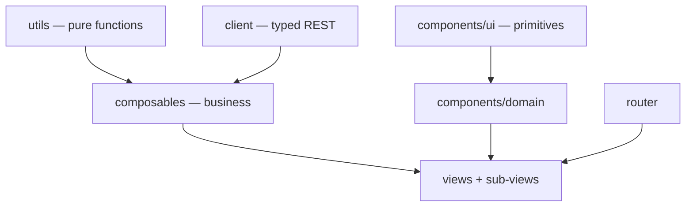

# Darow — Front-end specification

This document describes Darow's **Vue 3 admin application** (`web/`): its layered architecture, its
contracts, its invariants. It is written to be read by an AI agent that has to work on the code
without having read all of it.

`spec/back/spec.md` describes the Go server (storage, service, router, REST API). The two documents
are disjoint: what concerns the SPA lives here, what concerns the binary lives there. Their only
contact point is the REST API, described on the server side (§6 of `spec/back/spec.md`) and consumed
here by the `client/` layer (§2).

**The code is the source of truth.** This document is its description; if it diverges, it is this
document that must be fixed. It deliberately contains no code: exact signatures are read in the
files it cites, named in each section. It only describes the **stable** state: gaps between the
rules below and the current state of the code, accepted limitations, blockers and improvement leads
live in separate files, listed in §12.

Its sections are indexed by title, grouped by layer, in [`spec/index.md`](../index.md) — the entry
point to read only what a task needs. **Any section added, renamed, removed or renumbered here is
mirrored there in the same change.**

---

## 0. Non-negotiable rules

These rules apply to all code produced in `web/`. The numbering is stable and must never be
reordered.

1. **No network access outside `src/client/`.** No `fetch`, no hand-built API URL in a view, a
   component or a composable. The typed client is the only contact point with the server, including
   for URLs meant for an `<a href>` or a tile template (`exportUrl`, `tileUrl`).
2. **Business machinery never lives in a component.** Loading, pagination, mutation, selection,
   derived state: in a composable (`src/composables/`) or a pure function (`src/utils/`). A `.vue`
   file only contains the wiring of those bricks and the rendering.
3. **The visual never leaves the `<template>`.** No Tailwind or daisyUI class in a `.ts` file, a
   composable or a render function. A composable that returns a CSS class is a badly split
   composable.
4. **No markup in render functions (`h()`).** A rich table cell (button, badge, link, editable
   field) is a `.vue` component referenced by the column definition, never an inline `h()` tree.
5. **A shared component ignores the outside world.** `props` in, `emit` out. It knows neither the
   REST client, nor the router, nor the toast queue. Only a feature's domain components may receive
   data already loaded by their view.
6. **One route = one view; a view orchestrates, it does not detail.** As soon as a view carries a
   second responsibility (a panel, a modal, a self-contained section), that responsibility becomes a
   sub-view or a domain component in the feature's directory.
7. **Size targets.** 300 lines per `.vue` file, 150 per composable, 100 per pure function. These are
   the sizes to aim for, not a ceiling: passing one is a signal to look for a second subject in the
   file, and if there is one it is split out — never grown into. A file that holds a single dense
   subject stays whole past the figure, and its length is not a finding on its own (rule 11 is what
   is enforced; `limitations.md` LIM-F12).
8. **Any repeated class sequence becomes a primitive.** On the second occurrence of a given styling
   (button, field, panel), the matching `components/ui/` component is created. The existing
   primitive is always used once it exists — a bare `<button>`/`<input>`/`<select>`/`<textarea>`
   carrying `btn`/`input`/`select`/`textarea` daisyUI classes is never hand-rolled where
   `BaseButton`/`BaseInput`/`BaseSelect`/`BaseTextarea` already cover the case, including inside a
   `h()` cell renderer. Standalone text — a heading, a description, a caption — goes through
   `Typography` rather than a raw `<h1>`–`<h4>`/`<p>`/`<span>` with hand-picked size/colour classes;
   it is skipped only where the text is a fragment of a denser element that already owns its own
   typography (a button's label, a table cell, a form field's own small caption).
9. **No type assertion.** `as`, `!` and `typeof`/`Array.isArray` guards on route parameters are
   forbidden: they bypass the checker instead of using it. Cases are handled explicitly (`v-if`,
   default value, narrowing by predicate).
10. **daisyUI is the visual base, but never used directly in a view.** Its classes are encapsulated
    in the `components/ui/` primitives; views use Tailwind for layout only (flex, grid, spacing,
    widths). Before styling anything or adding a primitive, check
    [daisyui.com/components](https://daisyui.com/components/) for a matching component (drawer,
    menu, breadcrumbs, table, alert, skeleton…) rather than hand-rolling the equivalent in plain
    Tailwind — daisyUI class names are copied from that page, never guessed or invented (there is no
    `btn-quiet`, `btn-danger`; the real classes are `btn-ghost`, `btn-error`).
11. **One composable = one subject.** It exposes `ref`/`computed` and actions, never a reactive
    object to be destructured. Its name starts with `use`, its file carries that name.
12. **Remote state has a single owner.** A resource's data, its `loading` and its error are never
    duplicated across two components: they are held by the view (through its composable) and passed
    down as props.
13. **No API error is swallowed.** Every rejection is turned into a user message by `errorMessage`
    then displayed — a toast for a global action, a local message for a form. The only tolerated
    silence is that of best-effort display loads (tiles, extent), and it is commented in place.
14. **The front is not covered by automated tests.** This is a deliberate choice: verification is
    manual, backed by `mise run ui-build` (`vue-tsc` type-check) and `mise run ui-lint`.
    `client/http.test.ts` remains as a net over the HTTP transport, which cannot be checked by eye.
15. **Language conventions.** `<script setup lang="ts">` everywhere, never the Options API.
    PascalCase for component files, camelCase for the rest, UPPER_SNAKE_CASE for constants. Never a
    `.ts` extension in an import path (TS5097 with Volar).
16. **Comments explain the why.** As in the rest of the repository: an invariant, a trap, a server
    constraint. Never a paraphrase of the next line.
17. **Every user-visible string is in French**, including fallback error messages. No i18n: the
    product is monolingual.
18. **Every server-fed area handles its four states**: loading, empty, error, data. None of the four
    is left implicit, none is rendered as a blank screen (§8.1).
19. **No action without visible feedback.** A click produces, within the second, either the result,
    or a busy state, or a message. An action triggered twice out of impatience is an interface
    defect, not a user one (§8.2).
20. **Everything done with a mouse is done with a keyboard.** A clickable target is a `<button>` or
    an `<a>`, never a `<div>`/`<tr>` with an `@click`; every control has an accessible name (§8.7).

---

## 1. Architecture



Five layers, no short-circuit: a view never calls `fetch`, a composable never produces style, a
shared component never calls the client.

| Layer | Directory | Role | Forbidden |
|---|---|---|---|
| Pure functions | `src/utils/` | stateless, I/O-free computation (tile grid, filter tree, type coercion, sorting) | Vue, DOM, network, CSS |
| REST client | `src/client/` | one module per endpoint family + `http.ts` (transport) + `types.ts` (DTOs) | Vue, DOM, CSS |
| Composables | `src/composables/` | application state and orchestration: loading, pagination, mutations, selection, lifecycle of external resources (map, observers) | CSS, markup |
| Components | `src/components/` | rendering. `ui/` = domain-free primitives; `<feature>/` = presentational domain components | network calls, router, toasts (outside `ui/Toast`) |
| Views | `src/views/` | one per route, plus its sub-views; assemble composables and components | inline business logic, duplicated markup |

The router (`src/router.ts`) knows only the views. `src/App.vue` is the application shell: a daisyUI
`drawer` holding the side navigation (persistent on screens ≥1024px, an overlay below), collapsible
to an icon-only width — the choice is persisted (`useStorage`) as a display preference, not screen
state, so it stays out of the URL (§9) — a header carrying the page title and the collapse toggle,
status banner, mounting of `RouterView` and of the toast queue.

---

## 2. Client layer (`src/client/`)

A typed REST client, reusable outside this application: it depends neither on Vue nor on the DOM.

- `http.ts` — transport. Prefixes `/api/v1` on every application route (`apiUrl`), bare root for the
  probes (`getRoot`, used by `ops.ts` alone). `configureApiClient({ baseUrl })` allows pointing at a
  remote Darow instance; by default the page's origin, which is what the embedded SPA needs.
  `ApiError` carries the HTTP status and the server message; `errorMessage` is the only error → user
  text converter. A 204 and an empty body resolve to `undefined`.
- `types.ts` — **all** shared DTOs (`Metadata`, `Source`, `Row`, `RowsPage`, `ColumnSchema`,
  `FilterCondition`, `ErrorResponse`…). No response type is declared in a resource module.
- `tables.ts`, `sources.ts`, `geo.ts`, `features.ts`, `filters.ts`, `ops.ts`, `session.ts`,
  `settings.ts`, `tablesettings.ts` — one function per endpoint **the
  application calls**, named after the action and not after the HTTP verb, explicit parameters, typed
  return. A wrapper the app stopped calling is deleted rather than kept as surface: the server's
  contract is described on its own side, and an unreachable function here is code that rots without
  anyone noticing. Nothing is exported that only its own module uses. URLs built for a
  non-`fetch` use (export, tile template) go through `apiUrl` and are therefore subject to `baseUrl`
  like the rest.

The endpoint contracts (pagination, sorting, filter DSL, formats) are described on the server side —
`spec.md` §6. This document does not restate them.

---

## 3. Pure functions (`src/utils/`)

One module per subject, no module state, no side effect:

- `tileGrid.ts` — the per-zoom simplification tolerance, aligned on the server formula
  (`internal/storage/duckdb/tables/geo.go`), and `xyzGrid`, the 256-pixel XYZ grid both tile
  endpoints are cut along. Any change to the tolerance on one side requires the same on the other.
  The grid is the engine's (`createXYZ`) but it is **stated, never defaulted**: a vector-tile source
  left to itself uses 512-pixel tiles, which asks for a different zoom for the same view than the
  tolerance above is written against — the two render modes would request different tiles for the
  same map, and the simplification the server applies would not be the one the zoom means here.
- `projection.ts` — the boundary between the two coordinate systems the map lives between, and the
  only place they meet: everything crossing `src/client/` is OGC:CRS84 lon/lat, everything inside
  the map is Web Mercator. A geometry is read and written through one configured GeoJSON format, a
  bbox becomes a view extent through `viewExtent`. Nothing else in the app converts between the two
  — a geometry that reached the REST client still in meters would be written into the table in
  meters, and nothing on screen would say so. `viewBbox` is the other direction: it cuts the view
  down to the **projection's own extent**, which the engine knows and this module does not restate,
  before transforming. It answers null for the two views there is no honest bbox for — one the
  engine has not measured (a zero-sized container is reported as `[0, 0]`, an array, and truthy, so
  a caller trusting it queries a bbox that is a point, reads the empty answer as "there is nothing
  here", and leaves an edit session on a map with no editable geometry at all) and one that meets
  the world nowhere. `dataBbox` is that same conversion for an extent the engine hands over rather
  than the whole view — a loading strategy's tile — and carries the same clamp for the same reason:
  the tiles of the grid's edge cover ground Web Mercator cannot express, and the server fails such a
  query rather than clamping it.
- `filterTree.ts` — the model of the UI's filter tree (`DraftNode`) and its projection to the server
  DSL (`pruneActive`), which prunes inactive nodes and groups that have become empty (`BuildFilter`
  rejects an empty boolean group — `spec.md` §4.5). **Every** manipulation of that tree (activation,
  removal, duplication, replacement of children, addition, lookup) belongs to this module: the
  components that display it do not reimplement it. Which filter is *applied* is not part of it: a
  filter is a stored object, so `TableFilterBar` tracks it by identifier rather than by an `active`
  flag walked through the tree. `createLeaf` is the one shape a fresh, empty condition takes. `draftOf`/`nodeOf` are the pair the editor modal works through: a root node is
  presented as a boolean operator plus a list of conditions whatever its shape, and folded back to a
  bare leaf when it holds exactly one, so the pill row reads `height > 10` rather than a one-child
  group. `fromConditions` is `pruneActive`'s inverse, rebuilding an editable tree from a stored
  filter's server DSL; `describeDraft` renders a predicate as the default name a filter is saved
  under; `isComplete` is what the modal blocks submission on, and
  `takesValue` is what tells it that `IS NULL`/`IS NOT NULL` need no value box. A node's `not` flag
  negates it, leaf or group alike, mirroring the server's own `Not` (`spec.md` §4.5).
- `columnTypes.ts` — resolution of a column's type and coercion of a text input to the JSON type the
  API expects.
- `rows.ts` — `cellValue`, the one place a row's primary key is read: it is carried by `Row.pkey`,
  not by a `__pkey` entry, so any column list including it has to go through here. `isHiddenColumn`
  mirrors the server's `storage.IsHiddenColumn` (`spec.md` §4.4): `__pkey` and `OGC_FID` (GDAL's
  injected feature-id column, kept in storage but never shown) are excluded wherever a schema
  column list becomes a visible or editable column list — `useTableMetadata`'s `editableColumns`
  and `DeriveFromTableForm`'s `carryable`.
- `sort.ts` — projection of TanStack's sorting state onto the API's `sort` parameter.
- `geometry.ts` — rendering of a geometry read one row at a time: its GeoJSON text and the bounded
  excerpt a modal may put in the DOM (the clipboard still carries the whole value).
- `holes.ts` — `punchHole`, adding a drawn ring to the polygon that contains it as an interior ring.
  A hole is not a set operation and not a feature of its own: it is part of its polygon, every vertex
  of it stays editable, and it is undone the way it was made. Containment is tested on **every**
  vertex of the ring, not just the first: a ring half outside the polygon, or drawn inside a hole it
  already has, would otherwise be appended anyway and written back as an invalid polygon with
  nothing on screen saying so. Answers nothing when the ring has no polygon to belong to, which is
  what the caller turns into a message. `isAreal` is what tells the edit bar the hole tool applies
  to the layer at all.
- `editPrompts.ts` — the sentences the edit bar states (`editingPrompt`) — never one about the
  session's own budget (§8.8) — and the summary a
  save toasts (`summarizeWrites`). The order is the contract: a load in flight first, then a row
  waiting for its geometry — the one thing that is lost if the user walks away — then the session's
  cap, then the general instruction.
- `mapStyles.ts` / `drawStyles.ts` — the colours a table is read in and those an edit session is
  drawn in. For the canvas layer one style carries fill, stroke and image at once, so a column
  mixing geometry types needs one style and not one layer per type; the GPU layer cannot run a style
  function per feature, so its selection is compiled into the style instead (`wfsFlatStyle`). The two
  render modes are deliberately different colours so it is always readable which one is on. An edit
  session colours what it has **done**, never what it *could* do: being editable is not a state — it
  is true of the whole layer, and painting it over the rendering the user is reading turns the
  screen into a status display — so a reached, untouched geometry is drawn in a neutral slate that
  merely retraces the boundary already there. What is coloured is amber for a row whose geometry
  moved (the colour a pending write carries everywhere, and the same the grid tints a retyped cell
  with), violet for a shape that belongs to no row yet, and red for the
  individual **nodes a drag moved**: on a boundary of ten thousand points, "this row changed" says
  almost nothing and "these three points changed" says all of it. The first two are also drawn with
  a heavier stroke, so the distinction survives a colour-blind reading (§8.7), and `EDIT_LEGEND` is
  what names them, on the map itself (`components/map/MapEditLegend.vue`, a floating panel in the
  canvas' bottom-left corner) rather than in the bar — a legend is read next to the shapes it names,
  and the bar stays one row of controls. `PKEY_PROPERTY`/`DIRTY_PROPERTY`/`MOVED_PROPERTY` live here, next to
  the style that reads them on every frame, as do the two rules that keep a session's rendering
  cheap: every state's style is built once and handed back as it is, never rebuilt per feature per
  frame; and `verticesOf` caches a geometry's vertices against its own revision, so a dragged shape
  recomputes them and a still one does not. A third: an editable surface is drawn as its boundary
  and its vertices, never as a second filled surface over the rendering the session is meant to be
  compared against — a fill is a tessellation per geometry per frame, paid to hide the data
  underneath. It is reduced to near-nothing rather than dropped, and that is deliberate: the engine
  hit-tests what a style actually paints, so a polygon with no fill at all could only be reached on
  its outline, and reaching a polygon is how its vertices are shown and how the move tool grabs it.
  A shape **drawn in the session** is the exception and is properly filled: nothing is rendered under
  it — it belongs to no row, so no tile and no WFS feature carries it — so its fill hides nothing,
  and an outline alone over the basemap reads as a hole rather than as a new surface.
  `editStyle` draws a geometry, `focusStyle` draws the
  dots of the one under the pointer, and they are two layers for a reason (§8.8). The moved nodes
  are drawn by **both**: the focus layer sits above the edit layer, so a hover would otherwise bury
  them under the plain dots of the geometry carrying them.
- `sourceRows.ts` — the `SourceRow` view model of the sources tree (`toSourceRows`: a multi-layer
  file becomes a parent row over its layers, a single-layer one stays flat) and `formatSize`. The
  shape the cells read is defined once here, not rebuilt in the view and in each cell.

---

## 4. Composables (`src/composables/`)

**Contract.** A composable exposes read-only `ref`/`computed` and action functions; it registers the
cleanup it needs itself (`onUnmounted`, `AbortController`, `IntersectionObserver`, a map layer or
interaction). It renders nothing, styles nothing, and knows of a component only the parameters it is
given. A composable whose state must be shared by the whole application (toast queue) declares it at
module level and documents it; that is the exception, not the rule.

**Target split.** Each row is one composable, one file, one subject.

| Composable | Subject | Today |
|---|---|---|
| `useToast` | application notification queue (shared module state) | present |
| `usePaginatedList` | paginated list: infinite scroll, server sorting, reload after mutation, observer sentinel, and the optional `key` a list scoped to a route parameter reloads on. The sentinel is observed **when it appears**, not only at mount: it sits at the foot of the list, and a list showing a first-load skeleton has no foot yet — an observer bound once at mount was bound to nothing, and every list stopped at its first page. `limit` accepts a `Ref<number>` as well as a plain number — a page size resolved asynchronously (a table's effective row limit, `useTableRows`) reloads from page 1 the moment it changes, the same way a sort change does | present |
| `useServerStatus` | periodic `readyz` probe of the status banner, registering and clearing its own interval | present |
| `useSession` | who is calling and what they may do, from `GET /api/v1/session` (back `spec.md` §6.7): whether authentication is in force at all, the display name, `canWrite`, and `signIn`/`signOut`, which leave the application for the gateway's own pages through a full navigation — the session is a cookie this application never sees, so acquiring one means coming back through the gateway. Shared module state like `useToast`'s, read once per page load: nothing the application does can change who is calling. A failed probe is treated as authentication off, so a server that did not answer leaves the UI usable rather than locked on a failed request | present |
| `useTableMetadata` | a table's metadata and schema, reaction to a `tableId` change, its own four states for that load (§0.18 — a failed or slow load shows `Skeleton`/`ErrorState` with a retry rather than a toast), rename/delete/derive/add-column actions (still toasted, per §8.4 — a mutation's result, not the load's) | present |
| `useTableRows` | a table's rows: current page, sorting, duplication, deletion — built on `usePaginatedList`, paged on the table's effective row limit (a `Ref<number>` the caller passes, from `useTableSettings`) rather than a hardcoded size — `PAGE_SIZE` (exported) is only the value used before that limit has loaded. Neither retyping a cell nor creating a row is here: what a session holds until it is saved is `useRowEdits`', and what a single click does on the spot is this composable's. Duplicating reads the source row's geometry for it (`getRowGeometry`), since the geometry column is in no row listing (LIM-F3) and a geo row copied without it would land in the grid and nowhere on the map | present |
| `useRowEdits` | everything an edit session has written into the grid, held until its *Enregistrer*: the cells retyped on existing rows and the rows it is about to create. A draft row is a row like any other, under a key of its own (`__draft:n`, `isDraft`) — so its cells go in the same store, are displayed and marked the same way, and are ordered the way the geometries drawn for them come back. `syncDrafts` is how the map's count of drawn shapes becomes that many empty rows. Also: whether a given cell would be written (what the grid paints amber), the two counts (rows retyped, rows to create), and the payloads — updates carry **only** the columns actually retyped, since resending a whole row would write back, as the text a grid displayed, every column the user never touched, while an insert states every editable column, empty ones included — a column left out of a creation is not the same thing as a column created empty. A cell brought back to its stored value leaves the draft entirely. No network: a session writes its two halves in one request, and that request is `useLayerEditing`'s | present |
| `useRowFilter` | filter tree, effective conditions, filtered results and their retry, filtered extent | present |
| `useSavedFilters` | the filters persisted server-side against one table: list, create, update, delete, reloading from the server after each mutation | present |
| `useFeatureSelection` | feature selection (pkeys) and batch hydration of the matching rows — single source of truth, reflected onto the map by `useMvtLayer` rather than negotiated through a component ref. Instantiated by `TableDetailView` and handed to the data panel, because what is selected is one of the table's counters and is stated with the others in `TableHeader`. `zoomToSelection` fetches the selection's own extent (`getFilteredExtent` against an OR of `__pkey =` equalities — the pkeys picked one click at a time are exactly what the filter DSL can express, no dedicated endpoint needed) and bumps `zoomToken` so the map's watcher re-fires even on a repeat of the same bbox, a plain string ref would not | present |
| `useOpenLayers` | map lifecycle: creation, raster basemap, default controls, framing on a bbox, destruction. There is no style to wait for — a layer is added the moment the map exists — but a fit needs a laid-out viewport, so a bbox arriving before the first render waits rather than being dropped | present |
| `useMapDraw` | the edit session's lifecycle: the layer it works on, the single interaction over it — a `Modify` to reshape, a `Translate` to move a geometry whole, never both — the contextmenu the right-click delete has to suppress, the `modifystart`/`modifyend` snapshot-and-diff that says which vertices a drag actually moved, `commit` (what the session would write), teardown. It is also where a hover that lands on nothing the session holds is turned into a request for the row underneath: it is given `pkeyAt` (which row of the rendering is under a pixel) and `reach` (ask for it) and knows nothing of either render mode | present |
| `useEditTools` | which tool the edit bar has armed and nothing else: the `Draw` a shape button arms, the hole being cut, the `moving` mode that hands the drag to a `Translate` instead of the `Modify`, the two independent switches (`snapping`, `topological`) and the `Snap` the first one governs. Arming any one of drawing, cutting and moving disarms the others — they all want the same drag. Split from `useMapDraw` because every arming path has to respect the `Snap`'s place — it handles the pointer before the interactions it corrects, so nothing may be added over it — and that rule is kept in one place, `addUnderSnap`, rather than in each tool. The `Snap` itself is built once per session and never taken off the map to be put back: doing so drops and rebuilds the segment index it keeps over every feature in view, which is a freeze the length of the layer for each tool picked | present |
| `useEditLayer` | the one source an edit session works on, holding the geometries the pointer has reached, plus the second layer that draws the hovered geometry's vertices alone. One source is what makes editing topological — a vertex two geometries share is dragged in both at once. Owns what the session has touched (`changedCount`/`createdCount`, split the way the write is), whether anything on it can hold a hole at all (`hasAreal`), which single feature the pointer rests over (`trackPointer`/`blur` — at once the `solo` collection a non-topological `Modify` and the `Translate` follow, and the sole content of the second, vertex-drawing layer it owns; `trackPointer` also answers *whether* the session holds anything there at all, which is what tells the caller to go and fetch what it does not), which vertices a drag moved (`noteMoved`), the eviction of the untouched geometries the session no longer needs (`prune`), and answers it all as writes: the rows whose geometry moved, and the shapes that belong to no row yet | present |
| `useMoveLeaders` | what each moved node has *done*: the leader drawn from where it stood before the user touched it to where it stands now. Its own layer above the edit layer and the vertices, for the same reason those are two — a leader is a whole annotation (line, origin ring, arrowhead) and drawing it out of the edited feature's style would rebuild it on every frame of every drag. Each leader carries its own pre-built style (`Feature.setStyle`), so the layer needs no style function at all. A node dragged twice extends its leader instead of getting a second one: the origin the user cares about is the one before they touched it, not the halfway point | present |
| `useHoleTool` | drawing an interior ring and handing it to whichever polygon contains it (`utils/holes.ts`), rather than to a source: a hole is part of its polygon and is undone by editing its vertices, not by an opposite tool. A ring that belongs to no polygon is refused out loud | present |
| `useEditFeatures` | the session's **working set**: the geometries the pointer has reached, one row per `reach`, at full resolution and under one session-wide row cap that the ordinary gesture never meets. Holds every pkey it has asked for, answered or not — a hover rests over the same row for many frames and that has to become one request — and gives a pkey back on `release` so a row the session let go of can be reached again. Nothing is loaded on entering the mode | present |
| `useLayerEditing` | the session itself and what leaving it writes. Its `save` takes both halves — the geometries the map committed and `useRowEdits`' payloads — and merges the updates by pkey into **one** update request, so a row whose limit moved and whose name changed is written once and never twice; what was drawn is a second, insert request, each shape carrying the attributes of the draft row it raised (in order — the nth shape is the nth draft). It answers whether the session ended, which is what closes the mode | present |
| `useMapSelection` | the half of a render mode that has nothing to do with how the table is fetched: which features are selected, and what a click on one means. Shared by both modes rather than copied into each. Its listeners stay bound for the whole life of the layer; what `selectable` governs is the **gesture** — outside an edit session a plain click selects, under one that click belongs to the editor and only a shift-click does (the hover cursor stops too, it would fight the one `Modify` sets). `pkeyAt` is the hit test itself, exposed apart from those listeners: an edit session reads it precisely while they are unbound, since pointing at a feature is how its geometry enters the session | present |
| `useGeometryTypes` | the single geometry family a table is locked to (`utils/geometryFamilies.ts`), read when a session opens and after every write. Best-effort: a failed read constrains nothing, since it only mirrors a refusal the server makes anyway | present |
| `useRowGeometry` | one row's geometry read on demand — GeoJSON, WKT, and the copy to the clipboard | present |
| `useMvtLayer` / `useWfsLayer` | the layer of a render mode (`activate`/`deactivate`), symmetric add/remove; both delegate selection to `useMapSelection`, both relay its `pkeyAt` so an edit session can ask which row is drawn under a pixel, and both refetch on a bump of the data version the caller passes. MVT is one vector-tile layer styled per feature — nothing has to be asked of the server to know which geometry types the column holds; the layer read out of a tile is named from the `tableId` the URL is built from, never from a fixed name (back §4.7). WFS is a vector source reading the OGC API - Features items endpoint, one bbox query per tile of the loading grid — the engine deciding which tiles the view is missing and remembering the ones already loaded across a pan, the grid's zoom surviving only as the simplification tolerance. Each bbox is paged and its pages are added to the source as they arrive (§8.8), a load whose generation was ended by a refresh dropping the pages still in flight rather than injecting them into the emptied source | present |
| `useSources` | source list, upload, load with EPSG, deletion — built on `usePaginatedList` | present |
| `useDeriveTable` | the guided derivation from the table being viewed: the draft (carried columns, computed columns, condition tree) and its submission. `tableId`-scoped, unlike `useDeriveFromQuery` | present |
| `useDeriveFromQuery` | the free-SQL derivation: busy state, inline error, submission of a bare query against every registered table. Scoped to no table — opened from the catalogue screen, not one table's page | present |
| `useSqlSchemaReference` | the free-SQL form's schema reference panel: the registered tables, infinite-scrolled like `TablesView`, and each one's columns loaded only once expanded and cached from then on — never every table's columns up front, the same restraint `useTableSettingsOverrides` applies to a table-wide sweep | present |
| `useAggregateFromTable` | the guided aggregation from the table being viewed: group-by columns, aggregate expressions (alias plus a free SQL expression) and a condition tree applied before grouping, plus its submission. Its own composable rather than a third mode of `useDeriveTable` — a column there is either carried over row-wise or grouped/aggregated here, never both, and sharing one draft would let a column be "selected" without being either, which `GROUP BY` refuses as a query error rather than a default | present |
| `useColumnTransform` | rewriting one column's values in place, over the rows a filter names: a single free SQL expression, the row-scope condition tree, the server preview (invalidated by any further edit) and the write itself | present |
| `useColumnValues` | the values a column actually holds, narrowed by what is being typed: debounced, capped at the first 20 server-side matches, out-of-order responses discarded. One instance per input, never shared between two filter rows | present |
| `useColumnDistinctValues` | the full distinct-value listing behind the columns modal's "Voir les valeurs" toggle — one instance for the whole modal, one column expanded at a time, every column's list kept once fetched. Distinct from `useColumnValues`: no debounce, no search narrowing, a per-column cache instead of a per-keystroke one | present |
| `useSettings` | the runtime-editable settings row: load, draft-free save (a caller passes the patch it built), and per-field errors parsed out of the server's one joined validation message (`utils/settingsFields.ts`). Shared module state, the second exception to the "one composable, one component" default (`useToast` is the first): every caller reads the same loaded value — `useDashboardStats` sweeps the catalogue at `defaultListLimit`, the page size the server itself applies, so it never asks for more than one response can carry — without each fetching `/settings` on its own. `App.vue` triggers the load once, on mount, ahead of any view that depends on it | present |
| `useTableSettings` | one table's settings overrides: load, patch, reset, its own four states (§0.18, like `useTableMetadata`'s). `tableId`-scoped like `useTableMetadata`, but **not** shared module state like `useSettings` — every caller (the modal, `TableDataPanel`'s row limit) gets its own load, since a table's overrides are not a cross-cutting default the way the global row is | present |
| `useTableSettingsOverrides` | the tables that carry a settings override, for the settings screen's own section: a dedicated load (`GET /settings/tables`), its own four states, and a per-table reset. Never the table catalogue filtered client-side — a deployment with a thousand tables must not load them all to find the few that override something | present |

---

## 5. Components (`src/components/`)

Two families, two locations.

**`components/ui/` — domain-free primitives.** They encapsulate daisyUI and are the only ones to
carry component classes. A view never rewrites the styling of a button or a field.

| Primitive | Role |
|---|---|
| `Spinner` | the busy indicator, wherever something is in flight and the content around it stays on screen — a `Skeleton` is for a first load, this is for a refresh happening next to what it refreshes |
| `ButtonGroup` | a row of buttons welded into one control (daisyUI `join`). Each child carries `BaseButton`'s `joined` prop: daisyUI needs the modifier on the items, and a wrapper cannot put it there without reaching into the slot |
| `FloatingPanel` | a panel floating over the content behind it — the map's chrome: the render toggle in a corner (`top-left`). The caller says where, never how |
| `BaseButton` | variants (primary, secondary, danger, ghost — named after the matching daisyUI `btn-*` modifier; `danger` is the **filled** `btn-error`, never outlined: the theme draws a button's border and shadow on the solid variants only, so an outlined red button loses both and reads as a foreign control next to the ones it stands with), sizes (xs, sm, md), an optional `icon` component with an `icon-only` mode (label kept for `aria-label`, hidden visually), `square` for a slot-driven icon-only button, busy/disabled state |
| `BaseInput` / `BaseSelect` / `BaseTextarea` / `BaseCheckbox` | field + label + error message, `v-model`. `BaseInput`'s optional `label` renders above the control; both it and `BaseSelect` take `ariaLabel` for a field whose meaning is carried by its position rather than a visible label (a filter row's value box), since the accessible name must land on the control and not on the wrapping `<label>`. `BaseTextarea` exposes `insertAtCursor` (`defineExpose`) — replacing the current selection at the caret, which plain `v-model` cannot express since it only ever replaces the whole value — for a caller that inserts text from outside the field itself (`DeriveSqlForm`'s schema reference, `TransformColumnModal`'s column reference) |
| `BaseAutocomplete` | free-text field that suggests without constraining: the caller loads `options` in reaction to the `search` event (on focus and on every keystroke), keyboard navigation (↑/↓/Entrée/Échap), selection on `mousedown` so `blur` never wins the race. The list is absolutely positioned, so it never lengthens what contains it; a container that scrolls its own content has to let it spill over (`Modal`'s `overflowVisible`) |
| `MenuDropdown` | daisyUI `dropdown` + `menu`: a trigger button and the panel it opens under itself, with `MenuItem` (a `menu` `<li>`, its `actions` slot carrying the per-row buttons that must not trigger the entry) and `MenuTitle` (`menu-title`, a section heading) as its content. The open state is owned here, not left to daisyUI's CSS-focus or `<details>` variants: both only close when focus leaves, so acting from the panel left it hanging over the toolbar and opening a modal put it behind a still-open menu. The caller says which edge it hangs from (`align`) and how wide the panel is (`panelClass`) — only the caller knows whether its trigger stands at the left of a bar or at its right |
| `Divider` | daisyUI `divider`, tightened: the hairline saying the controls on either side belong to two different registers. daisyUI names its class after the layout it divides, so `orientation="vertical"` (the line) maps to `divider-horizontal` (the row) here, once |
| `ConfirmDialog` | the confirmation of a destructive action, worded once — always this box, never a native `confirm()` and never an inline pair (§8.3). `ConfirmButton` is it with its own trigger; a caller whose trigger is something else (a menu entry) opens it directly. `title` defaults to the deletion wording every caller but one relies on; a caller confirming a different irreversible write (a column transform) names it instead |
| `Breadcrumbs` | daisyUI `breadcrumbs`; every view passes its own trail (`{ label, to? }[]`) — the last, link-less entry is rendered as the page's only `<h1>` (a view never repeats the object's name in a second heading) |
| `Typography` | text rendering — `variant` (`h1`…`h4`, `body`, `body-sm`, `eyebrow`, `caption`, `code`, `paragraph`) picks both the tag and its styling; any standalone heading or paragraph goes through it instead of a raw `<h1>`–`<h4>`/`<p>`/`<span>` with hand-picked classes |
| `Modal` | teleported box, closing by backdrop and `Escape`, normal/wide widths, and `overflowVisible` for a box short enough not to scroll — daisyUI's `modal-box` scrolls its own content, which otherwise turns a field's dropdown into scrollable content, clipped at the box's edge |
| `ConfirmButton` | destructive action confirmed through `Modal` (never a native `confirm()`, never inline) — used identically for a rare, cascading deletion (a table) and a frequent one (a row). `size`, `icon`, `iconOnly` and `variant` are forwarded to the trigger so it matches the bar it sits in: a delete button a size apart from its neighbours, or the only one without an icon, reads as belonging to another screen |
| `Badge` | status pill, **semantic** tones (neutral, primary, success, warning, error) — never colour names. `warning` is the amber a pending write is shown in everywhere, including the edit bar's count of touched geometries |
| `Toast` | rendering of the `useToast` queue, mounted once in `App.vue` |
| `DataTable` | generic rendering of a TanStack Table instance: sortable headers, rows, empty state, `footer` and `row-after` slots. A column's `meta.pinned` (a Tailwind left offset) makes it stay put while the grid scrolls sideways, header included; the caller gives the offset because only it knows the widths before. Every row carries an **opaque** background of its own — the grid stripes itself rather than through daisyUI's `table-zebra`, and a selected row is `.row-selected`, an unlayered rule in `style.css` so it wins over the striping variant — because a pinned cell takes the row's background (`bg-inherit`) and a translucent one would let the scrolled columns show through it. A row-wide click is emitted only when it did not land on a control inside the row — a click on *Modifier* or *Supprimer* belongs to that button, and the row shortcut must not also fire on it |
| `ErrorState` / `Skeleton` | error states (message + retry) and first-load placeholders, worded once |
| `ListFooter` | the infinite-scroll sentinel (`usePaginatedList.sentinel`) plus its "Chargement…" indicator, dropped into `DataTable`'s `footer` slot — worded and styled once rather than repeated per paginated list |
| `StatTile` | a single-number KPI card, on daisyUI's own `stats`/`stat` component — `label`, `value`, optional `hint` and `icon` |

**`components/<feature>/` — presentational domain components.** They know the domain types
(`Metadata`, `Source`, `Row`) but stay mute: they receive data and emit intentions. A `DataTable`'s
rich cells (source actions, EPSG input, row actions, editable cell) are of this kind — that is what
replaces the `h()` trees.

**`components/charts/` — presentational chart primitives.** A third, domain-free family alongside
`ui/`: `BarChart` (single-hue horizontal magnitude comparison) and `DonutChart` (categorical share,
fixed hue order — `var(--color-primary)`/`--color-secondary`/`--color-info`, folding anything past
the third slice into a neutral "Autres" bucket rather than generating a fourth hue). D3
(`d3-scale`/`d3-shape`/`d3-array`) computes geometry only — scales, a pie layout, an arc generator —
and Vue owns every DOM node via `v-for` over a `computed`; D3 never calls `.select()`/`.append()`
itself. Props in, no fetch, no store, same contract as `ui/`.

---

## 6. Views and sub-views (`src/views/`)

One view per route; its sub-views live in a directory named after it. Every view opens with a
`Breadcrumbs` trail (§5) — `TableDetailView`'s is `Tables > {tableName}`, the others are a
single, link-less entry naming the page.

| Route | View | Role |
|---|---|---|
| `/dashboard` | `DashboardView` | landing route (`/` redirects here). Server diagnostics (`GET /diagnostics`, including a disk-quota donut against `maxSizeBytes` when it is set) and data stats aggregated client-side from every page of `GET /tables` — table count, row totals, geo/non-geo split, SRID distribution, top tables by row count |
| `/tables` | `TablesView` | table catalogue, search, sorting, infinite scroll, inline rename (`components/tables/TableNameCell.vue`) — patches the renamed row in the already-loaded list instead of reloading it — and free-SQL derivation (`DeriveSqlModal`), navigating to the created table on success |
| `/tables/:tableId` | `TableDetailView` | the table's header and its actions, then composition of the sub-views below |
| `/sources` | `SourcesView` | `workDir` files, upload, per-layer loading, deletion |
| `/settings` | `SettingsView` | the server's runtime-editable settings (`storage.Settings`), grouped by family, one input per field through `components/settings/SettingsField.vue`, saved as a diff-only patch, per-field refusals attached to their own input. A page size is one plain number per family (§back 2.5): what the input holds is what the server serves, so nothing is shown under it. An input's `min`/`max` and a field's unit come from the payload the value was read in (§back 2.5's descriptor), never from `utils/settingsFields.ts` — which carries what the server has no opinion on: the label, the description, the input `step`, the meaning of `0`, and whether the field is per-table. `inputRange` is the one place the server's bounds become an `<input>`'s, an exclusive minimum becoming the first value the step grid allows |

**`DashboardView`** composes two independent sections, each owning its own four-state load
(`components/dashboard/`): `ServerHealthSection` (`useDiagnostics`) and `DataOverviewSection`
(`useDashboardStats`). The two composables stay separate rather than merging into one — different
endpoints, different latency/failure profiles, and a shared retry would re-trigger both on one
section's failure. `useDashboardStats` is the one composable allowed to page a listing
(`listTables`) to completion instead of going through `usePaginatedList`'s infinite scroll: the
dashboard needs the whole catalogue to sum/aggregate (`utils/dashboardStats.ts`'s
`computeDashboardStats`), not a displayed page — it loops at `useSettings().current.defaultListLimit`
per page (the server's own live cap) until the reported `total` is reached.

**Target split of `TableDetailView`** — the view keeps only the header and the assembly:

- `TableHeader` (`components/tables/`) — what the table **is** (badge, row count, last update, and
  how many of its rows are selected, with one icon button to frame the map on the selection's own
  extent — geo tables only, via `useFeatureSelection.zoomToSelection` — and one to empty the
  selection) and
  what can be done to the table **as an object**, gathered behind one `MenuDropdown` labelled
  *Actions*: *Renommer* and *Ajouter une colonne* under **Structure**, *Dériver une table* and
  *Exporter* under **Produire**, then *Supprimer la table* alone under a divider, last as §8.9 asks.
  Five buttons of five registers side by side read as a pile, and four of them are used once in a
  table's life. The rename form is opened from the menu but the view owns its open state
  (`editingName`): only the view knows whether the write went through, and therefore whether the
  form may close.
- `TableToolbar` (`components/tables/`) — the workspace's own bar, one row below, holding
  everything that acts on what is **displayed**, in the order it is read: *les données*
  (`TableFilterBar`), *l'édition* (one `Éditer` toggle, whose tools are stated by `TableEditBar`
  above both panels), then *l'affichage* (*Colonnes*, and the
  `Tableau / ⬛ / Carte` group), the two registers parted by a `Divider`. It owns nothing: the
  visible-column choice is the view's state, so the *Colonnes* button asks the panel for its modal
  and the panel asks the view.
- Filtering is a **modal** affair, not a side panel: the editor needs the width, and a filter is a
  discrete thing one creates or edits and then applies. `components/filters/` holds the whole
  feature — `TableFilterBar` (the "Filtrer" button, the saved-filter menu, the pills, and the modal's
  open state, the one place that owns `useSavedFilters`), `FilterEditorModal` (one root node, create
  or edit), `FilterNodeEditor` (the condition/group rows, recursive), `SavedFilterMenu` (the full
  catalogue: apply, edit, delete), `ActiveFilterPill` (the applied filter alone) and
  `FilteredRowsPanel` (the flat, read-only result grid with its own four states and its row cap).
  `FilterNodeEditor` renders the boolean connector as a **left-hand column**, not as a sentence
  above the list: the first row reads "Où", the second carries the one editable ET/OU (a list joins
  with a single connector), the rest repeat it as plain text, and a nested group indents under that
  same column on a tinted background rather than nesting a second bordered box. Negation is a `NON`
  toggle at the end of each row, on a condition or on a whole group alike; `IS NULL`/`IS NOT NULL`
  drop the value box (`takesValue`). The column list carries each column's **type** in its label:
  it decides what the value has to look like and which operators mean anything. The value box is
  `FilterValueInput`, one per condition: on a text column (`isTextType`) it is a `BaseAutocomplete`
  fed by `useColumnValues` — the column's own values, the first 20 matching what is being typed —
  and a plain `BaseInput` otherwise, a number or a date being typed, not picked. A column change
  drops the suggestions rather than offering another column's values, and a failed lookup leaves
  the field plainly typable instead of raising an error over a filter being written.
  **Every filter is persisted, and the catalogue is the single source of truth.** There is no draft
  state and no opt-out, so `TableFilterBar` holds no parallel tree: `activeFilterId` is a controlled
  prop (`update:activeFilterId`) rather than local state — `TableDetailView` owns it, since the
  applied filter is part of the workspace's URL state (§9) — and the bar only *derives* the
  `DraftNode[]` it emits to the panel from the applied stored filter
  (`fromConditions`). Two copies is what previously let editing a pill save a duplicate instead of
  updating the filter it came from — a `DraftNode` carries no link back to its stored filter, so
  nothing else can be relied on to tell an update from a creation. Only one filter applies at a
  time: a second would silently AND with the first, which the pill row cannot show.
  The name field fills itself from `describeDraft`'s rendering of the conditions — but only once the
  predicate is complete, since a half-typed one would suggest a name that reads as a bug.
  The toolbar shows the **applied** filter only, never the whole catalogue: `SavedFilterMenu`
  already lists them all, so a pill row repeating it showed every filter twice, and a toolbar does
  not scale past a handful of chips anyway. `ActiveFilterPill`'s ✕ **un-applies**; deleting lives in
  the menu alone, a click away, since a ✕ one pixel from the apply target would destroy a stored
  filter by accident.
  `SavedFilterMenu` owns its open state rather than relying on daisyUI's `:focus-within` dropdown —
  that variant only closes when focus leaves, so applying a filter left the panel hanging over the
  toolbar and opening the editor put a modal behind a still-open menu. It is anchored to its
  button's **left** edge: the toolbar starts at the left of the panel, so a right-aligned menu
  (`dropdown-end`) ran off-screen and clipped every entry.
- `TableMapPanel` — map (loaded via `defineAsyncComponent`: OpenLayers is the bundle’s largest
  dependency) and the MVT/WFS toggle. Shares the width 50/50 with `TableRowsPanel` by default; a
  `Tableau / ⬛ / Carte` toggle group maximizes either one.
- `TableRowsPanel` (`components/tables/`) — row grid and nothing else: the rows selected on the map
  pinned at its top, infinite scroll, and the per-row action column. How many are selected, and the
  control that empties the selection, are **not** here — that is a counter of the table and it is
  stated with the table's other counters (`TableHeader`), where a count belongs. That column and the row number are the
  grid's first two, pinned there: a grid wider than its panel otherwise hid the number that names a
  row and pushed its actions past every attribute. The actions are icons alone — the same three on
  every line, each with its name in its tooltip and to assistive tech (§8.7) — because a row of
  labelled buttons, one of them a red *Supprimer* pill, repeated down the grid reads as a warning
  about the data rather than as controls. That column is **always** rendered:
  reading a row's geometry is a read, so arming edit mode to reach it would be a trap. It receives
  the `useTableRows` state and the `useRowEdits` draft its parent owns and emits intentions
  (`geometry`, `rowClick`), never reloading or writing anything itself. Which
  columns a session may retype is told to it (`editableColumns`), never guessed: the geometry is
  drawn and not typed, and the pkey is the server's. Switching between the
  filtered, read-only `DataTable` and the paginated one (`filter.filterActive`) carries a distinct
  `key` on each — two entirely different TanStack Table instances patched in place, at the same
  template position, left `<table-layout: auto>` column widths stale in Chromium until some
  unrelated repaint (a hover) forced a reflow; the `key` makes Vue replace the DOM outright instead.
- `AddColumnModal`, `ColumnsModal`, `GeometryModal`, `ExportModal` — one modal = one file, never
  inline modal markup in a view. `ExportModal` picks the export's format and its output CRS: the
  EPSG field only shows for a format that carries geometry (never CSV) on a geo table, and comes
  pre-filled with the table's own CRS, which is also what the server falls back to — leaving it
  untouched exports the table as it came in. The downloaded file takes the name the server sends in
  `Content-Disposition` rather than one rebuilt here: for an export that name carries the CRS, which
  no format states reliably (back LIM-16). `GeometryModal` (`components/tables/`) shows one row's geometry in both
  encodings with a copy button each, rendering a bounded excerpt while the clipboard carries the
  whole value. There is **no** add-row modal: a row is created empty, in the grid, by the session
  itself (§8.3).
- **Every table-producing modal's form opens on one caption**, right above its first section (or,
  for `DeriveSqlForm`, above its lone textarea): what the mode computes, closed by the same
  sentence, "Le résultat est matérialisé dans une nouvelle table." — the one structural and wording
  element the three forms (`DeriveSqlForm`, `DeriveFromTableForm`, `DeriveAggregateForm`) share, so
  a modal never opens straight into a section header with no sense of what the whole screen is for.
  Each form's own captions state what the geometry column becomes in that mode where it is not
  obvious from the controls alone — carried over untouched (`DeriveFromTableForm`), excluded from
  grouping but aggregable through the free expression field (`DeriveAggregateForm`) — since free SQL
  needs no such note, nothing constrains it there.
- **Deriving is two modes, two modals**, in `components/tables/`, split along the same line as their
  server routes (one scoped to a table, one to none): `DeriveTableModal` is the guided mode, opened
  from a table's own `TableHeader` *Actions* menu under **Produire**; `DeriveSqlModal` is the
  free-SQL mode, opened from `TablesView`'s own header, next to the catalogue it acts on. Each shell
  holds the new table's name, the submit and its own composable — `useDeriveTable` (guided,
  `tableId`-scoped) and `useDeriveFromQuery` (free SQL, scoped to no table) — rather than one
  instance shared by a tab pair, since the two modes no longer share a screen. `DeriveFromTableForm`
  is the guided mode's form — the column picker, the computed-column rows, and the condition tree,
  which reuses `FilterNodeEditor` rather than a second editor, plus a "reprendre un filtre
  enregistré" select that **copies** a stored filter's conditions into the draft (referencing it
  would suggest the derived table tracks it, and a derived table is a frozen snapshot). The geometry
  column and `__pkey` are absent from the picker — the server carries the first over on its own and
  regenerates the second. `DeriveSqlForm` is the free-SQL mode's textarea, whose caption states that
  the query runs against every registered table: it used to run inside a table's own modal,
  pre-filled with that table's name, which stated a scope the endpoint never had — it is now a
  top-level route (back §6.1), and the modal that posts to it opens from no particular table.
  `DeriveSqlForm` also carries `SqlSchemaReference`, beside the textarea rather than above or below
  it — a query is written with the schema in view, not memorised from a panel scrolled past. It
  lists every registered table (`useSqlSchemaReference`, infinite-scrolled) and, expanded, that
  table's columns; a click inserts the identifier at the caret through `BaseTextarea.insertAtCursor`.
  A table inserts its `physicalName`, never `tableName`: the query is handed straight to DuckDB
  (back `service/derive.go`), which knows no friendly name.
- **Aggregating** is a third act, not a third mode of `DeriveTableModal`: `AggregateTableModal`
  (`components/tables/`), opened from a table's own `TableHeader` *Actions* menu under **Agréger**,
  next to **Dériver**. Its form, `DeriveAggregateForm`, offers a group-by column list, a list of
  aggregate rows (an alias plus a free SQL expression, the aggregate counterpart of
  `DeriveFromTableForm`'s computed-column rows), and a condition tree applied before grouping
  (`FilterNodeEditor` again, plus the same "reprendre un filtre enregistré" copy-in). The geometry
  column is excluded from the group-by list — grouping it by value makes no sense, though it can
  still be aggregated (`ST_Union(geom)`) through the free expression field, which is untyped SQL.
  `useAggregateFromTable` holds the draft and makes the one combination the server refuses
  (no group-by column and no aggregate) unrepresentable as a submit rather than left for the server
  to reject.
- **Updating a column in place** is a separate act from deriving, in `components/tables/`:
  `TransformColumnModal` is the shell, opened from a pencil button on the column's own header
  (`TableColumnHeaderCell`, rendered by `TableRowsPanel`'s grid — a one-item menu here used to render
  its panel clipped by the grid's own scroll container, so the button opens the modal directly). The
  new value is one free SQL expression (`BaseTextarea`, `insertAtCursor`-driven like `DeriveSqlForm`'s)
  computed for every row the condition tree (`FilterNodeEditor`) names — there is no per-row branching
  (no `CASE WHEN` builder, no arm picker): a value that must differ across rows is written as two
  transforms, each with its own filter, rather than assembled as cases in one. `ColumnPickerList`
  is the column reference beside the expression field, shared with `SqlSchemaReference`'s expanded
  column list — the target column and the geometry are excluded, the same exclusion
  `DeriveFromTableForm` applies to what a derivation may carry over. The condition tree carries the
  same "reprendre un filtre enregistré" select (`useSavedFilters`, copying the stored filter's
  conditions into the draft) every other row-scope condition tree in `components/tables/` offers —
  `DeriveFromTableForm`'s and `DeriveAggregateForm`'s. `useColumnTransform` holds the
  expression and the condition tree, and runs the server preview (`TransformPreview`, the four
  states of §8.1) before the write, invalidating it on every further edit — the confirmation step
  must never count a stale number.

**`SourcesView`**: the view holds the header (counts, `Rafraîchir`, `Importer un fichier`) and the
TanStack instance over `toSourceRows`; `components/sources/` holds the rest — `SourceUploadModal`
(the drag-and-drop zone, in a modal opened by the import button rather than a permanent panel: the
page is a catalogue, and an import is an occasional act that should not cost a third of the screen),
`SourceNameCell` (file/layer icon, extension badge, layer indentation) and `SourceActionsCell`
(load with its EPSG prompt, link to the loaded table, deletion). The EPSG is asked **only of a
source that carries a geometry**: the load's first step reads `/sources/{name}/metadata`, and a file
of plain columns — a CSV of attributes, a non-geo Parquet — has nothing to project, so it is loaded
straight away rather than held behind a code the user would have to invent. `SourceActionsCell` stays
presentational: which row is being edited, loaded or deleted is decided by the view comparing
`useSources`' keys, the cell only renders the state it is handed and emits intentions.

`SourcesView` holds the header (counts, `Rafraîchir`, `Importer un fichier`) and the upload modal's
open state; `SourcesTable` (`components/sources/`) holds the files/layers tree — column definitions,
the TanStack instance and its four states — taking the whole `useSources` instance rather than a
narrower prop set, since its action functions (`startLoad`, `remove`…) are already the single owner
of that state.

The title shown by the banner comes from `route.meta.title`, whose type is declared once
(augmentation of `vue-router`'s `RouteMeta`) rather than read untyped.

---

## 7. Style

- **daisyUI base**, `light` theme declared in `src/style.css`, loaded through the Tailwind v4 plugin.
  Its classes (`btn`, `badge`, `modal`, `alert`, `navbar`) are used **only** in `components/ui/`.
- **Utility Tailwind** for layout in the templates: flex/grid, spacing, widths, the `min-h-0`/
  `shrink-0` of height-constrained panels.
- **Neutral, sober palette**, high density, no ornament: this is an admin console. Semantic colours
  go through the primitives' tones, never through a colour hardcoded in a view.
- The map is the only place where colours are hardcoded: those are map style values, not CSS
  classes; they live in the layer definitions.

---

## 8. User experience

The application is a **technical admin console**: the user is an operator handling large volumes of
data and performing irreversible actions. The priorities are therefore, in this order: do not make
them lose work, tell them at all times where they stand, be fast.

### 8.1 A screen's four states

Every server-fed area explicitly defines:

- **Loading** — a skeleton (grey shapes at the dimensions of the expected content) for a first list
  or panel load; a discreet indicator at the foot of the list for a next page. A full-screen spinner
  is reserved for real blocking. Below 300 ms, nothing is shown: a flashing indicator is worse than
  no indicator.
- **Empty** — a short sentence that distinguishes "there is nothing" from "your search returns
  nothing", and that offers the next action when there is one ("Aucune table. Chargez une source
  depuis l'onglet Sources.").
- **Error** — a message in French, cause and remedy, plus a way to retry without reloading the page.
  Never a raw technical trace, never an empty state disguised as a success.
- **Data** — the content.

**Content already displayed never disappears during a reload.** A change of sort, filter or page
keeps the current rows on screen (dimmed if need be) until the new ones arrive. No empty flicker, no
height jump.

### 8.2 Action feedback and latency

- Every button triggering a network call goes into a **busy** state: participle label
  ("Enregistrement…"), disabled button, unchanged width so the layout does not shift.
- Disabling serves only to prevent double submission and invalid input: a button disabled for any
  other reason carries a `title` explaining it.
- A successful action **says so or shows so**: a toast for a global action (deletion, loading a
  source), a visible data update for an inline edit.
- An action taking more than a few seconds (upload, import, derivation) shows progress or, failing
  that, an explicit busy state naming the object being processed.
- No optimistic UI: writes are server-authoritative (recomputation of `rowCount`, of `bbox`, of
  `UpdatedAt`), we display what the server has confirmed.

### 8.3 Destructive actions and the user's work

- Deletion, replacement, overwrite: confirmed through the shared `Modal` (never a native
  `confirm()`) — `ConfirmButton` opens it uniformly, whether the action is rare (a table, a source)
  or frequent (a row): the friction of an extra step is deliberate for all of them.
- The confirmation message names what is about to disappear, and mentions cascade effects where
  there are any (deleting a source deletes the tables derived from it).
- **No input is lost by accident.** A modal holding a modified form does not close on a backdrop
  click; `Escape` asks for confirmation. A schema reload does not reset the visible columns the user
  chose, nor the filter in progress.
- No undo: the server does not offer it. That is precisely why confirmation is the barrier.

### 8.4 Messages: what goes where

| Kind | Location | Duration |
|---|---|---|
| Result of a global action | toast, bottom right | ~4 s, dismissible by hand |
| Form or field error | inline message under the field or block concerned | until fixed |
| Server unavailability | permanent status banner in the sidebar | as long as it lasts |
| Contextual information | discreet text under the section title | permanent |

An error that prevents the action in progress **never** goes out as a toast alone: it stays in front
of the user, where they have to act. A message is short, in French, in the active voice, and says
what to do ("Nom de table déjà utilisé." rather than "erreur 409").

### 8.5 Forms

- One label per field, above it, always visible — a placeholder is an example, not a label.
- The first meaningful field receives focus when a modal opens.
- `Enter` submits, `Escape` cancels, in short forms as in inline editing.
- Validation on submit, not on every keystroke; the error goes under the offending field and focus
  moves there.
- Constant button order: secondary action left, primary action right.
- Known constraints (EPSG format, maximum upload size, accepted extensions) are stated **before** the
  attempt, not only in an error response.

### 8.6 Data tables

This is the product's main screen; it follows fixed rules.

- Sticky header, high density, a single scroll area (the page never scrolls horizontally — the table
  does, inside its own frame).
- Numbers and dates right-aligned, formatted in `fr-FR`; `NULL` rendered as a greyed value distinct
  from the empty string.
- Sorting: a visible indicator on the sorted column, numbered order for multi-sort, and the
  affordance explained (`title`) rather than guessed.
- Long cells are truncated with the full value in `title`; the row height is not broken.
- The grid opens on a rank column (`#`): the row's position in the grid as it is displayed,
  selection pinned at the top included. It is not the primary key — a pkey is an identifier, not a
  position, and the two stop agreeing the moment the grid is sorted.
- On a geo table, one click anywhere on a row that is not a control toggles it in and out of the
  selection: it is the same selection the map holds, so the gesture that reverses it is the same
  gesture (§8.8). A row whose cells are open for editing is not a target — the click is aimed at
  the field under the pointer.
- A row is duplicated from its own actions, geometry included, and the copy is not confirmed
  beforehand: it adds, and what it added is deleted by the button beside it (§8.3).
- Sorting, search and filtering apply to **all** the data server-side, never only to the pages
  already loaded: a silent partial result is a lie. The one exception is the map editor's working
  set, which is deliberately silent and says what it holds by drawing it (§8.8, LIM-F7) — nothing
  there is *answered* partially, it is a neighbourhood being worked on.
- Infinite scroll always states what is left ("50 sur 1 240") and does not prevent reaching the page
  footer.
- Selection and editing do not tread on each other: a selected row stays identifiable after a sort,
  a reload or a page change.

### 8.7 Accessibility and keyboard

- Clickable target = `<button>` or `<a>`. A clickable table row exposes the real action through a
  focusable control (the name link), the row's `@click` being only a shortcut.
- Every icon-only button has an accessible name (`aria-label`); decorative icons are `aria-hidden`.
- Focus visible everywhere, never removed by style. Tab order = visual order.
- Modal and side panel: focus moved inside on opening, trapped while they are open, returned to the
  triggering element on closing; `Escape` closes.
- Toasts are announced (`role="status"` / `aria-live="polite"`), blocking errors as `role="alert"`.
- Minimum AA contrast (4.5:1) for text; information is never carried by colour alone (a status has a
  label, not just a pill).
- Motion (animations, the status banner's `animate-ping`) respects `prefers-reduced-motion`.

### 8.8 Map

- Initial framing on the data's extent; reframing on the **filter's** extent when a filter is active,
  back to the table's extent when it no longer is.
- Data loading on `moveend`, never on every frame, and progressive rendering tile by tile rather than
  in one final block — **and page by page inside a tile**: a tile holding more features than one page
  draws each page as it lands instead of staying blank until its last one answers. A tile is still
  only *marked loaded* once whole, so a load cut short is asked again rather than left half-drawn.
- **A page is over when the server says so, never when it looks short.** The server resolves a
  requested page size against the operator's limit and answers against the one *it* chose, so a page
  clamped to a tenth of what was asked for is a full page that reads as the last one from the client
  — and every feature past it would be dropped with nothing to show for it. `numberMatched` is what
  says how much there is and the length of the first page is what says how big a page really is;
  between the two, the remaining offsets are known outright and are fetched several at a time under
  a bound rather than one round-trip after another.
- **The map reads the collection through the OGC API - Features items endpoint**, the same route an
  outside client would use, one bbox query per tile of the loading grid. The grid is the *strategy's*
  and never the query's: it is what decides which extents are missing and remembers those already
  loaded, while the zoom it yields survives only as the simplification tolerance — how finely the
  features come back, not which ones.
- A loading indicator visible while tiles are in flight; a failed tile does not break the map.
- `pointer` cursor on queryable features, highlighting of selected features, and selection reversible
  in one click — with no modifier key, to stay usable on a trackpad.
- Map selection and table selection are **the same** selection, always synchronized both ways, with
  an obvious way to deselect everything.
- Basemap attribution displayed, navigation controls present.
- **A table is edited in one session, both halves at once.** The attributes are retyped in the grid
  and the geometries reshaped on the map, under a single *Éditer* toggle: they are two halves of the
  same object, and a mode that made the user choose between them would be asking a question they
  cannot answer before touching anything. The session ends the same way for both — one
  *Enregistrer*, one *Annuler*.
- **One door per mode.** *Éditer* is the only way into the edit mode: a row's
  actions offer reading its geometry, never editing it. A second entry point onto the same mode is a
  second thing to explain and a second place to keep true, and it would suggest the mode is about
  that one row when it is about the whole layer.
- **Editing the geometries is a mode of the layer, not of a row.** Every row of the layer is a
  candidate, and they all land in **one** editable source. That is the whole point: two polygons of
  a coverage that share a limit hold the same coordinates, so dragging that limit drags both sides
  in the same gesture. The topology is held by construction, not rebuilt afterwards from set
  operations, and it works the same for a road network as for a parcel plan. What is already on the
  layer is never overwritten by the server's copy of it — a geometry the user moved stays moved.
- **The table stays drawn under an edit session.** The rendering the user was reading (MVT or WFS)
  is left on and the editable layer is drawn above it, so entering the mode never blanks the map
  while the editable copies are being fetched, and the layer is still legible where the session
  holds nothing. A row being reshaped shows its stored geometry underneath until the session is
  saved. The render-mode toggle stays available, since the layer it acts on is still there.
  **Selecting is not**: the click that places a vertex must not also toggle a row, and a hover cursor
  must not fight the one the reshaping sets, so the render mode's selection listeners are suspended
  for the length of the session. **The layout stays the user's**: entering the mode reframes
  nothing, and the `Tableau / ⬛ / Carte` group keeps working throughout. The map holds the session's
  unsaved work, so maximizing the table *hides* it instead of unmounting it — the session survives,
  and OpenLayers re-measures its container on its own when the map comes back. The way out of the
  mode is still *Enregistrer* or *Annuler*, both on the map itself.
- **The session grows by pointing, and entering it costs nothing.** Nothing is loaded on entering
  the mode, and nothing on panning. What the pointer rests over and the session does not already
  hold is a row of the rendering underneath: it is identified on that rendering (`pkeyAt`, the same
  hit test selection uses, read while selection's own listeners are unbound) and its geometry alone
  is then fetched at full resolution and becomes editable. Loading the whole view instead meant tens
  of megabytes of GeoJSON, thousands of engine features and a `Snap` index over every one of their
  vertices, all built before the user had said what they meant to touch — which froze the tab on
  entering the mode and froze it again on leaving. The cost is now one geometry per geometry
  pointed at, and the session accumulates exactly what was worked on. The hit test is throttled to
  at most one per frame and skipped mid-drag, and a hover that rests on the same row for a hundred
  frames is **one** request: the de-duplication belongs to whoever answers (`useEditFeatures`), not
  to the pointer.
- **Editing is one mode of the table, and its tools stand above both panels.** There is a single
  *Éditer* toggle in `TableToolbar`, never one per half: the rows and the geometries are two halves
  of one object, and choosing between them before touching anything is a question the user cannot
  answer yet. Arming it raises `TableEditBar` over both panels, holding what the table can actually
  carry — the row actions always, the map's tools only on a geo table. Those tools stay owned by
  `MapView` (the OpenLayers session is theirs, and OpenLayers must not reach the initial bundle
  through the bar) and are rendered into it by a `Teleport`, which is also what keeps *Enregistrer*
  and *Annuler* reachable while the map is the hidden half of a maximized table. That pair
  (`EditSessionActions`, with the session's counts) is rendered once per table: inside the map's
  tools on a geo table, in the bar itself on a table that has none.
- **The editor does not offer what the server would refuse.** A table already homogeneous in one
  geometry family rejects a geometry of another (back rule 23), so *Polygone / Ligne / Point* are
  read against what the table actually holds (`/geometry-types`, re-read after every write since the
  first shape drawn into an empty table is what locks it) and the two that do not apply are
  **disabled**, with the reason in their tooltip — not hidden: what a table cannot hold is worth
  reading once, and a bar whose buttons come and go from one table to the next has to be re-learned
  each time. The read is best-effort (`useGeometryTypes`): it only removes tools the server would
  refuse anyway, so a failed read leaves all three armed and the write is what says no.
- **Creating a row is one gesture, and on a geo table that gesture is a drawing.** *Polygone /
  Ligne / Point* do not draw a shape to be attached to something later: each closes a shape **and**
  raises the empty row it belongs to, at the top of the grid, violet like the shape itself. Its
  attributes are then typed in the grid like any others, and the save writes the two together. That
  is why there is no add-row modal and no *Ajouter une ligne* on a geo table: a form asking for
  attributes at the exact moment the user is looking at the map is a form asked at the wrong time,
  and it was the only reason a session could be left waiting for a geometry that never came. A table
  with nothing to draw keeps the same *Créer* group with the one button that still means something
  — a `+` that raises the same empty row.
- **A field follows its column's type, and says what it expects.** A boolean cell is a choice of
  three — *Vrai* / *Faux* / vide, since an empty cell is NULL and **not** `false`: a boolean turned
  into `false` by an empty box writes a fact the user never stated. A number is a number field, a
  `DATE` a date field (its stored form is exactly what the control round-trips), and everything else
  a text field checked against what its type can hold. What is still wrong is marked red on the cell
  that carries it, with the expected format in its tooltip, and *Enregistrer* refuses the session
  while any remains: the server's own refusal would name neither the row nor the column at fault, and
  would cost the whole session's work (§8.2).
- **A draft row is dropped where it was raised.** In the grid on a table without geometry, since the
  grid is what created it; with the whole session on a geo table, since the shape drawn for it is
  part of what would have to go with it (LIM-F5).
- **The mode is what makes a cell writable, not a button per row.** Under a session every editable
  column of every row is a field (`TableRowEditCell`) — a grid is read one column across many rows,
  and a mode that had to be armed row by row made the ordinary correction (the same typo in twenty
  rows) twenty gestures. So the row's action column carries no edit/save/cancel trio: what stays
  there is what a single click does on the spot — read a geometry, duplicate a row, delete one. A
  cell the session would write is drawn in the amber a pending write carries everywhere, the same
  the map draws a moved geometry in, and a value brought back to what it was stops being one.
- **Creating and modifying are two intentions, and the bar says so.** The session's toolbar
  (`components/map/MapEditBar.vue`) groups *Polygone / Ligne / Point* under
  **Créer** — each adds a row that does not exist yet — and *Trou / Déplacer / Annuler le point*
  under **Modifier**, which act on a shape already there, and the aimantation/topologie switches
  under **Aides**, which change how the other two behave without doing anything themselves.
  Undifferentiated, *Trou* read as a fourth shape to draw rather than as a cut into an existing
  polygon. The three groups are one row of welded button groups separated by rules, ending in the
  session's counts and its *Annuler* / *Enregistrer*: only one button of the whole bar is filled —
  the save — the `+` that raises a row is an outline like every tool, so the bar carries one primary
  intention rather than three competing ones.
- **Selecting survives an edit session, under a modifier.** A plain click under a session belongs to
  the editor — it grabs a handle, and the engine inserts a vertex on *pointerdown* over a segment —
  so selecting a feature to find its row in the grid is **Maj+clic**, and the `Modify`'s
  `insertVertexCondition` lets that modifier through so the click cannot reshape the geometry it was
  aimed at. It is the session's one gesture that is not on a button, so the map's legend states it.
  Outside a session nothing changes: one click, no modifier, trackpad-friendly (§8.8).
- **One gesture per operation, the desktop-GIS ones.** Dragging a vertex moves it, dragging anywhere
  on a segment creates a vertex there, a right-click on a vertex removes it. A shape is added by
  arming one of *Polygone* / *Ligne* / *Point* in the bar, clicking its vertices and closing it with
  a double-click; *Trou* draws a ring that becomes an interior ring of whichever polygon contains it,
  after which its vertices are dragged like any other. *Annuler le point* takes back the last click
  of whichever of the two is being drawn.
- **Moving a geometry whole is a mode, not a gesture.** *Déplacer* hands the drag to a `Translate`
  over the hovered feature alone and takes the `Modify` off the map for as long as it is armed. The
  two cannot share a press: near a boundary, "grab this vertex" and "grab this shape" are the same
  pointer event, and with both interactions on the vertex always wins and the move never happens.
  The `Translate` follows the same one-feature collection the non-topological `Modify` does — handed
  the whole source it would drag everything the session holds in one gesture. Arming any of
  *Polygone* / *Ligne* / *Point* / *Trou* / *Déplacer* disarms the others, since they all want that
  same drag.
- **Vertices are drawn where they can be grabbed, not everywhere.** The dots exist to say a limit is
  grabbable, and only the geometry the pointer rests over can be grabbed now — so it is the only one
  that shows them, in its own state's colour. Every vertex of a whole view's worth of geometry meant
  thousands of points rebuilt on every frame of every pan and every drag, which is what made the
  mode feel heavy; the affordance is the same and the map answers the mouse. They are drawn on a
  layer of their own, carrying that one feature — the feature itself, not a copy, so a drag takes
  its dots with it — because painting them from the edit layer's style would repaint every geometry
  in view each time the pointer crossed a new one. What is under the pointer is hit-tested at most
  once per frame, on the last pixel seen, and never mid-drag: the interaction has already chosen its
  feature by then, and a pointer that left the map is over nothing.
- **What has moved is visible before it is sent, down to the node.** A row whose geometry moved is
  drawn in the amber a pending write is shown in everywhere else; a shape drawn in the session is
  violet, because it belongs to no row yet and saving it is an insert, not an update. And the
  individual vertices a drag moved are drawn in red, wherever they are and not only under the
  pointer — on a boundary carrying ten thousand points, an amber outline says the row changed and
  nothing about *where*, which is the one thing the user needs to check before saving. Each of them
  also carries a **leader**: a dashed line from where the node stood before the user touched it to
  where it stands now, a hollow ring on the origin and an arrowhead on the arrival. A dot says
  which node moved; the leader says how far and which way, which is the difference between seeing
  that an edit happened and being able to check it. It is drawn when the drag ends, not followed
  live: telling which vertex is under the pointer mid-drag costs a scan of the whole geometry per
  frame, which is the one thing this mode must not do. The engine
  reports which **features** a modification touched and never which vertex, so the geometry is
  snapshotted on `modifystart` and diffed on `modifyend`, in both directions: a coordinate the
  geometry did not hold before is one the drag put there, one it no longer holds is where a node
  started. Exactly one arrival and one departure is a move and gets a leader; one arrival alone is
  a vertex inserted on a segment, which came from nowhere, and one departure alone is a deletion,
  which went nowhere. A deleted vertex marks nothing — the outline already says the row changed —
  and a whole-feature
  move marks nothing either, since every vertex moved and drawing all of them is the cost the
  session is built to avoid. The marks **accumulate over several drags but are never appended
  blindly**: a mark sits at the position its vertex was dropped at, so the next drag on that same
  vertex would leave the previous one behind on a coordinate the geometry no longer holds — a dot
  floating where the vertex used to be. Every recording first drops the marks the geometry has
  stopped carrying, which is also what clears them after a vertex is deleted or a whole feature
  translated. A leader follows the same rule the other way: a second drag on the same node extends
  the leader it already has rather than starting a new one from the halfway point, and a node
  brought back to where it started keeps neither mark nor leader. The set is bounded by the gestures the user actually made, never by
  what the view holds. Nothing is
  written until *Enregistrer* is clicked: a drag is not a submission, and *Annuler* drops the whole
  session. What is drawn again after the write is what the server answers, never the local state.
  The bar states its three counts separately — rows retyped, geometries moved, shapes drawn — next
  to the two buttons that decide the session's fate — they are the two requests a save makes, and they fail differently — and the map's
  own legend names what is coloured, so none of it rests on colour alone (§8.7).
- **What is edited is never what is rendered.** A vector tile's geometry is simplified for its zoom
  and clipped at its borders. The engine can rebuild it into an editable feature, and saving that
  would quietly write a degraded shape back over a correct one — so it never does. The rendering is
  read for one thing only, an **identifier**: which row lies under the pointer. The geometry that
  becomes editable is then fetched for that row alone, at full resolution, from the row's own
  geometry endpoint, and no coordinate that gets written ever came off a tile.
- **A session works on a working set, and moving it is silent.** The bound is on the **session**,
  not on one request: panning along a boundary is the gesture the mode exists for, so a cap counted
  per view would let a dozen pans pile up a dozen capfuls. One cap, in rows (`MAX_EDITABLE`), and
  the ordinary gesture never meets it — a session that grows one geometry at a time has to be
  worked at for an afternoon to fill it. It is not a ratchet, and it is given back on two grounds
  (`useEditLayer.prune` → `useEditFeatures.release`): an untouched geometry the view has left, and —
  once those are gone — the untouched ones reached longest ago, past a second, smaller cap
  (`MAX_RESTING`). The second is what bounds a session worked *in place*: reaching a geometry is a
  hover, hovering is cheap, and a session that never pans would otherwise pile up geometries nothing
  releases. That cap is not zero, and cannot be: a neighbour has to be in the source for a shared
  limit to move on both sides and for a new vertex to snap onto it, so dropping everything the user
  did not modify would take topology and snapping with it. A feature the user has touched is never
  released, in view or not — it carries unsaved work — and neither is one drawn in the session,
  which the server has no copy of, nor the one under the pointer. The whole of it is **silent**: the bar states what the session is waiting for, never
  what its budget is doing (`editPrompts`). What is editable is what is drawn as editable, over a
  rendering that keeps showing the rest — a message about a working set is a message about plumbing
  (`limitations.md` LIM-F7).
- **A tool that cannot apply says so; a gesture that answered nothing is a defect.** *Trou* is
  disabled, with the reason in its `title`, as long as the session holds no polygon to cut — the
  reason names the gesture that lifts it, which is to hover one — and a ring drawn
  where no polygon contains it is refused out loud rather than dropped. *Annuler le point* is
  disabled when no shape is being drawn. The work a user did with the mouse never disappears in
  silence (§8.2).
- **Two toggles, because they answer two questions.** *Aimantation* is about **placing**: a vertex
  put down within tolerance of a neighbour is pulled exactly onto it. Its tolerance is a screen
  distance, so it means the same thing at every zoom, and it pulls onto a vertex before a segment.
  *Topologie* is about **moving**: whether a coordinate two geometries already hold is one vertex or
  two. Snapping is how a boundary becomes shared; topology is what happens to it afterwards, and
  wanting to snap a new shape onto its neighbours without dragging those neighbours around is an
  ordinary thing to want.
- **Topology is expressed as what the `Modify` may touch, never as a coordinate comparison.** On, it
  works over the layer's whole source, so two geometries holding the same coordinate hold the same
  vertex and one drag moves both sides of a limit. Off, it works over a one-feature `Collection`
  kept on whatever the pointer rests over, so the neighbour is not in the interaction at all and its
  copy of the vertex stays put; the switch rebuilds the interaction. It is **not** done with
  `sharedVerticesEqual`: that comparison is also what tells `Modify` the pointer is on a vertex
  rather than on a segment, so defeating it makes every press insert a new vertex beside the old one
  instead of moving it — the shared node looks duplicated and nothing moves.
- **A save is one write per kind.** Every moved geometry goes in a single update request, so a limit
  two rows share is never left moved on one side only; the shapes drawn that belong to no row yet go
  in a single insert, each carrying the attributes of the draft row it raised — the nth shape is the
  nth draft, in order. A row therefore never lands without its geometry, and no session can be left
  waiting for one: there is nothing to wait for, since the shape is what created the row.
- **A write invalidates what the map shows.** A tile is cached by URL, so the
  panel bumps a data version after every row write and the layers ask again — an edited geometry is
  visible immediately, not at the next zoom.

### 8.9 Consistency and wording

- Fixed vocabulary: *source*, *couche*, *table*, *ligne*, *colonne*, *table dérivée*. An object
  carries the same name everywhere, including in error messages.
- Actions are infinitive verbs ("Ajouter une colonne"), with no full stop; help sentences are
  punctuated.
- Constant locations: title and description top left, object actions top right, row actions to the
  right of the row, destructive action always last.
- The same intention keeps the same component and the same label from one screen to the next.

### 8.10 Perceived performance and density

- Display target: workstation, width ≥ 1280 px. No mobile layout, but nothing must break or overlap
  down to 1024 px.
- Heavy dependencies are loaded on demand (the map as an async component), never in the initial
  bundle.
- Inputs that trigger a network call are debounced; a stale response never overwrites a more recent
  one (§9).
- Nothing perceptibly blocks the main thread: large data batches are rendered by pages, and bursts of
  updates are coalesced.

---

## 9. State, routing, lifecycle

- **No global store.** State lives in the view that owns it, through its composables. The only
  exception is the toast queue, shared at module level because a toast pushed from anywhere must show
  up in the component mounted once in `App.vue`.
- **Reaction to route parameters.** A parameterized view (`:tableId`) is reused by `vue-router` when
  only the parameter changes: any initial load is done by a `watch` on the parameter with
  `{ immediate: true }`, never by `onMounted` alone. A shared list primitive takes the parameter as
  its `key` rather than hiding the load in its own `onMounted`, so it is the primitive that reloads
  and not each caller that remembers to.
- **State scoped to the parameter is dropped with it.** A pkey, a filter, an open edit session and a
  visible-column choice all mean something inside one table and nothing in the next: each is reset by
  a `watch` on the parameter, in the composable that owns it. A load that reacts while the state
  around it does not is the same bug, one screen further on.
- **The URL carries the screen state.** Search, sort and active filter live in the query string: a
  screen is shared by copy-paste, a browser refresh loses nothing, and the Back/Forward buttons do
  what is expected. What is ephemeral (open modal, edit mode) stays out of the URL.
- **Page title.** `document.title` follows the route and names the object being viewed, not just its
  category.
- **Symmetry of effects.** Every `addEventListener`, `IntersectionObserver`, `setInterval`, map
  source or layer added is removed by the same composable that created it.
- **Concurrent requests.** A load triggered by an input or a map move is either debounced or
  versioned (request token): a stale response must never overwrite a more recent one.
- **Pagination.** Since sorting and filtering are server-side, any change to either invalidates the
  pages already loaded: we start again from page 1, keeping the displayed rows until the new page
  arrives (no empty flicker).

---

## 10. Build and commands

| Command | Effect |
|---|---|
| `mise run ui-install` | npm dependency installation |
| `mise run ui-build` | `vue-tsc` (type-check) then a Vite build **straight into `internal/webui/dist`** |
| `mise run ui-dev` | Vite server, `/api` proxied to `localhost:8080` |
| `mise run ui-lint` | ESLint (correctness rules only, no formatting) |
| `mise run ui-test` | vitest (`client/http.test.ts`) |

`base: "/ui/"`: assets resolve under the prefix served by the Go router (`spec.md` §6.3). The output
goes to `internal/webui/dist` because `go:embed` is relative to the embedding package. The
repository only versions a placeholder `dist/index.html`, overwritten by the first build.

An agent never launches `ui-dev` on its own initiative and never checks the UI in a browser: it
type-checks, and the human looks.

---

## 11. Target directory structure

```
web/
  src/
    client/           HTTP transport + one module per endpoint family + types.ts
    utils/            pure functions (tile grid, filter tree, types, sorting)
    composables/      one composable per subject (§4)
    components/
      ui/             domain-free primitives (§5)
      session/        the navbar's account control (§5)
      tables/         table domain components
      sources/        source domain components
      map/            map domain components
      settings/       settings-form components
    views/
      TablesView.vue
      SourcesView.vue / SourcesView/    sub-views and panels
      TableDetailView.vue / TableDetailView/
      SettingsView.vue
    router.ts         one route per view
    App.vue           shell: navigation, server status, toasts
    style.css         Tailwind + daisyUI
```

---

## 12. Where the rest lives

This document only describes the stable state: architecture, rules, invariants. It only moves when
the code moves. Everything that is in motion lives in four neighbouring files, independent of one
another, each of which exists even when empty:

| File | Contents |
|---|---|
| [`blockers.md`](blockers.md) | what prevents a correct use of the application — fixed before any new feature |
| [`limitations.md`](limitations.md) | what the front deliberately does not do — scope decisions, not defects |
| [`todo.md`](todo.md) | the identified debt: gaps between the rules above and the state of the code |
| [`improvements.md`](improvements.md) | the undecided leads, to be decided before being planned |

The Go server has the same structure in [`spec/back/`](../back/): [`spec.md`](../back/spec.md),
[`blockers.md`](../back/blockers.md), [`limitations.md`](../back/limitations.md),
[`todo.md`](../back/todo.md), [`improvements.md`](../back/improvements.md).

The project domain — product identity and naming, repository layout, toolchain and `mise` tasks,
Docker, CI, outward-facing documentation — has the same structure in
[`spec/project/`](../project/).
