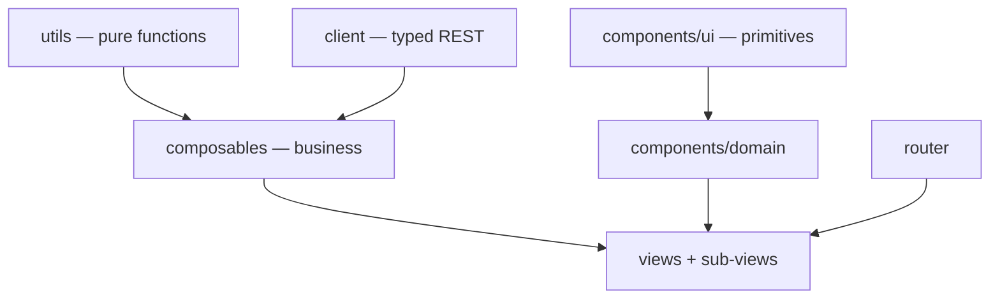

# Darow — Front-end specification

This document describes Darow's **Vue 3 admin application** (`web/`): its layered architecture, its
contracts, its invariants. It is written to be read by an AI agent that has to work on the code
without having read all of it.

`spec/back/spec.md` describes the Go server (storage, service, router, REST API). The two documents
are disjoint: what concerns the SPA lives here, what concerns the binary lives there. Their only
contact point is the REST API, described on the server side (§6 of `spec/back/spec.md`) and consumed
here by the `client/` layer (§2).

**The code is the source of truth.** This document is its description; if it diverges, it is this
document that must be fixed. It deliberately contains no code: exact signatures are read in the
files it cites, named in each section. It only describes the **stable** state: gaps between the
rules below and the current state of the code, accepted limitations, blockers and improvement leads
live in separate files, listed in §12.

---

## 0. Non-negotiable rules

These rules apply to all code produced in `web/`. The numbering is stable and must never be
reordered.

1. **No network access outside `src/client/`.** No `fetch`, no hand-built API URL in a view, a
   component or a composable. The typed client is the only contact point with the server, including
   for URLs meant for an `<a href>` or a tile template (`exportUrl`, `tileUrl`).
2. **Business machinery never lives in a component.** Loading, pagination, mutation, selection,
   derived state: in a composable (`src/composables/`) or a pure function (`src/utils/`). A `.vue`
   file only contains the wiring of those bricks and the rendering.
3. **The visual never leaves the `<template>`.** No Tailwind or daisyUI class in a `.ts` file, a
   composable or a render function. A composable that returns a CSS class is a badly split
   composable.
4. **No markup in render functions (`h()`).** A rich table cell (button, badge, link, editable
   field) is a `.vue` component referenced by the column definition, never an inline `h()` tree.
5. **A shared component ignores the outside world.** `props` in, `emit` out. It knows neither the
   REST client, nor the router, nor the toast queue. Only a feature's domain components may receive
   data already loaded by their view.
6. **One route = one view; a view orchestrates, it does not detail.** As soon as a view carries a
   second responsibility (a panel, a modal, a self-contained section), that responsibility becomes a
   sub-view or a domain component in the feature's directory.
7. **Size caps.** 300 lines per `.vue` file, 150 per composable, 100 per pure function. An overrun
   is resolved by splitting, never by growing.
8. **Any repeated class sequence becomes a primitive.** On the second occurrence of a given styling
   (button, field, panel), the matching `components/ui/` component is created. The existing
   primitive is always used once it exists — a bare `<button>`/`<input>`/`<select>`/`<textarea>`
   carrying `btn`/`input`/`select`/`textarea` daisyUI classes is never hand-rolled where
   `BaseButton`/`BaseInput`/`BaseSelect`/`BaseTextarea` already cover the case, including inside a
   `h()` cell renderer. Standalone text — a heading, a description, a caption — goes through
   `Typography` rather than a raw `<h1>`–`<h4>`/`<p>`/`<span>` with hand-picked size/colour classes;
   it is skipped only where the text is a fragment of a denser element that already owns its own
   typography (a button's label, a table cell, a form field's own small caption).
9. **No type assertion.** `as`, `!` and `typeof`/`Array.isArray` guards on route parameters are
   forbidden: they bypass the checker instead of using it. Cases are handled explicitly (`v-if`,
   default value, narrowing by predicate).
10. **daisyUI is the visual base, but never used directly in a view.** Its classes are encapsulated
    in the `components/ui/` primitives; views use Tailwind for layout only (flex, grid, spacing,
    widths). Before styling anything or adding a primitive, check
    [daisyui.com/components](https://daisyui.com/components/) for a matching component (drawer,
    menu, breadcrumbs, table, alert, skeleton…) rather than hand-rolling the equivalent in plain
    Tailwind — daisyUI class names are copied from that page, never guessed or invented (there is no
    `btn-quiet`, `btn-danger`; the real classes are `btn-ghost`, `btn-error`).
11. **One composable = one subject.** It exposes `ref`/`computed` and actions, never a reactive
    object to be destructured. Its name starts with `use`, its file carries that name.
12. **Remote state has a single owner.** A resource's data, its `loading` and its error are never
    duplicated across two components: they are held by the view (through its composable) and passed
    down as props.
13. **No API error is swallowed.** Every rejection is turned into a user message by `errorMessage`
    then displayed — a toast for a global action, a local message for a form. The only tolerated
    silence is that of best-effort display loads (tiles, extent), and it is commented in place.
14. **The front is not covered by automated tests.** This is a deliberate choice: verification is
    manual, backed by `mise run ui-build` (`vue-tsc` type-check) and `mise run ui-lint`.
    `client/http.test.ts` remains as a net over the HTTP transport, which cannot be checked by eye.
15. **Language conventions.** `<script setup lang="ts">` everywhere, never the Options API.
    PascalCase for component files, camelCase for the rest, UPPER_SNAKE_CASE for constants. Never a
    `.ts` extension in an import path (TS5097 with Volar).
16. **Comments explain the why.** As in the rest of the repository: an invariant, a trap, a server
    constraint. Never a paraphrase of the next line.
17. **Every user-visible string is in French**, including fallback error messages. No i18n: the
    product is monolingual.
18. **Every server-fed area handles its four states**: loading, empty, error, data. None of the four
    is left implicit, none is rendered as a blank screen (§8.1).
19. **No action without visible feedback.** A click produces, within the second, either the result,
    or a busy state, or a message. An action triggered twice out of impatience is an interface
    defect, not a user one (§8.2).
20. **Everything done with a mouse is done with a keyboard.** A clickable target is a `<button>` or
    an `<a>`, never a `<div>`/`<tr>` with an `@click`; every control has an accessible name (§8.7).

---

## 1. Architecture



Five layers, no short-circuit: a view never calls `fetch`, a composable never produces style, a
shared component never calls the client.

| Layer | Directory | Role | Forbidden |
|---|---|---|---|
| Pure functions | `src/utils/` | stateless, I/O-free computation (tile grid, filter tree, type coercion, sorting) | Vue, DOM, network, CSS |
| REST client | `src/client/` | one module per endpoint family + `http.ts` (transport) + `types.ts` (DTOs) | Vue, DOM, CSS |
| Composables | `src/composables/` | application state and orchestration: loading, pagination, mutations, selection, lifecycle of external resources (map, observers) | CSS, markup |
| Components | `src/components/` | rendering. `ui/` = domain-free primitives; `<feature>/` = presentational domain components | network calls, router, toasts (outside `ui/Toast`) |
| Views | `src/views/` | one per route, plus its sub-views; assemble composables and components | inline business logic, duplicated markup |

The router (`src/router.ts`) knows only the views. `src/App.vue` is the application shell: a daisyUI
`drawer` holding the side navigation (persistent on screens ≥1024px, an overlay below), collapsible
to an icon-only width — the choice is persisted (`useStorage`) as a display preference, not screen
state, so it stays out of the URL (§9) — a header carrying the page title and the collapse toggle,
status banner, mounting of `RouterView` and of the toast queue.

---

## 2. Client layer (`src/client/`)

A typed REST client, reusable outside this application: it depends neither on Vue nor on the DOM.

- `http.ts` — transport. Prefixes `/api/v1` on every application route (`apiUrl`), bare root for the
  probes (`getRoot`, used by `ops.ts` alone). `configureApiClient({ baseUrl })` allows pointing at a
  remote Darow instance; by default the page's origin, which is what the embedded SPA needs.
  `ApiError` carries the HTTP status and the server message; `errorMessage` is the only error → user
  text converter. A 204 and an empty body resolve to `undefined`.
- `types.ts` — **all** shared DTOs (`Metadata`, `Source`, `Row`, `RowsPage`, `ColumnSchema`,
  `FilterCondition`, `ErrorResponse`…). No response type is declared in a resource module.
- `tables.ts`, `sources.ts`, `geo.ts`, `features.ts`, `filters.ts`, `ops.ts` — one function per endpoint, named
  after the action and not after the HTTP verb, explicit parameters, typed return. URLs built for a
  non-`fetch` use (export, tile template) go through `apiUrl` and are therefore subject to `baseUrl`
  like the rest.

The endpoint contracts (pagination, sorting, filter DSL, formats) are described on the server side —
`spec.md` §6. This document does not restate them.

---

## 3. Pure functions (`src/utils/`)

One module per subject, no module state, no side effect:

- `tileGrid.ts` — XYZ grid (`tilesCovering`, `tileKey`) and per-zoom simplification tolerance,
  aligned on the server formula (`internal/storage/duckdb/data/geo.go`). Any change on one side
  requires the same on the other.
- `filterTree.ts` — the model of the UI's filter tree (`DraftNode`) and its projection to the server
  DSL (`pruneActive`), which prunes inactive nodes and groups that have become empty (`BuildFilter`
  rejects an empty boolean group — `spec.md` §4.5). **Every** manipulation of that tree (activation,
  removal, duplication, replacement of children, addition, lookup) belongs to this module: the
  components that display it do not reimplement it. Which filter is *applied* is not part of it: a
  filter is a stored object, so `TableFilterBar` tracks it by identifier rather than by an `active`
  flag walked through the tree. `createLeaf` is the one shape a fresh, empty condition takes. `draftOf`/`nodeOf` are the pair the editor modal works through: a root node is
  presented as a boolean operator plus a list of conditions whatever its shape, and folded back to a
  bare leaf when it holds exactly one, so the pill row reads `height > 10` rather than a one-child
  group. `fromConditions` is `pruneActive`'s inverse, rebuilding an editable tree from a stored
  filter's server DSL; `describeDraft` renders a predicate as the default name a filter is saved
  under; `isComplete` is what the modal blocks submission on, and
  `takesValue` is what tells it that `IS NULL`/`IS NOT NULL` need no value box. A node's `not` flag
  negates it, leaf or group alike, mirroring the server's own `Not` (`spec.md` §4.5).
- `columnTypes.ts` — resolution of a column's type and coercion of a text input to the JSON type the
  API expects.
- `rows.ts` — `cellValue`, the one place a row's primary key is read: it is carried by `Row.pkey`,
  not by a `__pkey` entry, so any column list including it has to go through here.
- `sort.ts` — projection of TanStack's sorting state onto the API's `sort` parameter.
- `sourceRows.ts` — the `SourceRow` view model of the sources tree (`toSourceRows`: a multi-layer
  file becomes a parent row over its layers, a single-layer one stays flat) and `formatSize`. The
  shape the cells read is defined once here, not rebuilt in the view and in each cell.

---

## 4. Composables (`src/composables/`)

**Contract.** A composable exposes read-only `ref`/`computed` and action functions; it registers the
cleanup it needs itself (`onUnmounted`, `AbortController`, `IntersectionObserver`, MapLibre
instance). It renders nothing, styles nothing, and knows of a component only the parameters it is
given. A composable whose state must be shared by the whole application (toast queue) declares it at
module level and documents it; that is the exception, not the rule.

**Target split.** Each row is one composable, one file, one subject.

| Composable | Subject | Today |
|---|---|---|
| `useToast` | application notification queue (shared module state) | present |
| `useTiledFeatures` | GeoJSON loading split over the tile grid, reusing already seen tiles | present |
| `usePaginatedList` | paginated list: infinite scroll, server sorting, reload after mutation, observer sentinel | present |
| `useServerStatus` | periodic `readyz` probe of the status banner | absent — inline in `App.vue` |
| `useTableMetadata` | a table's metadata and schema, reaction to a `tableId` change, rename/delete/derive/add-column actions | present |
| `useTableRows` | a table's rows: current page, sorting, editing, insertion, deletion — built on `usePaginatedList` | present |
| `useRowFilter` | filter tree, effective conditions, filtered results and their retry, filtered extent | present |
| `useSavedFilters` | the filters persisted server-side against one table: list, create, update, delete, reloading from the server after each mutation | present |
| `useFeatureSelection` | feature selection (pkeys) and batch hydration of the matching rows — single source of truth, reflected onto the map by `useMvtLayer` rather than negotiated through a component ref | present |
| `useMapLibre` | map lifecycle: creation, basemap, controls, `fitBounds`, destruction | present |
| `useMvtLayer` / `useWfsLayer` | sources and layers of a render mode (`activate`/`deactivate`), symmetric add/remove, listeners; only `useMvtLayer` wires selection (WFS has no click support) | present |
| `useSources` | source list, upload, load with EPSG, deletion — built on `usePaginatedList` | present |
| `useColumnValues` | the values a column actually holds, narrowed by what is being typed: debounced, capped at the first 20 server-side matches, out-of-order responses discarded. One instance per input, never shared between two filter rows | present |

---

## 5. Components (`src/components/`)

Two families, two locations.

**`components/ui/` — domain-free primitives.** They encapsulate daisyUI and are the only ones to
carry component classes. A view never rewrites the styling of a button or a field.

| Primitive | Role |
|---|---|
| `BaseButton` | variants (primary, secondary, danger, ghost — named after the matching daisyUI `btn-*` modifier; `danger` is the **filled** `btn-error`, never outlined: the theme draws a button's border and shadow on the solid variants only, so an outlined red button loses both and reads as a foreign control next to the ones it stands with), sizes (xs, sm, md), an optional `icon` component with an `icon-only` mode (label kept for `aria-label`, hidden visually), `square` for a slot-driven icon-only button, busy/disabled state |
| `BaseInput` / `BaseSelect` / `BaseTextarea` / `BaseCheckbox` | field + label + error message, `v-model`. `BaseInput`'s optional `label` renders above the control; both it and `BaseSelect` take `ariaLabel` for a field whose meaning is carried by its position rather than a visible label (a filter row's value box), since the accessible name must land on the control and not on the wrapping `<label>` |
| `BaseAutocomplete` | free-text field that suggests without constraining: the caller loads `options` in reaction to the `search` event (on focus and on every keystroke), keyboard navigation (↑/↓/Entrée/Échap), selection on `mousedown` so `blur` never wins the race. The list is absolutely positioned, so it never lengthens what contains it; a container that scrolls its own content has to let it spill over (`Modal`'s `overflowVisible`) |
| `Breadcrumbs` | daisyUI `breadcrumbs`; every view passes its own trail (`{ label, to? }[]`) — the last, link-less entry is rendered as the page's only `<h1>` (a view never repeats the object's name in a second heading) |
| `Typography` | text rendering — `variant` (`h1`…`h4`, `body`, `body-sm`, `eyebrow`, `caption`, `code`, `paragraph`) picks both the tag and its styling; any standalone heading or paragraph goes through it instead of a raw `<h1>`–`<h4>`/`<p>`/`<span>` with hand-picked classes |
| `Modal` | teleported box, closing by backdrop and `Escape`, normal/wide widths, and `overflowVisible` for a box short enough not to scroll — daisyUI's `modal-box` scrolls its own content, which otherwise turns a field's dropdown into scrollable content, clipped at the box's edge |
| `Drawer` | daisyUI `drawer`/`drawer-side` (`drawer-end` for the right edge) as a closeable side panel — `v-model`, wrapping the whole content region in its default slot (a `panel` slot holds the side panel's content), exactly as `App.vue`'s own nav drawer wraps the page. It is **not** shrink-wrapped around just a trigger button: `.drawer` is sized/laid out as the region it wraps (`display: grid`), so a caller keeps its own trigger as ordinary markup inside that default slot, wired to the same `v-model`. No feature uses it today — filtering, its former caller, moved to a modal — it stays as the primitive any future side panel builds on |
| `ConfirmButton` | destructive action confirmed through `Modal` (never a native `confirm()`, never inline) — used identically for a rare, cascading deletion (a table) and a frequent one (a row). `size` and `icon` are forwarded to the trigger so it matches the bar it sits in: a delete button a size apart from its neighbours, or the only one without an icon, reads as belonging to another screen |
| `Badge` | status pill, **semantic** tones (neutral, success, warning, error) — never colour names |
| `Toast` | rendering of the `useToast` queue, mounted once in `App.vue` |
| `DataTable` | generic rendering of a TanStack Table instance: sortable headers, rows, empty state, `footer` and `row-after` slots |
| `ErrorState` / `Skeleton` | error states (message + retry) and first-load placeholders, worded once |

**`components/<feature>/` — presentational domain components.** They know the domain types
(`Metadata`, `Source`, `Row`) but stay mute: they receive data and emit intentions. A `DataTable`'s
rich cells (source actions, EPSG input, row actions, editable cell) are of this kind — that is what
replaces the `h()` trees.

---

## 6. Views and sub-views (`src/views/`)

One view per route; its sub-views live in a directory named after it. Every view opens with a
`Breadcrumbs` trail (§5) — `TableDetailView`'s is `Tables > {tableName}`, the two others are a
single, link-less entry naming the page.

| Route | View | Role |
|---|---|---|
| `/tables` | `TablesView` | table catalogue, search, sorting, infinite scroll, inline rename (`components/tables/TableNameCell.vue`) — patches the renamed row in the already-loaded list instead of reloading it |
| `/tables/:tableId` | `TableDetailView` | the table's header and its actions, then composition of the sub-views below |
| `/sources` | `SourcesView` | `workDir` files, upload, per-layer loading, deletion |

**Target split of `TableDetailView`** — the view keeps only the header and the assembly:

- `TableHeader` — editable name, badges, counters, action bar.
- Filtering is a **modal** affair, not a side panel: the editor needs the width, and a filter is a
  discrete thing one creates or edits and then applies. `components/filters/` holds the whole
  feature — `TableFilterBar` (the "Filtrer" button, the saved-filter menu, the pills, and the modal's
  open state, the one place that owns `useSavedFilters`), `FilterEditorModal` (one root node, create
  or edit), `FilterNodeEditor` (the condition/group rows, recursive), `SavedFilterMenu` (the full
  catalogue: apply, edit, delete), `ActiveFilterPill` (the applied filter alone) and
  `FilteredRowsPanel` (the flat, read-only result grid with its own four states and its row cap).
  `FilterNodeEditor` renders the boolean connector as a **left-hand column**, not as a sentence
  above the list: the first row reads "Où", the second carries the one editable ET/OU (a list joins
  with a single connector), the rest repeat it as plain text, and a nested group indents under that
  same column on a tinted background rather than nesting a second bordered box. Negation is a `NON`
  toggle at the end of each row, on a condition or on a whole group alike; `IS NULL`/`IS NOT NULL`
  drop the value box (`takesValue`). The column list carries each column's **type** in its label:
  it decides what the value has to look like and which operators mean anything. The value box is
  `FilterValueInput`, one per condition: on a text column (`isTextType`) it is a `BaseAutocomplete`
  fed by `useColumnValues` — the column's own values, the first 20 matching what is being typed —
  and a plain `BaseInput` otherwise, a number or a date being typed, not picked. A column change
  drops the suggestions rather than offering another column's values, and a failed lookup leaves
  the field plainly typable instead of raising an error over a filter being written.
  **Every filter is persisted, and the catalogue is the single source of truth.** There is no draft
  state and no opt-out, so `TableFilterBar` holds no parallel tree: it keeps only `activeFilterId`,
  and *derives* the `DraftNode[]` it emits to the panel from the applied stored filter
  (`fromConditions`). Two copies is what previously let editing a pill save a duplicate instead of
  updating the filter it came from — a `DraftNode` carries no link back to its stored filter, so
  nothing else can be relied on to tell an update from a creation. Only one filter applies at a
  time: a second would silently AND with the first, which the pill row cannot show.
  The name field fills itself from `describeDraft`'s rendering of the conditions — but only once the
  predicate is complete, since a half-typed one would suggest a name that reads as a bug.
  The toolbar shows the **applied** filter only, never the whole catalogue: `SavedFilterMenu`
  already lists them all, so a pill row repeating it showed every filter twice, and a toolbar does
  not scale past a handful of chips anyway. `ActiveFilterPill`'s ✕ **un-applies**; deleting lives in
  the menu alone, a click away, since a ✕ one pixel from the apply target would destroy a stored
  filter by accident.
  `SavedFilterMenu` owns its open state rather than relying on daisyUI's `:focus-within` dropdown —
  that variant only closes when focus leaves, so applying a filter left the panel hanging over the
  toolbar and opening the editor put a modal behind a still-open menu. It is anchored to its
  button's **left** edge: the toolbar starts at the left of the panel, so a right-aligned menu
  (`dropdown-end`) ran off-screen and clipped every entry.
- `TableMapPanel` — map (loaded via `defineAsyncComponent`: MapLibre is the bundle's largest
  dependency) and the MVT/WFS toggle. Shares the width 50/50 with `TableRowsPanel` by default; a
  `Tableau / ⬛ / Carte` toggle group maximizes either one.
- `TableRowsPanel` — row grid: edit mode, pinned selection, infinite scroll. Switching between the
  filtered, read-only `DataTable` and the paginated one (`filter.filterActive`) carries a distinct
  `key` on each — two entirely different TanStack Table instances patched in place, at the same
  template position, left `<table-layout: auto>` column widths stale in Chromium until some
  unrelated repaint (a hover) forced a reflow; the `key` makes Vue replace the DOM outright instead.
- `DeriveTableModal`, `AddColumnModal`, `AddRowModal`, `ColumnsModal` — one modal = one file, never
  inline modal markup in a view.

**`SourcesView`**: the view holds the header (counts, `Rafraîchir`, `Importer un fichier`) and the
TanStack instance over `toSourceRows`; `components/sources/` holds the rest — `SourceUploadModal`
(the drag-and-drop zone, in a modal opened by the import button rather than a permanent panel: the
page is a catalogue, and an import is an occasional act that should not cost a third of the screen),
`SourceNameCell` (file/layer icon, extension badge, layer indentation) and `SourceActionsCell`
(load with its EPSG prompt, link to the loaded table, deletion). `SourceActionsCell` stays
presentational: which row is being edited, loaded or deleted is decided by the view comparing
`useSources`' keys, the cell only renders the state it is handed and emits intentions.

**Target split of `SourcesView`**: `SourcesTable` (files/layers tree) still to extract.

The title shown by the banner comes from `route.meta.title`, whose type is declared once
(augmentation of `vue-router`'s `RouteMeta`) rather than read untyped.

---

## 7. Style

- **daisyUI base**, `light` theme declared in `src/style.css`, loaded through the Tailwind v4 plugin.
  Its classes (`btn`, `badge`, `modal`, `alert`, `navbar`) are used **only** in `components/ui/`.
- **Utility Tailwind** for layout in the templates: flex/grid, spacing, widths, the `min-h-0`/
  `shrink-0` of height-constrained panels.
- **Neutral, sober palette**, high density, no ornament: this is an admin console. Semantic colours
  go through the primitives' tones, never through a colour hardcoded in a view.
- The map is the only place where colours are hardcoded: those are MapLibre paint values, not CSS
  classes; they live in the layer definitions.

---

## 8. User experience

The application is a **technical admin console**: the user is an operator handling large volumes of
data and performing irreversible actions. The priorities are therefore, in this order: do not make
them lose work, tell them at all times where they stand, be fast.

### 8.1 A screen's four states

Every server-fed area explicitly defines:

- **Loading** — a skeleton (grey shapes at the dimensions of the expected content) for a first list
  or panel load; a discreet indicator at the foot of the list for a next page. A full-screen spinner
  is reserved for real blocking. Below 300 ms, nothing is shown: a flashing indicator is worse than
  no indicator.
- **Empty** — a short sentence that distinguishes "there is nothing" from "your search returns
  nothing", and that offers the next action when there is one ("Aucune table. Chargez une source
  depuis l'onglet Sources.").
- **Error** — a message in French, cause and remedy, plus a way to retry without reloading the page.
  Never a raw technical trace, never an empty state disguised as a success.
- **Data** — the content.

**Content already displayed never disappears during a reload.** A change of sort, filter or page
keeps the current rows on screen (dimmed if need be) until the new ones arrive. No empty flicker, no
height jump.

### 8.2 Action feedback and latency

- Every button triggering a network call goes into a **busy** state: participle label
  ("Enregistrement…"), disabled button, unchanged width so the layout does not shift.
- Disabling serves only to prevent double submission and invalid input: a button disabled for any
  other reason carries a `title` explaining it.
- A successful action **says so or shows so**: a toast for a global action (deletion, loading a
  source), a visible data update for an inline edit.
- An action taking more than a few seconds (upload, import, derivation) shows progress or, failing
  that, an explicit busy state naming the object being processed.
- No optimistic UI: writes are server-authoritative (recomputation of `rowCount`, of `bbox`, of
  `UpdatedAt`), we display what the server has confirmed.

### 8.3 Destructive actions and the user's work

- Deletion, replacement, overwrite: confirmed through the shared `Modal` (never a native
  `confirm()`) — `ConfirmButton` opens it uniformly, whether the action is rare (a table, a source)
  or frequent (a row): the friction of an extra step is deliberate for all of them.
- The confirmation message names what is about to disappear, and mentions cascade effects where
  there are any (deleting a source deletes the tables derived from it).
- **No input is lost by accident.** A modal holding a modified form does not close on a backdrop
  click; `Escape` asks for confirmation. A schema reload does not reset the visible columns the user
  chose, nor the filter in progress.
- No undo: the server does not offer it. That is precisely why confirmation is the barrier.

### 8.4 Messages: what goes where

| Kind | Location | Duration |
|---|---|---|
| Result of a global action | toast, bottom right | ~4 s, dismissible by hand |
| Form or field error | inline message under the field or block concerned | until fixed |
| Server unavailability | permanent status banner in the sidebar | as long as it lasts |
| Contextual information | discreet text under the section title | permanent |

An error that prevents the action in progress **never** goes out as a toast alone: it stays in front
of the user, where they have to act. A message is short, in French, in the active voice, and says
what to do ("Nom de table déjà utilisé." rather than "erreur 409").

### 8.5 Forms

- One label per field, above it, always visible — a placeholder is an example, not a label.
- The first meaningful field receives focus when a modal opens.
- `Enter` submits, `Escape` cancels, in short forms as in inline editing.
- Validation on submit, not on every keystroke; the error goes under the offending field and focus
  moves there.
- Constant button order: secondary action left, primary action right.
- Known constraints (EPSG format, maximum upload size, accepted extensions) are stated **before** the
  attempt, not only in an error response.

### 8.6 Data tables

This is the product's main screen; it follows fixed rules.

- Sticky header, high density, a single scroll area (the page never scrolls horizontally — the table
  does, inside its own frame).
- Numbers and dates right-aligned, formatted in `fr-FR`; `NULL` rendered as a greyed value distinct
  from the empty string.
- Sorting: a visible indicator on the sorted column, numbered order for multi-sort, and the
  affordance explained (`title`) rather than guessed.
- Long cells are truncated with the full value in `title`; the row height is not broken.
- Sorting, search and filtering apply to **all** the data server-side, never only to the pages
  already loaded: a silent partial result is a lie.
- Infinite scroll always states what is left ("50 sur 1 240") and does not prevent reaching the page
  footer.
- Selection and editing do not tread on each other: a selected row stays identifiable after a sort,
  a reload or a page change.

### 8.7 Accessibility and keyboard

- Clickable target = `<button>` or `<a>`. A clickable table row exposes the real action through a
  focusable control (the name link), the row's `@click` being only a shortcut.
- Every icon-only button has an accessible name (`aria-label`); decorative icons are `aria-hidden`.
- Focus visible everywhere, never removed by style. Tab order = visual order.
- Modal and side panel: focus moved inside on opening, trapped while they are open, returned to the
  triggering element on closing; `Escape` closes.
- Toasts are announced (`role="status"` / `aria-live="polite"`), blocking errors as `role="alert"`.
- Minimum AA contrast (4.5:1) for text; information is never carried by colour alone (a status has a
  label, not just a pill).
- Motion (animations, the status banner's `animate-ping`) respects `prefers-reduced-motion`.

### 8.8 Map

- Initial framing on the data's extent; reframing on the **filter's** extent when a filter is active,
  back to the table's extent when it no longer is.
- Data loading on `moveend`, never on every frame, and progressive rendering tile by tile rather than
  in one final block.
- A loading indicator visible while tiles are in flight; a failed tile does not break the map.
- `pointer` cursor on queryable features, highlighting of selected features, and selection reversible
  in one click — with no modifier key, to stay usable on a trackpad.
- Map selection and table selection are **the same** selection, always synchronized both ways, with
  an obvious way to deselect everything.
- Basemap attribution displayed, navigation controls present.

### 8.9 Consistency and wording

- Fixed vocabulary: *source*, *couche*, *table*, *ligne*, *colonne*, *table dérivée*. An object
  carries the same name everywhere, including in error messages.
- Actions are infinitive verbs ("Ajouter une colonne"), with no full stop; help sentences are
  punctuated.
- Constant locations: title and description top left, object actions top right, row actions to the
  right of the row, destructive action always last.
- The same intention keeps the same component and the same label from one screen to the next.

### 8.10 Perceived performance and density

- Display target: workstation, width ≥ 1280 px. No mobile layout, but nothing must break or overlap
  down to 1024 px.
- Heavy dependencies are loaded on demand (MapLibre as an async component), never in the initial
  bundle.
- Inputs that trigger a network call are debounced; a stale response never overwrites a more recent
  one (§9).
- Nothing perceptibly blocks the main thread: large data batches are rendered by pages, and bursts of
  updates are coalesced.

---

## 9. State, routing, lifecycle

- **No global store.** State lives in the view that owns it, through its composables. The only
  exception is the toast queue, shared at module level because a toast pushed from anywhere must show
  up in the component mounted once in `App.vue`.
- **Reaction to route parameters.** A parameterized view (`:tableId`) is reused by `vue-router` when
  only the parameter changes: any initial load is done by a `watch` on the parameter with
  `{ immediate: true }`, never by `onMounted` alone.
- **The URL carries the screen state.** Search, sort and active filter live in the query string: a
  screen is shared by copy-paste, a browser refresh loses nothing, and the Back/Forward buttons do
  what is expected. What is ephemeral (open modal, edit mode) stays out of the URL.
- **Page title.** `document.title` follows the route and names the object being viewed, not just its
  category.
- **Symmetry of effects.** Every `addEventListener`, `IntersectionObserver`, `setInterval`, MapLibre
  source or layer added is removed by the same composable that created it.
- **Concurrent requests.** A load triggered by an input or a map move is either debounced or
  versioned (request token): a stale response must never overwrite a more recent one.
- **Pagination.** Since sorting and filtering are server-side, any change to either invalidates the
  pages already loaded: we start again from page 1, keeping the displayed rows until the new page
  arrives (no empty flicker).

---

## 10. Build and commands

| Command | Effect |
|---|---|
| `mise run ui-install` | npm dependency installation |
| `mise run ui-build` | `vue-tsc` (type-check) then a Vite build **straight into `internal/webui/dist`** |
| `mise run ui-dev` | Vite server, `/api` proxied to `localhost:8080` |
| `mise run ui-lint` | ESLint (correctness rules only, no formatting) |
| `mise run ui-test` | vitest (`client/http.test.ts`) |

`base: "/ui/"`: assets resolve under the prefix served by the Go router (`spec.md` §6.3). The output
goes to `internal/webui/dist` because `go:embed` is relative to the embedding package. The
repository only versions a placeholder `dist/index.html`, overwritten by the first build.

An agent never launches `ui-dev` on its own initiative and never checks the UI in a browser: it
type-checks, and the human looks.

---

## 11. Target directory structure

```
web/
  src/
    client/           HTTP transport + one module per endpoint family + types.ts
    utils/            pure functions (tile grid, filter tree, types, sorting)
    composables/      one composable per subject (§4)
    components/
      ui/             domain-free primitives (§5)
      tables/         table domain components
      sources/        source domain components
      map/            map domain components
    views/
      TablesView.vue
      SourcesView.vue / SourcesView/    sub-views and panels
      TableDetailView.vue / TableDetailView/
    router.ts         one route per view
    App.vue           shell: navigation, server status, toasts
    style.css         Tailwind + daisyUI
```

---

## 12. Where the rest lives

This document only describes the stable state: architecture, rules, invariants. It only moves when
the code moves. Everything that is in motion lives in four neighbouring files, independent of one
another, each of which exists even when empty:

| File | Contents |
|---|---|
| [`blockers.md`](blockers.md) | what prevents a correct use of the application — fixed before any new feature |
| [`limitations.md`](limitations.md) | what the front deliberately does not do — scope decisions, not defects |
| [`todo.md`](todo.md) | the identified debt: gaps between the rules above and the state of the code |
| [`improvements.md`](improvements.md) | the undecided leads, to be decided before being planned |

The Go server has the same structure in [`spec/back/`](../back/): [`spec.md`](../back/spec.md),
[`blockers.md`](../back/blockers.md), [`limitations.md`](../back/limitations.md),
[`todo.md`](../back/todo.md), [`improvements.md`](../back/improvements.md).

The project domain — product identity and naming, repository layout, toolchain and `mise` tasks,
Docker, CI, outward-facing documentation — has the same structure in
[`spec/project/`](../project/).
