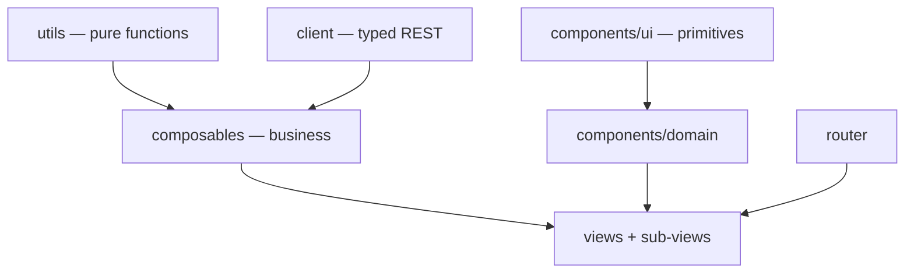

# Darow — Front-end specification

This document describes Darow's **Vue 3 admin application** (`web/`): its layered architecture, its
contracts, its invariants. It is written to be read by an AI agent that has to work on the code
without having read all of it.

`spec/back/spec.md` describes the Go server (storage, service, router, REST API). The two documents
are disjoint: what concerns the SPA lives here, what concerns the binary lives there. Their only
contact point is the REST API, described on the server side (§6 of `spec/back/spec.md`) and consumed
here by the `client/` layer (§2).

**The code is the source of truth.** This document is its description; if it diverges, it is this
document that must be fixed. It deliberately contains no code: exact signatures are read in the
files it cites, named in each section. It only describes the **stable** state: gaps between the
rules below and the current state of the code, accepted limitations, blockers and improvement leads
live in separate files, listed in §12.

---

## 0. Non-negotiable rules

These rules apply to all code produced in `web/`. The numbering is stable and must never be
reordered.

1. **No network access outside `src/client/`.** No `fetch`, no hand-built API URL in a view, a
   component or a composable. The typed client is the only contact point with the server, including
   for URLs meant for an `<a href>` or a tile template (`exportUrl`, `tileUrl`).
2. **Business machinery never lives in a component.** Loading, pagination, mutation, selection,
   derived state: in a composable (`src/composables/`) or a pure function (`src/utils/`). A `.vue`
   file only contains the wiring of those bricks and the rendering.
3. **The visual never leaves the `<template>`.** No Tailwind or daisyUI class in a `.ts` file, a
   composable or a render function. A composable that returns a CSS class is a badly split
   composable.
4. **No markup in render functions (`h()`).** A rich table cell (button, badge, link, editable
   field) is a `.vue` component referenced by the column definition, never an inline `h()` tree.
5. **A shared component ignores the outside world.** `props` in, `emit` out. It knows neither the
   REST client, nor the router, nor the toast queue. Only a feature's domain components may receive
   data already loaded by their view.
6. **One route = one view; a view orchestrates, it does not detail.** As soon as a view carries a
   second responsibility (a panel, a modal, a self-contained section), that responsibility becomes a
   sub-view or a domain component in the feature's directory.
7. **Size caps.** 300 lines per `.vue` file, 150 per composable, 100 per pure function. An overrun
   is resolved by splitting, never by growing.
8. **Any repeated class sequence becomes a primitive.** On the second occurrence of a given styling
   (button, field, panel), the matching `components/ui/` component is created. The existing
   primitive is always used once it exists — a bare `<button>`/`<input>`/`<select>`/`<textarea>`
   carrying `btn`/`input`/`select`/`textarea` daisyUI classes is never hand-rolled where
   `BaseButton`/`BaseInput`/`BaseSelect`/`BaseTextarea` already cover the case, including inside a
   `h()` cell renderer. Standalone text — a heading, a description, a caption — goes through
   `Typography` rather than a raw `<h1>`–`<h4>`/`<p>`/`<span>` with hand-picked size/colour classes;
   it is skipped only where the text is a fragment of a denser element that already owns its own
   typography (a button's label, a table cell, a form field's own small caption).
9. **No type assertion.** `as`, `!` and `typeof`/`Array.isArray` guards on route parameters are
   forbidden: they bypass the checker instead of using it. Cases are handled explicitly (`v-if`,
   default value, narrowing by predicate).
10. **daisyUI is the visual base, but never used directly in a view.** Its classes are encapsulated
    in the `components/ui/` primitives; views use Tailwind for layout only (flex, grid, spacing,
    widths). Before styling anything or adding a primitive, check
    [daisyui.com/components](https://daisyui.com/components/) for a matching component (drawer,
    menu, breadcrumbs, table, alert, skeleton…) rather than hand-rolling the equivalent in plain
    Tailwind — daisyUI class names are copied from that page, never guessed or invented (there is no
    `btn-quiet`, `btn-danger`; the real classes are `btn-ghost`, `btn-error`).
11. **One composable = one subject.** It exposes `ref`/`computed` and actions, never a reactive
    object to be destructured. Its name starts with `use`, its file carries that name.
12. **Remote state has a single owner.** A resource's data, its `loading` and its error are never
    duplicated across two components: they are held by the view (through its composable) and passed
    down as props.
13. **No API error is swallowed.** Every rejection is turned into a user message by `errorMessage`
    then displayed — a toast for a global action, a local message for a form. The only tolerated
    silence is that of best-effort display loads (tiles, extent), and it is commented in place.
14. **The front is not covered by automated tests.** This is a deliberate choice: verification is
    manual, backed by `mise run ui-build` (`vue-tsc` type-check) and `mise run ui-lint`.
    `client/http.test.ts` remains as a net over the HTTP transport, which cannot be checked by eye.
15. **Language conventions.** `<script setup lang="ts">` everywhere, never the Options API.
    PascalCase for component files, camelCase for the rest, UPPER_SNAKE_CASE for constants. Never a
    `.ts` extension in an import path (TS5097 with Volar).
16. **Comments explain the why.** As in the rest of the repository: an invariant, a trap, a server
    constraint. Never a paraphrase of the next line.
17. **Every user-visible string is in French**, including fallback error messages. No i18n: the
    product is monolingual.
18. **Every server-fed area handles its four states**: loading, empty, error, data. None of the four
    is left implicit, none is rendered as a blank screen (§8.1).
19. **No action without visible feedback.** A click produces, within the second, either the result,
    or a busy state, or a message. An action triggered twice out of impatience is an interface
    defect, not a user one (§8.2).
20. **Everything done with a mouse is done with a keyboard.** A clickable target is a `<button>` or
    an `<a>`, never a `<div>`/`<tr>` with an `@click`; every control has an accessible name (§8.7).

---

## 1. Architecture



Five layers, no short-circuit: a view never calls `fetch`, a composable never produces style, a
shared component never calls the client.

| Layer | Directory | Role | Forbidden |
|---|---|---|---|
| Pure functions | `src/utils/` | stateless, I/O-free computation (tile grid, filter tree, type coercion, sorting) | Vue, DOM, network, CSS |
| REST client | `src/client/` | one module per endpoint family + `http.ts` (transport) + `types.ts` (DTOs) | Vue, DOM, CSS |
| Composables | `src/composables/` | application state and orchestration: loading, pagination, mutations, selection, lifecycle of external resources (map, observers) | CSS, markup |
| Components | `src/components/` | rendering. `ui/` = domain-free primitives; `<feature>/` = presentational domain components | network calls, router, toasts (outside `ui/Toast`) |
| Views | `src/views/` | one per route, plus its sub-views; assemble composables and components | inline business logic, duplicated markup |

The router (`src/router.ts`) knows only the views. `src/App.vue` is the application shell: a daisyUI
`drawer` holding the side navigation (persistent on screens ≥1024px, an overlay below), collapsible
to an icon-only width — the choice is persisted (`useStorage`) as a display preference, not screen
state, so it stays out of the URL (§9) — a header carrying the page title and the collapse toggle,
status banner, mounting of `RouterView` and of the toast queue.

---

## 2. Client layer (`src/client/`)

A typed REST client, reusable outside this application: it depends neither on Vue nor on the DOM.

- `http.ts` — transport. Prefixes `/api/v1` on every application route (`apiUrl`), bare root for the
  probes (`getRoot`, used by `ops.ts` alone). `configureApiClient({ baseUrl })` allows pointing at a
  remote Darow instance; by default the page's origin, which is what the embedded SPA needs.
  `ApiError` carries the HTTP status and the server message; `errorMessage` is the only error → user
  text converter. A 204 and an empty body resolve to `undefined`.
- `types.ts` — **all** shared DTOs (`Metadata`, `Source`, `Row`, `RowsPage`, `ColumnSchema`,
  `FilterCondition`, `ErrorResponse`…). No response type is declared in a resource module.
- `tables.ts`, `sources.ts`, `geo.ts`, `features.ts`, `filters.ts`, `ops.ts` — one function per endpoint **the
  application calls**, named after the action and not after the HTTP verb, explicit parameters, typed
  return. A wrapper the app stopped calling is deleted rather than kept as surface: the server's
  contract is described on its own side, and an unreachable function here is code that rots without
  anyone noticing. Nothing is exported that only its own module uses. URLs built for a
  non-`fetch` use (export, tile template) go through `apiUrl` and are therefore subject to `baseUrl`
  like the rest.

The endpoint contracts (pagination, sorting, filter DSL, formats) are described on the server side —
`spec.md` §6. This document does not restate them.

---

## 3. Pure functions (`src/utils/`)

One module per subject, no module state, no side effect:

- `tileGrid.ts` — the per-zoom simplification tolerance, aligned on the server formula
  (`internal/storage/duckdb/data/geo.go`), and `xyzGrid`, the 256-pixel XYZ grid both tile
  endpoints are cut along. Any change to the tolerance on one side requires the same on the other.
  The grid is the engine's (`createXYZ`) but it is **stated, never defaulted**: a vector-tile source
  left to itself uses 512-pixel tiles, which asks for a different zoom for the same view than the
  tolerance above is written against — the two render modes would request different tiles for the
  same map, and the simplification the server applies would not be the one the zoom means here.
- `projection.ts` — the boundary between the two coordinate systems the map lives between, and the
  only place they meet: everything crossing `src/client/` is OGC:CRS84 lon/lat, everything inside
  the map is Web Mercator. A geometry is read and written through one configured GeoJSON format, a
  bbox becomes a view extent through `viewExtent`. Nothing else in the app converts between the two
  — a geometry that reached the REST client still in meters would be written into the table in
  meters, and nothing on screen would say so. `viewBbox` is the other direction: it cuts the view
  down to the **projection's own extent**, which the engine knows and this module does not restate,
  before transforming. It answers null for the two views there is no honest bbox for — one the
  engine has not measured (a zero-sized container is reported as `[0, 0]`, an array, and truthy, so
  a caller trusting it queries a bbox that is a point, reads the empty answer as "there is nothing
  here", and leaves an edit session on a map with no editable geometry at all) and one that meets
  the world nowhere.
- `filterTree.ts` — the model of the UI's filter tree (`DraftNode`) and its projection to the server
  DSL (`pruneActive`), which prunes inactive nodes and groups that have become empty (`BuildFilter`
  rejects an empty boolean group — `spec.md` §4.5). **Every** manipulation of that tree (activation,
  removal, duplication, replacement of children, addition, lookup) belongs to this module: the
  components that display it do not reimplement it. Which filter is *applied* is not part of it: a
  filter is a stored object, so `TableFilterBar` tracks it by identifier rather than by an `active`
  flag walked through the tree. `createLeaf` is the one shape a fresh, empty condition takes. `draftOf`/`nodeOf` are the pair the editor modal works through: a root node is
  presented as a boolean operator plus a list of conditions whatever its shape, and folded back to a
  bare leaf when it holds exactly one, so the pill row reads `height > 10` rather than a one-child
  group. `fromConditions` is `pruneActive`'s inverse, rebuilding an editable tree from a stored
  filter's server DSL; `describeDraft` renders a predicate as the default name a filter is saved
  under; `isComplete` is what the modal blocks submission on, and
  `takesValue` is what tells it that `IS NULL`/`IS NOT NULL` need no value box. A node's `not` flag
  negates it, leaf or group alike, mirroring the server's own `Not` (`spec.md` §4.5).
- `columnTypes.ts` — resolution of a column's type and coercion of a text input to the JSON type the
  API expects.
- `rows.ts` — `cellValue`, the one place a row's primary key is read: it is carried by `Row.pkey`,
  not by a `__pkey` entry, so any column list including it has to go through here.
- `sort.ts` — projection of TanStack's sorting state onto the API's `sort` parameter.
- `geometry.ts` — rendering of a geometry read one row at a time: its GeoJSON text and the bounded
  excerpt a modal may put in the DOM (the clipboard still carries the whole value).
- `holes.ts` — `punchHole`, adding a drawn ring to the polygon that contains it as an interior ring.
  A hole is not a set operation and not a feature of its own: it is part of its polygon, every vertex
  of it stays editable, and it is undone the way it was made. Containment is tested on **every**
  vertex of the ring, not just the first: a ring half outside the polygon, or drawn inside a hole it
  already has, would otherwise be appended anyway and written back as an invalid polygon with
  nothing on screen saying so. Answers nothing when the ring has no polygon to belong to, which is
  what the caller turns into a message. `isAreal` is what tells the edit bar the hole tool applies
  to the layer at all.
- `editPrompts.ts` — the sentences the edit bar states (`editingPrompt`) — never one about the
  session's own budget (§8.8) — and the summary a
  save toasts (`summarizeWrites`). The order is the contract: a load in flight first, then a row
  waiting for its geometry — the one thing that is lost if the user walks away — then the session's
  cap, then the general instruction.
- `mapStyles.ts` / `drawStyles.ts` — the colours a table is read in and those an edit session is
  drawn in. For the canvas layer one style carries fill, stroke and image at once, so a column
  mixing geometry types needs one style and not one layer per type; the GPU layer cannot run a style
  function per feature, so its selection is compiled into the style instead (`wfsFlatStyle`). The two
  render modes are deliberately different colours so it is always readable which one is on. An edit
  session draws **three** states and owns a palette none of the render modes uses, since it is drawn
  above one of them: cyan for what is editable and untouched, amber for a row whose geometry moved —
  the colour a pending write carries everywhere, free here because selection is suspended for the
  length of a session — and violet for a shape that belongs to no row yet. The last two are also
  drawn with a heavier stroke, so the distinction survives a colour-blind reading (§8.7), and
  `EDIT_LEGEND` is what names them in the bar. `PKEY_PROPERTY`/`DIRTY_PROPERTY` live here, next to
  the style that reads them on every frame, as do the two rules that keep a session's rendering
  cheap: every state's style is built once and handed back as it is, never rebuilt per feature per
  frame; and `verticesOf` caches a geometry's vertices against its own revision, so a dragged shape
  recomputes them and a still one does not. `editStyle` draws a geometry, `focusStyle` draws the
  dots of the one under the pointer, and they are two layers for a reason (§8.8).
- `sourceRows.ts` — the `SourceRow` view model of the sources tree (`toSourceRows`: a multi-layer
  file becomes a parent row over its layers, a single-layer one stays flat) and `formatSize`. The
  shape the cells read is defined once here, not rebuilt in the view and in each cell.

---

## 4. Composables (`src/composables/`)

**Contract.** A composable exposes read-only `ref`/`computed` and action functions; it registers the
cleanup it needs itself (`onUnmounted`, `AbortController`, `IntersectionObserver`, a map layer or
interaction). It renders nothing, styles nothing, and knows of a component only the parameters it is
given. A composable whose state must be shared by the whole application (toast queue) declares it at
module level and documents it; that is the exception, not the rule.

**Target split.** Each row is one composable, one file, one subject.

| Composable | Subject | Today |
|---|---|---|
| `useToast` | application notification queue (shared module state) | present |
| `usePaginatedList` | paginated list: infinite scroll, server sorting, reload after mutation, observer sentinel, and the optional `key` a list scoped to a route parameter reloads on | present |
| `useServerStatus` | periodic `readyz` probe of the status banner | absent — inline in `App.vue` |
| `useTableMetadata` | a table's metadata and schema, reaction to a `tableId` change, rename/delete/derive/add-column actions | present |
| `useTableRows` | a table's rows: current page, sorting, editing, insertion, deletion — built on `usePaginatedList` | present |
| `useRowFilter` | filter tree, effective conditions, filtered results and their retry, filtered extent | present |
| `useSavedFilters` | the filters persisted server-side against one table: list, create, update, delete, reloading from the server after each mutation | present |
| `useFeatureSelection` | feature selection (pkeys) and batch hydration of the matching rows — single source of truth, reflected onto the map by `useMvtLayer` rather than negotiated through a component ref | present |
| `useOpenLayers` | map lifecycle: creation, raster basemap, default controls, framing on a bbox, destruction. There is no style to wait for — a layer is added the moment the map exists — but a fit needs a laid-out viewport, so a bbox arriving before the first render waits rather than being dropped | present |
| `useMapDraw` | the edit session's lifecycle: the layer it works on, the one `Modify` over it, the contextmenu the right-click delete has to suppress, `commit` (what the session would write), teardown | present |
| `useEditTools` | which tool the edit bar has armed and nothing else: the `Draw` a shape button arms, the hole being cut, the two independent switches (`snapping`, `topological`) and the `Snap` the first one governs. Split from `useMapDraw` because every arming path has to respect the `Snap`'s place — it handles the pointer before the interactions it corrects, so nothing may be added over it — and that rule is kept in one place, `addUnderSnap`, rather than in each tool. The `Snap` itself is built once per session and never taken off the map to be put back: doing so drops and rebuilds the segment index it keeps over every feature in view, which is a freeze the length of the layer for each tool picked | present |
| `useEditLayer` | the one source an edit session works on, holding every feature of the layer in view, plus the second layer that draws the hovered geometry's vertices alone. One source is what makes editing topological — a vertex two geometries share is dragged in both at once. Owns what the session has touched (`changedCount`/`createdCount`, split the way the write is), whether anything on it can hold a hole at all (`hasAreal`), which single feature the pointer rests over (`trackPointer`/`blur` — at once the `solo` collection a non-topological `Modify` follows and the sole content of the second, vertex-drawing layer it owns), and answers it all as writes: the rows whose geometry moved, and the shapes that belong to no row yet | present |
| `useHoleTool` | drawing an interior ring and handing it to whichever polygon contains it (`utils/holes.ts`), rather than to a source: a hole is part of its polygon and is undone by editing its vertices, not by an opposite tool. A ring that belongs to no polygon is refused out loud | present |
| `useEditFeatures` | the session's **working set**: the rows of the view, at full resolution, under two caps — rows and vertices — counted over the whole session, with `release` giving back exactly what a released row cost so the caps are not a one-way ratchet. Holds the pkeys already loaded, so a row is never counted twice and the server's copy never comes back over a geometry the user moved, and versions its requests so a pan that outruns its own load is not undone by the slower answer | present |
| `useLayerEditing` | the mode itself: what it is waiting for (the prompt, the row whose geometry is still to be drawn) and what leaving it writes — one update request for what moved, one insert for what was drawn | present |
| `useMapSelection` | the half of a render mode that has nothing to do with how the table is fetched: which features are selected, and what a click on one means. Shared by both modes rather than copied into each. Its listeners are bound only while the selection is `selectable`, which an edit session turns off — the layer stays drawn and the selection stays painted, only the clicking stops | present |
| `useRowGeometry` | one row's geometry read on demand — GeoJSON, WKT, and the copy to the clipboard | present |
| `useMvtLayer` / `useWfsLayer` | the layer of a render mode (`activate`/`deactivate`), symmetric add/remove; both delegate selection to `useMapSelection` and both refetch on a bump of the data version the caller passes. MVT is one vector-tile layer styled per feature — nothing has to be asked of the server to know which geometry types the column holds. WFS is a vector source loading over the XYZ grid the tile endpoint is cut along, the engine deciding which tiles the view is missing and remembering the ones already loaded across a pan | present |
| `useSources` | source list, upload, load with EPSG, deletion — built on `usePaginatedList` | present |
| `useDeriveTable` | deriving a table from the one being viewed, in both modes: the guided draft (carried columns, computed columns, condition tree) and the two submissions, guided and free-SQL | present |
| `useColumnValues` | the values a column actually holds, narrowed by what is being typed: debounced, capped at the first 20 server-side matches, out-of-order responses discarded. One instance per input, never shared between two filter rows | present |

---

## 5. Components (`src/components/`)

Two families, two locations.

**`components/ui/` — domain-free primitives.** They encapsulate daisyUI and are the only ones to
carry component classes. A view never rewrites the styling of a button or a field.

| Primitive | Role |
|---|---|
| `Spinner` | the busy indicator, wherever something is in flight and the content around it stays on screen — a `Skeleton` is for a first load, this is for a refresh happening next to what it refreshes |
| `ButtonGroup` | a row of buttons welded into one control (daisyUI `join`). Each child carries `BaseButton`'s `joined` prop: daisyUI needs the modifier on the items, and a wrapper cannot put it there without reaching into the slot |
| `FloatingPanel` | a panel floating over the content behind it — the map's chrome: the render toggle in a corner (`top-left`). The caller says where, never how |
| `BaseButton` | variants (primary, secondary, danger, ghost — named after the matching daisyUI `btn-*` modifier; `danger` is the **filled** `btn-error`, never outlined: the theme draws a button's border and shadow on the solid variants only, so an outlined red button loses both and reads as a foreign control next to the ones it stands with), sizes (xs, sm, md), an optional `icon` component with an `icon-only` mode (label kept for `aria-label`, hidden visually), `square` for a slot-driven icon-only button, busy/disabled state |
| `BaseInput` / `BaseSelect` / `BaseTextarea` / `BaseCheckbox` | field + label + error message, `v-model`. `BaseInput`'s optional `label` renders above the control; both it and `BaseSelect` take `ariaLabel` for a field whose meaning is carried by its position rather than a visible label (a filter row's value box), since the accessible name must land on the control and not on the wrapping `<label>` |
| `BaseAutocomplete` | free-text field that suggests without constraining: the caller loads `options` in reaction to the `search` event (on focus and on every keystroke), keyboard navigation (↑/↓/Entrée/Échap), selection on `mousedown` so `blur` never wins the race. The list is absolutely positioned, so it never lengthens what contains it; a container that scrolls its own content has to let it spill over (`Modal`'s `overflowVisible`) |
| `MenuDropdown` | daisyUI `dropdown` + `menu`: a trigger button and the panel it opens under itself, with `MenuItem` (a `menu` `<li>`, its `actions` slot carrying the per-row buttons that must not trigger the entry) and `MenuTitle` (`menu-title`, a section heading) as its content. The open state is owned here, not left to daisyUI's CSS-focus or `<details>` variants: both only close when focus leaves, so acting from the panel left it hanging over the toolbar and opening a modal put it behind a still-open menu. The caller says which edge it hangs from (`align`) and how wide the panel is (`panelClass`) — only the caller knows whether its trigger stands at the left of a bar or at its right |
| `Divider` | daisyUI `divider`, tightened: the hairline saying the controls on either side belong to two different registers. daisyUI names its class after the layout it divides, so `orientation="vertical"` (the line) maps to `divider-horizontal` (the row) here, once |
| `ConfirmDialog` | the confirmation of a destructive action, worded once — always this box, never a native `confirm()` and never an inline pair (§8.3). `ConfirmButton` is it with its own trigger; a caller whose trigger is something else (a menu entry) opens it directly |
| `Breadcrumbs` | daisyUI `breadcrumbs`; every view passes its own trail (`{ label, to? }[]`) — the last, link-less entry is rendered as the page's only `<h1>` (a view never repeats the object's name in a second heading) |
| `Typography` | text rendering — `variant` (`h1`…`h4`, `body`, `body-sm`, `eyebrow`, `caption`, `code`, `paragraph`) picks both the tag and its styling; any standalone heading or paragraph goes through it instead of a raw `<h1>`–`<h4>`/`<p>`/`<span>` with hand-picked classes |
| `Modal` | teleported box, closing by backdrop and `Escape`, normal/wide widths, and `overflowVisible` for a box short enough not to scroll — daisyUI's `modal-box` scrolls its own content, which otherwise turns a field's dropdown into scrollable content, clipped at the box's edge |
| `ConfirmButton` | destructive action confirmed through `Modal` (never a native `confirm()`, never inline) — used identically for a rare, cascading deletion (a table) and a frequent one (a row). `size` and `icon` are forwarded to the trigger so it matches the bar it sits in: a delete button a size apart from its neighbours, or the only one without an icon, reads as belonging to another screen |
| `Badge` | status pill, **semantic** tones (neutral, primary, success, warning, error) — never colour names. `warning` is the amber a pending write is shown in everywhere, including the edit bar's count of touched geometries |
| `Toast` | rendering of the `useToast` queue, mounted once in `App.vue` |
| `DataTable` | generic rendering of a TanStack Table instance: sortable headers, rows, empty state, `footer` and `row-after` slots |
| `ErrorState` / `Skeleton` | error states (message + retry) and first-load placeholders, worded once |

**`components/<feature>/` — presentational domain components.** They know the domain types
(`Metadata`, `Source`, `Row`) but stay mute: they receive data and emit intentions. A `DataTable`'s
rich cells (source actions, EPSG input, row actions, editable cell) are of this kind — that is what
replaces the `h()` trees.

---

## 6. Views and sub-views (`src/views/`)

One view per route; its sub-views live in a directory named after it. Every view opens with a
`Breadcrumbs` trail (§5) — `TableDetailView`'s is `Tables > {tableName}`, the two others are a
single, link-less entry naming the page.

| Route | View | Role |
|---|---|---|
| `/tables` | `TablesView` | table catalogue, search, sorting, infinite scroll, inline rename (`components/tables/TableNameCell.vue`) — patches the renamed row in the already-loaded list instead of reloading it |
| `/tables/:tableId` | `TableDetailView` | the table's header and its actions, then composition of the sub-views below |
| `/sources` | `SourcesView` | `workDir` files, upload, per-layer loading, deletion |

**Target split of `TableDetailView`** — the view keeps only the header and the assembly:

- `TableHeader` (`components/tables/`) — what the table **is** (badge, row count, last update) and
  what can be done to the table **as an object**, gathered behind one `MenuDropdown` labelled
  *Actions*: *Renommer* and *Ajouter une colonne* under **Structure**, *Dériver une table* and
  *Exporter* under **Produire**, then *Supprimer la table* alone under a divider, last as §8.9 asks.
  Five buttons of five registers side by side read as a pile, and four of them are used once in a
  table's life. The rename form is opened from the menu but the view owns its open state
  (`editingName`): only the view knows whether the write went through, and therefore whether the
  form may close.
- `TableToolbar` (`components/tables/`) — the workspace's own bar, one row below, holding
  everything that acts on what is **displayed**, in the order it is read: *les données*
  (`TableFilterBar`), *l'édition* (one `Éditer` toggle, whose tools are stated by `TableEditBar`
  above both panels), then *l'affichage* (*Colonnes*, and the
  `Tableau / ⬛ / Carte` group), the two registers parted by a `Divider`. It owns nothing: the
  visible-column choice is the view's state, so the *Colonnes* button asks the panel for its modal
  and the panel asks the view.
- Filtering is a **modal** affair, not a side panel: the editor needs the width, and a filter is a
  discrete thing one creates or edits and then applies. `components/filters/` holds the whole
  feature — `TableFilterBar` (the "Filtrer" button, the saved-filter menu, the pills, and the modal's
  open state, the one place that owns `useSavedFilters`), `FilterEditorModal` (one root node, create
  or edit), `FilterNodeEditor` (the condition/group rows, recursive), `SavedFilterMenu` (the full
  catalogue: apply, edit, delete), `ActiveFilterPill` (the applied filter alone) and
  `FilteredRowsPanel` (the flat, read-only result grid with its own four states and its row cap).
  `FilterNodeEditor` renders the boolean connector as a **left-hand column**, not as a sentence
  above the list: the first row reads "Où", the second carries the one editable ET/OU (a list joins
  with a single connector), the rest repeat it as plain text, and a nested group indents under that
  same column on a tinted background rather than nesting a second bordered box. Negation is a `NON`
  toggle at the end of each row, on a condition or on a whole group alike; `IS NULL`/`IS NOT NULL`
  drop the value box (`takesValue`). The column list carries each column's **type** in its label:
  it decides what the value has to look like and which operators mean anything. The value box is
  `FilterValueInput`, one per condition: on a text column (`isTextType`) it is a `BaseAutocomplete`
  fed by `useColumnValues` — the column's own values, the first 20 matching what is being typed —
  and a plain `BaseInput` otherwise, a number or a date being typed, not picked. A column change
  drops the suggestions rather than offering another column's values, and a failed lookup leaves
  the field plainly typable instead of raising an error over a filter being written.
  **Every filter is persisted, and the catalogue is the single source of truth.** There is no draft
  state and no opt-out, so `TableFilterBar` holds no parallel tree: it keeps only `activeFilterId`,
  and *derives* the `DraftNode[]` it emits to the panel from the applied stored filter
  (`fromConditions`). Two copies is what previously let editing a pill save a duplicate instead of
  updating the filter it came from — a `DraftNode` carries no link back to its stored filter, so
  nothing else can be relied on to tell an update from a creation. Only one filter applies at a
  time: a second would silently AND with the first, which the pill row cannot show.
  The name field fills itself from `describeDraft`'s rendering of the conditions — but only once the
  predicate is complete, since a half-typed one would suggest a name that reads as a bug.
  The toolbar shows the **applied** filter only, never the whole catalogue: `SavedFilterMenu`
  already lists them all, so a pill row repeating it showed every filter twice, and a toolbar does
  not scale past a handful of chips anyway. `ActiveFilterPill`'s ✕ **un-applies**; deleting lives in
  the menu alone, a click away, since a ✕ one pixel from the apply target would destroy a stored
  filter by accident.
  `SavedFilterMenu` owns its open state rather than relying on daisyUI's `:focus-within` dropdown —
  that variant only closes when focus leaves, so applying a filter left the panel hanging over the
  toolbar and opening the editor put a modal behind a still-open menu. It is anchored to its
  button's **left** edge: the toolbar starts at the left of the panel, so a right-aligned menu
  (`dropdown-end`) ran off-screen and clipped every entry.
- `TableMapPanel` — map (loaded via `defineAsyncComponent`: OpenLayers is the bundle’s largest
  dependency) and the MVT/WFS toggle. Shares the width 50/50 with `TableRowsPanel` by default; a
  `Tableau / ⬛ / Carte` toggle group maximizes either one.
- `TableRowsPanel` (`components/tables/`) — row grid: the pinned
  selection, infinite scroll, and the per-row action column. That column is **always** rendered:
  reading a row's geometry is a read, so arming edit mode to reach it would be a trap. It receives
  the `useTableRows` state its parent owns and emits intentions (`toggleEditMode`, `updateCell`,
  `geometry`, `editGeometry`), never mutating that prop itself. Switching between the
  filtered, read-only `DataTable` and the paginated one (`filter.filterActive`) carries a distinct
  `key` on each — two entirely different TanStack Table instances patched in place, at the same
  template position, left `<table-layout: auto>` column widths stale in Chromium until some
  unrelated repaint (a hover) forced a reflow; the `key` makes Vue replace the DOM outright instead.
- `AddColumnModal`, `AddRowModal`, `ColumnsModal`, `GeometryModal` — one modal = one file, never
  inline modal markup in a view. `GeometryModal` (`components/tables/`) shows one row's geometry in
  both encodings with a copy button each, rendering a bounded excerpt while the clipboard carries
  the whole value; `AddRowModal` collects attributes only — on a geo table the geometry is drawn
  next, on the map.
- **Deriving is two modes in one modal**, in `components/tables/`. `DeriveTableModal` is the shell:
  the tab pair, the new table's name, the submit, and the one `useDeriveTable` instance both tabs
  work through. `DeriveFromTableForm` is the guided tab — the column picker, the computed-column
  rows, and the condition tree, which reuses `FilterNodeEditor` rather than a second editor, plus a
  "reprendre un filtre enregistré" select that **copies** a stored filter's conditions into the
  draft (referencing it would suggest the derived table tracks it, and a derived table is a frozen
  snapshot). `DeriveSqlForm` is the free-SQL tab, whose caption states that the query runs against
  every registered table: it used to be the only mode, pre-filled with this table's name, which
  stated a scope the endpoint never had. The geometry column and `__pkey` are absent from the
  picker — the server carries the first over on its own and regenerates the second.

**`SourcesView`**: the view holds the header (counts, `Rafraîchir`, `Importer un fichier`) and the
TanStack instance over `toSourceRows`; `components/sources/` holds the rest — `SourceUploadModal`
(the drag-and-drop zone, in a modal opened by the import button rather than a permanent panel: the
page is a catalogue, and an import is an occasional act that should not cost a third of the screen),
`SourceNameCell` (file/layer icon, extension badge, layer indentation) and `SourceActionsCell`
(load with its EPSG prompt, link to the loaded table, deletion). `SourceActionsCell` stays
presentational: which row is being edited, loaded or deleted is decided by the view comparing
`useSources`' keys, the cell only renders the state it is handed and emits intentions.

**Target split of `SourcesView`**: `SourcesTable` (files/layers tree) still to extract.

The title shown by the banner comes from `route.meta.title`, whose type is declared once
(augmentation of `vue-router`'s `RouteMeta`) rather than read untyped.

---

## 7. Style

- **daisyUI base**, `light` theme declared in `src/style.css`, loaded through the Tailwind v4 plugin.
  Its classes (`btn`, `badge`, `modal`, `alert`, `navbar`) are used **only** in `components/ui/`.
- **Utility Tailwind** for layout in the templates: flex/grid, spacing, widths, the `min-h-0`/
  `shrink-0` of height-constrained panels.
- **Neutral, sober palette**, high density, no ornament: this is an admin console. Semantic colours
  go through the primitives' tones, never through a colour hardcoded in a view.
- The map is the only place where colours are hardcoded: those are map style values, not CSS
  classes; they live in the layer definitions.

---

## 8. User experience

The application is a **technical admin console**: the user is an operator handling large volumes of
data and performing irreversible actions. The priorities are therefore, in this order: do not make
them lose work, tell them at all times where they stand, be fast.

### 8.1 A screen's four states

Every server-fed area explicitly defines:

- **Loading** — a skeleton (grey shapes at the dimensions of the expected content) for a first list
  or panel load; a discreet indicator at the foot of the list for a next page. A full-screen spinner
  is reserved for real blocking. Below 300 ms, nothing is shown: a flashing indicator is worse than
  no indicator.
- **Empty** — a short sentence that distinguishes "there is nothing" from "your search returns
  nothing", and that offers the next action when there is one ("Aucune table. Chargez une source
  depuis l'onglet Sources.").
- **Error** — a message in French, cause and remedy, plus a way to retry without reloading the page.
  Never a raw technical trace, never an empty state disguised as a success.
- **Data** — the content.

**Content already displayed never disappears during a reload.** A change of sort, filter or page
keeps the current rows on screen (dimmed if need be) until the new ones arrive. No empty flicker, no
height jump.

### 8.2 Action feedback and latency

- Every button triggering a network call goes into a **busy** state: participle label
  ("Enregistrement…"), disabled button, unchanged width so the layout does not shift.
- Disabling serves only to prevent double submission and invalid input: a button disabled for any
  other reason carries a `title` explaining it.
- A successful action **says so or shows so**: a toast for a global action (deletion, loading a
  source), a visible data update for an inline edit.
- An action taking more than a few seconds (upload, import, derivation) shows progress or, failing
  that, an explicit busy state naming the object being processed.
- No optimistic UI: writes are server-authoritative (recomputation of `rowCount`, of `bbox`, of
  `UpdatedAt`), we display what the server has confirmed.

### 8.3 Destructive actions and the user's work

- Deletion, replacement, overwrite: confirmed through the shared `Modal` (never a native
  `confirm()`) — `ConfirmButton` opens it uniformly, whether the action is rare (a table, a source)
  or frequent (a row): the friction of an extra step is deliberate for all of them.
- The confirmation message names what is about to disappear, and mentions cascade effects where
  there are any (deleting a source deletes the tables derived from it).
- **No input is lost by accident.** A modal holding a modified form does not close on a backdrop
  click; `Escape` asks for confirmation. A schema reload does not reset the visible columns the user
  chose, nor the filter in progress.
- No undo: the server does not offer it. That is precisely why confirmation is the barrier.

### 8.4 Messages: what goes where

| Kind | Location | Duration |
|---|---|---|
| Result of a global action | toast, bottom right | ~4 s, dismissible by hand |
| Form or field error | inline message under the field or block concerned | until fixed |
| Server unavailability | permanent status banner in the sidebar | as long as it lasts |
| Contextual information | discreet text under the section title | permanent |

An error that prevents the action in progress **never** goes out as a toast alone: it stays in front
of the user, where they have to act. A message is short, in French, in the active voice, and says
what to do ("Nom de table déjà utilisé." rather than "erreur 409").

### 8.5 Forms

- One label per field, above it, always visible — a placeholder is an example, not a label.
- The first meaningful field receives focus when a modal opens.
- `Enter` submits, `Escape` cancels, in short forms as in inline editing.
- Validation on submit, not on every keystroke; the error goes under the offending field and focus
  moves there.
- Constant button order: secondary action left, primary action right.
- Known constraints (EPSG format, maximum upload size, accepted extensions) are stated **before** the
  attempt, not only in an error response.

### 8.6 Data tables

This is the product's main screen; it follows fixed rules.

- Sticky header, high density, a single scroll area (the page never scrolls horizontally — the table
  does, inside its own frame).
- Numbers and dates right-aligned, formatted in `fr-FR`; `NULL` rendered as a greyed value distinct
  from the empty string.
- Sorting: a visible indicator on the sorted column, numbered order for multi-sort, and the
  affordance explained (`title`) rather than guessed.
- Long cells are truncated with the full value in `title`; the row height is not broken.
- Sorting, search and filtering apply to **all** the data server-side, never only to the pages
  already loaded: a silent partial result is a lie. The one exception is the map editor's working
  set, which is deliberately silent and says what it holds by drawing it (§8.8, LIM-F7) — nothing
  there is *answered* partially, it is a neighbourhood being worked on.
- Infinite scroll always states what is left ("50 sur 1 240") and does not prevent reaching the page
  footer.
- Selection and editing do not tread on each other: a selected row stays identifiable after a sort,
  a reload or a page change.

### 8.7 Accessibility and keyboard

- Clickable target = `<button>` or `<a>`. A clickable table row exposes the real action through a
  focusable control (the name link), the row's `@click` being only a shortcut.
- Every icon-only button has an accessible name (`aria-label`); decorative icons are `aria-hidden`.
- Focus visible everywhere, never removed by style. Tab order = visual order.
- Modal and side panel: focus moved inside on opening, trapped while they are open, returned to the
  triggering element on closing; `Escape` closes.
- Toasts are announced (`role="status"` / `aria-live="polite"`), blocking errors as `role="alert"`.
- Minimum AA contrast (4.5:1) for text; information is never carried by colour alone (a status has a
  label, not just a pill).
- Motion (animations, the status banner's `animate-ping`) respects `prefers-reduced-motion`.

### 8.8 Map

- Initial framing on the data's extent; reframing on the **filter's** extent when a filter is active,
  back to the table's extent when it no longer is.
- Data loading on `moveend`, never on every frame, and progressive rendering tile by tile rather than
  in one final block.
- A loading indicator visible while tiles are in flight; a failed tile does not break the map.
- `pointer` cursor on queryable features, highlighting of selected features, and selection reversible
  in one click — with no modifier key, to stay usable on a trackpad.
- Map selection and table selection are **the same** selection, always synchronized both ways, with
  an obvious way to deselect everything.
- Basemap attribution displayed, navigation controls present.
- **A table is edited in two halves, and never in both at once.** The attributes are edited in the
  grid, the geometries on the map, and each is armed by its own button in the panel's action bar:
  *Éditer la table* and *Éditer la géométrie*. A table without geometry has only the first, and its
  button says just *Mode édition* — there is no second half to distinguish it from. Arming one
  disarms the other, so there is only ever one thing the screen is waiting for.
- **One door per mode.** *Éditer la géométrie* is the only way into the map's edit mode: a row's
  actions offer reading its geometry, never editing it. A second entry point onto the same mode is a
  second thing to explain and a second place to keep true, and it would suggest the mode is about
  that one row when it is about the whole layer.
- **Editing the geometries is a mode of the layer, not of a row.** Entering it loads every row of
  the current view, at full resolution, into one editable layer — and every one of them is editable
  at once. That is the whole point: two polygons of a coverage that share a limit hold the same
  coordinates, so dragging that limit drags both sides in the same gesture. The topology is held by
  construction, not rebuilt afterwards from set operations, and it works the same for a road network
  as for a parcel plan. Panning loads what the view has gained without touching what is already
  there: a geometry the user moved is never overwritten by the server's copy of it.
- **The table stays drawn under an edit session.** The rendering the user was reading (MVT or WFS)
  is left on and the editable layer is drawn above it, so entering the mode never blanks the map
  while the editable copies are being fetched, and the layer is still legible where the session
  holds nothing. A row being reshaped shows its stored geometry underneath until the session is
  saved. The render-mode toggle stays available, since the layer it acts on is still there.
  **Selecting is not**: the click that places a vertex must not also toggle a row, and a hover cursor
  must not fight the one the reshaping sets, so the render mode's selection listeners are suspended
  for the length of the session. **The layout stays the user's**: entering the mode reframes
  nothing, and the `Tableau / ⬛ / Carte` group keeps working throughout. The map holds the session's
  unsaved work, so maximizing the table *hides* it instead of unmounting it — the session survives,
  and OpenLayers re-measures its container on its own when the map comes back. The way out of the
  mode is still *Enregistrer* or *Annuler*, both on the map itself.
- **The session asks for what is in view, whenever the view changes.** Entering the mode, panning
  and zooming all ask; so does the map growing to the full width, which is a resize and not a
  move. A view not yet measured — including one the engine measured at zero, which it reports as a
  size rather than as nothing — has no extent to ask about and asks again on the next animation
  frame, never on the next render: a map with no area draws nothing, so there is no next render to
  wait for. A load that never answers is dropped after a fixed delay and stated as a failure; the
  bar never keeps saying it is loading once nothing is.
- **Editing is one mode of the table, and its tools stand above both panels.** There is a single
  *Éditer* toggle in `TableToolbar`, never one per half: the rows and the geometries are two halves
  of one object, and choosing between them before touching anything is a question the user cannot
  answer yet. Arming it raises `TableEditBar` over both panels, holding what the table can actually
  carry — the row actions always, the map's tools only on a geo table. Those tools stay owned by
  `MapView` (the OpenLayers session is theirs, and OpenLayers must not reach the initial bundle
  through the bar) and are rendered into it by a `Teleport`, which is also what keeps *Enregistrer*
  and *Annuler* reachable while the map is the hidden half of a maximized table.
- **Creating and modifying are two intentions, and the bar says so.** The session's toolbar
  (`components/map/MapEditBar.vue`) groups *Polygone / Ligne / Point* under
  **Créer** — each adds a row that does not exist yet — and *Trou / Annuler le point* under
  **Modifier**, which act on a shape already there. Undifferentiated, *Trou* read as a fourth shape
  to draw rather than as a cut into an existing polygon.
- **One gesture per operation, the desktop-GIS ones.** Dragging a vertex moves it, dragging anywhere
  on a segment creates a vertex there, a right-click on a vertex removes it. A shape is added by
  arming one of *Polygone* / *Ligne* / *Point* in the bar, clicking its vertices and closing it with
  a double-click; *Trou* draws a ring that becomes an interior ring of whichever polygon contains it,
  after which its vertices are dragged like any other. *Annuler le point* takes back the last click
  of whichever of the two is being drawn.
- **Vertices are drawn where they can be grabbed, not everywhere.** The dots exist to say a limit is
  grabbable, and only the geometry the pointer rests over can be grabbed now — so it is the only one
  that shows them, in its own state's colour. Every vertex of a whole view's worth of geometry meant
  thousands of points rebuilt on every frame of every pan and every drag, which is what made the
  mode feel heavy; the affordance is the same and the map answers the mouse. They are drawn on a
  layer of their own, carrying that one feature — the feature itself, not a copy, so a drag takes
  its dots with it — because painting them from the edit layer's style would repaint every geometry
  in view each time the pointer crossed a new one. What is under the pointer is hit-tested at most
  once per frame, on the last pixel seen, and never mid-drag: the interaction has already chosen its
  feature by then, and a pointer that left the map is over nothing.
- **What has moved is visible before it is sent, and so is what it will become.** A row whose
  geometry moved is drawn in the amber a pending write is shown in everywhere else; a shape drawn in
  the session is violet, because it belongs to no row yet and saving it is an insert, not an update.
  The bar states the two counts separately for the same reason — they are the two requests a save
  makes, and they fail differently — each taken from what actually changed, not from what was
  loaded, and a legend names the three states so none of it rests on colour alone (§8.7). Nothing is
  written until *Enregistrer* is clicked: a drag is not a submission, and *Annuler* drops the whole
  session. What is drawn again after the write is what the server answers, never the local state.
- **What is edited is never what is rendered.** A vector tile's geometry is simplified for its zoom
  and clipped at its borders. The engine can rebuild it into an editable feature, and saving that
  would quietly write a degraded shape back over a correct one — so it never does: a session loads
  its rows from the OGC Features endpoint, at full resolution, and no coordinate that gets written
  ever came off a tile.
- **A session works on a working set, and moving it is silent.** The bound is on the **session**,
  not on one request: panning along a boundary is the gesture the mode exists for, so a cap counted
  per view would let a dozen pans pile up a dozen capfuls. A row count alone is not a bound at all —
  one administrative boundary at full resolution carries more vertices than a thousand parcels, and
  every vertex is indexed by the `Modify` and by the `Snap`, then re-indexed on every change: a
  hundred such rows freeze the tab for seconds on entering the mode. So a second cap is counted in
  vertices (`countVertices`, `MAX_EDITABLE_VERTICES`), a feature being taken whole or not at all.
  Neither cap is a ratchet: leaving a view **releases** the untouched rows it held
  (`useEditLayer.prune` → `useEditFeatures.release`), giving their exact cost back, so the next
  neighbourhood loads whole. A feature the user has touched is never released, in view or not — it
  carries unsaved work — and neither is one drawn in the session, which the server has no copy of.
  The whole of it is **silent**: the bar states what the session is waiting for, never what its
  budget is doing (`editPrompts`). What is editable is what is drawn as editable, over a rendering
  that keeps showing the rest — a message about a working set is a message about plumbing
  (`limitations.md` LIM-F7).
- **A tool that cannot apply says so; a gesture that answered nothing is a defect.** *Trou* is
  disabled, with the reason in its `title`, on a view holding no polygon to cut, and a ring drawn
  where no polygon contains it is refused out loud rather than dropped. *Annuler le point* is
  disabled when no shape is being drawn. The work a user did with the mouse never disappears in
  silence (§8.2).
- **Two toggles, because they answer two questions.** *Aimantation* is about **placing**: a vertex
  put down within tolerance of a neighbour is pulled exactly onto it. Its tolerance is a screen
  distance, so it means the same thing at every zoom, and it pulls onto a vertex before a segment.
  *Topologie* is about **moving**: whether a coordinate two geometries already hold is one vertex or
  two. Snapping is how a boundary becomes shared; topology is what happens to it afterwards, and
  wanting to snap a new shape onto its neighbours without dragging those neighbours around is an
  ordinary thing to want.
- **Topology is expressed as what the `Modify` may touch, never as a coordinate comparison.** On, it
  works over the layer's whole source, so two geometries holding the same coordinate hold the same
  vertex and one drag moves both sides of a limit. Off, it works over a one-feature `Collection`
  kept on whatever the pointer rests over, so the neighbour is not in the interaction at all and its
  copy of the vertex stays put; the switch rebuilds the interaction. It is **not** done with
  `sharedVerticesEqual`: that comparison is also what tells `Modify` the pointer is on a vertex
  rather than on a segment, so defeating it makes every press insert a new vertex beside the old one
  instead of moving it — the shared node looks duplicated and nothing moves.
- **A save is one write per kind.** Every moved geometry goes in a single update request, so a limit
  two rows share is never left moved on one side only; the shapes drawn that belong to no row yet go
  in a single insert. Adding a row on a geo table is still two steps — the attributes are collected
  in the grid, and the first shape drawn in the session that follows takes them — so a row never
  lands without its geometry. That session says what it is waiting for while the shape is missing,
  refuses to save until it is drawn, and states that the row was not created if the session is
  cancelled instead: attributes the user typed never disappear without a word (§8.3).
- **A write invalidates what the map shows.** A tile is cached by URL, so the
  panel bumps a data version after every row write and the layers ask again — an edited geometry is
  visible immediately, not at the next zoom.

### 8.9 Consistency and wording

- Fixed vocabulary: *source*, *couche*, *table*, *ligne*, *colonne*, *table dérivée*. An object
  carries the same name everywhere, including in error messages.
- Actions are infinitive verbs ("Ajouter une colonne"), with no full stop; help sentences are
  punctuated.
- Constant locations: title and description top left, object actions top right, row actions to the
  right of the row, destructive action always last.
- The same intention keeps the same component and the same label from one screen to the next.

### 8.10 Perceived performance and density

- Display target: workstation, width ≥ 1280 px. No mobile layout, but nothing must break or overlap
  down to 1024 px.
- Heavy dependencies are loaded on demand (the map as an async component), never in the initial
  bundle.
- Inputs that trigger a network call are debounced; a stale response never overwrites a more recent
  one (§9).
- Nothing perceptibly blocks the main thread: large data batches are rendered by pages, and bursts of
  updates are coalesced.

---

## 9. State, routing, lifecycle

- **No global store.** State lives in the view that owns it, through its composables. The only
  exception is the toast queue, shared at module level because a toast pushed from anywhere must show
  up in the component mounted once in `App.vue`.
- **Reaction to route parameters.** A parameterized view (`:tableId`) is reused by `vue-router` when
  only the parameter changes: any initial load is done by a `watch` on the parameter with
  `{ immediate: true }`, never by `onMounted` alone. A shared list primitive takes the parameter as
  its `key` rather than hiding the load in its own `onMounted`, so it is the primitive that reloads
  and not each caller that remembers to.
- **State scoped to the parameter is dropped with it.** A pkey, a filter, an open edit session and a
  visible-column choice all mean something inside one table and nothing in the next: each is reset by
  a `watch` on the parameter, in the composable that owns it. A load that reacts while the state
  around it does not is the same bug, one screen further on.
- **The URL carries the screen state.** Search, sort and active filter live in the query string: a
  screen is shared by copy-paste, a browser refresh loses nothing, and the Back/Forward buttons do
  what is expected. What is ephemeral (open modal, edit mode) stays out of the URL.
- **Page title.** `document.title` follows the route and names the object being viewed, not just its
  category.
- **Symmetry of effects.** Every `addEventListener`, `IntersectionObserver`, `setInterval`, map
  source or layer added is removed by the same composable that created it.
- **Concurrent requests.** A load triggered by an input or a map move is either debounced or
  versioned (request token): a stale response must never overwrite a more recent one.
- **Pagination.** Since sorting and filtering are server-side, any change to either invalidates the
  pages already loaded: we start again from page 1, keeping the displayed rows until the new page
  arrives (no empty flicker).

---

## 10. Build and commands

| Command | Effect |
|---|---|
| `mise run ui-install` | npm dependency installation |
| `mise run ui-build` | `vue-tsc` (type-check) then a Vite build **straight into `internal/webui/dist`** |
| `mise run ui-dev` | Vite server, `/api` proxied to `localhost:8080` |
| `mise run ui-lint` | ESLint (correctness rules only, no formatting) |
| `mise run ui-test` | vitest (`client/http.test.ts`) |

`base: "/ui/"`: assets resolve under the prefix served by the Go router (`spec.md` §6.3). The output
goes to `internal/webui/dist` because `go:embed` is relative to the embedding package. The
repository only versions a placeholder `dist/index.html`, overwritten by the first build.

An agent never launches `ui-dev` on its own initiative and never checks the UI in a browser: it
type-checks, and the human looks.

---

## 11. Target directory structure

```
web/
  src/
    client/           HTTP transport + one module per endpoint family + types.ts
    utils/            pure functions (tile grid, filter tree, types, sorting)
    composables/      one composable per subject (§4)
    components/
      ui/             domain-free primitives (§5)
      tables/         table domain components
      sources/        source domain components
      map/            map domain components
    views/
      TablesView.vue
      SourcesView.vue / SourcesView/    sub-views and panels
      TableDetailView.vue / TableDetailView/
    router.ts         one route per view
    App.vue           shell: navigation, server status, toasts
    style.css         Tailwind + daisyUI
```

---

## 12. Where the rest lives

This document only describes the stable state: architecture, rules, invariants. It only moves when
the code moves. Everything that is in motion lives in four neighbouring files, independent of one
another, each of which exists even when empty:

| File | Contents |
|---|---|
| [`blockers.md`](blockers.md) | what prevents a correct use of the application — fixed before any new feature |
| [`limitations.md`](limitations.md) | what the front deliberately does not do — scope decisions, not defects |
| [`todo.md`](todo.md) | the identified debt: gaps between the rules above and the state of the code |
| [`improvements.md`](improvements.md) | the undecided leads, to be decided before being planned |

The Go server has the same structure in [`spec/back/`](../back/): [`spec.md`](../back/spec.md),
[`blockers.md`](../back/blockers.md), [`limitations.md`](../back/limitations.md),
[`todo.md`](../back/todo.md), [`improvements.md`](../back/improvements.md).

The project domain — product identity and naming, repository layout, toolchain and `mise` tasks,
Docker, CI, outward-facing documentation — has the same structure in
[`spec/project/`](../project/).
